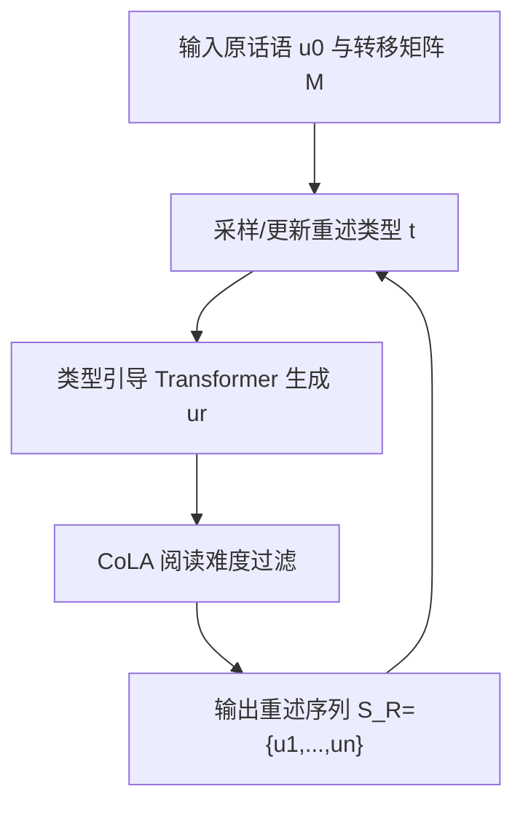
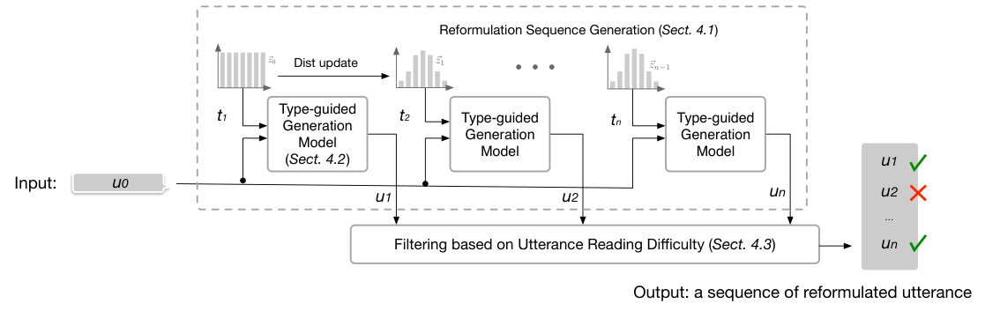

# Analyzing and Simulating User Utterance Reformulation in Conversational Recommender Systems (对话推荐系统中用户话语重述的分析与模拟)

- **会议/期刊**: SIGIR 2022
- **作者与机构**: Shuo Zhang (Bloomberg)、Mu-Chun Wang (USTC)、Krisztian Balog (University of Stavanger)
- **推荐链路定位**: 端到端对话仿真与系统评测（非排序链路）
- **研究方向**: 对话推荐与智能体仿真
- **论文原文**: [https://arxiv.org/abs/2205.01763v1](https://arxiv.org/abs/2205.01763v1)
- **开源代码**: [https://github.com/iai-group/sigir2022-usersim](https://github.com/iai-group/sigir2022-usersim)

## TL;DR (1分钟核心速览)

本文针对对话推荐系统用户模拟器在系统未理解时立即放弃的痛点，基于 150 名用户与 5 个 agent 的交互研究归纳“先改述、再简化、后放弃”模式，提出重述序列生成任务：用类型引导 T5/BART 生成候选，并用 CoLA 阅读难度过滤。电影/旅行/混合域上 T5-TR 的 ROUGE-L 达 0.740/0.753/0.785，BLEU 达 20.7/23.2/22.5；众包端到端 39%–49% 无法区分真实与模拟。

## Background & Motivation (背景与核心矛盾)

- **主流范式**: 用户模拟器（agenda-based、NLU/NLG/response generation）是 CRS 低成本、可扩展的自动评测手段。
- **前人局限**: 现有模拟器在系统返回 “Failed” 时往往立即重启或终止对话；生成话语也缺少“重述类型”和“可读性”控制，拟人度不足。
- **核心洞察 (Key Insight)**: 用户研究中 62% 的重述发生在 agent “Failed” 后；持续用户典型路径是先 rephrase、再 simplify，最后才放弃。
- **本文切入点**: 将失败后的重述行为显式建模为“重述序列生成 (RSG)”任务，并把类型转移与阅读难度过滤注入模拟器。

## Method (核心方法设计)

### 1. 整体框架 (Overall Architecture)

输入原始用户话语 $u_0$与用户研究估计的重述类型转移矩阵$M$；按$M$采样/更新类型$t$（rephrase、simplify、repeat、refine、restart 等），由类型引导的 Transformer 生成候选$u_r$，再用 CoLA 阅读难度分类器过滤不可读候选，迭代生成长度为 3 的重述序列，最终接入模拟器的 response generation / NLG 组件。

<figure class="paper-figure" markdown="span">
  <figcaption>图2：重新表述序列生成架构。</figcaption>
</figure>

### 2. 关键设计拆解 (Key Designs)

1. **重述序列生成与类型转移 (RSG + Transition)**：前人只做单次 query rewrite，本文定义 $RSG(u_0)=S_R=\{u_1,\dots,u_n\}$。用最大似然估计类型转移$m_{ij}=p(t_r=j\mid t_{r-1}=i)=\frac{\sum_r \mathbb{I}(t_{r-1}=i \land t_r=j)}{\sum_r \mathbb{I}(t_{r-1}=i)}$，并以$\boldsymbol{\pi}_r=M\boldsymbol{\pi}_{r-1}$ 更新下一类型分布。直觉：把“用户坚持重试”建模为马尔可夫链，避免固定模板式回复。

2. **类型引导生成 (Type-guided Generation)**：将 $u_0$与目标类型$t$拼接为 seq2seq 输入，学习$p(u_r\mid u_0,t)$；比较 GPT2、BERT-to-BERT、BART、T5，T5 最优。类型条件把同一语义的不同表达解耦，降低“改述但语义漂移”的歧义。

3. **阅读难度过滤与训练/推理**：用 BERT 在 CoLA 上微调的二分类器判断生成话语是否语言可接受，拒绝不可读候选；训练目标为 $\mathcal{L}=-\sum \log p(u_r\mid u_0,t)$，生成式任务无需负采样。推理时序列长度设为 3，重复生成 5 次以稳定自动指标，过滤后再输出。

## Experimental Setup & Evaluation Protocol (实验设置与评估协议)

- **数据集与预处理**: 非传统 user-item 交互，按对话/话语级资源统计；训练用 logged dialogues 排除 Music（仅 5 条重述序列），众包改写按 domain/intent/type 合并。

| 数据来源 | 规模 | 领域 | 说明 |
| :--- | :---: | :---: | :--- |
| Logged dialogues | 150 dialogues（5 agents × 30） | movie/music/travel | 专家标注 intent、slot、reformulation |
| 训练用 logged triads | 4 agents（排除 Music） | movie/travel | 构造 $\langle u_0,t,u_{rt}\rangle$ |
| 众包改写 | 208 triads × 9 annotators；约 1.8k utterances；265 workers | movie/travel | 扩充重述多样性 |
| 专家人工评估 | Movie/Hybrid 各 200 序列；Travel 150 序列 | 三域 | Grammar / Difficulty / Type Accuracy |
| 众包端到端 | 46 dialogues；302 dialogue pieces；3 workers | 三域 | 真实 vs 模拟 side-by-side |

- **数据划分与防穿越 (Splitting Strategy)**: 采用 5-fold cross-validation；每折用 $\langle u_0,t,u_{rt}\rangle$ 三元组训练，测试时按图 2 的序列生成流程滚动生成，序列长度固定为 3。
- **排名评测协议 (Ranking Protocol)**: 本文不是排序任务，不采用 Full-Ranking/Sampled Ranking；自动评测用 ROUGE-1/2/L 与 BLEU，人工评测用专家三维打分和众包“真实/模拟”二选一（允许 Tie）。
- **对比基线与超参设置**: 基线为 GPT2、BERT-to-BERT、BART、T5，以及各自 `-T`（类型引导）、`-R`（阅读难度过滤）、`-TR`（二者结合）变体；batch size 10，预训练模型默认参数；显著性检验报告 $p<0.005$（‡）。

## Key Experimental Results (实验关键数据)

### 1. 主实验对比 (Main Results)

| 方法 | Movie R-1 | Movie R-L | Movie BLEU | Hybrid R-L | Improv.% (T5-TR vs T5) |
| :--- | :---: | :---: | :---: | :---: | :---: |
| GPT2 | 0.112 | 0.102 | 0.058 | 0.092 | — |
| BERT | 0.228 | 0.221 | 0.113 | 0.192 | — |
| BART | 0.281 | 0.279 | 2.229 | 0.302 | — |
| T5 | 0.410 | 0.410 | 3.472 | 0.399 | — |
| GPT2-TR | 0.086 | 0.132 | 0.128 | 0.173 | — |
| BERT-TR | 0.324 | 0.312 | 0.132 | 0.342 | — |
| BART-TR | 0.521 | 0.517 | 6.532 | 0.532 | — |
| **T5-TR** | **0.766** | **0.740** | **20.739** | **0.785** | **+86.8 / +80.5 / +497.2** |

### 2. 消融实验 (Ablation Study)

| 方法 | Movie R-1 | Movie R-L | Movie BLEU | Hybrid R-L |
| :--- | :---: | :---: | :---: | :---: |
| BART | 0.281 | 0.279 | 2.229 | 0.302 |
| BART-T | 0.504 | 0.501 | 5.308 | 0.516 |
| BART-R | 0.343 | 0.328 | 3.326 | 0.396 |
| **BART-TR** | **0.521** | **0.517** | **6.532** | **0.532** |
| T5 | 0.410 | 0.410 | 3.472 | 0.399 |
| T5-T | 0.742 | 0.739 | 19.031 | 0.782 |
| T5-R | 0.401 | 0.399 | 3.578 | 0.430 |
| **T5-TR** | **0.766** | **0.740** | **20.739** | **0.785** |

### 3. 关键实验发现 (Key Findings)

1. **类型引导是主增益，难度过滤需与类型结合才稳定**：T5-TR 相对 T5 在 Movie 上 R-L +80.5%、BLEU +497.2%；BART-TR 相对 BART 的 Movie BLEU 从 2.229 升至 6.532。单独 `-R` 在 T5 上几乎无增益（R-L 0.399 vs 0.410），说明“可读”不等于“符合重述意图”。
2. **Seq2seq 显著优于 GPT2，跨域混合不降反升**：T5-TR 的 Hybrid R-1 为 0.792，高于 Movie 单域 0.766；而 BERT-TR 仅 0.321、BART-TR 为 0.585，说明 T5 的条件生成与类型控制更适合该任务，且 hybrid 训练具备域泛化性。
3. **人类感知与自动指标存在错位**：专家评估中 T5-TR 把 Type Accuracy 从 0.22 提到 0.78、Difficulty 从 0.95 降到 0.69（越低越好）；众包端到端 BART-TR 的 Tie 率最高达 49%，真实/模拟胜负为 25%/26%，接近随机；T5-TR 把 T5 的“被识破为模拟”比例从 39% 降到 28%，但并非所有人类指标都绝对最优。

## Highlights & Limitations (亮点、对比与审稿批判)

- **与代表作对比 (vs. Prior Work)**: Zhang & Balog 的 agenda-based simulator 能控对话流但失败即重启/终止；Salle et al. 建模 cooperativeness/patience，Sekulic et al. 让模拟用户会追问；本文首次把“失败触发的重述序列”作为可生成、可过滤的显式子任务。
- **可迁移亮点**: 用转移矩阵控制“类型序列”而非单次改写，可迁移到对话搜索/问答的 query reformulation；用 CoLA 可读性分类器做生成后过滤，可迁移到任何“简化型”文本生成。
- **审稿级局限批判**: 用户研究强制“持续用户”设定，存在 persistence 偏差；仅覆盖 5 个 agent、3 个域且 Music 训练样本极少，新 agent 需重新采集/微调；人类评估样本偏小，自动 ROUGE/BLEU 与端到端人类判断并不完全一致。

## Rating (四维评分)

- **方法创新性 (Novelty)**: ⭐⭐⭐⭐ （首次把失败后的重述序列建模为 RSG 任务，用户研究到模拟器的闭环较完整。）
- **评估协议与实验扎实度 (Protocol & Experiments)**: ⭐⭐⭐⭐ （自动+专家+众包三层评估，5-fold CV 与显著性检验；但人类评估规模有限。）
- **写作与数学规范度 (Clarity & Rigor)**: ⭐⭐⭐⭐ （任务定义、转移矩阵和过滤流程清晰；生成模型本身创新有限，偏工程组合。）
- **工业落地与复现价值 (Industrial & Practical Value)**: ⭐⭐⭐ （代码与数据开源，模拟器可降评测成本；但依赖特定 agent 数据，线上部署仍需适配。）

