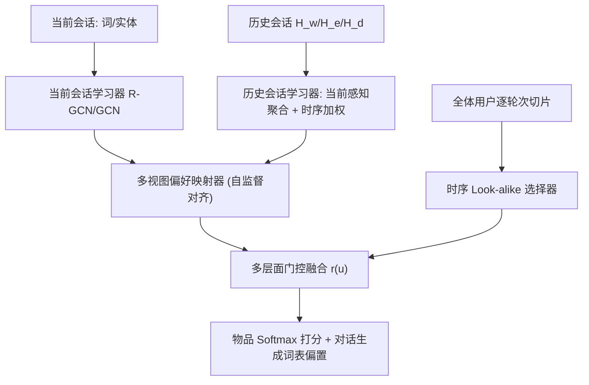

# User-Centric Conversational Recommendation with Multi-Aspect User Modeling (多层面用户建模的以用户为中心对话推荐)

- **会议/期刊**: SIGIR 2022
- **作者与机构**: Shuokai Li, Ruobing Xie, Yongchun Zhu, Xiang Ao, Fuzhen Zhuang, Qing He（中科院计算所、腾讯微信搜索、北航）
- **推荐链路定位**: 端到端生成式（推荐 + 对话生成联合）
- **研究方向**: 对话推荐与智能体仿真 / 自监督对比学习
- **论文原文**: [https://arxiv.org/abs/2204.09263v2](https://arxiv.org/abs/2204.09263v2)
- **开源代码**: [https://github.com/lisk123/UCCR](https://github.com/lisk123/UCCR)

## TL;DR (1分钟核心速览)

现有 CRS 模型把全部注意力放在"当前会话"的语言理解上，忽略了推荐系统真正的主体——用户的历史多轮会话与相似用户。UCCR 提出以用户为中心的三层面（当前会话 / 历史会话 / look-alike 用户）、三视图（词 / 实体 / 物品）建模框架：历史信息以"当前意图为约束"做注意力聚合，视图之间用自监督对齐损失正则，相似用户则按时序切片检索。在 TG-ReDial 与 ReDial 的时间序切分协议下，推荐 HR@10 相对最强基线 RevCore 提升 21.5% / 5.0%，对话生成的 Dist-4 与 PPL 亦同步改善。

## Background & Motivation (背景与核心矛盾)

- **主流范式**: KBRD / KGSF / TG-ReDial / RevCore 等生成式 CRS 以 R-GCN+ConceptNet 编码**当前会话**中的实体与词，再用 seq2seq 解码回复，推荐与生成共享会话表征。
- **前人局限**: ① 所谓 "conversation history" 实为当前会话内的历史**轮次**，而非跨会话的历史行为，用户长期偏好完全缺失；② 当当前会话只提到 0–2 个实体时（ReDial 中占比近 55%），纯会话建模严重欠定，冷启动用户几乎无信号可用。
- **核心洞察 (Key Insight)**: CRS 的用户意图比传统推荐更**显式且确定**，因此历史与相似用户信息不能独立建模，必须作为"当前意图约束下的补充"，否则会污染当前会话偏好。
- **本文切入点**: 把 item-CF / user-CF 的思想搬进 CRS——历史会话提供物品级协同信号，相似用户提供用户级协同信号，并用可学习门控调节注入比例。

## Method (核心方法设计)

### 1. 整体框架 (Overall Architecture)

输入为用户 $u$的当前会话（当前词$C_w$、当前实体$C_e$）与$T-1$个历史会话（历史词$H_w$、历史实体$H_e$、历史推荐物品$H_d$）。当前会话用 R-GCN（实体，DBpedia 三元组）与 GCN（词，ConceptNet 边）编码并经自注意力池化得$\boldsymbol{r}^c_e,\boldsymbol{r}^c_w$；历史会话学习器以当前表征为 query 做**当前感知聚合**（实体/物品视图）或**时序加权**（词视图）；多视图偏好映射器施加三组自监督对齐损失；时序 look-alike 选择器把全体用户拆成逐轮次偏好切片，按历史相似度检索贡献；最后三层面加权融合为$\boldsymbol{r}(u)$，同时驱动 Softmax 物品打分与 Transformer 解码器的词表偏置。

### 2. 关键设计拆解 (Key Designs)

1. **当前感知的历史会话聚合（实体 / 物品视图）**：痛点是把历史会话像当前会话一样独立编码会与当前意图错位。UCCR 对第 $j$个历史会话编码$\boldsymbol{h}^j_e$后，用与当前表征的相似度做 softmax 权重：$\boldsymbol{r}^h_e=\sum_{j=1}^{T-1}\varphi(\boldsymbol{h}^j_e,\boldsymbol{r}^c_e)\boldsymbol{h}^j_e,\ \varphi=\mathrm{Softmax}(\boldsymbol{h}^j_e W_s \boldsymbol{r}^{c\top}_e/\lambda_e)$。结构化的实体/物品是"具体对象"，用当前意图直接筛选比 LSTM/GRU 顺序建模更合理（作者实测 RNN 无增益且更贵）；而语义词视图信息泛化性强，仅用轮次与序号的时序因子$s(w^j_m)$ 加权即可。

2. **多视图偏好映射器（跨视图自监督对齐）**：同一用户的词视图与实体视图应比别人的更接近，故设 $\mathcal{L}_a(\boldsymbol{v}_1,\boldsymbol{v}_2)=\sum_{u\in\mathcal{B}}(1-\mathrm{sim}(\boldsymbol{v}^u_1,\boldsymbol{v}^u_2))^2+\lambda_a\sum_{u,u'\in\mathcal{B}}(\mathrm{sim}(\boldsymbol{v}^u_1,\boldsymbol{v}^{u'}_2))^2$。三组任务分别为（当前词, 当前实体）、（历史词, 历史实体）、（历史物品, 历史词∪实体）。关键取舍：**不做当前↔历史对齐**，因为当前意图与历史偏好本就不一致，跨层面关系已由式 (3) 的当前感知聚合承担。

3. **时序 Look-alike 选择与门控融合**：用户偏好随会话演化，单一用户向量不合理。把用户 $u'$拆成$K$个轮次切片$u'_k$，以历史词表征的相似度经截断函数$\delta(x)=\max(0,x-\delta_w)$稀疏化后加权其当前表征：$\boldsymbol{r}^l_w(u,u')=\sum_{k=1}^{K}\delta(\mathrm{sim}(\boldsymbol{r}^h_w(u),\boldsymbol{r}^h_w(u'_k)))\boldsymbol{r}^c_w(u'_k)$，并对相似度做梯度阻断以控开销。融合式为$\boldsymbol{r}_e(u)=\boldsymbol{r}^c_e(u)+\alpha_h\boldsymbol{r}^h_e(u)+\alpha_s\sum_{u'}\boldsymbol{r}^l_e(u,u')$，其中$\alpha_h$由$\mathrm{Concat}(\boldsymbol{r}^c_e,\boldsymbol{r}^h_e)$经 Sigmoid 前馈自适应生成；物品视图因当前物品未知，用$\gamma_h=\delta(\mathrm{sim}(\boldsymbol{p}^h_d,\boldsymbol{p}^c_d))$门控。总损失$\mathcal{L}=\mathcal{L}_{rec}+\lambda_{CL}\sum_{(v_1,v_2)}\mathcal{L}_a+\mathcal{L}_{dial}$，物品打分采用**全库 Softmax**（非负采样），生成端将$\boldsymbol{r}(u)$ 线性映射为词表偏置。

## Experimental Setup & Evaluation Protocol (实验设置与评估协议)

- **数据集与预处理**:

| 数据集 | #Users | #Items | #Interactions | 语言/说明 | 特征 |
| :--- | :---: | :---: | :---: | :---: | :--- |
| TG-ReDial | 1,482 | 33,834 | 10,000 sessions | 中文，含 topic thread | 词/实体/物品三视图 |
| ReDial | 504 | 51,699 | 10,006 sessions | 英文，众包对话 | 词/实体/物品三视图 |

- **数据划分与防穿越**: 采用**按时间序的会话级划分**（非 Leave-One-Out）：随机选部分用户，取其最后 2 个（TG-ReDial）/ 最后 4 个（ReDial）会话作验证与测试，其余为训练，整体比例约 8:1:1。作者特别指出，此前工作报告的较高数值源于**随机样本划分**，会泄漏用户历史信息。
- **排名评测协议**: `Full-Ranking`（对全物品库打分排序），指标 HR@10/50、MRR@10/50、NDCG@10/50；对话侧用 BLEU-2/3、Distinct-2/3/4、PPL 及 3 人 0–2 分人工评测（Fluency / Informativeness）。
- **对比基线与超参**: 基线含 SASRec、Text CNN、BERT（非 CRS）与 ReDial、KBRD、TG-ReDial、KGSF、KECRS、RevCore（CRS），全部在 CRSLab 统一复现；嵌入维度 128（推荐）/300（对话），R-GCN 与 GCN 均 1 层，$\lambda_e=\lambda_i=\lambda_a=0.1$，$\tau_w=\tau_e=6$，$\delta_w=\delta_e=0.85$，Adam 学习率 1e-3，batch 128，显著性用$t$-test（$p<0.05$）。

## Key Experimental Results (实验关键数据)

### 1. 主实验对比 (Main Results)

| 数据集 | 方法 | HR@10 | HR@50 | NDCG@10 | NDCG@50 |
| :--- | :--- | :---: | :---: | :---: | :---: |
| TG-ReDial | SASRec | 0.0048 | 0.0170 | 0.0019 | 0.0046 |
| TG-ReDial | BERT | 0.0098 | 0.0356 | 0.0051 | 0.0101 |
| TG-ReDial | KBRD | 0.0141 | 0.0481 | 0.0072 | 0.0143 |
| TG-ReDial | TG-ReDial | 0.0168 | 0.0513 | 0.0088 | 0.0161 |
| TG-ReDial | KGSF | 0.0175 | 0.0543 | 0.0096 | 0.0175 |
| TG-ReDial | RevCore | 0.0191 | 0.0581 | 0.0105 | 0.0189 |
| TG-ReDial | **UCCR** | **0.0232** | **0.0664** | **0.0122** | **0.0214** |
| TG-ReDial | Improv.% | +21.5% | +14.3% | +16.2% | +13.2% |
| ReDial | BERT | 0.1499 | 0.2937 | 0.0813 | 0.1167 |
| ReDial | KBRD | 0.1827 | 0.3688 | 0.1004 | 0.1428 |
| ReDial | KGSF | 0.2006 | 0.4034 | 0.1110 | 0.1556 |
| ReDial | RevCore | 0.2058 | 0.4088 | 0.1132 | 0.1583 |
| ReDial | **UCCR** | **0.2161** | **0.4258** | **0.1182** | **0.1642** |
| ReDial | Improv.% | +5.0% | +4.2% | +4.4% | +3.7% |

对话生成侧：TG-ReDial 上 BLEU-2 0.0494 vs. RevCore 0.0467，Dist-4 1.9376 vs. 1.6631，PPL 50.21 vs. 51.03；ReDial 上 PPL 53.24 vs. 54.43，人工 Informativeness 1.22 vs. 1.15。

### 2. 消融实验 (Ablation Study)

| 设置 | HR@10 | HR@50 | MRR@10 | NDCG@10 | NDCG@50 |
| :--- | :---: | :---: | :---: | :---: | :---: |
| UCCR w/o Entity 视图 | 0.0167 | 0.0506 | 0.0071 | 0.0092 | 0.0165 |
| UCCR w/o Word 视图 | 0.0207 | 0.0592 | 0.0080 | 0.0114 | 0.0196 |
| UCCR w/o Item 视图 | 0.0211 | 0.0626 | 0.0082 | 0.0116 | 0.0201 |
| **UCCR (full)** | **0.0232** | **0.0664** | **0.0088** | **0.0122** | **0.0214** |
| w/o En → +当前层面 | 0.0195 | 0.0612 | 0.0076 | 0.0103 | 0.0192 |
| + 历史层面 | 0.0214 | 0.0633 | 0.0082 | 0.0114 | 0.0204 |
| + Look-alike 层面 | 0.0232 | 0.0664 | 0.0088 | 0.0122 | 0.0214 |

### 3. 关键实验发现 (Key Findings)

1. **实体视图是命门，历史层面是增量**：去掉实体视图后 HR@10 从 0.0232 跌至 0.0167（−28%），甚至低于 KGSF（0.0175），说明 DBpedia 结构化知识是推荐主信号；而在仅保留实体视图的基座上依次叠加当前 / 历史 / look-alike 层面，NDCG@50 单调升至 0.0214，证明后两者是稳定的正向补充而非噪声。
2. **冷启动收益最大**：当前会话实体数为 0 时，UCCR HR@10 为 11.61 vs. RevCore 10.23（+13.5%）、NDCG@50 0.0906 vs. 0.0799（+13.4%），且随实体数增加到 ≥6 时优势收窄至 +3.5%；对无历史会话的新用户，HR@50 提升 12.6%（老用户仅 2.8%），说明 look-alike 层面在双冷启场景下承担了主要兜底作用。
3. **更好的用户表征反哺生成**：仅靠把 $\boldsymbol{r}(u)$ 作为词表偏置注入解码器，Distinct-4 从 1.6631 提升至 1.9376（+16.5%）、PPL 下降 0.82，说明多层面融合表征不仅提升排序，也实质缓解了 CRS 回复的"安全但空洞"问题。

## Highlights & Limitations (亮点、对比与审稿批判)

- **与代表作对比 (vs. Prior Work)**: 与 KGSF 同样使用 DBpedia+ConceptNet 双知识源，但 KGSF 只用当前会话做词-实体互信息对齐，UCCR 把对齐扩展到历史三视图并引入用户级协同信号；与 RevCore 相比，UCCR 不依赖外部影评文本，仅靠会话结构即取得更优结果；与 SASRec 相比，UCCR 明确指出纯序列推荐在 CRS 中失效（HR@10 仅 0.0048），因为当前意图才是主导约束。
- **可迁移亮点**: ① "当前表征作 query、历史表征作 key"的当前感知聚合，可直接迁移到多场景/跨域推荐中的历史行为压缩；② 对相似度施加梯度阻断 + 截断阈值 $\delta$ 的稀疏检索，是低成本引入 user-CF 的通用工程技巧。
- **审稿级局限批判**: ① 时序 look-alike 需**每个 epoch 重算全体用户逐轮次表征**，$O(|U|^2 K)$的相似度计算在万级用户以上难以扩展，论文未给出实际训练耗时对比；② 时间序切分虽更真实，但 ReDial 仅 504 用户、TG-ReDial 仅 1,482 用户，新用户/冷启结论的统计功效有限，且未报告方差或多随机种子结果；③ 超参$\tau_e$、$\delta_e$ 在 3–8、0.7–1.0 区间呈先升后降的尖峰形态，迁移到新数据集需细粒度网格搜索。

## Rating (四维评分)

- **方法创新性 (Novelty)**: ⭐⭐⭐⭐ （首次系统区分"跨会话历史"与"会话内历史轮次"，并以当前意图约束聚合 + 时序 look-alike 切片形成完整用户中心范式）
- **评估协议与实验扎实度 (Protocol & Experiments)**: ⭐⭐⭐⭐ （采用更严格的时间序会话切分并主动指出前人随机划分的泄漏问题，含冷启分桶与人工评测，但缺多随机种子方差）
- **写作与数学规范度 (Clarity & Rigor)**: ⭐⭐⭐⭐ （三视图三层面结构清晰、公式与门控定义完整，但符号 $\boldsymbol{p}^h_d$与$\boldsymbol{p}^c_d$ 出现前后定义略不统一）
- **工业落地与复现价值 (Industrial & Practical Value)**: ⭐⭐⭐⭐ （基于 CRSLab 开源可复现，历史聚合与相似用户检索均为可插拔模块，但全量用户相似度重算的在线成本需工程侧近似召回替代）

