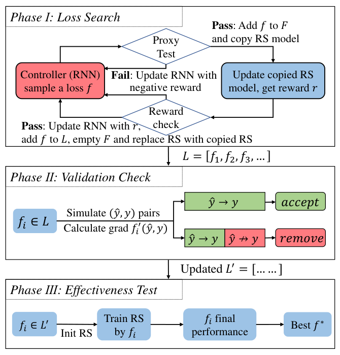
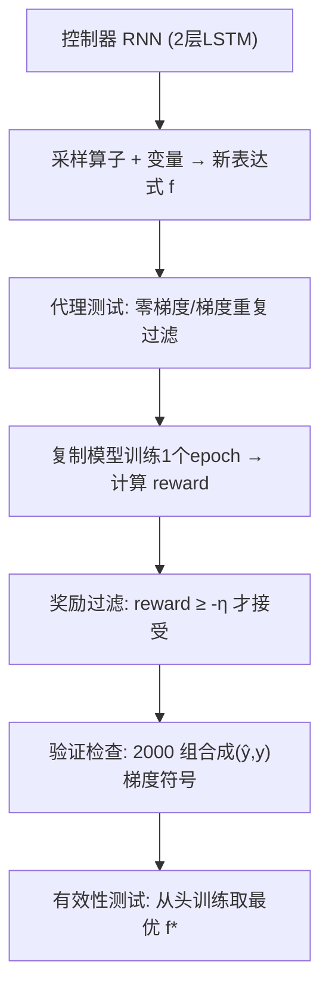
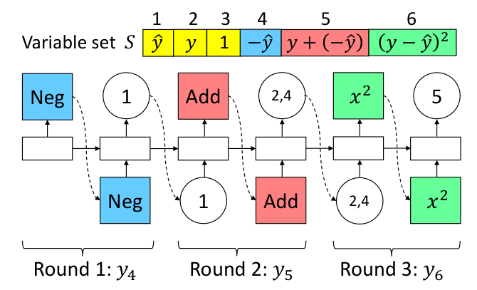

# AutoLossGen: Automatic Loss Function Generation for Recommender Systems (面向推荐系统的损失函数自动生成)

- **会议/期刊**: SIGIR 2022
- **作者与机构**: Zelong Li, Jianchao Ji, Yingqiang Ge, Yongfeng Zhang (Rutgers University)
- **推荐链路定位**: 召回（MF/MLP 匹配模型的训练目标层面）
- **研究方向**: 协同过滤与双塔召回 / CTR 预估与特征交叉
- **论文原文**: [https://arxiv.org/abs/2204.13160v1](https://arxiv.org/abs/2204.13160v1)
- **开源代码**: [https://github.com/rutgerswiselab/AutoLossGen](https://github.com/rutgerswiselab/AutoLossGen)

## TL;DR (1分钟核心速览)

推荐模型的训练目标（损失）长期依赖人工设计，而不同「模型-数据集」组合的最优损失并不一致。本文提出 AutoLossGen：用 RNN 控制器在 9 个基础数学算子构成的表达式空间里，以 REINFORCE 从零生成损失函数（不预设任何损失结构），并用「代理测试 + 奖励过滤 + 验证检查」三阶段缓解极端稀疏导致的稀疏奖励问题。在 ML-100K 与 Amazon Electronics 上（positive Leave-One-Out 划分，AUC/F1/Acc 评估），生成的 MaxR 损失在 MF-ML100K 上把 AUC 从最优基线 Focal 的 0.7930 提升到 0.8087（相对 +1.98%）。

## Background & Motivation (背景与核心矛盾)

- **主流范式**: 推荐模型本身（MF、MLP、GNN 等）被大量研究，但优化目标几乎固定为 MSE / BCE / Hinge / Focal 等手工设计损失；AUC 等排序指标不可微，只能靠代理损失近似。
- **前人局限**: (1) 损失组合类方法（如 AutoLoss-KDD'21、SLF）只学习若干手工基损失的权重，无法跳出既有损失族；(2) CV 领域的算子级损失搜索需要稠密标注与稳定奖励信号，直接搬到推荐系统会因数据极度稀疏（Electronics 密度仅 0.014%）而奖励信噪比极低。
- **核心洞察 (Key Insight)**: 损失函数与 NAS 的搜索单元同构——变量 (变量集 $S$)、算子 (算子的 arity) 对应「节点与边」；因此可把损失搜索形式化为「采样表达式树 + 策略梯度」。同时作者发现不存在全局最优的手工损失（Hinge 在 MF-Electronics 最好、Focal 在 MF-ML100K 最好、BCE 在 MLP-ML100K 最好），说明定制搜索有真实收益。
- **本文切入点**: 用 RL 控制器直接组装新损失，并以「训练前过滤」替代「训练后筛选」，把有限算力投给有希望的候选损失。

## Method (核心方法设计)

### 1. 整体框架 (Overall Architecture)

框架包含推荐模型（MF 或 MLP：Embedding→Interaction→Sigmoid 输出）与控制器（2 层 LSTM，32 隐藏单元）。控制器每轮先采样一个算子，再按其 arity 从变量集 $S$（初始为$\{\hat{y}, y, 1\}$）中不放回地采样输入变量，执行后把新变量并入$S$；最多 10 个中间变量，最终以$S$中最后一个变量作为损失$f$。搜索完成后进入验证检查（合成$(\hat{y},y)$ 对上的梯度方向校验），再做有效性测试（从随机初始化训练到收敛，取最优者）。整个流程见 <figure class="paper-figure" markdown="span">
  <figcaption>图3：损失生成过程概览，包括三个阶段：损失搜索、验证检查与有效性测试。</figcaption>
</figure>。

### 2. 关键设计拆解 (Key Designs)

1. **算子级表达式生成（把损失当作计算图来搜）**：前人只能组合已有损失，本文改为从 9 个算子（Add/Multi/Max/Min/Neg/Identical/Log/Square/Reciprocal，结果 clamp 到 $[\xi, 1/\xi]$）自由组装。策略为$\pi(f,\theta)$，每轮采样概率由上一轮 LSTM 隐状态经 softmax 给出。其物理直觉是：只需有限算子即可覆盖 CE、L2 等常见损失，搜索空间足够大且不引入结构先验。生成过程见 <figure class="paper-figure" markdown="span">
  <figcaption>图2：以MSE损失的生成为例，说明控制器的损失生成过程。</figcaption>
</figure>。
2. **代理测试（Proxy Test，把算力从「废解」上省下来）**：因限制极松，大量采样是无梯度或梯度重复的表达式。固定一个小批次 $B$（ML-100K 取 5、Electronics 取 20），若
$\|\nabla_{\omega}\mathcal{L}(B,f)\| < \delta$（$\delta=10^{-4}$）判为零梯度损失并直接给负奖励；若$\exists f'\in F,\ \|\nabla_{\omega}\mathcal{L}(B,f)-\nabla_{\omega}\mathcal{L}(B,f')\|<\delta$，判为梯度级重复并直接复用$f'$ 的奖励。
3. **奖励过滤 + 迭代交替优化（解决稀疏奖励与模型崩坏）**：理想双层目标是
$\max_{\theta}\mathbb{E}_{f\sim\pi(f,\theta)}[R_{val}(f,\omega^{*}(f))],\ \text{s.t.}\ \omega^{*}(f)=\arg\min_{\omega}\mathcal{L}_{train}(\omega,f)$，
但对每个 $f$训练到收敛不可行，故用一阶近似$\omega^{*}(f)\approx \omega-\rho\nabla_{\omega}\mathcal{L}_{train}(\omega,f)$（仅 1 个 epoch）。关键一步是**先复制模型再试**：奖励$r=\text{perf}_{updated}-\text{perf}_{init}$，仅当$r\geq -\eta$才用副本替换原模型并记录$f$，否则丢弃副本；允许小幅负奖励保留探索能力。控制器用 REINFORCE 更新（Adam, lr=1e-3），推荐模型用 SGD（lr=0.01），并对 10 个采样损失的奖励取平均以降方差。

## Experimental Setup & Evaluation Protocol (实验设置与评估协议)

- **数据集与预处理**:

| 数据集 | #Users | #Items | #Interactions | 稀疏度/密度 | 特征/场景说明 |
| :--- | :---: | :---: | :---: | :---: | :--- |
| ML-100K | 943 | 1,682 | 100,000 (55,375 pos / 44,625 neg) | 6.30% | 电影评分 1–5，二值化为 like(≥4)/dislike(≤3) |
| Amazon Electronics | 192,403 | 63,001 | 1,689,188 (1,356,067 pos / 333,121 neg) | 0.014% | 电商 5-core 评分，极大且极稀疏 |

- **数据划分与防穿越**: `positive Leave-One-Out` + 时间戳顺序——每个用户最后一条正交互及其后负交互入测试集，倒数第二条正交互及其后负交互入验证集，其余入训练集；交互数 < 5 的用户全部入训练集以避免冷启动。
- **排名评测协议**: 分类任务用 `AUC / F1 / Accuracy`（AUC 对预测扰动敏感，故也用作 RL 奖励），回归任务用 `MAE / RMSE`；未采用全库排序式 Recall@K。
- **对比基线与超参**: 基线为 MSE、BCE、Hinge、Focal 四种手工损失（因本文生成的是「新损失」而非损失组合，故不与 SLF/AutoLoss 组合方法直接对比）；Embedding 维 $d=64$，MLP 三层 128×64、64×16、16×1，dropout 0.2；生成损失中的平滑系数$\epsilon$在$\{1,\dots,10^{-6}\}$网格搜索；显著性以$p<0.01$ 标注。

## Key Experimental Results (实验关键数据)

### 1. 主实验对比 (Main Results)

| 模型-数据集 | 指标 | MSE | BCE | Hinge | Focal | MaxR (生成) | SumR (生成) | LogMin (生成) |
| :--- | :--- | :---: | :---: | :---: | :---: | :---: | :---: | :---: |
| MF / ML-100K | AUC↑ | 0.7808 | 0.7882 | 0.7848 | 0.7930 | **0.8087** | 0.8086 | 0.7981 |
| MF / ML-100K | F1↑ | 0.6058 | 0.6073 | 0.6133 | 0.6121 | **0.6260** | 0.6245 | 0.6160 |
| MF / ML-100K | Acc↑ | 0.6919 | 0.6972 | 0.7239 | 0.7011 | 0.7305 | **0.7645** | 0.7398 |
| MF / Electronics | AUC↑ | 0.6510 | 0.6515 | 0.6689 | 0.6521 | **0.6697** | 0.6695 | 0.6534 |
| MLP / ML-100K | AUC↑ | 0.7655 | 0.7725 | 0.7472 | 0.7629 | 0.7747 | 0.7743 | **0.7752** |
| MLP / ML-100K | Acc↑ | 0.6625 | 0.6797 | 0.6717 | 0.6437 | **0.7077** | 0.6830 | 0.6909 |
| MLP / Electronics | AUC↑ | 0.6232 | 0.6228 | 0.6242 | 0.6205 | 0.6250 | **0.6404** | 0.6318 |

生成的三条新损失为：MaxR $=\max\!\big(\frac{\hat{y}+\epsilon}{y+\epsilon},\frac{y+\epsilon}{\hat{y}+\epsilon}\big)$；SumR$=\frac{\hat{y}+y+\epsilon}{\hat{y}\cdot y+\epsilon}$；LogMin$=\log\frac{1+\epsilon}{\min(\hat{y},y)+\epsilon}\cdot(\hat{y}+y+\min(\hat{y},y))$。回归任务中，四种「模型-数据集」组合全部召回出 MSE（MF-ML100K RMSE 0.4480 vs BCE 0.4540，MAE 0.3548），说明框架在存在真解时能复原真解。

### 2. 消融实验 (Ablation Study)

| 配置 | 关键结果 | 说明 |
| :--- | :--- | :--- |
| w/o Proxy Test | 24h 内仅采样 3,200 个损失 | 大量算力耗在零梯度/重复表达式 |
| w/ Proxy Test | 24h 内采样 93,792 个损失（**~30×**） | 相同时间探索量提升一个量级 |
| w/o Reward Filtering | MF-ML100K 上 AUC 恒在 0.5 附近 | 模型被劣质损失反复破坏，无法恢复 |
| w/ Reward Filtering | AUC 随搜索升至 0.8087 | 只接受 $r\geq-\eta$ 的更新 |

### 3. 关键实验发现 (Key Findings)

1. **定制损失确实压过最优手工损失，但幅度依赖场景**: MF-ML100K 上 MaxR 相对 Focal 的 AUC 提升 +1.98%、F1 提升 +2.27%；MLP-Electronics 上 SumR 相对 Hinge 提升 +2.59%，而在 MLP-ML100K 上仅 +0.35%，说明稀疏度越低（Electronics）搜索带来的相对收益越明显。
2. **「没有全局最优损失」是可量化的现象**: 手工损失中最优者随组合切换（Focal→MF-ML100K、Hinge→MF-Electronics、BCE→MLP-ML100K），这正是需要逐环境搜索的直接证据；同时生成的损失在跨组合迁移时多数仍优于基线（MaxR 迁到 MF-Electronics 仍达 0.6697 > Hinge 0.6689），唯一例外是 LogMin 略逊于 Hinge。
3. **效率机制是可用性的前提**: 代理测试带来约 30× 采样吞吐；而移除奖励过滤后 AUC 直接退化为随机猜测（≈0.5），证明「先复制模型、后决定是否采纳」是稀疏奖励下防止推荐模型崩坏的必要条件，而非可选加速项。

## Highlights & Limitations (亮点、对比与审稿批判)

- **与代表作对比 (vs. Prior Work)**: 相比 AutoLoss(KDD'21)/SLF 的「基损失加权组合」，本文不预设损失族，搜索空间是算子表达式，可产出人类不会写出的形式（如 SumR 的倒数合并式）；相比 AutoLoss-Zero 等 CV 算子级搜索，本文的增量在于针对推荐稀疏性设计的代理测试与奖励过滤，而非搜索算法本身。
- **可迁移亮点**: (1) 「复制模型 + 小幅负奖励容忍」的 reward filtering 可直接迁移到任何 RL 驱动的训练策略/采样策略搜索；(2) 「梯度符号校验」（$y=0$时要求$\nabla_{\hat{y}}f\geq0$，$y=1$时$\leq0$）是一种极廉价的目标一致性检查，可用于过滤任何候选代理损失。
- **审稿级局限批判**: (1) **算力代价高**：单次搜索需 2 天至 1 周（单卡 2080Ti），且每个「模型-数据集」组合都要重跑，工业场景下多业务多模型几乎不可承受；(2) **评估面偏窄**：仅 MF/MLP 两个浅层模型、仅二值化评分任务，未验证排序损失（BPR/Softmax）、未做全库排序 Recall@K/NDCG，也未与损失组合方法在同一下游做端到端对比；此外生成的损失依赖 $\epsilon$ 网格搜索，超参敏感度与方差（多随机种子下部分损失 AUC 掉到 0.49）尚未系统报告。

## Rating (四维评分)

- **方法创新性 (Novelty)**: ⭐⭐⭐⭐ （首次把「算子级损失生成」落到推荐系统，并用代理测试/奖励过滤回应稀疏奖励，思路清晰但搜索算法本身沿用 NAS/REINFORCE 框架）
- **评估协议与实验扎实度 (Protocol & Experiments)**: ⭐⭐⭐ （Leave-One-Out + 四基线 + 迁移性与两项消融较完整，但仅两个模型两个数据集、缺少排序指标与多随机种子方差报告）
- **写作与数学规范度 (Clarity & Rigor)**: ⭐⭐⭐⭐ （双层优化与一阶近似的表述规范，三阶段流程图与符号表清晰；对「为何有效」的理论解释仍停留在实证直觉）
- **工业落地与复现价值 (Industrial & Practical Value)**: ⭐⭐⭐ （代码开源、生成损失一次搜索可长期复用且有迁移性，但单次搜索需数天 GPU 时间，落地更适合作为离线「损失挖掘」而非在线组件）

