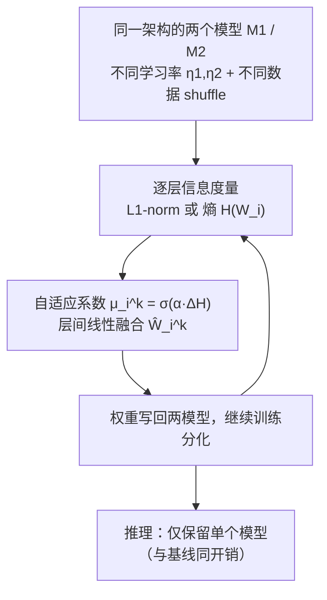
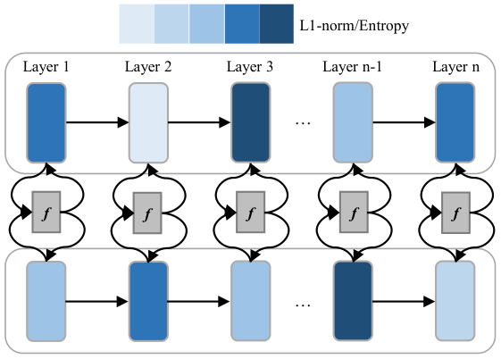

# Enhancing Top-N Item Recommendations by Peer Collaboration (基于同伴协作的 Top-N 物品推荐增强)

- **会议/期刊**: SIGIR 2022
- **作者与机构**: Yang Sun、Fajie Yuan（西湖大学）、Min Yang（中科院深圳先进院 SIAT）、Alexandros Karatzoglou（Google）、Li Shen（京东探索研究院）、Xiaoyan Zhao
- **推荐链路定位**: 端到端训练范式（不改变推理链路，召回/排序模型通用）
- **研究方向**: 协同过滤与双塔召回 / 序列推荐
- **论文原文**: [论文原文链接](https://arxiv.org/abs/2111.00429v3)
- **开源代码**: 暂未开源（PCRec 未放码；SASRec 基线实现见 https://github.com/kang205/SASRec）

## TL;DR (1分钟核心速览)

现有 DNN 推荐模型普遍过参数化，剪枝实验显示 SASRec 砍掉 10% 权重几乎不掉点、砍 30% 再微调甚至更好——说明大量"无效权重"被浪费。本文提出 PCRec：并行训练两个同构推荐网络（不同学习率与样本打乱顺序），每 epoch 用层重要性（L1-norm / 熵）判定谁的信息更少，并从同伴移植权重予以"复活"。推理只保留单模型，开销与基线完全相同。在 Retailrocket / ML-20M / QQBrowser 三个数据集、BPR / YouTubeDNN / SASRec 三种基座上，MRR@5 相对提升 3.4%–13.0%，且 $p<0.01$ 显著。

## Background & Motivation (背景与核心矛盾)

- **主流范式**: 推荐模型依靠超大的 embedding 维度（$d=256$）与深层自注意力/Tower 结构提升精度，参数冗余被视为"必要代价"；对应做法是剪枝或蒸馏以压缩模型。
- **前人局限**: 其一，剪枝只"丢弃"冗余权重，而推荐模型部署在云端，参数量减少并不能带来推理收益，白扔了容量；其二，从零训练一个小模型（$d$ 减半）在 ML-20M 上明显掉点，证明小模型无法替代大模型的表达能力。
- **核心洞察 (Key Insight)**: 两个独立初始化、不同学习率下训练的同伴网络，其"无效层"位置是不同的——一个模型的冗余权重位置，恰好是另一个模型承载有效信息的位置，因此可互补移植而非丢弃。
- **本文切入点**: 把剪枝的"重要性度量"从丢弃信号改造为"移植信号"，用同伴的对位权重填补冗余位置，构造一个只训练、不增推理成本的双网络协作范式。

<figure class="paper-figure" markdown="span">
  ![图 1：在 SASRec 上剪枝的性能变化。我们按照 \[29\] 基于权重幅值进行标准剪枝。实验设置见第 4 节。](../../../../assets/papers/2111.00429v3/figure_1.png)<figcaption>图 1：在 SASRec 上剪枝的性能变化。我们按照 [29] 基于权重幅值进行标准剪枝。实验设置见第 4 节。</figcaption>
</figure>

## Method (核心方法设计)

### 1. 整体框架 (Overall Architecture)

PCRec 维护两个结构相同但超参/数据顺序不同的模型 $M_1,M_2$。每个 batch 内两模型各自独立前向反传（可用不同学习率$\eta_1,\eta_2$、不同 shuffle 的数据$\mathcal{D}_1,\mathcal{D}_2$）；每个 epoch 结束时，逐层计算两模型该层的信息量$H(W_i^k)$，据此得到融合系数$\mu_i^k$，对同层权重做线性组合并把结果写回两个模型，然后继续训练以"重新分化"。收敛后只取单个模型上线，故推理阶段时间复杂度与参数占用与原模型完全一致（并行训练$TC$时间 /$2SC$空间，串行训练$2TC$/$SC$）。整个框架与具体打分函数无关，作者用 BPR、YouTubeDNN、SASRec 三种基座实例化。

<figure class="paper-figure" markdown="span">
  <figcaption>图 3：采用 LW 协作的 PCRec 框架。𝑓 表示基于层信息的线性组合，即 𝐻(𝑊1</figcaption>
</figure>

### 2. 关键设计拆解 (Key Designs)

1. **层重要性双准则（L1-norm 与熵）**：剪枝式度量只看权重幅值，若某层权重全为同一大常数 $z$，L1 范数很大但对上层变换贡献均等、实为无效信息。为此作者把权重矩阵展平、按等值区间分$m$ 桶，用分布熵度量层内变异：
$$H(W_i)=-\sum_{k=1}^{m}p_k\log p_k,\qquad \hat{W}_i^k=\mu_i^k W_i^k+(1-\mu_i^k)W_i^{k\%2+1}$$
熵越小说明该层信息越贫乏、越需要外部补充；相对信息量亦可用 $H(W_i^k)=\|W_i^k\|/(\|W_i^k\|+\|W_i^{k\%2+1}\|)$ 的 L1 版本。

2. **层粒度自适应线性移植（替代参数粒度硬替换）**：参数粒度方案 $\hat{W}_i^k=W_i^k*(1-I_i^k)+W_i^{k\%2+1}*I_i^k$（$|W|<\gamma$ 处被对位替换）会破坏层内协同、割裂一致性。层粒度方案用 sigmoid 包裹信息差构造自适应系数：
$$\mu_i^k=\sigma\!\left(\alpha\left(H(W_i^k)-H(W_i^{k\%2+1})\right)\right)$$
信息少的层自动获得更大的同伴权重份额；且因 $\mu_i^2=1-\mu_i^1$，融合后$\hat{W}_i^1\equiv\hat{W}_i^2$——两模型在该时刻"权重重合"，随后靠不同学习率与不同样本顺序重新分化，这解释了为何 DD（双差异）配置必要。

3. **训练目标、负采样与推理效率**：总损失即基座模型原损失（BPR 用 pairwise BPR loss + 1 个均匀负样本；SASRec 用 next-item 二元交叉熵 + 每正样本 1 个负样本；YouTubeDNN 用全库 softmax 交叉熵），协作本身不引入额外损失项、不梯度回传，仅做周期性权重写回。推理零额外开销（这是相对 Ensemble / 互学习的关键优势），训练开销约 2 倍。

## Experimental Setup & Evaluation Protocol (实验设置与评估协议)

- **数据集与预处理**（均做 5-core 过滤，按时间戳排序取最近 $t$ 次交互构造序列）：

| 数据集 | #Users | #Items | #Interactions | 稀疏度/密度 | 特征/场景说明 |
| :--- | :---: | :---: | :---: | :---: | :--- |
| Retailrocket | 47K | 61K | 0.4M | 极稀疏 | 电商行为，短序列 $t=10$ |
| QQBrowser | 978K | 70K | 25M | 中等 | 腾讯工业数据（新闻/视频/广告），$t=50$ |
| ML-20M | 138K | 18K | 20M | 较密 | 电影评分视为隐式反馈，$t=100$ |

- **数据划分与防穿越**: `Leave-One-Out` —— 每用户最后 1 次交互为测试、倒数第 2 次为验证，其余训练；序列按时间戳排序，超长序列在训练集内切分为长度 $t$ 的子序列，不足则前补零。
- **排名评测协议**: 沿用 SASRec 等前作脚本，report MRR@5/20 与 HIT@5/20；**论文未显式说明候选集构造**，按所引 SASRec 官方实现惯例应为"1 正 + 100 均匀采样负"的 Sampled Ranking，故表中数值不宜与 Full-Ranking 结果横向比较（此为本笔记对协议透明度的质疑点）。
- **对比基线与超参设置**: 三类基座各做 "原模型 vs. PC 版" 自身对照（BPR / YouTubeDNN / SASRec），$d\in\{16,...,256\}$（SASRec、DNN、BPR 多为 256，Retailrocket 上 SASRec/DNN 取 64 防过拟合），学习率$\eta\in\{1\text{e-}4,1\text{e-}3\}$，batch 128（BPR 2048），SASRec 用 2 层单头自注意力；PCRec 除$\eta$（一个同伴用次优学习率）与$\alpha\in[10,50]$外与基座完全同参；提升在$p<0.01$ 下统计显著。

## Key Experimental Results (实验关键数据)

### 1. 主实验对比 (Main Results)

| 数据集 | 模型 | MRR@5 | MRR@20 | HIT@5 | HIT@20 |
| :--- | :--- | :---: | :---: | :---: | :---: |
| Retailrocket | BPR → PC-BPR | 0.0599 → **0.0650** (8.5%) | 0.0712 → **0.0770** | 0.1091 → **0.1179** | 0.2321 → **0.2420** |
| Retailrocket | DNN → PC-DNN | 0.1648 → **0.1706** (3.5%) | 0.1704 → **0.1777** | 0.2087 → **0.2198** | 0.2628 → **0.2900** (10.4%) |
| Retailrocket | SASRec → PC-SAS | 0.2022 → **0.2091** (3.4%) | 0.2192 → **0.2261** | 0.3169 → **0.3262** | 0.4830 → **0.4921** |
| ML-20M | BPR → PC-BPR | 0.0250 → **0.0274** (9.6%) | 0.0332 → **0.0360** | 0.0483 → **0.0531** | 0.1412 → **0.1530** |
| ML-20M | DNN → PC-DNN | 0.0334 → **0.0364** (9.0%) | 0.0415 → **0.0445** | 0.0628 → **0.0671** | 0.1484 → **0.1531** |
| ML-20M | SASRec → PC-SAS | 0.1292 → **0.1360** (5.3%) | 0.1443 → **0.1513** | 0.2049 → **0.2137** | 0.3593 → **0.3710** |
| QQBrowser | BPR → PC-BPR | 0.0184 → **0.0208** (13.0%) | 0.0239 → **0.0264** | 0.0352 → **0.0392** (11.4%) | 0.0953 → **0.1041** |
| QQBrowser | SASRec → PC-SAS | 0.0185 → **0.0195** (5.4%) | 0.0250 → **0.0264** | 0.0371 → **0.0392** | 0.1055 → **0.1111** |

### 2. 消融实验 (Ablation Study)

| 变体（Retailrocket / ML-20M，MRR@5 \| HIT@5） | DNN 系 | SASRec 系 |
| :--- | :---: | :---: |
| 基座（无协作） | 0.1648 \| 0.2087 / 0.0334 \| 0.0628 | 0.2022 \| 0.3169 / 0.1292 \| 0.2049 |
| PC-N（高斯噪声替代移植） | 0.1639 \| 0.2053 / 0.0325 \| 0.0611 | 0.1994 \| 0.3147 / 0.1283 \| 0.2034 |
| PC-W（参数粒度硬替换） | 0.1665 \| 0.2155 / 0.0351 \| 0.0648 | 0.2071 \| 0.3207 / 0.1338 \| 0.2108 |
| PC-LN（层粒度 + L1-norm） | 0.1686 \| 0.2171 / 0.0355 \| 0.0659 | 0.2078 \| 0.3231 / 0.1343 \| 0.2110 |
| **PC-LE（层粒度 + 熵）** | **0.1706 \| 0.2198 / 0.0364 \| 0.0671** | **0.2091 \| 0.3262 / 0.1360 \| 0.2137** |
| Ensemble-M2（两模型打分平均） | 0.1693 \| 0.2187 / 0.0355 \| 0.0661 | 0.2076 \| 0.3236 / 0.1357 \| 0.2126 |

| 差异来源（MRR@5） | Retailrocket | ML-20M |
| :--- | :---: | :---: |
| SASRec / DNN | 0.2022 / 0.1648 | 0.1292 / 0.0334 |
| PC-XX-DD（异学习率 + 异采样） | **0.2091 / 0.1706** | **0.1360 / 0.0364** |
| PC-XX-SD（同学习率，异采样） | 0.2059 / 0.1663 | 0.1317 / 0.0338 |
| PC-XX-DS（异学习率，同采样） | 0.2071 / 0.1681 | 0.1341 / 0.0352 |

### 3. 关键实验发现 (Key Findings)

1. **移植的必须是"有效信息"而非扰动**：用高斯噪声重生无效权重（PC-N）在所有设置下均劣于基座（ML-20M HIT@5 从 0.2087 掉到 0.2053），而同伴权重移植版一律提升；同时 PC-LE 的 0.1706 略超两模型打分平均的 Ensemble-M2（0.1693），却只需 1 个模型推理——协作是"以训练换推理效率"的集成替代品。
2. **层粒度 + 熵准则是最优组合，嵌入层是收益主战场**：PC-LE > PC-LN > PC-W 的单调排序（SASRec/ML-20M MRR@5：0.1360 > 0.1343 > 0.1338）证明层内一致性重要；仅在 embedding 层协作（PC-SAS-E）在 ML-20M 上甚至超过全层协作，因为推荐模型绝大多数参数与个性化信息集中在嵌入层，中层注意力协作增益有限。
3. **多样性保障与信息复活可被直接观测**：DD（异学习率 + 异采样）> DS > SD，说明两种差异都要有；$\alpha$ 在 30–40 最优，偏离仅损失 1–4%；训练后 SASRec 在 ML-20M 上约 20% 的层为"无效层"（熵阈值 0.5），PC-SAS 仅 <5%，从机制层面证实同伴协作确实抬升了每层的信息量。

## Highlights & Limitations (亮点、对比与审稿批判)

- **与代表作对比 (vs. Prior Work)**: 与剪枝 [Han et al.] 相比，本文不减少参数而是把冗余位"填成有效参数"，动机上更适合云端推荐的算力结构；与知识蒸馏/互学习 [Hinton; Zhang] 相比，无需教师-学生容量差、无额外蒸馏损失、无可解释性差的 dark knowledge；与 Bagging/Stacking 集成相比，推理只跑单模型，避免多模型在线打分的内存与时延膨胀。
- **可迁移亮点**: ①"层熵 = 信息量"可作为廉价诊断指标，用于判断某层是否欠训练、是否需要加宽/加正则；②周期性权重交换 + 差异超参（不同学习率、不同采样）是一种几乎零调的通用正则化插件，可直接搬到双塔召回、跨域多场景共享底层等场景。
- **审稿级局限批判**: ①由 $\mu^2=1-\mu^1$可知每轮融合后两模型权重完全重合，同伴多样性被周期性"清零"，协作强度受限于 epoch 级频率，作者未讨论是否应做部分融合或加噪；②评测协议未交代候选集构造（全库 vs 1:100 采样），指标绝对量级偏低且与 Full-Ranking 不可比；③提升幅度在强基座（SASRec）上仅 3–5%，训练成本翻倍、需要调$\alpha$ 与双学习率，工业性价比需线上 A/B 才可判定；④"重要性"仅以层熵/范数衡量，缺乏对最终损失的敏感度（如 Fisher/Hessian）视角。

## Rating (四维评分)

- **方法创新性 (Novelty)**: ⭐⭐⭐⭐ （把剪枝信号反转为跨网络"权重移植"，视角新颖且模型无关，但本质仍是权重平均类协作，理论刻画止于熵的经验解释）
- **评估协议与实验扎实度 (Protocol & Experiments)**: ⭐⭐⭐ （三数据集 × 三基座 × 多指标较完整、$p<0.01$ 显著，但候选集协议未明示、缺少与 SOTA 序列模型的横向对比及线上验证）
- **写作与数学规范度 (Clarity & Rigor)**: ⭐⭐⭐⭐ （PW/LW 两方案与两准则定义清晰、算法伪码完整，复杂度分析到位；但 Eq.(2) 与 Eq.(4) 复用符号 $H$、融合后权重重合的性质未在正文点明）
- **工业落地与复现价值 (Industrial & Practical Value)**: ⭐⭐⭐⭐ （推理零开销、可作为插件热插拔到现有 DNN 推荐栈，工程价值明确；扣分在于未开源、训练成本翻倍且 $\alpha$ 需逐数据集调参）

