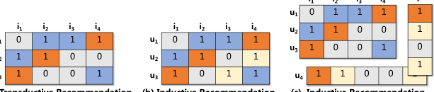
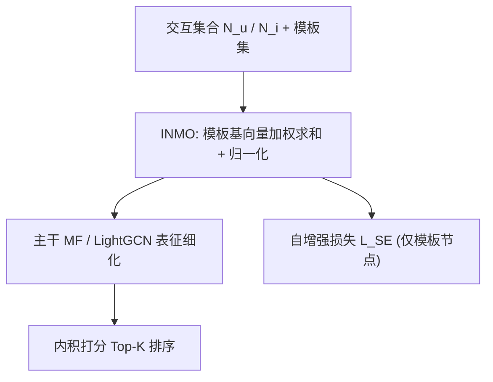
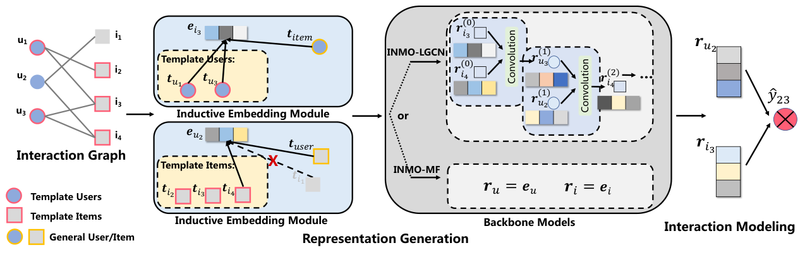

# INMO: A Model-Agnostic and Scalable Module for Inductive Collaborative Filtering (INMO：面向归纳式协同过滤的模型无关可扩展模块)

- **会议/期刊**: SIGIR 2022
- **作者与机构**: Yunfan Wu, Qi Cao, Huawei Shen, Shuchang Tao, Xueqi Cheng（中科院计算所 数据智能系统研究中心 / UCAS）
- **推荐链路定位**: 召回（Embedding 生成前置模块）
- **研究方向**: 协同过滤与双塔召回 / 冷启动与长尾推荐
- **论文原文**: [https://arxiv.org/abs/2107.05247v2](https://arxiv.org/abs/2107.05247v2)
- **开源代码**: [https://github.com/WuYunfan/igcn_cf](https://github.com/WuYunfan/igcn_cf)

## TL;DR (1分钟核心速览)

潜因子模型依赖 ID→Embedding 查表，本质是**直推式**的：新用户/新物品无 ID 即无嵌入，且参数量随用户物品数线性膨胀。INMO 把嵌入改为「与该用户交互过的**模板物品**向量之和」（物品对称），将查表换成可在线计算的归纳函数，并给出模板选择的误差上界指标 `error-sort`。作为前置模块挂载于 MF / LightGCN，在 Gowalla/Yelp/Amazon-Book 上以全库 Top-20 排序评测：直推场景 Recall@20 相对 LightGCN 提升 6.8%/6.0%/15.9%，新交互场景 NDCG@20 再提升 7.2%/6.0%/15.6%，仅用 20% 模板参数即超越原主干。

## Background & Motivation (背景与核心矛盾)

- **主流范式**: 潜因子模型（MF、NeuMF、NGCF、LightGCN、Mult-VAE）均为每个用户/物品学习专属嵌入，通过在交互矩阵上重构误差优化，近年改进集中在「表征生成」（GNN 高阶聚合）与「交互建模」（MLP）两条线。
- **前人局限**: 其一，嵌入查表天然直推，测试期新增的用户/物品找不到对应向量，只能重训或增量学习，代价高昂；其二，参数量为 $(n+m)d$，与全库规模强耦合。
- **前人局限（归纳派）**: IDCF 需 $O(n)$ 量级的 key-user 消息传递（二次复杂度），IGMC 对每个 (u,i) 对单独抽子图回归，Top-K 场景不可承受；IMC-GAE 用全局平均嵌入后处理，牺牲个性化。
- **核心洞察 (Key Insight)**: 既然 CF 的基本假设是「历史交互相似则未来偏好相似」，则用户偏好可由其在**少量模板物品**上的交互线性组合表征——模板即嵌入空间的一组基；忽略 70% 的非模板用户/物品仅带来 <10% 的附加误差。
- **本文切入点**: 用模板基向量之和替代查表，使嵌入成为交互集合的函数，从而免重训地覆盖新交互与新用户/物品，同时把参数量降到 $(n_t+m_t)d$。

<figure class="paper-figure" markdown="span">
  <figcaption>图2：传统直推式推荐场景与本文提出的两种归纳式场景。</figcaption>
</figure>

## Method (核心方法设计)

### 1. 整体框架 (Overall Architecture)

INMO 是一个**可插拔前置模块**，串接在原潜因子模型之前：输入为用户/物品的交互集合与预选模板集合，输出 $d$维归纳嵌入$\boldsymbol{e}_u,\boldsymbol{e}_i$；随后交给主干（MF 直接内积，LightGCN 再做$K$层线性邻居聚合）得到最终表征$\boldsymbol{r}_u,\boldsymbol{r}_i$，内积打分$\hat{y}_{ui}=\boldsymbol{r}_u^{\top}\boldsymbol{r}_i$ 完成 Top-K 排序。训练采用 BPR + 自增强损失，配合归一化退火与交互丢弃两项技巧；推理期新用户只需查其交互过的模板物品并求和，无需任何梯度更新。

<figure class="paper-figure" markdown="span">
  <figcaption>图3：归纳式协同过滤推荐器的整体架构，由两个关键组件组成，即表示生成和交互建模。这里，我们以基于 MF 实现的 INMO（INMO-MF）和基于 LightGCN 实现的 INMO（INMO-LGCN）作为两个具体实例。模板用户（模板物品）是经过精心选择的一些用户（物品），用作在嵌入空间中刻画每个物品（用户）的基础。</figcaption>
</figure>

### 2. 关键设计拆解 (Key Designs)

1. **模板基归纳嵌入（表达力无损 + 参数可调）**：痛点是把 ID 映射到独立向量导致归纳失效。INMO 定义 $\boldsymbol{e}_u=\frac{1}{(|N_u\cap I_{tem}|+1)^{\alpha}}\left(\sum_{i\in N_u\cap I_{tem}}\boldsymbol{t}_i+\boldsymbol{t}_{user}\right)$，物品侧对称。定理 4.1 用 Eckart-Young 分解证明：取全部用户/物品为模板时，令$\boldsymbol{T}_u=\boldsymbol{U}_d(\boldsymbol{S}_d)^{-1},\boldsymbol{T}_i=\boldsymbol{V}_d$可使 INMO-MF 误差恰为最优秩-$d$误差$\epsilon_{min}$——即**线性求和足以还原原始 MF 的表达力**，而$\boldsymbol{t}_{user}/\boldsymbol{t}_{item}$兜底零交互新节点。直觉：SVD 的左右奇异向量本就是「物品空间基$\times$ 用户权重」，模板求和正是其显式参数化。
2. **error-sort 模板筛选指标（理论上界驱动）**：只保留部分模板会引入附加误差项 $\|\boldsymbol{U}_d\boldsymbol{U}_d^{\top}\boldsymbol{L}_u\boldsymbol{Y}\|_F^2$，定理 4.2 用 Cauchy-Schwarz 推出其上界被$\sum_{u_j\in U_{non\text{-}tem}}\|\boldsymbol{s}_{u_j}\|_2^2\sum_{i\in N_{u_j}}|N_i|$控制，故应按$\|\boldsymbol{s}_{u_j}\|_2^2\sum_{i}|N_i|$从大到小选模板。工程上因$\boldsymbol{U}_d\boldsymbol{U}_d^{\top}$昂贵，退化为按$\sum_{i\in N_u}1/|N_i|$ 排序（IDF 式加权），实验证其显著优于 degree / PageRank（图 4、图 6）。
3. **训练目标与两项稳定化技巧**：总损失 $\mathcal{L}=\mathcal{L}_{BPR}+\beta\mathcal{L}_{SE}$，其中$\mathcal{L}_{SE}$仅在模板节点上做一次 BPR：$-\ln\sigma(\boldsymbol{t}_{u_i}^{\top}\boldsymbol{W}_s\boldsymbol{t}_{i_j}-\boldsymbol{t}_{u_i}^{\top}\boldsymbol{W}_s\boldsymbol{t}_{i_k})$，用可学习对角阵$\boldsymbol{W}_s$补偿「$\boldsymbol{T}_u=\boldsymbol{U}_d\boldsymbol{S}_d^{-1}$而$\boldsymbol{E}_u=\boldsymbol{U}_d\boldsymbol{S}_d$」的尺度差异，防止模板向量在求和中被同质化。**归一化退火**：$\alpha$训练期从 0.5 线性升至 1（测试期固定为 1），早期弱化归一化以放大高活用户的梯度、加速收敛；**交互丢弃**：以一定概率随机丢弃$N_u$，制造同用户的不同交互组合，直接训练归纳泛化。负采样为均匀未交互采样（BPR 标准），推理复杂度$O(|N_u\cap I_{tem}|)$，空间$O((n_t+m_t)d)$。

## Experimental Setup & Evaluation Protocol (实验设置与评估协议)

- **数据集与预处理**: Yelp / Amazon-Book 保留评分 >3 的隐式交互，并过滤交互数 <10 的用户与物品（类 10-core）；Gowalla 使用原始签到。

| 数据集 | #Users | #Items | #Interactions | 密度 | 场景说明 |
| :--- | :---: | :---: | :---: | :---: | :--- |
| Gowalla | 29,858 | 40,988 | 1,027,464 | 0.00084 | LBS 签到 |
| Yelp | 75,173 | 42,706 | 1,931,173 | 0.00060 | 本地商户点评 |
| Amazon-Book | 109,730 | 96,421 | 3,181,759 | 0.00030 | 图书电商（最稀疏） |

- **数据划分与防穿越**: 逐用户随机 `70%/10%/20%` 划分 train/valid/test，重复 5 次不同划分并报告均值±标准差（非全局时间戳切分，存在轻度未来信息泄漏风险）。
- **排名评测协议**: `Full-Ranking`（对全库未交互物品打分排序，$k=20$），指标 Recall@20 / Precision@20 / NDCG@20，表中数值统一 ×100。
- **归纳场景协议**: ①**新交互**——训练前随机剔除每用户 20% 交互，测试期作为新交互回流，对比「用/不用新交互」（后缀 `-new`），并以重训版 `INMO-LGCN-retrain` 为上界；②**新用户/新物品**——训练与验证集随机剔除 20% 用户与物品，测试集保持完整，分别汇报 New User / New Item / Over All。
- **对比基线与超参**: 基线 7 个（MF-BPR、NeuMF、Mult-VAE、NGCF、LightGCN、IMC-GAE、IDCF-LGCN）；嵌入维度 $d=64$，batch 2048，GNN 层数 3，Adam，早停（验证 NDCG@20 50 轮不升）；INMO-MF/LGCN 用全模板，`*` 版仅用 30% 模板；IDCF 采样 50 以控制耗时。

## Key Experimental Results (实验关键数据)

### 1. 主实验对比 (Main Results)

直推场景（Table 2，Gowalla / Yelp / Amazon-Book）：

| 方法 | Gowalla R@20 | Gowalla N@20 | Yelp R@20 | Yelp N@20 | Amazon R@20 | Amazon N@20 |
| :--- | :---: | :---: | :---: | :---: | :---: | :---: |
| MF-BPR | 16.11 | 12.03 | 8.61 | 5.36 | 11.41 | 7.37 |
| NeuMF | 15.08 | 11.20 | 7.94 | 4.87 | — | — |
| Mult-VAE | 18.36 | 13.90 | 10.13 | **6.49** | 13.63 | 9.44 |
| NGCF | 17.36 | 12.77 | 8.72 | 5.31 | 12.04 | 7.89 |
| IMC-GAE | 15.42 | 11.63 | 6.43 | 4.00 | 8.24 | 5.43 |
| IDCF-LGCN | 12.80 | 9.60 | 5.49 | 3.55 | — | — |
| LightGCN | 18.88 | 14.18 | 9.68 | 6.16 | 12.32 | 8.19 |
| INMO-MF | 18.41 | 14.15 | 9.54 | 6.07 | 13.40 | 9.23 |
| INMO-MF* | 16.20 | 12.40 | 9.09 | 5.81 | 11.88 | 8.13 |
| **INMO-LGCN** | **20.17** | **15.41** | **10.26** | 6.51 | **14.28** | **9.86** |
| INMO-LGCN* | 19.58 | 14.96 | 10.21 | 6.47 | 13.77 | 9.53 |
| **Improv.% (vs 最优基线)** | +6.83% | +8.67% | +1.28% | +0.31% | +4.77% | +4.45% |

归纳场景精选（NDCG@20）：新交互下 INMO-LGCN-new 相对 LightGCN-new 提升 **+7.24% / +5.98% / +15.64%**（Gowalla/Yelp/Amazon），逼近 `retrain` 上界；新用户/新物品场景（Gowalla）INMO-LGCN 达 New User 12.36、New Item 13.62、Over All 14.52，优于 IMC-LGCN（10.38 / 10.90 / 13.24），上界为 14.01 / 16.20 / 15.41。

### 2. 消融实验 (Ablation Study)

Gowalla 新用户/新物品场景，NDCG@20（NA=归一化退火，DI=交互丢弃）：

| 配置 | New User | New Item | Over All |
| :--- | :---: | :---: | :---: |
| INMO-MF (NA+DI) | 10.85 | 10.92 | 13.10 |
| INMO-MF w/o NA | 3.29 | 4.06 | 5.31 |
| INMO-MF w/o DI | 10.45 | 10.70 | 12.83 |
| INMO-MF w/o 两者 | 6.44 | 7.09 | 9.29 |
| INMO-LGCN (NA+DI) | 12.36 | 13.62 | 14.52 |
| INMO-LGCN w/o NA | 12.26 | 13.42 | 14.37 |
| INMO-LGCN w/o DI | **12.38** | 13.44 | 14.52 |
| INMO-LGCN w/o 两者 | 12.17 | 13.05 | 14.26 |

### 3. 关键实验发现 (Key Findings)

1. **归纳式嵌入自带正则增益**：即使在无新交互的纯直推设定下，INMO-LGCN 仍全面超越 LightGCN（Gowalla +6.83% R@20、Amazon +15.9% R@20 与 +20.4% N@20）。原因是嵌入成为交互集合的确定性函数（同历史 → 同向量），消除了随机初始化 ID 带来的噪声自由度，等价于参数共享正则。
2. **参数压缩近乎「免费」**：INMO-LGCN* 仅用 20% 模板参数量即取得 19.58/14.96（Gowalla）反超原版 LightGCN；且 `error-sort` 选择的模板在相同比例下始终优于 degree 与 PageRank（图 6），验证定理 4.2 的上界指标具备工程指导价值；忽略 70% 非模板节点仅引入 <10% 附加误差。
3. **推理替代重训的量级收益**：Gowalla 上 LightGCN 全量重训需 8007.1s、MF 需 4291.2s，而 INMO 归纳推理仅 3.4s / 1.8s（约 3 个数量级加速），同时新用户 NDCG 达重训上界的 88%（12.36 vs 14.01）。
4. **归一化退火是 MF 主干的生死线**：去掉 NA 后 INMO-MF 新用户 NDCG 从 10.85 崩至 3.29（−70%），而 LGCN 主干仅降 0.8%——说明纯线性聚合且无邻居平滑时，嵌入范数失控会直接摧毁泛化；$\beta$ 亦需分主干调节（MF 最优 0.1，LGCN 最优 0.01）。

## Highlights & Limitations (亮点、对比与审稿批判)

- **与代表作对比 (vs. Prior Work)**: 相较 IMC-GAE 用全局均值后处理（丧失个性化），INMO 以交互组合保留个体差异，Gowalla 新用户 NDCG 高出 19%；相较 IDCF 的二次复杂度与 IGMC 的逐对子图回归，INMO 嵌入查询仅 $O(|N_u\cap I_{tem}|)$，可支撑全库 Top-K；相较 LightGCN，INMO 是正交的正交「前置模块」而非替代架构，可叠加于任意潜因子主干。
- **可迁移亮点**: ①用「模板基 + 求和」把 ID Embedding 改写成集合函数，可直接迁移到双塔召回的用户侧实时特征编码与增量索引；②`error-sort` 的 IDF 式简化版 $\sum_{i\in N_u}1/|N_i|$ 可作为通用的「锚点节点」筛选启发式，用于图摘要与 KG 对齐。
- **审稿级局限批判**: ①归纳能力**依赖模板覆盖率**——若新用户未与任何模板物品交互，嵌入退化为 $\boldsymbol{t}_{user}$（近似 Popular 基线），论文未对该长尾情形分桶报告；②线性无权求和缺少对交互重要性的区分（无注意力/时间衰减），且逐用户随机划分 + 缺显著性检验使结论在真实时序分布下有待复核；③模板选择所需的$\boldsymbol{U}_d$与贪心比例搜索仍是离线一次性开销，超参$\alpha$退火曲线与$\beta$ 对数据集较敏感。

## Rating (四维评分)

- **方法创新性 (Novelty)**: ⭐⭐⭐⭐ （把 SVD 奇异向量结构显式化为「模板基求和」，并有定理 4.1 的表达力等价性与定理 4.2 的误差上界支撑，思路朴素但理论闭环完整）
- **评估协议与实验扎实度 (Protocol & Experiments)**: ⭐⭐⭐⭐ （直推 + 两种归纳场景共三套协议、5 次划分均值±方差、7 个基线含归纳专用对手，略欠显著性检验与前缀时序切分）
- **写作与数学规范度 (Clarity & Rigor)**: ⭐⭐⭐⭐ （证明链条清晰、复杂度分析具体；但公式 9 的 $\alpha$ 符号与归一化指数混用、部分表格数字与正文百分比口径略有出入）
- **工业落地与复现价值 (Industrial & Practical Value)**: ⭐⭐⭐⭐⭐ （代码开源、模块即插即用、参数量可按算力裁剪，8007s 重训 → 3.4s 推理的量级收益对实时新用户召回极具吸引力）

