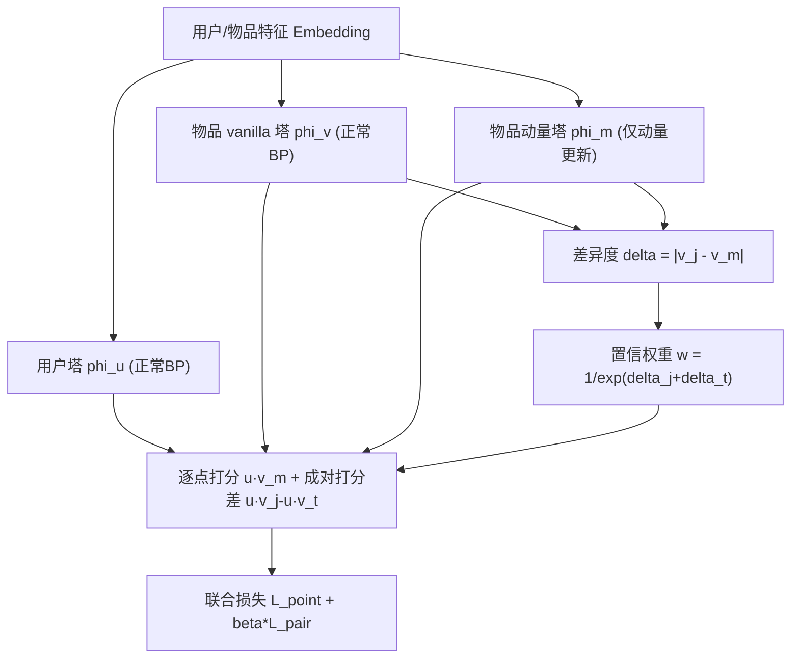

# MP2: A Momentum Contrast Approach for Recommendation with Pointwise and Pairwise Learning（动量对比的逐点—成对联合推荐）

- **会议/期刊**: SIGIR 2022（5 页短文）
- **作者与机构**: Menghan Wang、Yuchen Guo（eBay Inc.）；Zhenqi Zhao（Tencent）；Guangzheng Hu、Mingming Gong（Univ. of Melbourne）；Yuming Shen、Philip Torr（Univ. of Oxford）
- **推荐链路定位**: 召回（双塔向量打分，可扩展至精排）
- **研究方向**: 协同过滤与双塔召回 / 自监督对比与交互去噪
- **论文原文**: [https://arxiv.org/abs/2204.08326v1](https://arxiv.org/abs/2204.08326v1)
- **开源代码**: 暂未开源

## TL;DR (1分钟核心速览)

隐式反馈的二值逐点标签无法表达偏好强度，同一物品在同一用户下会同时被打 0 和 1，本文称之为 **annotation bias（标注偏置）**，它让物品表示收到相反梯度而剧烈震荡。MP2 用「一用户塔 + 双物品塔」结构：动量物品塔平滑演化以稳定表示，并以两塔表示的差异度作为逐点标签的置信度权重，再与成对 BPR 损失联合训练。四个数据集上 HitRate/NDCG@5,20 全面超 NeuMF、BPR、Ranknet-NN、APPL、T3，NDCG@5 提升 1.3%–3.2%。

## Background & Motivation (背景与核心矛盾)

- **主流范式**: 深度推荐（NeuMF、DLRM、DeepFM 系）以二值隐式反馈 + 逐点 BCE 训练双塔，学 $u^\top v$ 打分。
- **前人局限 1（正负冲突）**: 用户偏好是连续且上下文相关的，二值标签只能取 0/1。图 1 的例子中物品 $B$ 真实偏好 0.7，却在不同记录里分别被标 1 和 0，同一物品表示在不同 batch 收到方向相反的优化信号，导致表示高波动、训练震荡。
- **前人局限 2（成对学习的缺陷）**: 成对标签天然是软标签（只描述序关系，无绝对打分），免于该偏置；但深度推荐中成对学习研究稀少，且纯 pairwise 模型（BPR/Ranknet-NN）丢弃了绝对置信度信息，也无法判断某条交互是否可信。
- **核心洞察 (Key Insight)**: 逐点与成对是**互补**的；更关键的是，"同一物品在两个网络下的表示差异"可以作为该标签不确定性的**无监督代理度量**——差异大 ⇒ 表示被冲突标签拉扯 ⇒ 该逐点标签应降权。
- **本文切入点**: 不改损失函数的形式，而是改**骨干结构**：用动量更新的第二物品塔制造"慢演化参照系"，把表示差异变成可微的样本级权重。

## Method (核心方法设计)

### 1. 整体框架 (Overall Architecture)

三个塔共享底层特征 Embedding 层：用户塔 $\phi_u(\cdot,\theta_u)$与物品 vanilla 塔$\phi_v(\cdot,\theta_v)$走常规反向传播；物品动量塔$\phi_m(\cdot,\theta_m)$与 vanilla 塔**同构但只做动量平均**、不接收梯度。逐点损失用「用户表示 × 动量物品表示」计算$\hat{y}_{ij}=u_i v_{mj}$，以避免冲突标签直接污染缓慢演化的参照表示；成对损失则在同一用户下比较两个物品的打分差。两条物品表示$v_j$与$v_{mj}$ 的逐元素差异被聚合成标量，反过来作为该样本逐点损失的置信度权重，形成"表示差异 → 标签可信度 → 损失权重 → 表示更新"的闭环。推理时仅需常规双塔内积，动量塔只是训练期的"教师参照"。

### 2. 关键设计拆解 (Key Designs)

1. **动量物品塔（一致性表示）**：痛点是被冲突标签拉扯的物品表示不稳定 $\to$令动量塔参数按$\theta_m = \alpha\theta_m + (1-\alpha)\theta_v$更新，$\alpha \in [0,1)$ $\to$ 直觉是对物品编码做"时间维度的低通滤波/时序集成（temporal ensembling）"：用户表示每步即时刷新以快速拟合，物品表示缓慢演化以抵抗噪声，快慢非对称使冲突样本只造成小幅偏移而非翻转。注意作者明确区别于 MoCo 类工作——那里动量是省显存的负样本队列手段，此处动量是**主动的稳定性正则**。

2. **差异度置信加权（Discrepancy-as-Confidence）**：痛点是如何在无干净标签的情况下识别坏样本 $\to$定义$\bar{\delta}_j=\frac{1}{c}\sum_{d=1}^{c}|v_{j,d}-v_{mj,d}|$，并将同一样本内两个物品联合加权：$w_{jt}=1/\exp(\bar{\delta}_j+\bar{\delta}_t)$ $\to$ 与自集成（self-ensembling）通常"最小化差异"不同，本文不把差异塞进损失去惩罚，而是用它**重加权**，从而把不确定性显式传给用户侧的梯度。联合（pairwise 形式）而非分别加权的好处是：两个物品共享一个权重，等价于在样本粒度上做一次软性拒绝，避免逐点权重导致的过拟合。

3. **训练目标与推理效率**：$L_{point}=-\sum_j w_{jt}\,y_j\log p_j + w_{jt}(1-y_j)\log(1-p_j)$，$L_{pair}=\sum_u\sum_{j,t}\mathbb{I}(j\succ_u t)\log\big(1+\exp(u_iv'_j-u_iv'_t)\big)$（原文此处用$v'$与 3.1 节的$v_m$记号略有出入，实指动量塔表示），总损失$L_{total}=L_{point}+\beta L_{pair}+\text{reg}$。负样本由同一用户下随机采样的物品对构成（**未采用 hard negative，也未报告 uniform/in-batch 采样细节**）；推理只需$u_i^\top v_j$，与标准双塔同构，无额外线上开销（该结论为依据结构的合理推断，原文未实测）。

## Experimental Setup & Evaluation Protocol (实验设置与评估协议)

- **数据集与预处理**: 显式评分（1–5）按阈值 3 二值化为逐点标签；成对标签由同一用户下随机抽取物品对并按相对分数决定序关系。原文**未声明 5-core 过滤或任何采样阈值**，下表为用户/物品/交互数的常用统计（非论文正文给出的表格，仅供规模参考）：

| 数据集 | #Users | #Items | #Interactions | 稀疏度 | 特征/场景说明 |
| :--- | :---: | :---: | :---: | :---: | :--- |
| MovieLens-100k | 943 | 1,682 | 100,000 | 93.7% | 电影评分，稠密小规模 |
| MovieLens-1M | 6,040 | 3,706 | 1,000,209 | 95.5% | 电影评分，中等规模 |
| Beauty | 22,363 | 12,101 | 198,502 | 99.93% | Amazon 美妆评论，极稀疏 |
| Office Products | 4,905 | 2,420 | 53,258 | 99.55% | Amazon 办公用品，极稀疏 |

- **数据划分与防穿越**: 原文未明确说明（推测为按用户的留一/留尾划分），**未报告时间戳切分或冷启动划分**，是本文复现性上的主要缺口。
- **排名评测协议**: 使用 HitRate@5/20 与 NDCG@5/20；**未标注是 Full-Ranking 全库排序还是 Sampled 负采样排序，也未给出候选集规模与正负比**，跨论文比较时需谨慎。
- **对比基线与超参设置**: 三类基线——逐点 NeuMF；成对 BPR（MF）、Ranknet-NN（深度）；混合 APPL（双逐点 + 一成对，作者改写为深度版）与 T3（MP2 去掉动量与差异加权的消融版）。Embedding 维度、学习率等原文未列表，仅说明网格搜索取各自最优超参；**未做显著性检验**。

## Key Experimental Results (实验关键数据)

### 1. 主实验对比 (Main Results)

表 1：MovieLens 两数据集（加粗为最优，Improv. 相对该列最强基线）

| Models | ML-100k HR@5 | ML-100k HR@20 | ML-100k NDCG@5 | ML-100k NDCG@20 | ML-1M HR@5 | ML-1M HR@20 | ML-1M NDCG@5 | ML-1M NDCG@20 |
| :--- | :---: | :---: | :---: | :---: | :---: | :---: | :---: | :---: |
| NeuMF | 0.4709 | 0.8163 | 0.3311 | 0.4570 | 0.2182 | 0.5034 | 0.1961 | 0.3002 |
| BPR | 0.4550 | 0.8182 | 0.3172 | 0.4526 | 0.4810 | 0.7194 | 0.4369 | 0.5241 |
| Ranknet-NN | 0.5949 | 0.8822 | 0.4415 | 0.5493 | 0.4074 | 0.6939 | 0.3498 | 0.4627 |
| APPL | 0.5877 | 0.8851 | 0.4590 | 0.5510 | 0.3881 | 0.6347 | 0.3447 | 0.4330 |
| T3 | 0.5927 | 0.8824 | 0.4531 | 0.5491 | 0.4832 | 0.7109 | 0.4391 | 0.5217 |
| **MP2** | **0.5983** | **0.8947** | **0.4721** | **0.5604** | **0.4920** | **0.7270** | **0.4449** | **0.5314** |
| Improv. | +0.57% | +1.09% | +2.85% | +1.71% | +1.83% | +1.06% | +1.32% | +1.39% |

表 2：Beauty 与 Office Products

| Models | Beauty HR@5 | Beauty HR@20 | Beauty NDCG@5 | Beauty NDCG@20 | Office HR@5 | Office HR@20 | Office NDCG@5 | Office NDCG@20 |
| :--- | :---: | :---: | :---: | :---: | :---: | :---: | :---: | :---: |
| NeuMF | 0.2347 | 0.9038 | 0.1136 | 0.2616 | 0.2229 | 0.8150 | 0.1145 | 0.2706 |
| BPR | 0.2555 | 0.8629 | 0.1275 | 0.2605 | 0.2754 | 0.8613 | 0.1504 | 0.2858 |
| Ranknet-NN | 0.3157 | 0.8824 | 0.1643 | 0.2889 | 0.2923 | 0.8449 | 0.1537 | 0.2829 |
| APPL | 0.2780 | 0.8664 | 0.1429 | 0.2716 | 0.2311 | 0.8947 | 0.1192 | 0.2756 |
| T3 | 0.2811 | 0.9078 | 0.1440 | 0.2821 | 0.2657 | 0.8789 | 0.1436 | 0.2841 |
| **MP2** | **0.3170** | 0.8850 | **0.1668** | **0.2917** | **0.3031** | 0.8894 | **0.1586** | **0.2915** |
| Improv. | +0.41% | −2.51% | +1.52% | +0.97% | +3.69% | −0.59% | +3.19% | +1.99% |

### 2. 消融实验 (Ablation Study)

| 变体 | 说明 | ML-100k NDCG@5 | ML-100k NDCG@20 | Beauty NDCG@5 | Beauty NDCG@20 |
| :--- | :--- | :---: | :---: | :---: | :---: |
| T3（表 1） | 去动量、去差异加权 | 0.4531 | 0.5491 | 0.1440 | 0.2821 |
| MP2$_{uniform}$ | 权重全部置 1 | 0.4683 | 0.5640 | 0.1549 | 0.2871 |
| MP2$_{separate}$| 两物品各自权重$1/\exp(\bar{\delta})$ | 0.4702 | 0.5617 | 0.1519 | 0.2833 |
| MP2$_{joint}$|$1/\exp(\bar{\delta}_j+\bar{\delta}_t)$ | **0.4740** | **0.5687** | **0.1664** | **0.2897** |

动量系数 $\alpha$敏感性（图 3）：$\alpha\in\{0,0.1,0.5,0.9,0.99,0.999,0.9999,1\}$上性能随$\alpha$**单调上升并在$\alpha=0.999$达峰**；$\alpha=1$（动量塔恒等于 vanilla 塔、退化为双塔）显著下降。

### 3. 关键实验发现 (Key Findings)

1. **增益主体来自"逐点+成对联合"而非"塔的数量"**：ML-100k 上联合类模型（APPL 0.4590、T3 0.4531、MP2 0.4721）碾压单损失模型（NeuMF NDCG@5 仅 0.3311、BPR 0.3172，差距 30%+）；而在最强基线之上，MP2 的增量只有 +1.3%–+3.2%，说明动量与差异加权属于"精修"级别的收益。
2. **动量必须"慢"才有效，但不能等于不更新**：$\alpha$从 0→0.999 单调增益、$\alpha=1$ 塌陷，直接验证了"物品表示一致性"假设；但最优值落在 0.999 这种极端点，意味着动量塔几乎被冻结，对最新交互的响应近乎停滞，失衡风险被论文忽略。
3. **成对（联合）加权显著优于逐点（分离）加权，且分离加权甚至不如不加权**：Beauty 上 $0.1664 > 0.1549 > 0.1519$（NDCG@5），$MP2_{separate}$反被$MP2_{uniform}$ 反超，作者归因为"分离加权模型最复杂、易过拟合"，说明差异度信号本身噪声不小，必须借由成对结构做平滑才有收益。另外 Beauty HR@20 上 MP2（0.8850）反落后于 NeuMF（0.9038）与 T3（0.9078），提示长列表召回存在 trade-off。

## Highlights & Limitations (亮点、对比与审稿批判)

- **与代表作对比 (vs. Prior Work)**: 与 APPL 同为"逐点+成对混合损失"，但 APPL 停留在**损失函数设计**层面（两个逐点 + 一个成对），MP2 改的是**骨干网络**——引入第三个动量塔，使"标签可信度"成为可计算的中间变量；与 Ranknet-NN／BPR 这类纯成对模型相比，MP2 保留了逐点损失的绝对打分与样本级置信度；与 MoCo 系动量对比不同，动量在此不是负样本记忆库而是稳定性正则项。
- **可迁移亮点**: ①「快塔学用户 / 慢塔学物品」的非对称更新范式，可直接套用到序列推荐或跨域场景中噪声更重的物品侧；②用双塔表示差异作为样本置信度、再以成对形式联合作权，这一"差异→权重"的无监督去噪插件可嫁接至任意带噪声隐式反馈的精排模型。
- **审稿级局限批判**: ①**评测协议严重不透明**——未交代划分方式、候选集规模、是否为全库排序、负采样策略，也未做显著性检验，1% 量级的提升在此前提下说服力有限；且 Table 1（ML-100k NDCG@5 = 0.4721）与 Table 2（MP2$_{joint}$= 0.4740）数值不一致，暴露实验记录/随机种子管理问题。②**代价与敏感度被淡化**：训练期需额外一份物品塔的前向与参数存储，物品表大时显存与吞吐成本近似翻倍；$\alpha=0.999$属极端取值，缺乏对$\alpha$与$\beta$、学习率交互的敏感性分析，也未做线上 A/B，工业收益未被证实。

## Rating (四维评分)

- **方法创新性 (Novelty)**: ⭐⭐⭐⭐ （把"动量表示差异"从对比学习的负样本工具改造成标签置信度度量，双物品塔设计简洁且动机自洽，但本质仍是工程化的结构组合）
- **评估协议与实验扎实度 (Protocol & Experiments)**: ⭐⭐ （四个数据集覆盖稠密到极稀疏是加分项，但划分/候选集/负采样/显著性全部缺失，且两处表格数值自相矛盾，1–3% 的提升难以严格定论）
- **写作与数学规范度 (Clarity & Rigor)**: ⭐⭐⭐⭐ （图 1 的标注偏置示例极清晰，公式精简；但 3.1 节与 Eq.5 的 $v_m$／$v'$记号不一致，$\bar{\delta}$ 的聚合方式与权重温度系数缺少理论解释）
- **工业落地与复现价值 (Industrial & Practical Value)**: ⭐⭐⭐ （推理阶段与标准双塔同构、零额外线上开销，落地友好；但训练成本近翻倍、无开源代码、5 页短文细节不足，复现门槛偏高）

