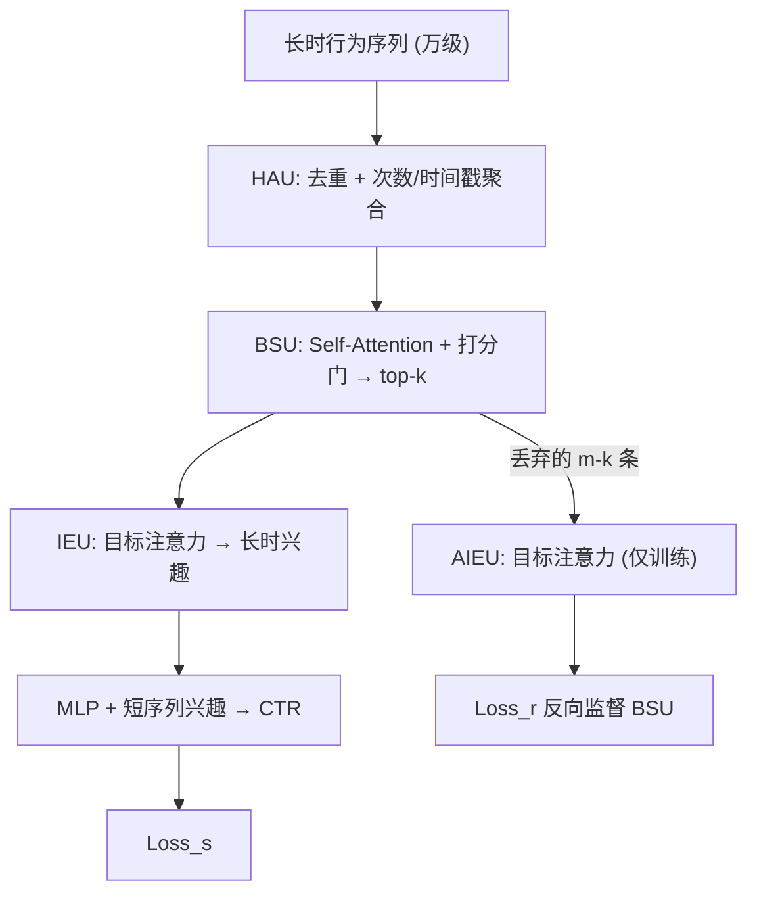
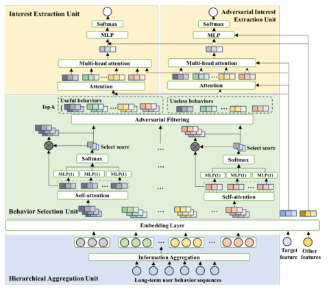

# Adversarial Filtering Modeling on Long-term User Behavior Sequences for Click-Through Rate Prediction (面向点击率预估的长时用户行为序列对抗过滤建模)

- **会议/期刊**: SIGIR 2022 (short paper, 5 pages)
- **作者与机构**: Xiaochen Li, Rui Zhong (共同一作), Jian Liang, Xialong Liu (阿里巴巴集团); Yu Zhang (Lazada Group)
- **推荐链路定位**: 精排 (CTR 预估)
- **研究方向**: CTR/CVR 预估与特征交叉 / 序列与会话推荐
- **论文原文**: [https://arxiv.org/abs/2204.11587v2](https://arxiv.org/abs/2204.11587v2)
- **开源代码**: 暂未开源

## TL;DR (1分钟核心速览)

长时行为序列（数月、上万条）能提升 CTR 精度，但带来存储/延迟开销，且**重复行为**（多次点击同款）与**无用行为**（误点、长尾）构成强噪声。已有缩短方案（MIMN 定长 memory、SIM 硬/软搜索、UBR 的 BM25 检索）要么把噪声一并编码进固定向量，要么检索目标与 CTR 任务解耦、无法端到端优化。本文提出 ADFM：分层聚合去重（HAU）→ 自注意力打分门选 top-k（BSU）→ 目标注意力抽兴趣（IEU），并引入结构与 IEU 不对称的 AIEU 处理被丢弃的 $m-k$条行为，用"最小化$\mathcal{L}_s-\mathcal{L}_r$"的对抗目标直接监督选择器。在 Amazon Books、Taobao 与 43 亿条工业样本上，AUC 分别较最优基线提升 +1.34%、+1.09%、+0.67%，线上 A/B 12 天 CTR +4.7%、RPM +3.1%。

## Background & Motivation (背景与核心矛盾)

- **主流范式**: 短序列（<100）用 DIN/DIEN 类目标注意力；长序列则先"变短"再建模——MIMN 用固定长度 memory 增量更新，SIM 用类目硬搜索或向量内积软搜索取 top-k，UBR 用倒排索引 + BM25 检索。
- **前人局限**: ① MIMN 把全部历史压进定长 memory，等价于对噪声做无差别编码，给定目标 item 时难以精确刻画兴趣；② SIM 的硬搜索是规则式（按类目裁剪）会信息损失，软搜索用的 item embedding 主要为 CTR 任务学习，**相似度不等于相关性**，原文实验亦显示软搜索仅略优于硬搜索；③ UBR 的 BM25 排序函数独立于 CTR 模型，无法端到端优化，检索次优。
- **核心洞察 (Key Insight)**: 作者逐案分析长序列后发现噪声有两类且性质不同——**重复行为**（热 item/brand/shop 被反复触达，占满有限长度却不带来新信息）与**无用行为**（误点、长尾，不反映近期兴趣）。因此"去重"与"判废"应拆成两步，且"判废"需要一个独立于 CTR 精度的监督信号。
- **本文切入点**: 用确定性聚合消掉重复（零学习成本、顺带压存储），再用**对抗式"选好 vs. 剩坏"的损失差**给选择器一个显式的可学习目标。

## Method (核心方法设计)

### 1. 整体框架 (Overall Architecture)

输入为 item profile、user profile、短序列（3 天/≤100）与长序列（180 天/上万条）。长序列先经 HAU 按 `behavior_id` 分组去重并附带出现次数与最大时间戳的稀疏分桶特征，序列由万级压到百级；BSU 用 self-attention 捕捉行为间交互后经打分门输出重要性分数，排序取 top-$k$得到$E^{u,s}$；IEU 以目标 item 为 query 做多头目标注意力，得到长时兴趣向量，与短序列兴趣、其余特征拼接进 MLP 出 CTR。训练时被丢弃的$m-k$条行为进入 AIEU（结构同 IEU、参数不共享），两路损失构成对抗博弈。**推理时仅保留 top-$k$ 序列上传在线缓存**，AIEU 只在离线训练存在。

<figure class="paper-figure" markdown="span">
  <figcaption>图 1：ADFM 的结构。i) 分层聚合单元聚合原始序列以去除重复行为。ii) 行为选择单元细化每个行为，并分离有用行为和无用行为。iii) 兴趣提取单元和对抗兴趣提取单元分别从有用行为和无用行为中捕获用户兴趣。</figcaption>
</figure>

### 2. 关键设计拆解 (Key Designs)

1. **HAU 分层聚合（去重不丢序信息）**：纯去重会丢失"访问频次"与"最近一次时间"，故每条聚合行为表示为三元组 $\langle b_i, n_i, \tau_i\rangle$，并把$n_i$、$\tau_i$ 分桶成稀疏特征走 embedding，等价于用"统计画像"补偿被抹掉的顺序信号。工业集上单此一步压缩 60% 序列长度。
2. **BSU 打分门 + AIEU 对抗过滤（核心创新）**：仅靠 CTR 损失回传梯度，优化目标是"预测准"而非"选得准"，top-$k$未必是最有用的$k$条。为此对剩余序列训练 AIEU 得其损失$\mathcal{L}_r$，交替优化：固定 BSU 时$\min_{\text{IEU},\text{AIEU}}\mathcal{L}_s+\mathcal{L}_r$（先把两路都学好），固定 IEU/AIEU 时$\min_{\text{BSU}}\mathcal{L}_s-\mathcal{L}_r$。**直觉**：若选择器把有用行为都挑走，剩余$m-k$条应"学不动"、$\mathcal{L}_r$大，故最大化$\mathcal{L}_r$等价于把噪声推给对手模型；交替训练避免 top-$k$ 分布随 BSU 更新剧烈漂移导致两路不收敛。
3. **训练目标与推理开销**：总损失为两路 NLL 的对抗组合 $\mathcal{L}=-\frac{1}{N}\sum (y\log p+(1-y)\log(1-p))$；此处不做负采样（曝光级点击标签、pointwise BCE）。推理仅跑 HAU+BSU+IEU，延迟与定长 memory 方案相当且**随原始序列增长保持恒定**（SIM 则持续上升）。

## Experimental Setup & Evaluation Protocol (实验设置与评估协议)

- **数据集与预处理**: 长序列建模仅保留序列长度 ≥ 20 的样本；行为类型含 impression/click/add-to-cart/pay，行为目标含 item/brand/shop/category。

| 数据集 | #Users | #Items | #Interactions | 稀疏度/密度 | 特征/场景说明 |
| :--- | :---: | :---: | :---: | :---: | :--- |
| Amazon Books | 1.5 M | 2.9 M | 51 M | 1252 类目，review 视为 click | 公开基准 |
| Taobao | 1.0 M | 4.0 M | 89 M | 9407 类目，仅用 click | 公开基准 |
| Industrial | 11.5 M | 16.4 M | 4.3 B | 5000 类目，180 天多行为类型 | 阿里线上广告系统 |

- **数据划分与防穿越 (Splitting Strategy)**: 论文按时间窗构造样本（短序列 3 天、工业长序列前 180 天），但**未明示训练/验证/测试的具体切分比例与是否严格全局时间戳切分**——这是本文评估叙述的一处薄弱点。
- **排名评测协议 (Ranking Protocol)**: 非 ranking 协议，采用 **pointwise CTR 评估**：AUC，以及按 user / request 分组的 $\text{GAUC}_{user}$、$\text{GAUC}_{req}$（仅工业集因分组数充足而报告）。
- **对比基线与超参设置**: 短序列基线 DNN / DIN / DIEN / ComicRec，长序列基线 MIMN / SIM（仅硬搜索，与其线上一致）。$D=16$，MLP 256-128-64，多头数 2，Adam lr=0.001；$k=20$（公开集）/$k=100$（工业集）。未见显著性检验（如$p<0.05$）说明。

## Key Experimental Results (实验关键数据)

### 1. 主实验对比 (Main Results)

| Models | Amazon AUC | Taobao AUC | Industrial AUC | $\text{GAUC}_{user}$|$\text{GAUC}_{req}$ |
| :--- | :---: | :---: | :---: | :---: | :---: |
| DNN | 0.8355 | 0.8714 | 0.7001 | 0.6354 | 0.6083 |
| DIN | 0.8386 | 0.8804 | 0.7019 | 0.6367 | 0.6094 |
| DIEN | 0.8442 | 0.9032 | 0.7034 | 0.6379 | 0.6106 |
| ComicRec | 0.8458 | 0.9012 | 0.7037 | 0.6381 | 0.6109 |
| MIMN | 0.8494 | 0.9144 | 0.7046 | 0.6392 | 0.6131 |
| SIM (hard) | 0.8461 | 0.9360 | 0.7047 | 0.6390 | 0.6128 |
| **ADFM** | **0.8574** | **0.9462** | **0.7094** | **0.6428** | **0.6161** |
| **Improv.%** | **+1.34%** | **+1.09%** | **+0.67%** | **+0.59%** | **+0.54%** |

线上 A/B（12 天，对比 SIM）：**CTR +4.7%、RPM +3.1%**。

### 2. 消融实验 (Ablation Study)

| 变体 (工业集) | AUC | Δ |
| :--- | :---: | :---: |
| DNN (仅短序列) | 0.7001 | — |
| $\text{DNN}_{long}$ (长序列 + sum-pooling) | 0.7028 | +0.0027 |
| $+\ \text{HAU}$ | 0.7035 | +0.0007 |
| $+\ \text{BSU}$ | 0.7061 | +0.0026 |
| $+\ \text{adversarial}$ (**ADFM**) | **0.7094** | **+0.0033** |
| $\text{DNN}_{long}+\text{HAU}+\text{ComicRec}$ | 0.7074 | +0.0039 |

### 3. 关键实验发现 (Key Findings)

1. **收益主要来自"选择"而非"去重"**：HAU 只带来 +0.0007 AUC，却砍掉 60% 序列长度——它是**成本项而非精度项**；BSU（+0.0026）与对抗监督（+0.0033）才贡献主要精度，说明长序列价值瓶颈在噪声判别而非压缩。
2. **对抗监督是"易优化版本"而非"更强结构"**：把 ComicRec 多兴趣模块接到 $\text{DNN}_{long}+\text{HAU}$ 上得 0.7074，已**超过无对抗的 BSU（0.7061）**，但仍低于 ADFM（0.7094）——直接印证作者判断："BSU 本身难优化，对抗学习是在缓解优化问题"，即打分门的增益被梯度信号质量而非容量所限制。
3. **工业场景的边际收益与规模正相关**：工业集 AUC 增益（+0.0047 绝对值）远大于公开集，且 GAUC 三档同步提升（user/request 分组），说明在万级长序列、180 天窗口下噪声比例更高、过滤收益更大；线上 +4.7% CTR 也表明离线 1e-3 级 AUC 提升可兑现为可观流量收益。

## Highlights & Limitations (亮点、对比与审稿批判)

- **与代表作对比 (vs. Prior Work)**: 与 MIMN 的本质差异是"不把噪声编码进定长 memory，而是显式判废"；与 SIM 的差异是"选择器由 CTR 任务的对抗损失监督"而非类目规则或 embedding 内积相似度，且选择结果可离线缓存使在线延迟与原始长度解耦；与 UBR 的差异是检索/排序与 CTR 模型**端到端联合优化**（BM25 是外挂的）。
- **可迁移亮点**: ① "去重聚合 + 频次/时间戳分桶补信息"这一招可直接用于任何超长行为序列的预处理，且是零训练成本的正则化；② "主模型吃 top-$k$、影子模型吃剩余$m-k$、以损失差作为选择器奖励"的对抗式特征选择范式可迁移到特征筛选、样本去噪、多路召回裁剪。
- **审稿级局限批判**: ① **评估叙述不严谨**：未交代训练/测试切分方式与是否严格按时间戳防穿越，CTR 场景下这一点直接决定 AUC 可信度；② **对抗训练的稳定性与开销未量化**：交替优化的收敛判据（"$\mathcal{L}_s,\mathcal{L}_r$变化小"）依赖超参，且训练需额外跑一遍 AIEU，$k$ 与对抗强度对精度/成本的敏感度曲线缺失；③ 5 页短文，公开集只报告 AUC 单指标，未给 GAUC 与置信区间/显著性检验。

## Rating (四维评分)

- **方法创新性 (Novelty)**: ⭐⭐⭐⭐ （把"长序列检索"重述为"对抗式判废"问题，AIEU 的损失差监督是清晰且少见的增量，但整体仍是 HAU+BSU+目标注意力的工程组合）
- **评估协议与实验扎实度 (Protocol & Experiments)**: ⭐⭐⭐ （两公开集 + 43 亿工业集 + 线上 12 天 A/B 很有说服力，但切分方式未交代、无显著性检验、公开集仅报 AUC）
- **写作与数学规范度 (Clarity & Rigor)**: ⭐⭐⭐⭐ （模块职责与损失设计表述干净，HAU 三元组表示与交替优化目标交代到位；但 $\mathcal{L}_s$/$\mathcal{L}_r$ 符号在正文曾有笔误混用，收敛性无分析）
- **工业落地与复现价值 (Industrial & Practical Value)**: ⭐⭐⭐⭐ （存储压缩 60%+27%、在线延迟与序列长度解耦、线上 CTR +4.7%，落地价值高；但无开源代码，对抗训练调参成本是复现门槛）

