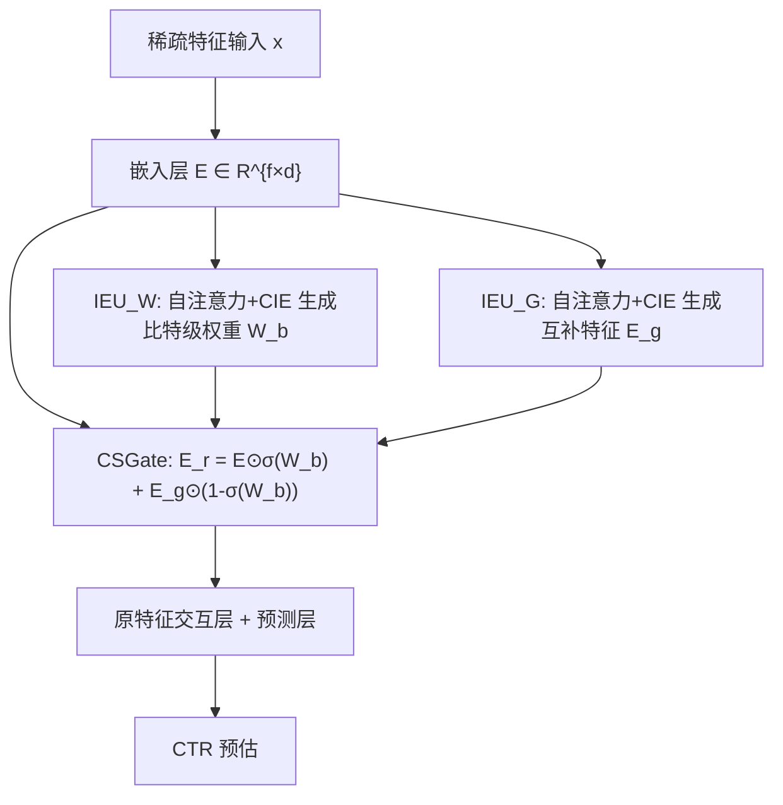
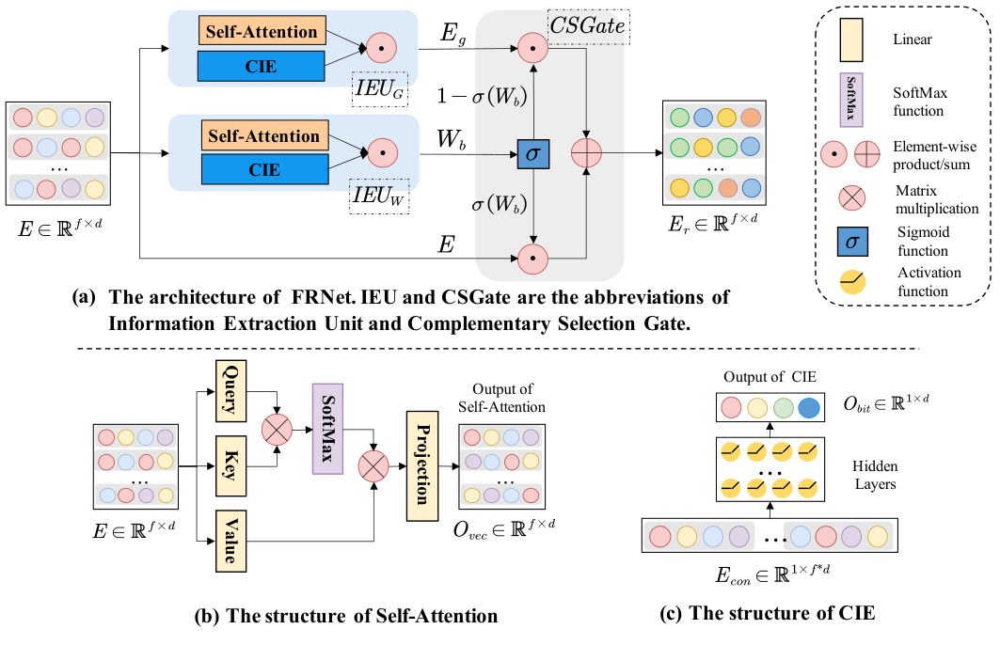

# Enhancing CTR Prediction with Context-Aware Feature Representation Learning (上下文感知特征表示学习增强 CTR 预估)

- **会议/期刊**: SIGIR 2022
- **作者与机构**: Fangye Wang, Yingxu Wang, Dongsheng Li, Hansu Gu, Tun Lu, Peng Zhang, Ning Gu（复旦大学、微软亚洲研究院）
- **推荐链路定位**: 精排
- **研究方向**: CTR 预估与特征交叉
- **论文原文**: [论文原文链接](https://arxiv.org/abs/2204.08758v1)
- **开源代码**: [开源代码仓库链接](https://github.com/frnetnetwork/frnet)

## TL;DR (1分钟核心速览)

FRNet 针对现有 CTR 模型为每个特征学习固定表示、无法随上下文自适应变化的痛点，提出即插即用的特征精炼网络：信息提取单元（IEU）融合自注意力跨特征关系与 MLP 提取的实例级上下文，生成比特级权重与互补特征，再由互补选择门（CSGate）按比特级权重融合两者。在 4 个真实数据集上，$FM_{FRNet}$ 的 AUC 较最优基线 DCN-V2 平均提升 0.68%，Logloss 平均降低 0.0118，且兼容 7 种主流 CTR 模型。

## Background & Motivation (背景与核心矛盾)

- **主流范式**: FM 系列捕捉低阶交叉，DNN/CIN/Attention 系列捕捉高阶交叉，但嵌入层后每个特征仍只对应一个固定向量。
- **前人局限**: ① IFM/DIFM/FiBiNET 仅学习向量级权重，对原始表示做线性缩放，无法刻画同一特征在不同上下文中的非线性语义漂移；② 自注意力只关注同一实例内的特征对重要性，使用归一化权重，导致 "female" 在 {红, 口红, 工作日} 与 {红, 口红, 周末} 两个实例中的表示几乎相同。
- **核心洞察 (Key Insight)**: 每个比特位承载独立的语义信息，且不同实例的整体上下文可由所有特征联合编码为唯一的上下文向量，二者逐元素相乘即可让同一特征在不同实例中拉开差异。
- **本文切入点**: 用实例级上下文向量对自注意力输出做逐元素调制得到比特级权重，再引入互补特征与门控，构成即插即用的 FRNet。

## Method (核心方法设计)

### 1. 整体框架 (Overall Architecture)

FRNet 插在嵌入层之后、特征交叉层之前。原始嵌入矩阵 $E \in \mathbb{R}^{f \times d}$同时送入两个独立 IEU：$IEU_W$输出比特级权重矩阵$W_b$，$IEU_G$输出互补特征$E_g$；CSGate 以$\sigma(W_b)$与$1-\sigma(W_b)$为权重融合$E$与$E_g$，得到上下文感知表示$E_r$，再送入原模型的交互层与预测层。整个模块端到端训练，与主干模型联合优化。

<figure class="paper-figure" markdown="span">
  <figcaption>图2：Feature Refinement Network（FRNet）、自注意力与上下文信息提取器（CIE）的架构。</figcaption>
</figure>

### 2. 关键设计拆解 (Key Designs)

1. **信息提取单元 IEU（融合跨特征关系与实例级上下文）**：痛点在于自注意力只用了成对关系、忽略全局上下文。IEU 先对 $E$做自注意力得到$O_{vec}=\text{SoftMax}(QK^T)V W_P$，再用单隐层 MLP 将拼接后的所有特征编码为上下文向量$O_{bit}=\text{PReLU}(W_L h_L + b_L) \in \mathbb{R}^{1 \times d}$，最后逐元素相乘$O_{IEU}=O_{vec} \odot O_{bit}$。这样同一特征在不同实例中的表示会因$O_{bit}$不同而被显著拉开，且$O_{bit}$ 是唯一实例级向量，避免了自注意力归一化权重带来的跨实例同质化。

2. **互补选择门 CSGate（比特级融合原始与互补特征）**：痛点在于 IFM/DIFM 只对原始特征加权，丢弃了未选中信息。CSGate 定义 $E_r = E \odot \sigma(W_b) + E_g \odot (1-\sigma(W_b))$，其中$\sigma(W_b) \in \mathbb{R}^{f \times d}$为比特级选择门。$\sigma(W_b)$同时包含跨特征关系与上下文信息，且比特级粒度让每个语义位独立加权，非线性表达能力远强于向量级线性缩放；$E_g$ 补偿未选中信息，门控在比特级自适应平衡两者。

3. **训练目标、负采样与推理效率**：沿用交叉熵损失 $\mathcal{L} = -\frac{1}{N}\sum_{i=1}^N [y_i \log \sigma(\hat{y}_i) + (1-y_i)\log(1-\sigma(\hat{y}_i))]$，CTR 场景无显式负采样。FRNet 只比 FM 多 104K 参数，训练时间与 IFM/DCN 相当，远快于 DIFM 与 xDeepFM（图 4），可即插即用地替换嵌入层后的任意模块。

## Experimental Setup & Evaluation Protocol (实验设置与评估协议)

- **数据集与预处理**:

| 数据集 | 正例率 | #Fields | #Features | 训练/验证/测试 | 特征/场景说明 |
| :--- | :---: | :---: | :---: | :---: | :--- |
| Criteo | 26% | 39 | 1,086,810 | 35.8M/5M/5M | 工业展示广告，数值特征 log 分桶，出现<10 次特征置为 unknown |
| Malware | 50% | 81 | 976,208 | 7.1M/892K/892K | 微软恶意软件预测，转为二分类 |
| Frappe | 33% | 10 | 5,382 | 202K/58K/29K | 上下文感知 App 使用日志 |
| MovieLens | 33% | 3 | 90,445 | 1.4M/401K/201K | 用户-电影-标签三元组 |

- **数据划分与防穿越 (Splitting Strategy)**: Criteo 按时间顺序取最后 5M 条为测试集、再前 5M 为验证集；其余三个数据集按比例随机划分训练/验证/测试，用户/物品可重叠，非冷启动划分。
- **排名评测协议 (Ranking Protocol)**: 该任务为 CTR 二分类，采用 AUC 与 Logloss 指标，在全量测试集上评估，不涉及负采样排序。
- **对比基线与超参设置**: 三类基线共 21 个：FM 系（FM、IFM、DIFM）、高阶交叉（NFM、IPNN、OPNN、CIN、FINT）、集成/多塔（WDL、DCN、DeepFM、xDeepFM、FiBiNET、AutoInt+、AFN+、NON、TFNET、FED、DCN-V2）。嵌入维度 Criteo/Malware 取 10，Frappe/MovieLens 取 20；MLP 统一 3 层 400-400-400，Dropout 0.5，Adam 学习率 0.001，batch 4096。每个实验跑 5 次取均值，双尾 t 检验，★ 表示 $p<10^{-2}$，★★ 表示$p<10^{-4}$。

## Key Experimental Results (实验关键数据)

### 1. 主实验对比 (Main Results)

| 模型 | Criteo AUC | Criteo Logloss | Malware AUC | Frappe AUC | MovieLens AUC | MovieLens Logloss |
| :--- | :---: | :---: | :---: | :---: | :---: | :---: |
| FM | 0.8028 | 0.4514 | 0.7309 | 0.9708 | 0.9391 | 0.2856 |
| DIFM | 0.8085 | 0.4457 | 0.7397 | 0.9788 | 0.9490 | 0.2459 |
| FiBiNET | 0.8093 | 0.4450 | 0.7405 | 0.9787 | 0.9471 | 0.2630 |
| xDeepFM | 0.8086 | 0.4456 | 0.7405 | 0.9792 | 0.9480 | 0.2889 |
| AutoInt+ | 0.8088 | 0.4456 | 0.7406 | 0.9786 | 0.9501 | 0.2813 |
| DCN-V2 | 0.8098 | 0.4443 | 0.7411 | 0.9802 | 0.9516 | 0.2527 |
| $FM_{FRNet-Vec}$ | 0.8115 | 0.4428 | 0.7438 | 0.9816 | 0.9635 | 0.2365 |
| $FM_{FRNet}$ | **0.8120** | **0.4424** | **0.7445** | **0.9830** | **0.9679** | **0.2278** |
| Improv.% vs DCN-V2 | +0.27% | -0.43% | +0.46% | +0.29% | +1.71% | -9.85% |

注：平均 $\Delta AUC$较 DCN-V2 提升 0.68%，平均$\Delta Logloss$降低 0.0118；$FM_{FRNet}$ 相对 FM 在四个数据集上 AUC 分别提升 1.15%、1.86%、1.26%、3.07%。

### 2. 消融实验 (Ablation Study)

| 变体 | 公式 | Criteo AUC | Criteo Logloss | Frappe AUC | Frappe Logloss |
| :--- | :--- | :---: | :---: | :---: | :---: |
| #1 FM | $E_r = E$ | 0.8028 | 0.4514 | 0.9708 | 0.1934 |
| #2 仅自注意力 | $E_r = O_{vec}$ | 0.8056 | 0.4483 | 0.9717 | 0.1912 |
| #3 仅互补特征 | $E_r = E_g$ | 0.8071 | 0.4470 | 0.9744 | 0.1897 |
| #4 去掉 CIE | 自注意力代替 IEU | 0.8073 | 0.4468 | 0.9754 | 0.1878 |
| #6 向量级权重 | $E_r = E \odot \sigma(W_v)$ | 0.8110 | 0.4443 | 0.9793 | 0.1713 |
| #7 比特级权重 | $E_r = E \odot \sigma(W_b)$ | 0.8113 | 0.4437 | 0.9797 | 0.1697 |
| #10 向量级+互补 | $E_r = E \odot \sigma(W_v) + E_g$ | 0.8110 | 0.4433 | 0.9798 | 0.1696 |
| #11 比特级+互补 | $E_r = E \odot \sigma(W_b) + E_g$ | 0.8114 | 0.4430 | 0.9804 | 0.1689 |
| #12 FRNet-Vec | $E_r = E \odot \sigma(W_v) + E_g \odot (1-\sigma(W_v))$ | 0.8115 | 0.4428 | 0.9816 | 0.1653 |
| #13 FRNet | $E_r = E \odot \sigma(W_b) + E_g \odot (1-\sigma(W_b))$ | **0.8120** | **0.4424** | **0.9830** | **0.1607** |

### 3. 关键实验发现 (Key Findings)

1. **比特级权重显著优于向量级**：对比 #7 vs #6（Criteo +0.0003 AUC）、#13 vs #12（+0.0005 AUC、Frappe -0.0046 Logloss），比特级粒度让每个语义位独立加权，非线性表达能力更强；而 #8/#9 的残差连接方案（DIFM 风格）反而弱于 #6/#7，说明简单相加不足以保留原始信息。
2. **互补特征与门控是关键增益来源**：去掉 $E_g$的 #7 在 Criteo 上 AUC 0.8113，加入$E_g$的 #11 升至 0.8114，再引入$1-\sigma(W_b)$ 门控的 #13 进一步升至 0.8120；权重分布统计显示原始特征平均被选中 57.8%、互补特征 42.2%，两者贡献接近均衡。
3. **即插即用兼容性极强**：FRNet 在 7 个主干模型上平均提升 AUC 0.68%、Logloss 1.15%，是唯一全部 7 个基模型都提升的模块；SENET/EGate/FEN/Dual-FEN 在 AFM 或 FM 上甚至出现性能下降（如 EGate 在 Frappe 上平均 AUC 下降 0.37%）。$FM_{FRNet}$ 仅比 FM 多 104K 参数，却优于 DIFM（+266K）与 xDeepFM（+483K）。

## Highlights & Limitations (亮点、对比与审稿批判)

- **与代表作对比 (vs. Prior Work)**: 相比 IFM/DIFM/FiBiNET 的向量级线性缩放，FRNet 同时做比特级权重与互补特征的非线性融合；相比 AutoInt+ 的自注意力，FRNet 显式引入实例级上下文向量，解决跨实例同质化；相比 GateNet 的 EGate，FRNet 的表示随实例非线性变化而非固定空间映射（图 7 可视化证实）。
- **可迁移亮点**: ① "上下文向量 ⊙ 自注意力输出" 的调制思路可迁移到序列推荐、多模态融合等需要实例级自适应的场景；② 互补特征 + 门控的残差式设计可作为通用插件替换任意嵌入层后的加权模块。
- **审稿级局限批判**: ① 仅在随机划分下评估，未验证冷启动/时间漂移场景下的鲁棒性；② 上下文向量由 MLP 编码全部特征，对超长特征域（如 Malware 81 个字段）可能引入额外开销；③ 与 DCN-V2 等强基线的绝对 AUC 差距在 Criteo 上仅 0.27%，需在更大规模工业数据上进一步验证。

## Rating (四维评分)

- **方法创新性 (Novelty)**: ⭐⭐⭐⭐ （比特级权重 + 互补特征 + 上下文调制的组合新颖，但各组件均属已有算子的重新组合）
- **评估协议与实验扎实度 (Protocol & Experiments)**: ⭐⭐⭐⭐ （4 个数据集、21 个基线、5 次重复 + t 检验、7 模型兼容性实验齐全，但缺少冷启动/时间切分评估）
- **写作与数学规范度 (Clarity & Rigor)**: ⭐⭐⭐⭐ （公式简洁、符号一致、消融表与可视化充分，但部分推导略简）
- **工业落地与复现价值 (Industrial & Practical Value)**: ⭐⭐⭐⭐⭐ （即插即用、参数增量仅 104K、训练速度接近 IFM，代码已开源，工业部署价值高）

