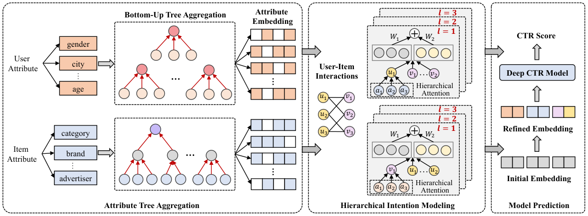
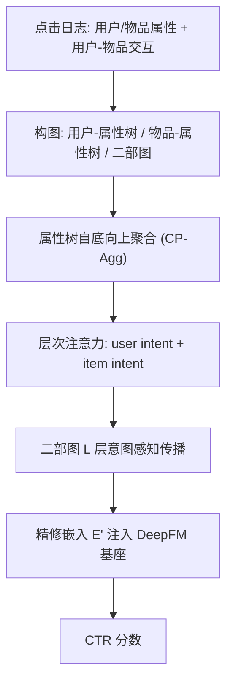
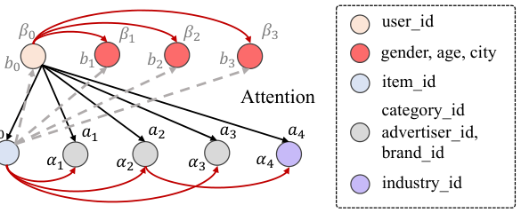

# HIEN: Hierarchical Intention Embedding Network for Click-Through Rate Prediction (层次意图嵌入网络)

- **会议/期刊**: SIGIR 2022
- **作者与机构**: Zuowu Zheng, Xiaofeng Gao, Guihai Chen (上海交通大学)；Changwang Zhang (腾讯)
- **推荐链路定位**: 精排（Embedding 层前置模块，可插入任意 CTR 网络）
- **研究方向**: CTR/CVR 预估与特征交叉 / 图神经网络推荐
- **论文原文**: [https://arxiv.org/abs/2206.00510v1](https://arxiv.org/abs/2206.00510v1)
- **开源代码**: 暂未开源

## TL;DR (1分钟核心速览)

现有 CTR 模型把 item 属性（advertiser、industry、brand）当作彼此独立的 ID one-hot 特征，丢失了属性之间的树状层级依赖；同时 DIN/DIEN 类兴趣建模只做"用户-物品"粒度，缺乏"用户对哪些属性敏感、物品因哪些用户属性被点击"的双向意图刻画。HIEN 把属性图拆解为属性树做自底向上聚合精修属性嵌入，再用层次注意力同时学习 user intent 与 item intent，最终把精修后的嵌入注入 DeepFM 等基座。在阿里、Tmall 与腾讯生产数据上按"前 7 天训练 / 次日测试"的时间切分评估，AUC 分别较最强基线 DG-ENN 提升 0.86%、0.76%、0.49%（LogLoss 降低 4.81%、2.08%、0.41%）。

## Background & Motivation (背景与核心矛盾)

- **主流范式**: CTR 界长期沿"Embedding & MLP"两条主线演进：一条是 FM/DeepFM/AutoInt+ 的高阶特征交叉，另一条是 DIN/DIEN/DSIN 的用户历史行为兴趣建模。
- **前人局限**: 其一，`advertiser_id`、`industry_id` 之间存在天然的父子归属关系，传统做法把它当同层 ID 特征，结构信息被抹平；其二，兴趣建模只看"用户点了什么"，无法回答"该用户是冲着品类还是价格点的"、"该物品是被何种年龄段用户点中的"，可解释性缺失。
- **核心洞察 (Key Insight)**: 属性本身语义与分布差异极大，直接套用 GCN/NGCF 的邻域卷积会把异构属性节点混在一起引入噪声；正确做法是只在**同一条属性树的父子边**上做自底向上聚合，保留各属性的固有特性。
- **本文切入点**: 把"结构精修"与"意图建模"放在 Embedding 层而非特征交叉层完成，从而可与任意现成 CTR 网络正交组合。

<figure class="paper-figure" markdown="span">
  <figcaption>图2：所提出框架HIEN的架构。属性树聚合考虑属性间的结构信息与关系依赖，其嵌入向量通过自底向上的属性树聚合进行细化。为了建模用户和物品对不同属性的意图，意图建模模块基于层次注意力和图神经网络设计。细化后的用户嵌入、物品嵌入和属性嵌入被输入深度CTR网络以产生最终分数。</figcaption>
</figure>

## Method (核心方法设计)

### 1. 整体框架 (Overall Architecture)

HIEN 由三个模块串联：先由点击日志构建用户-属性树 $G^t_u$、物品-属性树$G^t_v$（item 为叶节点、属性为父节点）及用户-物品二部图$G_{uv}$；随后在属性树上执行自底向上聚合，把父节点嵌入用子节点（含更深层孙属性）加权更新，得到精修属性嵌入$E'$中的$e'_{A_u}, e'_{A_v}$；接着在二部图上做$L$层传播，每层传播前先用层次注意力把精修后的属性嵌入按"意图权重$\times$固有重要性"加权汇入用户/物品节点嵌入，得到意图感知的$e'_u, e'_v$；最终整个精修嵌入集合$E'$ 被喂入 DeepFM 等基座得到 CTR 分数。训练端到端，与基座联合反向传播。

### 2. 关键设计拆解 (Key Designs)

1. **属性树自底向上聚合 + CP-Agg 聚合器**：常规 GCN 让中心节点同时吸收多类邻居，噪声大；HIEN 只沿树边聚合子节点。作者还对比了四种聚合器，最终采用的 CP-Agg 同时建模"中心-子节点"的乘积与拼接两类交互：$g(\boldsymbol{e}_h,\boldsymbol{e}_{C_h})=\sigma\big(\boldsymbol{W}_1\boldsymbol{e}_h+\sum_{i\in C_h}(\boldsymbol{W}_1\boldsymbol{e}_i+\boldsymbol{W}_2(\boldsymbol{e}_h\odot\boldsymbol{e}_i)+\boldsymbol{W}_3(\boldsymbol{e}_h\oplus\boldsymbol{e}_i))\big)$。直觉上 Element-wise 乘积捕捉属性共现强化信号，拼接保留原始语义，从而在不混叠异构属性的前提下放大父子交互。

2. **层次意图建模（双向意图 + 层级加权）**：以用户对物品属性的意图为例，物品嵌入不是属性嵌入的等权求和，而是 $\boldsymbol{e}^{(1)}_v = a_0\alpha_0\boldsymbol{e}^x_0 + a_1\alpha_1\boldsymbol{e}^x_1 + a_2(\alpha_2\boldsymbol{e}^x_2 + a_4\alpha_4\boldsymbol{e}^x_4) + a_3\alpha_3\boldsymbol{e}^x_3$。其中 $\alpha_i$是可学习的**固有重要性**（静态、全局），$a_i$是用户$u$对属性$x_i$的**动态注意力**，由个性化内积给出：$a_i(u,x_i)=\frac{\exp(\boldsymbol{e}^{(0)}_u\cdot\boldsymbol{e}^x_i)}{\sum_{x'\in A_v}\exp(\boldsymbol{e}^{(0)}_u\cdot\boldsymbol{e}^{x'})}$。关键在于式子中把子属性与父属性写进同一括号$\alpha_2\boldsymbol{e}^x_2+\alpha_4\boldsymbol{e}^x_4$，使树层级关系直接被注意力加权吸收，而非事后拼接。反向同理，物品对用户属性（gender/age/occupation）的意图由$b_i\beta_i$加权，$b_i(v,y_i)=\frac{\exp(\boldsymbol{e}^{(0)}_v\cdot\boldsymbol{e}^y_i)}{\sum_{y'\in A_u}\exp(\boldsymbol{e}^{(0)}_v\cdot\boldsymbol{e}^{y'})}$。

<figure class="paper-figure" markdown="span">
  <figcaption>图3：层次意图建模的示例。节点表示不同属性。红色箭头表示属性之间的关系和依赖，其中𝛼𝑖和𝛽𝑖衡量属性的固有重要性。黑色/灰色箭头表示对相应属性的用户意图和物品意图，其中𝑎𝑖和𝑏𝑖是建模意图时不同属性的动态分数。</figcaption>
</figure>

3. **训练目标、负采样与推理开销**：不做负采样，直接以日志曝光样本做点击二分类，损失为带 $L_2$的交叉熵$\mathcal{L}(\Theta)=-\frac{1}{|D|}\sum_{(x,y)\in D}\big(y\log\hat{y}+(1-y)\log(1-\hat{y})\big)+\lambda\|\Theta\|_2$。所有图结构在训练前离线一次性构建（静态图，无采样邻居），属性树聚合与$L$ 层传播只增加矩阵乘与内积开销，与 DG-ENN 等多层图传播相比计算量更小，可在线部署。

## Experimental Setup & Evaluation Protocol (实验设置与评估协议)

- **数据集与预处理**: 三个数据集均保留原始日志样本，不做 `5-core` 过滤（广告场景物品天然长尾）；Alibaba 正样本率仅 5.15%，属典型极度不平衡的广告点击分布。

| 数据集 | #Train | #Test | #Fields | #Features | #Items | 正样本率 |
| :--- | :---: | :---: | :---: | :---: | :---: | :---: |
| Alibaba | 5,544,213 | 660,694 | 16 | 1,657,981 | 512,431 | 5.15% |
| Tmall | 4,382,613 | 505,228 | 9 | 1,480,725 | 565,888 | 10.23% |
| Tencent | 5,240,498 | 873,604 | 17 | 1,248,065 | 347,206 | 13.00% |

- **数据划分与防穿越 (Splitting Strategy)**: 严格**全局时间戳切分**——Alibaba 用 5.06–5.12 七天训练、5.13 测试；Tmall 用"双 11"前六个月建模、当天测试；Tencent 前六天训练、第七天测试。避免了 CTR 场景中常见的随机切分穿越。
- **排名评测协议 (Ranking Protocol)**: 不采用排序协议，而是**全样本点级打分评估**：对测试集全部曝光日志逐条算 $\hat{y}$，计算 AUC 与 LogLoss（$\mathrm{AUC}=\frac{1}{N^+N^-}\sum_{x^+\in D^+}\sum_{x^-\in D^-}\mathbb{I}(f(x^+)>f(x^-))$）。这相当于无负采样的全量日志评估，比 Sampled Ranking 更贴近线上分布。
- **对比基线与超参设置**: 覆盖浅层 (LR/FM/FwFM)、深层 (DeepFM/AutoInt+/PNN)、兴趣 (DIN/DIEN/DSIN)、图模型 (GIN/Fi-GNN/DG-ENN) 四类。嵌入维度 $K=128$，MLP 三层 200/800/1（PReLU/PReLU/Sigmoid），Adagrad lr=0.001，batch 4096，每个实验跑 5 次取均值±标准差，并做 t-test（$p<10^{-6}$）。

## Key Experimental Results (实验关键数据)

### 1. 主实验对比 (Main Results)

| Model | Alibaba AUC | Alibaba LogLoss | Tmall AUC | Tmall LogLoss | Tencent AUC | Tencent LogLoss |
| :--- | :---: | :---: | :---: | :---: | :---: | :---: |
| LR | 0.6157 | 0.2638 | 0.8724 | 0.1985 | 0.7212 | 0.3668 |
| FwFM | 0.6427 | 0.2526 | 0.9075 | 0.1791 | 0.7335 | 0.3617 |
| DeepFM | 0.6594 | 0.2447 | 0.9184 | 0.1772 | 0.7370 | 0.3532 |
| AutoInt+ | 0.6508 | 0.2506 | 0.9126 | 0.1789 | 0.7313 | 0.3604 |
| DIN | 0.6523 | 0.2364 | 0.9155 | 0.1785 | 0.7394 | 0.3510 |
| DSIN | 0.6708 | 0.2308 | 0.9313 | 0.1684 | 0.7442 | 0.3477 |
| DG-ENN | 0.6740 | 0.2265 | 0.9396 | 0.1635 | 0.7489 | 0.3416 |
| **HIEN** | **0.6798** | **0.2156** | **0.9467** | **0.1601** | **0.7526** | **0.3402** |
| Improv. (vs. DG-ENN) | +0.86% | -4.81% | +0.76% | -2.08% | +0.49% | -0.41% |

### 2. 消融实验 (Ablation Study)

| 变体 | Alibaba AUC (Δ) | Tmall AUC (Δ) | Tencent AUC (Δ) |
| :--- | :---: | :---: | :---: |
| w/o user_agg | 0.6796 (-0.0002) | 0.9459 (-0.0008) | 0.7521 (-0.0005) |
| w/o item_agg | 0.6783 (-0.0015) | 0.9428 (-0.0039) | 0.7496 (-0.0030) |
| w/o user_intent | 0.6786 (-0.0012) | 0.9432 (-0.0035) | 0.7511 (-0.0015) |
| w/o item_intent | 0.6791 (-0.0007) | 0.9450 (-0.0017) | 0.7517 (-0.0009) |
| HIEN (full) | 0.6798 | 0.9467 | 0.7526 |

**聚合器对比**：CP-Agg (0.6798/0.9467/0.7526) > NGCF (0.6789/0.9461/0.7520) > LightGCN (0.6784/0.9457/0.7514) ≈ GCN (0.6781/0.9452/0.7506)。

### 3. 关键实验发现 (Key Findings)

1. **去掉物品属性树聚合是最大损伤**：三数据集 AUC 分别掉 0.0015/0.0039/0.0030，显著高于去掉用户属性树的 0.0002/0.0008/0.0005——说明广告场景中 item→category→advertiser→industry 这条层级链承载了最核心的结构信号，而用户属性本身近似扁平，树聚合收益有限。
2. **意图建模两项均不可拆**：去掉 user_intent 在 Tmall 掉 0.0035、去掉 item_intent 掉 0.0017，且都大于各自对应的"树聚合"损伤，证明"用户对哪些物品属性敏感"的动态注意力贡献超过了静态结构精修本身；LightGCN 式聚合反而因丢弃中心节点表示在广告稀疏图上劣于 NGCF，印证了本文"结构简单图不宜过度平滑"的判断。
3. **可作为通用插件带来二次增益**：将 HIEN 精修嵌入替换原输入后，DSIN 在 Alibaba/Tmall/Tencent 上 AUC 分别再涨 1.10%/0.72%/1.89%，DG-ENN 涨 1.14%/0.95%/1.43%，说明收益来自嵌入层而非与特定交叉网络的耦合；同时层数实验显示 HIEN-3 后增层收益边际化，三阶关系已足够。

## Highlights & Limitations (亮点、对比与审稿批判)

- **与代表作对比 (vs. Prior Work)**: 相比 DeepFM/AutoInt+ 把属性当同层 ID 做交叉，HIEN 显式引入属性层级先验；相比 DG-ENN/Fi-GNN 在整图上做卷积或节点交互，HIEN 把聚合限制在树边以避开异构属性噪声；相比 DIN/DIEN 只做用户侧行为注意力，HIEN 补上了 item intent 这一反向分支，并把层级结构直接写进注意力公式。
- **可迁移亮点**: ①"固有重要性 $\alpha_i$× 动态注意力$a_i$"的乘积式加权，可低成本迁移到任何需要对多字段做注意力的精排模型；②以 Embedding 精修模块形式插入现有基座、不改动主网络的做法，是工业侧最易落地的改造范式。
- **审稿级局限批判**: ①属性树需人工依据业务语义预先定义（谁是谁的父节点），层级错误会直接污染聚合，缺乏自动学树结构的能力；②静态全图构建在用户/物品规模膨胀时需离线重建，文中未给出图更新频率与内存开销分析；③对比基线多为 2020 年前模型，缺少与近年 Transformer-based CTR（如 DHEN、FAT 类）的对照，也未报告线上 A/B 的 CTR/收入增益。

## Rating (四维评分)

- **方法创新性 (Novelty)**: ⭐⭐⭐⭐ （把属性层级先验写进注意力括号内的做法简洁有效，但树聚合与双向注意力本质是已有组件的组合式创新，理论分析偏弱）
- **评估协议与实验扎实度 (Protocol & Experiments)**: ⭐⭐⭐⭐ （三个数据集含腾讯生产集、严格时间切分、5 次重复 + t-test，消融/聚合器/层数/兼容性四组实验齐备，唯缺点是无排序协议与线上 A/B）
- **写作与数学规范度 (Clarity & Rigor)**: ⭐⭐⭐⭐ （Eq.14 的层级括号写法直观，四个聚合器公式对比清晰；但 $\alpha_i$与$a_i$的符号在正文中偶有混用，图传播与树聚合共用$g(\cdot)$ 表述略含糊）
- **工业落地与复现价值 (Industrial & Practical Value)**: ⭐⭐⭐⭐ （即插即用插件在 DSIN/DG-ENN 上均有稳定增益，推理开销低；但未开源代码，属性树构建依赖业务人工先验，复现门槛中等）

