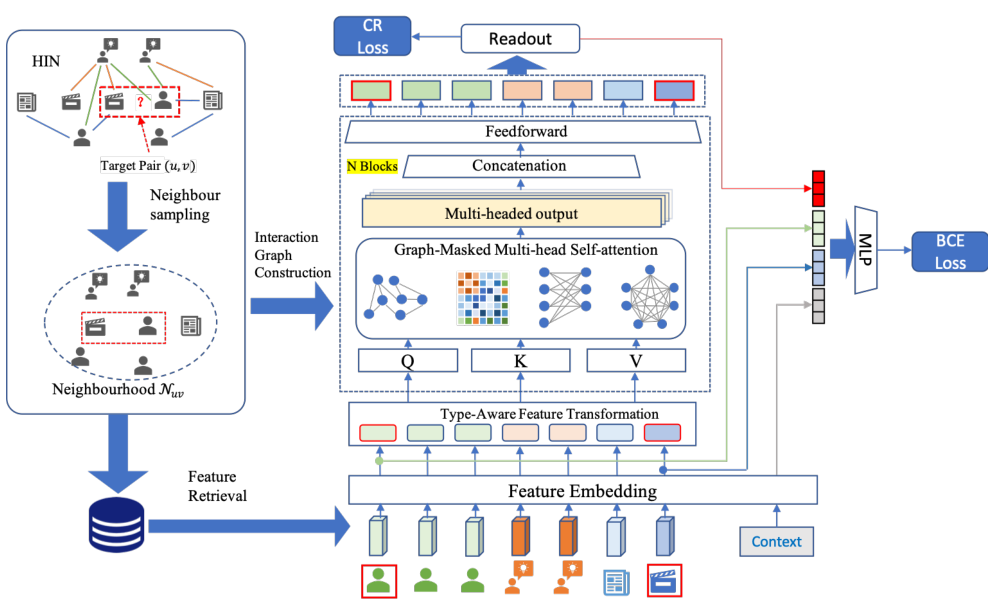
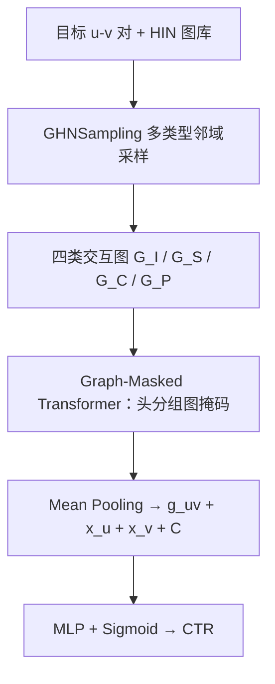
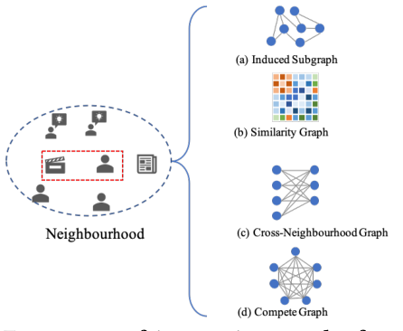

# Neighbour Interaction based Click-Through Rate Prediction via Graph-masked Transformer (基于图掩码 Transformer 的邻域交互点击率预估)

- **会议/期刊**: SIGIR 2022
- **作者与机构**: Erxue Min, Yu Rong, Tingyang Xu, Yatao Bian, Junzhou Huang, Peilin Zhao 等（腾讯 AI Lab / 微信开放平台 / 曼彻斯特大学 / UTA）
- **推荐链路定位**: 精排（CTR 预估）
- **研究方向**: CTR/CVR 预估与特征交叉 / 图神经网络与知识图谱推荐
- **论文原文**: [https://arxiv.org/abs/2201.13311v2](https://arxiv.org/abs/2201.13311v2)
- **开源代码**: [https://github.com/qwerfdsaplking/F2R-HMT](https://github.com/qwerfdsaplking/F2R-HMT)

## TL;DR (1分钟核心速览)

现有 CTR 模型（DIN/DIEN/DMR、以及 GAT/NIRec）只挖用户直接交互过的物品，受曝光偏置与稀疏性双重限制，冷门用户兴趣挖掘不全。本文把 CTR 改写为异构信息网络（HIN）上的「局部邻域连边预测」：对每个目标 $u\text{-}v$ 对先做 GHNSampling 采样多类型邻居，再构造自然/相似/跨邻域/全连接四类交互图，用**图掩码 Transformer (GMT)** 将图先验注入不同注意力头，并加一致性正则缓解采样噪声。在微信（0.8B 节点/46B 边）与 Tmall 三个工业数据集上，AUC 较最强 Transformer 基线相对提升 1.10%/0.96%/0.70%，线上 10 天 A/B 平均 CTR **+21.9%**。

## Background & Motivation (背景与核心矛盾)

- **主流范式**: 以 DIN/DIEN/DSIN/DMR 为代表，把用户历史点击序列作为输入，用注意力/Gru/Transformer 提取兴趣；另一支是 GAT/RGCN/HAN 聚合目标节点的子图嵌入。
- **前人局限**: ① 用户行为稀疏（inactive user）时序列表征质量崩坏，冷启动明显；② 受推荐系统**曝光偏置**限制，用户直接交互过的物品并不能穷尽潜在兴趣。
- **核心洞察 (Key Insight)**: 微信视频号场景中，用户点过哪些文章、订阅过哪些公众号、公众号又发布过哪些视频，这些**跨类型间接关系**同样是判断「他会不会点这条视频」的强信号；而传统 GNN 将邻居压成单向量，存在 early-summarization 问题，丢失邻域内部的细粒度交互。
- **本文切入点**: 把 HIN 中的 $u\text{-}v$ 局部邻域整体送入深度自注意力层，用四类图结构掩码规范注意力头，并显式保留目标节点自身特征。

## Method (核心方法设计)

### 1. 整体框架 (Overall Architecture)

给定目标 $u\text{-}v$对，先在预构建 HIN（User/Video/Article/OAccount 四类节点，click/publish/subscribe 三类边）上做 **GHNSampling**：从 1-hop 起逐层贪心扩展，每类节点按预算$s_k$采样，候选节点被选中概率正比于它与已采样集合$\mathcal{C}$的连边数$f_t$，以「近邻优先 + 高拓扑连接优先」拿到约 200 个节点。随后构造四类交互图并送入 **Graph-Masked Transformer**，最终把邻域池化向量$g_{uv}$与目标节点自身特征$x_u,x_v$及上下文特征$\mathcal{C}$ 拼接，经 MLP+Sigmoid 输出 CTR。

<figure class="paper-figure" markdown="span">
  <figcaption>图2：NI-CTR概览。给定目标用户-物品对，我们首先在HIN中进行邻居采样以获取关联邻居。然后检索对应实体特征，并基于邻居构建交互图。之后，应用Graph-Masked Transformer编码特征信息和拓扑信息。结合二元交叉熵损失和一致性正则化损失来优化网络。</figcaption>
</figure>

### 2. 关键设计拆解 (Key Designs)

**① 四类交互图：把邻域内显式与隐式关系全部显式化**。仅仅依赖 HIN 原边（Induced Graph $\mathcal{G}^I$）会丢失标签等语义相似性、且缺少跨邻域交互。本文追加：相似图$\mathcal{G}^S$用共享特征组的 cosine 相似度$\text{sim}(i,j)$构图（加权或$k$-NN）；跨邻域图$\mathcal{G}^C=\{(\mathcal{N}_u,\mathcal{N}_v)\}$显式建模「用户侧邻居 × 物品侧邻居」的全部配对（重叠节点按连边数归属一侧）；全集图$\mathcal{G}^P$ 放弃结构先验。四图分别对应邻域内「实边关系/特征相似/跨侧交互/自由交互」四种视角。

<figure class="paper-figure" markdown="span">
  <figcaption>图3：用于邻域建模的四类交互图，包括自然交互、特征相似性、跨邻域交互和所有成对交互。</figcaption>
</figure>

**② Graph-Masked Transformer：按头分组注入不同图先验**。与 Graphormer 不同，本文不改 embedding，而是在注意力打分上乘掩码 $\lambda = M_{ij}$：$e_{ij} = f_m\left(\frac{(Qh_i)^\top(Kh_i)}{\sqrt{d}}, M_{ij}\right)$，其中$f_m(x,\lambda)=\lambda x$（$\lambda\neq 0$）或$-\infty$（$\lambda=0$），把$H$个注意力头均分为四组，分别用$\mathcal{G}^I,\mathcal{G}^S,\mathcal{G}^C,\mathcal{G}^P$的邻接矩阵掩码。相比软注意力，这种「硬先验 + 头分工」把拓扑结构显式注入到不同表征子空间，避免浅层 GNN 的过度压缩；节点侧先做 type-aware 线性变换$h_i = \text{Linear}_{t(i)}(x_i)$ 对齐异构特征空间。

**③ 一致性正则与训练目标**。邻域采样随机导致同一 $u\text{-}v$对在不同 epoch 得到不同$g_{uv}$。本文对每个实例采样$S$次，令$\mathcal{L}_{BCE} = \frac{1}{S}\sum_{s} \text{BCE}(\hat{y}^s_{uv},y_{uv})$，并加$\mathcal{L}_{CR}=\frac{1}{S}\sum_{s}\frac{1}{d_g}\|\hat{g}^s_{uv}-\bar{g}_{uv}\|_2$（$\bar{g}_{uv}$为$S$次的均值嵌入），总损失$\mathcal{L}=\mathcal{L}_{BCE}+\gamma\mathcal{L}_{CR}$。负采样沿用工业日志的真实曝光负样本（Tmall 为 1:10 采样）。推理复杂度$O(n^2 d)$（$n\approx 100\sim200$），相似图计算$O(n^2\hat{d}_t)$ 可用稀疏库加速。

## Experimental Setup & Evaluation Protocol (实验设置与评估协议)

- **数据集与预处理**: 三个数据集均为工业全量点击日志、无 5-core 过滤；微信侧构建 HIN 覆盖 14 天日志：

| 数据集 | #Users | #Items(Video) | #Interactions | 稀疏度/密度 | 特征/场景说明 |
| :--- | :---: | :---: | :---: | :---: | :--- |
| WC_FULL | 17M | 0.5M | 20M×2（Day1/Day2） | 极高稀疏 | 微信视频号，HIN 总 0.8B 节点/46B 边 |
| WC_SMALL | 10M（日志量） | - | 10M×2（Day1 前/后 12h） | 高压 | 同 WC，短周期快速验证 |
| Tmall | - | - | 6 个月购物日志 | 稀疏 | 双 11 前一周训练→双 11 当天测试，每用户随机 10 未点击作负例 |

- **数据划分与防穿越 (Splitting Strategy)**: 均为**全局时间戳切分**（D1 训练 / D2 测试；Tmall 双 11 前一周 → 双 11 当天），严格防穿越。
- **排名评测协议 (Ranking Protocol)**: 微信侧无负采样、直接在全量曝光日志上算 `Full-Ranking` AUC/Logloss；Tmall 用 `Sampled Ranking`（正:负 = 1:10）。
- **对比基线与超参设置**: 覆盖四类 13 个基线（FI: DeepFM/xDeepFM；UIM: DIN/DIEN/DMR；GNN: GraphSAGE/GAT/RGCN/HAN/NIRec；Transformer: Transformer/Graph-Trans/Graph-BERT）。统一 $d=100$、batch=128、dropout 0–0.9、子图节点上限 50/100/200/400、$\gamma\in\{0.01,0.1,1\}$网格搜参；正文未报告显著性检验（$p$ 值）。

## Key Experimental Results (实验关键数据)

### 1. 主实验对比 (Main Results)

| 类别 | 模型 | WC_FULL AUC | WC_FULL Logloss | WC_SMALL AUC | WC_SMALL Logloss | Tmall AUC | Tmall Logloss |
| :--- | :--- | :---: | :---: | :---: | :---: | :---: | :---: |
| FI | DeepFM | 0.7009 | 0.2379 | 0.7022 | 0.2365 | 0.9012 | 0.1999 |
| UIM | DIN | 0.7042 | 0.2345 | 0.7073 | 0.2320 | 0.9034 | 0.1954 |
| UIM | DMR | 0.7098 | 0.2280 | 0.7089 | 0.2310 | 0.9065 | 0.1926 |
| GNN | GAT | 0.7130 | 0.2214 | 0.7145 | 0.2210 | 0.9245 | 0.1776 |
| GNN | NIRec | 0.7149 | 0.2200 | 0.7167 | 0.2197 | 0.9246 | 0.1775 |
| Trans | Transformer | 0.7200 | 0.2174 | 0.7260 | 0.2075 | 0.9339 | 0.1700 |
| Trans | Graph-BERT | 0.7211 | 0.2165 | 0.7290 | 0.2054 | 0.9345 | 0.1693 |
| 本文 | **GMT** | **0.7290** | **0.2103** | **0.7360** | **0.2014** | **0.9410** | **0.1603** |
| — | Improv.% vs 次优 | **+1.10%** | **−2.86%** | **+0.96%** | **−1.95%** | **+0.70%** | **−5.32%** |

### 2. 消融实验 (Ablation Study)

| 配置（WC_FULL） | AUC | Logloss | ΔAUC |
| :--- | :---: | :---: | :---: |
| Full（四图 + CR） | **0.7290** | **0.2103** | — |
| w/o $\mathcal{G}^I$（自然边） | 0.7243 | 0.2132 | −0.0047 |
| w/o $\mathcal{G}^S$（相似图） | 0.7252 | 0.2126 | −0.0038 |
| w/o $\mathcal{G}^C$（跨邻域） | 0.7237 | 0.2149 | −0.0053 |
| w/o $\mathcal{G}^P$（全连接） | 0.7263 | 0.2123 | −0.0027 |
| w/o CR（一致性正则） | 0.7274 | 0.2116 | −0.0016 |
| 仅保留 $\mathcal{G}^C$（单图掩码） | 0.7211 | 0.2154 | −0.0079 |
| 仅保留 $\mathcal{G}^P$（单图掩码） | 0.7203 | 0.2157 | −0.0087 |
| 裸 Transformer（无图/无 CR） | 0.7200 | 0.2174 | −0.0090 |

### 3. 关键实验发现 (Key Findings)

1. **Transformer 类整体优于 FI/UIM/GNN 一档**：同为无图加强版，裸 Transformer（0.7200）已比最强 UIM DMR（0.7098）高约 1.44%，说明深自注意力对异构邻域特征的交互学习是关键；GMT 再加四图掩码后 AUC 0.7290（+0.90 vs 裸 Transformer），证明拓扑先验注入的边际增益独立于深层架构。
2. **跨邻域交互比域内连接更「值钱」**：单图掩码消融里 $\mathcal{G}^C$（0.7211）优于$\mathcal{G}^P$（0.7203）/$\mathcal{G}^S$（0.7179）/$\mathcal{G}^I$（0.7180），而移除任一图均掉点（缺$\mathcal{G}^C$ 掉 0.0053 最狠），说明「用户侧邻居 × 物品侧邻居」的成对交互是目标对连边的核心桥接信号。
3. **冷启动明确受益于 HIN 跨类型信息**：图 8 显示，用户历史视频 ≤5 条时 GMT 相对 DIN 的 AUC 相对提升约 7%，随历史数增至 35 条下降至约 4%；线上微信 10 天 A/B 相对 DeepFM/GBDT/DIN/DIEN/DeepMCP/DMR 平均 CTR **+21.9%**，验证间接关系可补偿直接交互的曝光不足。

## Highlights & Limitations (亮点、对比与审稿批判)

- **与代表作对比 (vs. Prior Work)**: 相较 DIN/DMR 只看用户正向序列，本文把「文章点击、公众号订阅」等跨域边也引入预测；相较 HetGNN/HAN 把邻域压成单向量、Graph-BERT/Graph-Trans 只支持同构单边图，本文保留完整邻域节点集并用四图掩码让**不同注意力头分担不同关系视角**，避免了 early-summarization。
- **可迁移亮点**: ① **头分组掩码**技巧极轻量（仅改 $e_{ij}=\lambda M_{ij}$），可无缝搬到多行为/多场景 Transformer 精排模型里；② 一致性正则抑制采样方差，对任何随机负采样/邻居采样的鲁棒化都通用；③ S4 特征策略揭示「高维稀疏特征宜作相似图连边、不宜入节点特征」，是工业落地实用 trick。
- **审稿级局限批判**: ① 每个请求需实时做 200 节点邻域采样 + $O(n^2d)$自注意力，单请求延迟与内存开销论文未报告、工业吞吐成疑；② \(\mathcal{L}_{CR}\) 依赖每样本$S$次重采样，训练成本线性膨胀；③ 无公共数据集（微信数据仅承诺「未来放出」），且实验未做显著性检验，\(\gamma\)、$k$ 与相似图加权/kNN 的选择对性能影响未系统报告，复现门槛高。

## Rating (四维评分)

- **方法创新性 (Novelty)**: ⭐⭐⭐⭐ （四类交互图 + 头分组图掩码把异构拓扑先验注入 Transformer，思路清晰且有别于 Graphormer，但缺少理论/谱分析支撑，更多是经验性结构设计）
- **评估协议与实验扎实度 (Protocol & Experiments)**: ⭐⭐⭐⭐ （两个亿级工业数据集 + Tmall + 10 天线上 A/B + 冷启动分桶，覆盖充分；但无显著性检验、清洗与放出的公共数据集缺失，复现性打折）
- **写作与数学规范度 (Clarity & Rigor)**: ⭐⭐⭐⭐ （模块拆解清楚、复杂度有量化、伪代码完整；一致性正则中 $\bar{g}$ 的记法与 batch 内均值语义存在歧义，容易误读）
- **工业落地与复现价值 (Industrial & Practical Value)**: ⭐⭐⭐⭐⭐ （已在微信视频号亿级用户上线、日均 4000 万样本持续训练、线上 +21.9% CTR，工程细节与开源 demo 都较完整）

