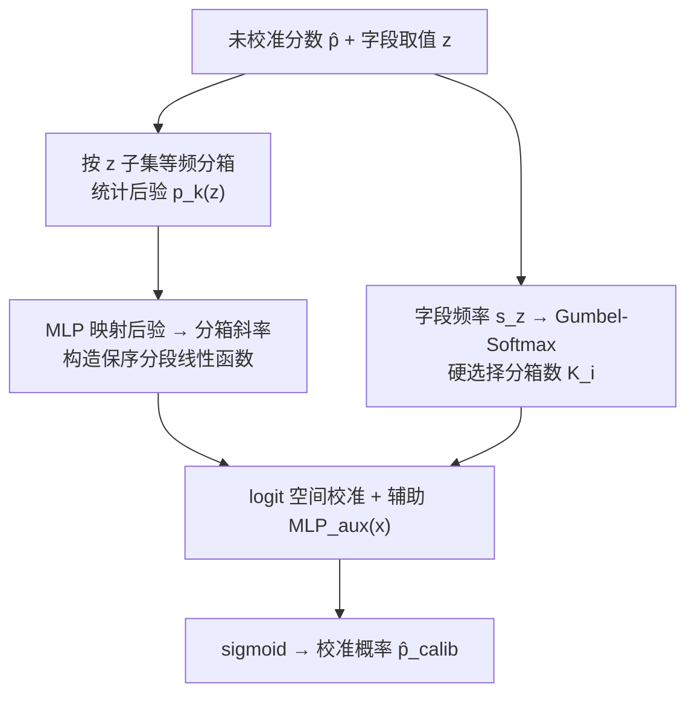
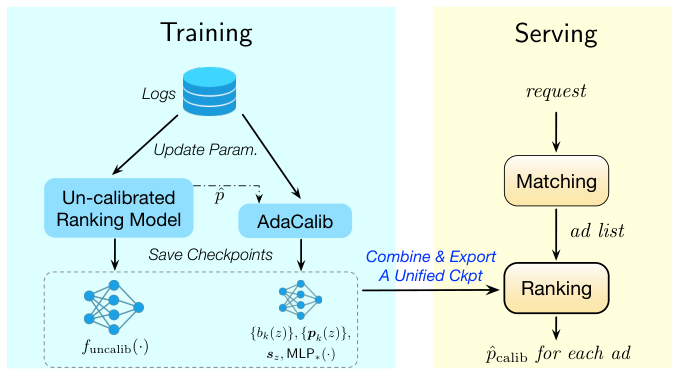
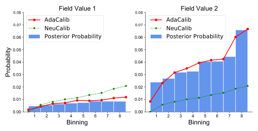

# Posterior Probability Matters: Doubly-Adaptive Calibration for Neural Predictions in Online Advertising (后验概率至关重要：面向在线广告神经预测的双自适应校准)

- **会议/期刊**: SIGIR 2022 (short paper)
- **作者与机构**: Penghui Wei, Weimin Zhang, Ruijie Hou, Jinquan Liu, Shaoguo Liu, Liang Wang, Bo Zheng（阿里巴巴）
- **推荐链路定位**: 精排（预估后处理 / 校准，直接服务 eCPM 计费与出价）
- **研究方向**: CTR/CVR 预估与特征交叉 / 去偏公平与工业架构
- **论文原文**: [https://arxiv.org/abs/2205.07295v2](https://arxiv.org/abs/2205.07295v2)
- **开源代码**: 暂未开源

## TL;DR (1分钟核心速览)

广告计费要求预估值等于真实后验概率，但模型只用 0/1 标签训练，且不同字段取值（如 item ID、用户活跃度档位）的后验差异极大，全局校准必然"此高彼低"。本文提出 AdaCalib：为每个字段取值学一条由**分箱后验统计**参数化的保序分段线性校准函数（函数自适应），并用字段频率统计经 Gumbel-Softmax 硬选择分箱数（分箱自适应）。在 12 亿曝光工业 CTR、2 亿点击工业 CVR 与 8000 万公开数据上，Field-RCE 相对最优基线 NeuCalib 分别降 10.4%、13.2%、69.7%，线上 A/B 的 CVR +5.05%、GMV +5.47%。

## Background & Motivation (背景与核心矛盾)

- **主流范式**: 校准作为后处理，分三类——分箱类（Histogram Binning、Isotonic Regression）、参数缩放类（Platt/Gamma Calibration）、混合类（SIR、NeuCalib）。NeuCalib 首次把样本特征作为辅助输入做字段级校准。
- **前人局限**: ① 分箱/缩放类只把未校准分数 $\hat{p}$ 当唯一输入，对字段无感知，而同一模型在不同字段取值子集上的平均响应率可差数倍，导致一个取值被低估、另一个被高估；② NeuCalib 虽引入特征，但字段信息只作用于**输出端的辅助 MLP**，并未进入校准函数本身的参数化，且分箱数对所有字段取值固定为 10，低频取值分箱内样本过少、后验统计不可靠。
- **核心洞察 (Key Insight)**: 校准的本质是逼近"条件后验" $\mathbb{E}[y\mid \hat{p}, z]$。既然分箱内的平均响应率就是该后验的经验估计，那么它不应只用于打分，而应直接**决定校准函数的斜率**；同时后验估计的方差随样本量变化，故分箱粒度必须随字段频率自适应。
- **本文切入点**: 把"函数自适应 + 分箱自适应"耦合进一个可端到端训练的轻量网络，与预估模型 checkpoint 合并导出，线上零额外模块。

## Method (核心方法设计)

### 1. 整体框架 (Overall Architecture)

输入为已训练模型给出的未校准分数 $\hat{p}$与样本的字段取值$z$。训练阶段（用$\mathcal{D}_{train}\cup\mathcal{D}_{dev}$）先按$z$划分子集，在子集内按$\hat{p}$升序做等频分箱得到边界$\{b_k(z)\}$，并统计每箱后验$\boldsymbol{p}_k(z)$（平均响应率 + 响应数）；随后 MLP 把相邻箱的后验映射为斜率，构成该$z$专属的分段线性保序函数。并行的$n$组候选分箱数各自产生一个校准分数，由字段频率$s_z$经 Gumbel-Softmax 硬选择加权融合。校准在 logit 空间进行，可叠加辅助项$\mathrm{MLP}_{aux}(x)$ 以不损排序能力，最后过 sigmoid 输出。推理时把校准网络与预估模型合并为单一 checkpoint。

<figure class="paper-figure" markdown="span">
  <figcaption>图 2：AdaCalib 的训练与服务。</figcaption>
</figure>

### 2. 关键设计拆解 (Key Designs)

1. **后验统计参数化的保序函数族（函数自适应）**：痛点是把斜率当自由可学参数会过拟合、丢排序；本文让斜率由后验决定：
$$\hat{p}_{calib}=\frac{\mathrm{MLP}(\boldsymbol{p}_{k+1}(z))-\mathrm{MLP}(\boldsymbol{p}_{k}(z))}{b_{k+1}(z)-b_k(z)}\left(\hat{p}-b_k(z)\right)+\mathrm{MLP}(\boldsymbol{p}_k(z)),\ \ b_k(z)\le\hat{p}<b_{k+1}(z)$$
因后验随分数单调（高分段响应率更高），分子天然为正，斜率非负即保序；MLP 只负责把离散化的后验 ID 嵌入映射到概率空间，参数极少、表达力却强于纯查表。直觉上它等价于"用数据说话的可微等频保序回归"。

2. **字段频率驱动的自适应分箱（分箱自适应）**：高频取值样本充足可分 20 箱获得细粒度后验，低频取值分 5 箱避免单箱方差爆炸。做法是维护 $n$个候选分箱数$\{K_1,\dots,K_n\}$对应的函数族，用频率统计$s_z$（样本数 + 字段 ID 嵌入）打分后经 Gumbel-Softmax 近似硬选：
$$\alpha_i=\frac{\exp((\log\hat{\alpha}_i+g_i)/\tau)}{\sum_j\exp((\log\hat{\alpha}_j+g_j)/\tau)},\quad g_i=-\log(-\log u_i),\ u_i\sim U(0,1)$$
硬选择的动机是分箱数本质是离散超参，软加权会混合不同粒度的后验、反而模糊；Gumbel 噪声保留可微性使选择能被端到端优化。

<figure class="paper-figure" markdown="span">
  <figcaption>图 3：AdaCalib 与 NeuCalib 的校准函数。</figcaption>
</figure>

3. **训练目标、负采样与推理效率**：总损失为各候选分支的交叉熵 + 单调性惩罚（无负采样，纯二分类全样本训练）：
$$\mathcal{L}_{AdaCalib}=\sum_{i=1}^{n}\sum_{k}\Big[\ell(\hat{p}^{i}_{calib},y)+\max\{\mathrm{MLP}(\boldsymbol{p}_k(z))-\mathrm{MLP}(\boldsymbol{p}_{k+1}(z)),0\}\Big]$$
推理仅为一个浅层 MLP + 查表，且与预估模型合并部署，**无独立校准服务、无额外 RTT**；相较两阶段"先预测再校准"消除了线上双模型一致性维护成本。

## Experimental Setup & Evaluation Protocol (实验设置与评估协议)

- **数据集与预处理**: 无 5-core 过滤，全量日志；公开数据为阿里点击日志。

| 数据集 | 规模 | 校准字段 Z | 字段取值数 | 划分说明 |
| :--- | :---: | :--- | :---: | :--- |
| CVR 工业 | 2 亿点击 | item ID | 542 | 前 60 天 train / 7 天 dev / 7 天 test |
| CTR 工业 | 12 亿曝光 | item ID | 969 | 前 5 天 / 第 6 天 / 第 7 天 |
| CTR 公开 | 8000 万曝光 | user group ID | 13 | 原训练集按 1:1 切 train/dev |

- **数据划分与防穿越 (Splitting Strategy)**: 工业集采用**全局时间戳切分**（严格三段，dev 不参与 test）；公开集因无时间戳，退化为比例划分，存在轻微穿越风险。
- **排名评测协议 (Ranking Protocol)**: 校准任务不做采样排序，测试集**全量打分（Full Scoring，无负采样、无候选截断）**；主指标 Field-RCE（字段级相对校准误差，分母为该字段子集的真实响应数，衡量相对偏差）、Field-AUC（加权 AUC，检验校准是否损伤字段内排序），辅以 LogLoss / AUC。
- **对比基线与超参设置**: HistoBin、IsoReg、GammaCalib、SIR、NeuCalib 五类代表方法；未校准模型为 4 层全连接；基线分箱数经验取 10，AdaCalib 候选集 CVR 取 $\{5,10,20\}$、CTR 取$\{2,4,8\}$；所有校准器均在$\mathcal{D}_{train}\cup\mathcal{D}_{dev}$上训练；显著性用配对 t 检验$p<0.05$。

## Key Experimental Results (实验关键数据)

### 1. 主实验对比 (Main Results)

| 方法 | CVR Field-RCE↓ | CVR Field-AUC↑ | CTR-ind Field-RCE↓ | CTR-ind Field-AUC↑ | CTR-pub Field-RCE↓ | CTR-pub AUC↑ |
| :--- | :---: | :---: | :---: | :---: | :---: | :---: |
| No Calib. | 0.3311 | 0.7833 | 0.2592 | 0.5879 | 0.3258 | 0.5765 |
| HistoBin | 0.3060 | 0.7833 | 0.2537 | 0.5878 | 0.0452 | 0.5765 |
| IsoReg | 0.2329 | 0.7833 | 0.2538 | 0.5877 | 0.0430 | 0.5765 |
| GammaCalib | 0.2095 | 0.7833 | 0.2540 | 0.5878 | 0.0394 | 0.5765 |
| SIR | 0.2579 | 0.7833 | 0.2532 | 0.5878 | 0.0428 | 0.5765 |
| NeuCalib | 0.1920 | 0.7833 | 0.1815 | 0.5888 | 0.0485 | 0.5903 |
| **AdaCalib** | **0.1666** | **0.7843** | **0.1626** | **0.5899** | **0.0147** | **0.5905** |
| Improv. vs best | −13.2% | +0.13% | −10.4% | +0.19% | −69.7% | +0.03% |

### 2. 消融实验 (Ablation Study)

| AdaCalib 变体（CVR 任务） | Field-RCE | Field-AUC |
| :--- | :---: | :---: |
| Full（后验引导 + 自适应函数 + 自适应分箱 + 辅助 MLP） | **0.1666** | **0.7843** |
| w/o 辅助 $\mathrm{MLP}_{aux}(x)$ | 0.1778 | 0.7828 |
| w/o 自适应分箱（固定 K） | 0.1946 | 0.7827 |
| w/o 自适应函数（全局分箱，非字段级） | 0.2120 | 0.7828 |
| w/o 后验引导（斜率自由学） | 0.2348 | 0.7833 |

### 3. 关键实验发现 (Key Findings)

1. **字段级建模是主要增益来源，后验引导次之**：移除字段自适应（退回全局分箱）使 Field-RCE 从 0.1666 涨到 0.2120（+27.3%），而移除后验引导涨到 0.2348（+40.9%）——后者甚至比 NeuCalib 的 0.1920 更差，说明"字段级 + 后验参数化"必须成对出现，单给字段信息而不约束斜率反而过拟合。
2. **自适应分箱确实按数据量分配粒度**：将字段子集按正样本数排序分 10 组后，正样本最少组几乎全选 5 箱，最多组显著偏向 20 箱；消融上固定 K 使 Field-RCE 恶化 16.8%，印证"低频取值细分箱 = 高方差后验"的诊断。
3. **校准几乎不损排序，且公开集上分箱类方法存在阈值效应**：所有方法 Field-AUC 波动 <0.3%，AdaCalib 因辅助 MLP 反而略升（0.7833→0.7843）；值得注意的是公开集 LogLoss 上 NeuCalib（0.1646）略优于 AdaCalib（0.1653），说明 Field-RCE 与 LogLoss 在极端不均衡（13 个粗粒度用户组）下并不完全同向。

## Highlights & Limitations (亮点、对比与审稿批判)

- **与代表作对比 (vs. Prior Work)**: 相比 IsoReg/SIR 这类纯分箱方法，AdaCalib 用 MLP 参数化斜率获得表达力并支持端到端；相比 NeuCalib，本文把字段信息从"输出端辅助支路"前移到"校准函数参数本身 + 分箱粒度"，是真正的字段级函数族而非单一函数加特征扰动；相比 GammaCalib 的强分布假设，本文不假设任何参数分布族。
- **可迁移亮点**: ①"后验统计作为可微参数化输入"可迁移到 CVR 延迟反馈纠偏、多任务概率一致性对齐；②用字段频率 + Gumbel-Softmax 做离散超参的样本级自适应选择，可直接复用到分桶数、序列长度、量化比特等场景。
- **审稿级局限批判**: ①校准器在 $\mathcal{D}_{train}\cup\mathcal{D}_{dev}$ 上训练，dev 与 test 时间相邻，存在分布贴近带来的乐观偏差，且公开集仅按 1:1 随机切分，穿越风险未讨论；②后验统计依赖历史日志的曝光分布，对冷启动/新 item（取值首次出现）无字段子集可用，作者亦在结论中承认数据稀疏下待改进；③分箱边界与后验需离线预计算并在线上同步更新，日志分布漂移时的更新频率与陈旧代价未做敏感性分析。

## Rating (四维评分)

- **方法创新性 (Novelty)**: ⭐⭐⭐⭐ （把后验统计从"打分"改造为"斜率参数"的思路简洁有效，双自适应机制互补，但仍是分箱+缩放的混合范式改良）
- **评估协议与实验扎实度 (Protocol & Experiments)**: ⭐⭐⭐⭐ （12 亿/2 亿/8000 万三级数据 + 5 个 SOTA 基线 + 显著性检验 + 线上 A/B，惟公开集划分偏弱）
- **写作与数学规范度 (Clarity & Rigor)**: ⭐⭐⭐⭐ （Field-RCE 定义清晰、公式与单调性约束推导完整，5 页短文对 Gumbel 选择的理论必要性论证略简）
- **工业落地与复现价值 (Industrial & Practical Value)**: ⭐⭐⭐⭐⭐ （与预估模型合并 checkpoint、线上零额外模块、CVR +5.05%/GMV +5.47%，工程可复制性极高；未开源为唯一遗憾）

