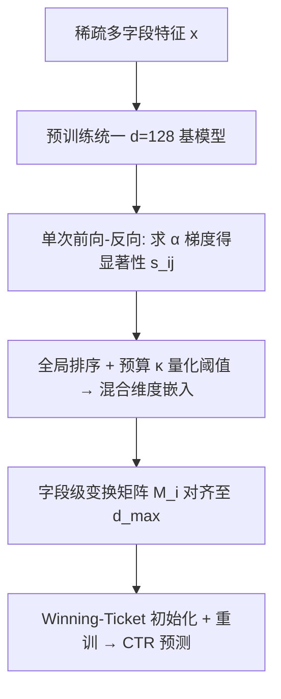
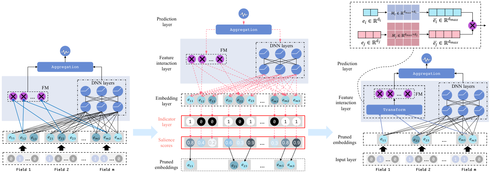

# Single-shot Embedding Dimension Search in Recommender System (推荐系统中的单次嵌入维度搜索)

- **会议/期刊**: SIGIR 2022
- **作者与机构**: Liang Qu、Hongzhi Yin（昆士兰大学）；Yonghong Ye、Lixin Zhang（腾讯微信）；Ningzhi Tang、Yuhui Shi（南方科技大学）
- **推荐链路定位**: 精排（CTR 预估模型的嵌入层压缩，属于模型侧特征表征优化）
- **研究方向**: CTR/CVR 预估与特征交叉 / 工业级架构与效率
- **论文原文**: [https://arxiv.org/abs/2204.03281v2](https://arxiv.org/abs/2204.03281v2)
- **开源代码**: 暂未开源

## TL;DR (1分钟核心速览)

现代深度推荐模型给所有特征字段统一分配嵌入维度 $d$（常为 128），既浪费显存又让低频特征过拟合。SSEDS 把「嵌入维度搜索」化为「嵌入维度剪枝」：借用 SNIP 的梯度显著性准则，仅用**一次前向-反向**就为每个字段的每一维打分，按参数预算$\kappa$ 全局排序裁剪，再用字段级变换矩阵对齐维度并重训。在 Criteo/Avazu 的 8:1:1 随机划分、AUC 协议下，砍掉 90% 嵌入参数仍比 DeepFM(128) 高 1.7‰/4.3‰ AUC，微信订阅号 7 天 A/B 提升约 4% CTR。

## Background & Motivation (背景与核心矛盾)

- **主流范式**: FM/DeepFM/Wide&Deep 等特征交叉模型把每个字段的 one-hot 映射为统一 $d$维嵌入$e_i=V_ix_i$，再做内积/DNN 交叉。
- **前人局限**: ①NAS/HPO 路线（NIS、ESAPN、AutoDim、DNIS、AutoEmb）需预设候选维度搜索空间，且策略网络或 DARTS 反复迭代，代价高；②剪枝路线（PEP、ATML、Deeplight）引入可学习阈值 mask，需**交替优化阈值与模型参数**，训练慢且稀疏度不可严格可控。
- **核心洞察 (Key Insight)**: 嵌入表占据模型 90% 以上参数，且字段显著性服从**幂律分布**——极少数维度对损失影响大，绝大多数近乎冗余；因此「哪些维度该留」可由其对损失的一阶影响直接量化，无需训练额外控制器。
- **本文切入点**: 用一次 mini-batch 的梯度幅值替代逐维 mask 的损失差分，实现「单次剪枝 + 维度对齐 + 重训」三段式轻量流水线，且与基模型无关。

## Method (核心方法设计)

### 1. 整体框架 (Overall Architecture)

三阶段闭环：**预训练**——按标准流程训练统一 $d=128$的基模型（FM/DeepFM/W&D），获得有表达力的$\hat{V},\hat{\Theta}$；**单次剪枝**——抽取一个 mini-batch，对指示矩阵$\alpha$求一次梯度得到全体$(i,j)$的显著性分数，按降序全局排序，依预算$\kappa$保留高显著性维度，得到混合维度嵌入$\bar{V}=\{\bar{V}_1,\dots,\bar{V}_q\}$（$d_i$可为 0，等价于删除整个字段）；**重训**——为各字段加字段级变换矩阵$M_i$把维度对齐到$d_{\max}$，用剪枝后的嵌入作为「中奖彩票」初始化，端到端重训瘦身模型。

<figure class="paper-figure" markdown="span">
  <figcaption>图1：SSEDS 概览。a）预训练过程使用统一维度嵌入训练传统基础模型。b）单次剪枝过程识别每个字段各维度的显著性分数，并输出混合维度嵌入。c）重训练过程对齐不同字段的维度，并以标准方式重新训练新的轻量模型。</figcaption>
</figure>

### 2. 关键设计拆解 (Key Designs)

1. **梯度显著性准则（一次反向替代 $md$次前向）**：逐维 mask 计算$\Delta\mathcal{L}_{i,j}$需$m\times d$次前向，不可行。引入与$\hat{V}$同形的二值指示层$\alpha$，将约束问题写为$\min \mathcal{L}(\hat{V}\odot\alpha,\hat{\Theta})$s.t.$\|\alpha\|_0<\kappa\|V\|_0$，并把$\alpha$松弛到$[0,1]$，在驻点$\alpha=\mathbf{1}$ 用梯度近似损失差分：

$$g_{i,j}=\frac{\partial\mathcal{L}(\hat{V}\odot\alpha,\hat{\Theta};\mathcal{D}_b)}{\partial\alpha_{i,j}}\Big|_{\alpha=\mathbf{1}},\qquad s_{i,j}=\frac{|g_{i,j}|}{\sum_{i'}\sum_{j'}|g_{i',j'}|}$$

一次自动微分即得全部 $s_{i,j}$，再由分位数$\tilde{s}$得$\alpha_{i,j}=\mathbb{I}(s_{i,j}-\tilde{s}\ge 0)$。直觉：$|g|$ 大的维度一旦置零损失抖动剧烈，说明其承载关键信号。与 SNIP 的两点差异：剪枝放在**预训练后**（嵌入表与架构解耦，初始化阶段无架构线索可依）；粒度取**字段级**而非特征级，因稀疏长尾使单个 mini-batch 无法覆盖全部唯一特征。

2. **字段级维度对齐（让混合维度可插拔）**：内积交叉要求维度一致，FmFM 需 $q(q-1)/2$个成对矩阵，过重。SSEDS 只引入$q$个$M_i\in\mathbb{R}^{d_{\max}\times d_i}$：

$$\bar{e}_i=M_i\bar{V}_ix_i,\qquad \langle\bar{e}_i,\bar{e}_j\rangle$$

新增参数远少于剪掉的嵌入；同时 $M_i$ 把低维嵌入投影回高维空间，并在同字段所有特征间共享、隐式建模字段共性，起正则与升维表达双重作用。

3. **训练目标、初始化与推理开销**：预训练与重训均用标准交叉熵 $\mathcal{L}=-\sum[y\log p+(1-y)\log(1-p)]$，无额外正则、无负采样（CTR 二分类用全量曝光样本）；按 Lottery Ticket 假设，用剪枝后的$\hat{V}$初始化、$M$ 随机初始化。搜索额外开销仅为一次前向-反向 + 排序，训练总时长在对比方法中最短；推理侧参数量与计算量随嵌入同步缩减。

## Experimental Setup & Evaluation Protocol (实验设置与评估协议)

- **数据集与预处理**: 低频（出现 <10 次）特征统一归入 "others"，数值特征做 $\log_2(x)\,(x>2)$ 变换。

| 数据集 | #Users/实例 | #Fields | #Features | 稀疏度/密度 | 特征/场景说明 |
| :--- | :---: | :---: | :---: | :---: | :--- |
| Criteo | 46M | 39 | 1M | 极度稀疏 one-hot | 13 数值 + 26 类别，广告点击 |
| Avazu | 40M | 22 | 0.6M | 极度稀疏 one-hot | 全类别，11 天移动广告点击 |

- **数据划分与防穿越 (Splitting Strategy)**: **随机 8:1:1** 划分 train/valid/test（非全局时间戳切分，存在轻度时序泄漏风险）。
- **排名评测协议 (Ranking Protocol)**: 本文属 CTR 二分类，**不涉及 Full-Ranking / Sampled Ranking**，直接在全测试集上算 **AUC**；辅以 #Parameter 衡量空间复杂度。
- **对比基线与超参设置**: 统一维度基模型 FM / DeepFM / Wide&Deep（$d\in\{32,64,128\}$）；EDS 基线 MDE（启发式）、AutoDim（DARTS 类）、PEP、Deeplight（剪枝类）。所有方法初始维度 128，$\kappa=0.1$，DNN 两层 1024 + ReLU，Adam lr=0.001，batch=2048，2×Tesla P100。

## Key Experimental Results (实验关键数据)

### 1. 主实验对比 (Main Results)

原文主结果以 AUC–#Parameter 曲线（图 2/图 3）呈现，下表给出可精确引用的锚点值（DeepFM 为基模型）：

| 方法 | Criteo AUC | Avazu AUC | 嵌入参数 |
| :--- | :---: | :---: | :---: |
| DeepFM, $d$=32 | < 0.8017 | < 0.7800 | 低 |
| DeepFM, $d$=64 | < 0.8017 | < 0.7800 | 中 |
| DeepFM, $d$=128 (Base) | 0.8017 | 0.7800 | 100% |
| MDE (启发式) | 曲线优于 Base | 曲线优于 Base | ~10–100% |
| AutoDim (HPO/DARTS) | 曲线优于 Base | 曲线优于 Base | 可调 |
| PEP (阈值剪枝) | 曲线优于 MDE/AutoDim | 同左 | 三档稀疏度 |
| Deeplight (剪枝) | 曲线优于 Base | 曲线优于 Base | 20–90% |
| **SSEDS ($\kappa$=0.1)** | **0.8031** | **0.7834** | **~10%** |
| **Improv. vs Base(128)** | **+1.7‰** | **+4.3‰** | **−90%** |

在 FM / Wide&Deep 上结论一致：EDS 类方法整体优于统一维度模型，剪枝类 > 启发式/HPO 类，SSEDS 在各预算档位均最优。

### 2. 消融实验 (Ablation Study)

| 变体 (DeepFM) | Criteo AUC | Avazu AUC | 说明 |
| :--- | :---: | :---: | :--- |
| Base（$d$=128，不剪枝） | 0.8017 | 0.7800 | 过参数化基线 |
| SSEDS w/o retraining | 0.8020 | 0.7812 | 剪枝后直接用预训练嵌入 |
| SSEDS w/o ticket | 0.8027 | 0.7826 | 重训但嵌入随机初始化 |
| **SSEDS (full)** | **0.8031** | **0.7834** | 剪枝 + 对齐 + 彩票初始化重训 |

### 3. 关键实验发现 (Key Findings)

1. **剪枝本身就是正则**：即使完全不重训（w/o retraining），AUC 仍从 0.8017→0.8020、0.7800→0.7812，说明统一 128 维对低频字段确有噪声与过拟合，剪掉冗余维度即可净赚。
2. **重训与彩票初始化各贡献一段增益**：重训带来 +1.1‰（Criteo 0.8020→0.8031），彩票初始化在此基础上再 +0.4‰（0.8027→0.8031），两者不可互相替代，验证 Lottery Ticket 假设在嵌入层成立。
3. **幂律分布支撑 90% 压缩**：显著性分数呈 power-law（图 7/图 8），仅极少数维度 $|g|$ 大；搜索后多数字段被压到很小维度甚至 0 维，SSEDS 顺带成为自动特征选择器。工业侧微信订阅号 7 天 A/B：CTR 提升约 4%、参数降约 90%，且随时序增量训练收益持续走高。

## Highlights & Limitations (亮点、对比与审稿批判)

- **与代表作对比 (vs. Prior Work)**: 相比 NIS/AutoDim 一类 NAS/HPO 方法，SSEDS 无需预设候选维度空间、无策略网络迭代；相比 PEP/ATML/Deeplight 一类阈值剪枝，它把「交替优化 mask」换成「一次梯度打分 + 分位数硬阈值」，搜索开销从多轮降到单次，且 $\kappa$直接硬约束稀疏度；相比 FmFM 的$O(q^2)$对对齐矩阵，仅需$O(q)$ 个字段级变换。
- **可迁移亮点**: ①「预训练 → 单次梯度显著性 → 硬阈值 → 彩票初始化重训」这套流程可直接迁移到双塔召回的用户/物品嵌入表压缩、序列模型 item embedding 压缩；②用 $M_i$ 共享投影兼顾维度对齐与字段共性建模，可用于任何需要混合维度输入的交叉网络。
- **审稿级局限批判**: ①剪枝粒度为**字段级**，同一字段内高频/低频特征被迫共享维度，作者亦承认特征级搜索是未来工作，故对「字段内长尾差异极大」的场景收益受限；②显著性仅由**单个 mini-batch** 的梯度估计，方差敏感，batch 大小与采样时机可能影响排序稳定性，论文未给出敏感性分析；③随机 8:1:1 划分而非时间切分，AUC 可能偏乐观，且仅报 AUC、未报 GAUC/LogLoss 等工业更关心的指标；④对齐维度取 $d_{\max}$，若个别字段被保留满维，则变换矩阵规模回升，压缩收益被部分抵消。

## Rating (四维评分)

- **方法创新性 (Novelty)**: ⭐⭐⭐⭐ （把 SNIP 显著性准则迁到字段级嵌入剪枝，并用分位数硬阈值严格控预算，机制简洁但理论分析止于幂律经验观察）
- **评估协议与实验扎实度 (Protocol & Experiments)**: ⭐⭐⭐⭐ （两大公开集 + 三种基模型 + 5 个 SOTA 基线 + 消融 + 效率 + 7 天线上 A/B，惟随机划分与单一 AUC 指标略显单薄）
- **写作与数学规范度 (Clarity & Rigor)**: ⭐⭐⭐⭐ （问题形式化与梯度近似推导清晰，主结果以曲线呈现导致精确数值可引用性稍弱）
- **工业落地与复现价值 (Industrial & Practical Value)**: ⭐⭐⭐⭐⭐ （单次剪枝适配小时级增量训练，参数降 90% 且线上 CTR +4%，模型无关、即插即用；可惜未开源）

