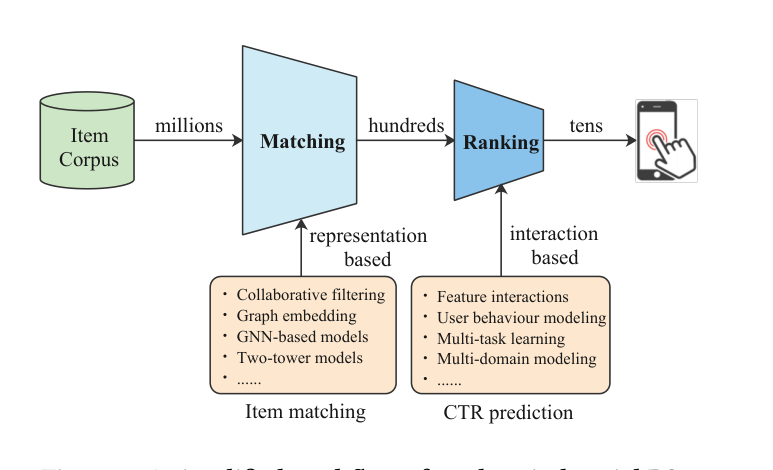
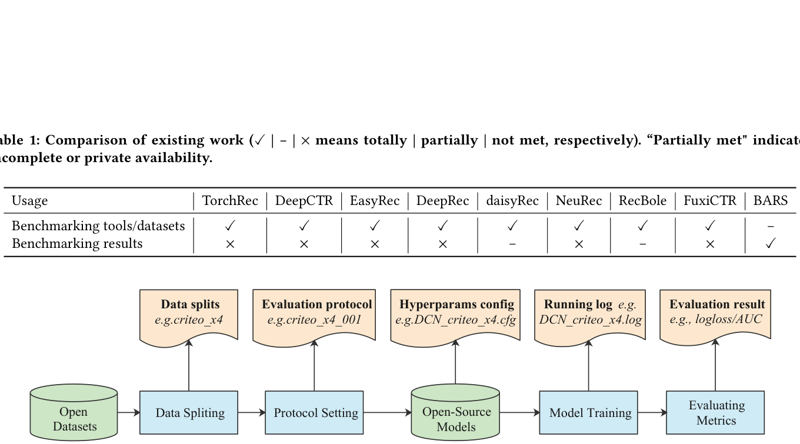
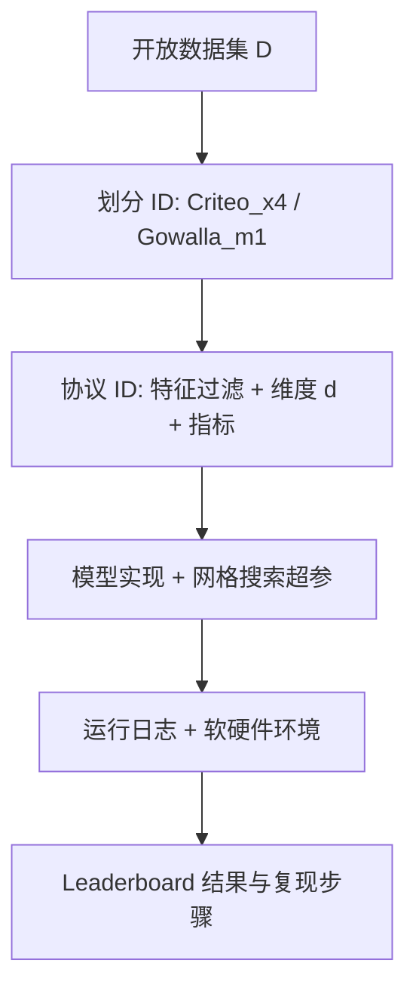

# BARS: Towards Open Benchmarking for Recommender Systems (面向推荐系统开放基准的 BARS 计划)

- **会议/期刊**: SIGIR 2022 (Madrid)
- **作者与机构**: Jieming Zhu, Quanyu Dai, Guohao Cai, Xi Xiao（华为诺亚方舟实验室）; Liangcai Su, Rong Ma（清华）; Jinyang Liu（港中文）; Rui Zhang
- **推荐链路定位**: 召回（候选物品匹配）+ 精排（CTR 预估）双阶段基准
- **研究方向**: 去偏公平、可信隐私与工业架构 / CTR 预估与特征交叉
- **论文原文**: [https://arxiv.org/abs/2205.09626v5](https://arxiv.org/abs/2205.09626v5)
- **开源代码**: [https://github.com/openbenchmark/BARS](https://github.com/openbenchmark/BARS)（门户站点 https://openbenchmark.github.io/BARS）

## TL;DR (1分钟核心速览)

本文不是新模型，而是一次针对推荐领域“评测不可复现、基线未调优”痼疾的体系性纠偏。作者把数据集、划分、协议、调参、日志、结果串成标准化流水线，为每个划分与协议分配唯一 ID，并在 6 个公开数据集、70+ 模型上跑了 8000+ 次、15,000 GPU 小时实验。全部召回评测坚持**全库 Full-Ranking（不用采样指标）**，结果暴露：2001 年的 ItemKNN、2011 年的 SLIM 在 AmazonBooks 上 Recall@20 仍达 0.0736/0.0755，远超 LightGCN 的 0.0411；Criteo 上 DeepFM/DCN/xDeepFM/DCN-V2 的 AUC 挤在 81.43–81.45 的 0.05% 磁带内，近年“SOTA 提升”多为调参不充分所致。

## Background & Motivation (背景与核心矛盾)

- **主流范式**: 工业推荐采用「匹配（百万级→百级）→ 精排（百级→十级）」两段式；匹配侧以双塔/图模型做向量检索，精排侧以特征交叉网络做 CTR 预估（图 1）。
  <figure class="paper-figure" markdown="span">
  <figcaption>图1：现代工业RS的简化工作流程。</figcaption>
</figure>
- **前人局限**: ① 各论文自建私有划分与预处理，`min_counts`、embedding 维度 $d$ 各异，AUC/Recall 数值互不可比；② 基线常直接跑默认超参，形成“弱基线对比”，使新模型提升被放大；多数只开源模型代码，缺超参与日志。
- **核心洞察 (Key Insight)**: 可复现性不是“开源代码”一件事，而是 7 件产物的闭环；只要把「划分 ID」与「协议 ID」一并固化，结果才具备可比性——这是 RecBole/Elliot 只给工具、daisyRec 只给部分结果所缺失的一环。
- **本文切入点**: 用“数据划分 × 评测协议”双 ID 把历史结果钉在坐标系里，并用大规模调参后的实测值给每个模型重新定级。

## Method (核心方法设计)

### 1. 整体框架 (Overall Architecture)

图 2 的流水线把研究闭环拆成六个阶段：开放数据集 → 数据划分（打 ID，如 `Criteo_x4`）→ 协议设定（再打 ID，如 `Criteo_x4_002` 表示改用 FGCNN 的 $d{=}40$）→ 开源模型实现 → 记录超参配置与运行日志 → 按任务给指标（匹配用 Recall@K/HR@K/NDCG@K，精排用 logloss/AUC）→ 汇总为可交互 Leaderboard。任何人都可用同一 ID 复跑或追加贡献，站点负责持久化与版本演进。本质上它是 GLUE/ImageNet 式的“评测契约”，而非模型。
<figure class="paper-figure" markdown="span">
  <figcaption>图2：用于可复现推荐研究的开放基准测试流水线。</figcaption>
</figure>

### 2. 关键设计拆解 (Key Designs)

1. **双 ID 标准化契约（本文最核心的“算子”）**：痛点是无 ID 时两次实验不可判定是否同构。作者要求任一可比结果满足
   $\mathcal{D}^{(i)}_{\text{id}}=\mathcal{D}^{(j)}_{\text{id}}\ \wedge\ \mathcal{P}^{(i)}_{\text{id}}=\mathcal{P}^{(j)}_{\text{id}}$，
   其中协议 $\mathcal{P}=(\text{min\_counts},\ d,\ \text{负采样},\ \text{划分种子})$。直觉：把“实验环境”从口头描述降维成可哈希的主键，比较才有意义。
2. **全库排序而非采样指标**：匹配评测严格在**整个物品集**上排序（推广 daisyRec 对 sampled metrics 的批评）。这是与大量论文的关键分野——采样负例（常 1:99）会系统性抬高 Recall/NDCG 并改变模型排序。BARS 选择与工业 ANN 检索（Faiss/Milvus）一致的无偏协议。
3. **训练与调参规范**：不做统一的负采样改写，保留各模型官方训练目标（如 BPR 均匀负采样、LightGCN 的 $\mathcal{L}=\mathcal{L}_{\text{BPR}}+\lambda\|\mathbf{E}\|_2^2$），但**一律网格搜索超参并记录最优配置与日志**；离线批量实验，在线只有 ANN 检索开销，无额外推理成本。

## Experimental Setup & Evaluation Protocol (实验设置与评估协议)

**匹配任务数据集**（全部百万级以上交互，密度极稀疏）：

| 数据集(划分 ID) | #Users | #Items | #Interactions | 稀疏度/密度 |
| :--- | :---: | :---: | :---: | :---: |
| AmazonBooks_m1 | 52,643 | 91,599 | 2,984,108 | 0.062% |
| Yelp2018_m1 | 31,668 | 38,048 | 1,561,406 | 0.130% |
| Gowalla_m1 | 29,858 | 40,981 | 1,027,370 | 0.084% |

**CTR 数据集**：

| 数据集(划分 ID) | #Instances | #Fields | #Features | %Positives |
| :--- | :---: | :---: | :---: | :---: |
| Criteo_x4 | 46M | 39 | 5.55M | 26% |
| Avazu_x4 | 40M | 24 | 8.37M | 17% |
| KKBox_x1 | 6.5M | 13 | 0.1M | 50.4% |

- **数据划分**: 匹配沿用 GNN 社区通用划分并以 `*_m1` ID 固化；CTR 沿用 AutoInt 的随机 train/valid/test 划分（`*_x4`），预处理脚本一并释放。相比 RecBole 的灵活切分，此处是“锁定一份、拒绝漂移”。
- **排名评测协议**: 匹配为 `Full-Ranking`（全库未交互排序，K=20）；CTR 为逐条打分，报告 logloss 与 AUC。Criteo_x4 协议固定 `min_counts=10`、$d=16$。
- **对比基线与超参**: 匹配 33 个模型（CF 9 / 自编码 4 / 双塔 3 / 图嵌入 4 / GNN 13），精排 32 个（LR→FM→DNN→DCN-V2）。全部经网格搜索；未做显著性检验，而以“多次不同 seed 下的稳定数值区间”作为可复现性判据。

## Key Experimental Results (实验关键数据)

### 1. 主实验对比 (Main Results)

**候选物品匹配（Recall@20 / NDCG@20，粗体为各列前 5）**

| 年份 | 模型 | AmazonBooks_m1 | Yelp2018_m1 | Gowalla_m1 |
| :--- | :--- | :---: | :---: | :---: |
| 2001 | ItemKNN | **0.0736 / 0.0606** | 0.0639 / 0.0531 | 0.1570 / 0.1214 |
| 2011 | SLIM | **0.0755 / 0.0602** | 0.0646 / 0.0541 | 0.1699 / 0.1382 |
| 2017 | NeuMF | 0.0258 / 0.0200 | 0.0451 / 0.0363 | 0.1399 / 0.1212 |
| 2019 | NGCF | 0.0344 / 0.0263 | 0.0579 / 0.0477 | 0.1570 / 0.1327 |
| 2020 | LightGCN | 0.0411 / 0.0315 | 0.0649 / 0.0530 | 0.1830 / **0.1554** |
| 2021 | SGL-ED | 0.0478 / 0.0379 | 0.0675 / 0.0555 | – |
| 2021 | GF-CF | **0.0710 / 0.0584** | **0.0697 / 0.0571** | **0.1849 / 0.1518** |
| 2021 | UltraGCN | **0.0681 / 0.0556** | **0.0683 / 0.0561** | **0.1862 / 0.1580** |
| 2021 | SimpleX | 0.0583 / 0.0468 | **0.0701 / 0.0575** | **0.1872 / 0.1557** |

**CTR 预估（Logloss×10⁻² / AUC%）**

| 年份 | 模型 | Criteo_x4 | Avazu_x4 | KKBox_x1 |
| :--- | :--- | :---: | :---: | :---: |
| 2007 | LR | 45.68 / 79.34 | 38.15 / 77.75 | 57.46 / 76.78 |
| 2010 | FM | 44.31 / 80.86 | 37.54 / 78.87 | 50.75 / 82.91 |
| 2017 | DeepFM | **43.76 / 81.43** | 37.19 / 79.30 | 47.85 / **85.31** |
| 2017 | DCN | **43.76 / 81.44** | 37.19 / 79.31 | **47.66 / 85.31** |
| 2018 | xDeepFM | **43.76 / 81.43** | 37.18 / 79.33 | **47.72 / 85.35** |
| 2020 | DeepIM | **43.75 / 81.46** | **37.16 / 79.35** | **47.75 / 85.37** |
| 2020 | ONN | **43.72 / 81.48** | **36.83 / 79.92** | 48.56 / 84.98 |
| 2021 | DCN-V2 | **43.75 / 81.45** | 37.19 / 79.31 | 47.87 / 85.31 |

### 2. 消融/对照分析 (Capability Matrix, 原文 Table 1)

| 能力 | TorchRec | DeepCTR | EasyRec | daisyRec | RecBole | FuxiCTR | **BARS** |
| :--- | :---: | :---: | :---: | :---: | :---: | :---: | :---: |
| 提供工具/数据集 | ✓ | ✓ | ✓ | ✓ | ✓ | ✓ | ✓ |
| 划分与协议 ID 固化 | × | × | × | × | × | × | **✓** |
| 超参 + 运行日志归档 | × | × | × | − | × | × | **✓** |
| 公开可复现 Leaderboard | × | × | × | − | − | × | **✓** |
| 匹配 + 精排双阶段覆盖 | − | × | − | × | ✓ | × | **✓** |

### 3. 关键实验发现 (Key Findings)

1. **老模型被严重欠比较**：AmazonBooks_m1 上 ItemKNN（2001）与 SLIM（2011）的 Recall@20 分别为 0.0736/0.0755，比 LightGCN 的 0.0411 高 **79%–84%**，也比 2021 年的 SGL-ED（0.0478）高出 54%–58%——近年 GNN 论文大量遗漏了这两条相似度型基线。
2. **没有“通吃”的模型，任务与数据强相关**：匹配侧冠军在 AmazonBooks（SLIM）、Yelp2018（SimpleX 0.0701）、Gowalla（SimpleX 0.1872）各不相同；CTR 侧 ONN 在 Criteo/Avazu 最优（AUC 81.48/79.92），却只在 KKBox 排第 8（84.98，比 DCN 低 0.33），说明单一数据集的 SOTA 声明不具外推性。
3. **深度 CTR 已进饱和带**：Criteo_x4 上 DeepFM、DCN、xDeepFM、DCN-V2、DeepIM 的 AUC 全部落在 81.43–81.46，极差 $\Delta_{\text{sat}}<0.05\%$；Avazu 上 PNN/HFM+/FGCNN 三者同为 79.44。反之 InterHAt（81.04）、AFN+（81.38）、LorentzFM（80.83）在大规模调参后**低于** DNN/Wide&Deep 时代基线，与部分原文声称的显著提升直接冲突。

## Highlights & Limitations (亮点、对比与审稿批判)

- **与代表作对比 (vs. Prior Work)**: 相对 RecBole/Elliot（提供灵活框架但无榜单）与 daisyRec（只给部分经典模型结果、覆盖窄），BARS 的差别是“结果 + 复现步骤 + ID 契约”三件套齐备；相对其前作（24 模型/4 数据集），本版扩到 70+ 模型并新增匹配任务与双阶段分层。
- **可迁移亮点**: ① “划分 ID + 协议 ID”双主键机制可直接迁移到任何需要被审计的离线实验平台；② 用“多 seed 数值极差”替代单点显著性检验作为可复现性度量，成本低、说服力强。
- **审稿级局限批判**: ① 仅覆盖 accuracy 类指标，作者自认缺 diversity/coverage/fairness 维度，因此无法评估近年去偏与公平性工作；② 15,000 GPU 小时的调参预算普通实验室难以复现，且“充分调参”本身缺客观收敛判据（未报告搜索空间与预算明细），可能引入“BARS 调得比原文更好”的新不可比；③ 未纳入序列推荐、重排与生成式任务，榜单存在快速过时风险。

## Rating (四维评分)

- **方法创新性 (Novelty)**: ⭐⭐⭐ （无新算法，但“双 ID 评测契约 + 全库排序强制”是方法论层面的实质增量）
- **评估协议与实验扎实度 (Protocol & Experiments)**: ⭐⭐⭐⭐⭐ （Full-Ranking 无偏协议、6 数据集 70+ 模型、8000+ 次实验与网格搜索，规模与严谨度均为社区之最）
- **写作与数学规范度 (Clarity & Rigor)**: ⭐⭐⭐⭐ （流水线定义清晰、表格信息密度高；但公式层面几乎无理论推导，可复现细节大量外链至站点）
- **工业落地与复现价值 (Industrial & Practical Value)**: ⭐⭐⭐⭐⭐ （直接回应工业界“该选哪个模型”的选型问题，开源代码、配置与日志齐全，落地即用）

