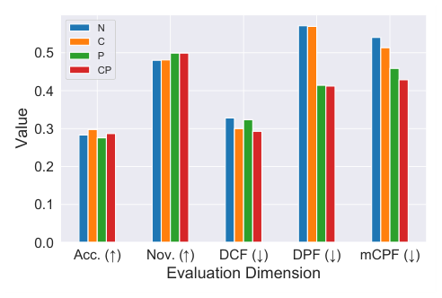
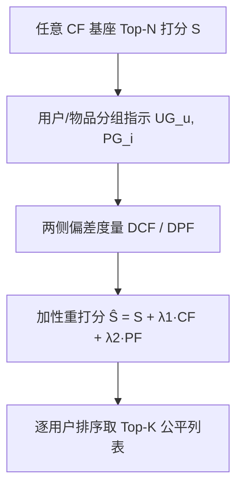

# CPFair: Personalized Consumer and Producer Fairness Re-ranking for Recommender Systems (面向双边市场的消费者-生产者公平个性化重排)

- **会议/期刊**: SIGIR 2022
- **作者与机构**: Mohammadmehdi Naghiaei (USC)、Hossein A. Rahmani (UCL)、Yashar Deldjoo (Politecnico di Bari)
- **推荐链路定位**: 重排（精排后处理，model-agnostic）
- **研究方向**: 去偏公平与可信推荐 / 列表级重排
- **论文原文**: [论文原文链接](https://arxiv.org/abs/2204.08085v1)
- **开源代码**: [开源代码仓库链接](https://rahmanidashti.github.io/CPFairRecSys/)

## TL;DR (1分钟核心速览)

现有公平推荐研究把「消费者公平（用户间相关性均等）」与「生产者公平（物品曝光均等）」割裂优化，而平台本质是双边市场：单侧优化会显著伤害另一侧（Epinion 上仅优化曝光使 DCF 从 0.3797 恶化到 0.3877）。本文提出 CPFair——把两侧偏差 $\mathrm{DCF}$、$\mathrm{DPF}$作为**软惩罚**加入一个混合整数线性规划，再松弛为$O(nN)$ 的加性贪心打分重排。在 8 个真实数据集 × 4 个 CF 基座共 128 组实验中，mCPF 相对无公平基座平均下降 12.84%（Epinion）与 46.90%（Gowalla），且 nDCG@10 不降反升。

## Background & Motivation (背景与核心矛盾)

- **主流范式**: 公平推荐按受益方分为 C-fairness（用户相关性均等，如 Li et al. 的群组公平）与 P-fairness（物品曝光均等/长尾扶持，如 Dong et al. 的曝光上限约束），二者多以硬约束或正则方式嵌入训练。
- **前人局限**: 作者统计 120 篇文献发现仅 9.1% 涉及多边公平、3.6% 给出真正的双边算法；单侧硬约束优化在双边市场中会「按下葫芦浮起瓢」——以曝光为约束会压缩用户相关性，以用户公平为目标则让热门短头物品垄断列表。
- **核心洞察 (Key Insight)**: 数据层面同时存在两类不均衡：Top 5% 活跃用户拿到近满分的归一化 nDCG（1.0 vs 非活跃用户 0.6），而数量占比极小的短头物品占据了绝大多数曝光位；即**用户侧偏差与物品侧偏差同源（交互长尾），必须联合建模**。
- **本文切入点**: 不做重训练，只在已有 Top-$N$ 列表上做**保持精度的软惩罚联合重排**，且惩罚项不强制严格 parity，以免精度崩塌。

<figure class="paper-figure" markdown="span">
  <figcaption>图1：推荐算法在准确性、新颖性和公平性性能上的公平无感知（N）、面向用户（C）、面向物品（P）和双侧公平-性能（CP）。消费者公平评估（DCF）和生产者公平评估（DPF）是构成mCPF的两个指标。注意，CP代表我们贡献的核心。每个柱上的结果展示了跨数据集和基线CF模型的32次实验平均值。</figcaption>
</figure>

## Method (核心方法设计)

### 1. 整体框架 (Overall Architecture)

先跑任意 CF 基座得到打分矩阵 $S\in\mathbb{R}^{n\times N}$；按训练集交互数把用户切为活跃组$U_1$（Top 5%）与非活跃组$U_2$，物品切为短头$I_1$（Top 20%）与长尾$I_2$；用二元决策矩阵$A$表示新列表是否包含某物品，构造「相关性收益 − 两侧公平偏差惩罚」的目标函数；由于该 MILP 是 NP-hard 的定长背包特例（每件物品权重恒为 1），用贪心重打分在多项式时间内求得最优解并按新分数取 Top-$K$。全过程无参数训练、无梯度，可插在任意精排模型之后。

### 2. 关键设计拆解 (Key Designs)

1. **双侧 parity 偏差度量（把两侧公平写进同一量纲）**：痛点是把用户相关性与物品曝光放在两个不可比的尺度上。作者统一用「优势组期望 − 弱势组期望」定义偏差：$\mathrm{DCF}=\mathbb{E}[M_C(u,A)\,|\,u\in U_1]-\mathbb{E}[M_C(u,A)\,|\,u\in U_2]$，$\mathrm{DPF}=\mathbb{E}[M_P(i,A)\,|\,i\in I_1]-\mathbb{E}[M_P(i,A)\,|\,i\in I_2]$，保留符号以指示偏差方向；再用$\mathrm{mCPF}(w)=w\cdot\mathrm{DPF}+(1-w)\cdot\mathrm{DCF}$（实验取$w=0.5$）合成单一评价标尺。
2. **软惩罚联合目标 + 贪心闭式重打分**：如果像前人那样把 parity 作为硬约束，会在大规模目录下大幅牺牲精度。本文改为无约束惩罚形式 $\max_{A}\sum_{u}\sum_{i}S_{ui}A_{ui}-\lambda_1\mathrm{DCF}-\lambda_2\mathrm{DPF}$，s.t.$\sum_i A_{ui}=K,\ A_{ui}\in\{0,1\}$；松弛后等价于对每个$(u,i)$加分：$\hat{S}_{ui}=S_{ui}+\lambda_1\,UG_u\,M_C(u,i)+\lambda_2\,PG_i\,M_P(u,i)$，其中$UG_u,PG_i\in\{+1,-1\}$为「弱势组 +1 / 优势组 −1」的指示符号。直觉上$\lambda_1$抬升非活跃用户、$\lambda_2$ 抬升长尾物品，且因两项共享同一打分轴，两侧纠正可同时生效且可调权。
3. **训练目标与推理开销**：无训练损失，只需一次基座推理 + 一次重打分排序；复杂度为 $O(nN)$（用 max-heap 取 Top-$K$为$O(N+K\log K)$），$\lambda_1,\lambda_2\in[0,1]$ 在验证集上按 mCPF 与 nDCG 联合最优选取（典型取值 0.05 量级）。

## Experimental Setup & Evaluation Protocol (实验设置与评估协议)

- **数据集与预处理**: 8 个跨域数据集，均做 $k$-core 过滤，交互稀疏度 92%–99%：

| 数据集 | #Users | #Items | #Interactions | 稀疏度 | 场景 |
| :--- | :---: | :---: | :---: | :---: | :--- |
| MovieLens | 943 | 1,349 | 99,287 | 92.19% | 电影（显式） |
| Epinion | 2,677 | 2,060 | 103,567 | 98.12% | 意见/信任（显式） |
| Gowalla | 1,130 | 1,189 | 66,245 | 95.06% | POI 签到（隐式） |
| LastFM | 1,797 | 1,507 | 62,376 | 97.69% | 音乐（隐式） |
| BookCrossing | 1,136 | 1,019 | 20,522 | 98.22% | 图书 |
| Foursquare | 1,568 | 1,461 | 42,678 | 98.13% | POI |
| AmazonToy / Office | 2,170 / 2,448 | 1,733 / 1,596 | 32,852 / 36,841 | 99.12% / 99.05% | 电商 |

- **数据划分与防穿越**: 随机 `70%/10%/20%` 训练/验证/测试划分（**非**时间戳切分，存在未来信息泄漏风险）；分组阈值仅由训练集交互数决定。
- **排名评测协议**: 在测试集正例上计算 `nDCG@10` 并据其取 Top-10（**Sampled Ranking 式的测试集内排序，非 Full-Ranking 全库排序**，未报告负采样比例），另报 Beyond-Accuracy 的 Novelty 与 Coverage。
- **对比基线与超参**: 基座 PF、WMF、NeuMF、VAECF（另附 Random / MostPop），再分别叠加 N（无公平）、C（仅 $\lambda_1$）、P（仅$\lambda_2$）、CP（双侧）四种重排；嵌入维度$d=50$，NeuMF 的 MLP 为 32-16-8 + TanH，学习率 1e-3，Adam + Early Stopping；未做显著性检验。

## Key Experimental Results (实验关键数据)

### 1. 主实验对比 (Main Results)

两个详表数据集上「无公平 N → CPFair」的对照（$w=0.5$，Top-10）：

| 数据集 | 基座 | nDCG@10 (N→CP) | DCF↓ (N→CP) | DPF↓ (N→CP) | mCPF↓ (N→CP) | Δ(%) |
| :--- | :--- | :---: | :---: | :---: | :---: | :---: |
| Epinion | PF | 0.0321 → 0.0313 | 0.4321 → 0.4368 | 0.6562 → **0.2226** | 0.6210 → **0.4074** | 34.39 |
| Epinion | WMF | 0.0235 → 0.0234 | 0.4534 → 0.4450 | 0.8846 → 0.8644 | 0.7496 → **0.7339** | 2.09 |
| Epinion | NeuMF | 0.0447 → **0.0455** | 0.3264 → 0.2606 | 0.9828 → 0.9702 | 0.7127 → **0.6618** | 7.14 |
| Epinion | VAECF | 0.0444 → 0.0439 | 0.3067 → 0.2716 | 0.8380 → 0.7886 | 0.6269 → **0.5784** | 7.73 |
| Gowalla | PF | 0.0592 → **0.0618** | 0.0771 → 0.0288 | 0.4052 → **−0.0240** | 0.2569 → **0.0083** | 96.76 |
| Gowalla | WMF | 0.0338 → 0.0334 | 0.2541 → 0.1793 | 0.1550 → **−0.0590** | 0.2564 → **0.0967** | 62.28 |
| Gowalla | NeuMF | 0.0563 → **0.0583** | 0.3283 → 0.2214 | 0.8490 → 0.7736 | 0.6556 → **0.5427** | 17.22 |
| Gowalla | VAECF | 0.0608 → **0.0619** | 0.2227 → 0.1900 | 0.4212 → 0.3838 | 0.3674 → **0.3257** | 11.35 |

### 2. 消融实验 (Ablation Study)

以「关闭某一侧惩罚项」作为组件消融（N = 全关，C = 仅 $\lambda_1$，P = 仅$\lambda_2$，CP = 双侧）：

| 数据集 / 基座 | N | C（仅用户公平） | P（仅物品公平） | CP（本文） |
| :--- | :---: | :---: | :---: | :---: |
| Epinion / PF | 0.6210 | 0.5930 | 0.4270 | **0.4074** |
| Epinion / VAECF | 0.6269 | 0.5976 | 0.6016 | **0.5784** |
| Gowalla / PF | 0.2569 | 0.2269 | 0.0653 | **0.0083** |
| Gowalla / VAECF | 0.3674 | 0.3532 | 0.3560 | **0.3257** |
| 平均 mCPF 降幅（4 基座） | — | 3.83% / 10.36% | 9.25% / 31.28% | **12.84% / 46.90%** |

### 3. 关键实验发现 (Key Findings)

1. **单侧优化确实互相拆台，且 P 侧伤害 C 侧更甚**：Epinion 上做 P-fairness 使 DCF 从 0.3797 恶化到 0.3877，而做 C-fairness 时 DPF 甚至略降（0.8404→0.8382）；双侧 CP 才能把 DPF 从 0.6562 压到 0.2226（PF 基座，降 66%），平均 mCPF 降幅从单侧的 9.25% 拉到 12.84%。
2. **公平不必以精度为代价**：Gowalla 上 CP 使 4 个基座的 nDCG@10 全部持平或上升（PF 0.0592→0.0618、VAECF 0.0608→0.0619），因为把长尾物品补进列表同时提升了 Novelty 与 Coverage；Epinion 上仅 WMF 等弱基座出现 0.0001~0.0005 的微小损失。
3. **精度越高的基座偏得越狠，选型不能只看 nDCG**：NeuMF 在 Epinion 精度最高（0.0447）但 DPF 高达 0.9828（列表几乎全为短头），而 PF 的 $m\mathrm{CPF}/\mathrm{Acc}$ 最低（13.02 vs NeuMF 14.55），说明在双边市场里「公平-精度联合指标」才是基座选择的正确依据。

## Highlights & Limitations (亮点、对比与审稿批判)

- **与代表作对比 (vs. Prior Work)**: 相较 Li et al.（仅用户群组公平、目标为约束式）、Dong et al.（仅物品曝光上限）、Patro et al.（不可分物品公平分配），本文的核心增量是**把两侧偏差写进同一个可加打分的软惩罚项**，并给出定长背包贪心最优解与 $O(nN)$ 复杂度证明；相比 Wu et al. 的个体级双边公平，本文采用分组级 parity，计算更轻。
- **可迁移亮点**: (1) 用 $\pm1$ 组指示符号把「群组级公平梯度」线性化进逐条打分，可复用到位置去偏、流行度去偏等任何需要「抬弱势、压强势」的重排场景；(2) mCPF 这类加权合成偏差指标可直接作为线上重排的监控指标。
- **审稿级局限批判**: (1) **理论缺口**：DCF/DPF 是跨用户的群组期望，贪心逐用户重打分忽略了用户间耦合，并非严格求解 MILP，论文未给出近似比保证，且在 Gowalla/PF 上 DPF 被推到负值（−0.024），说明过度纠正会反向歧视短头；(2) **评估薄弱**：8 个数据集只详报 2 个，划分为随机切分而非时间切分，指标是测试集内 Top-10 排序而非 Full-Ranking，且无显著性检验，$\lambda$ 也按 mCPF+nDCG 联合调优（存在对评测指标的过拟合）。

## Rating (四维评分)

- **方法创新性 (Novelty)**: ⭐⭐⭐ （双边公平统一进软惩罚目标 + 定长背包贪心求解思路干净，但本质是在 Li et al. 框架上做加性扩展，理论深度有限）
- **评估协议与实验扎实度 (Protocol & Experiments)**: ⭐⭐⭐ （8 数据集 × 4 基座共 128 组实验规模可观，但仅 2 个数据集给详表、随机切分 + 测试集内排序、缺显著性检验）
- **写作与数学规范度 (Clarity & Rigor)**: ⭐⭐⭐⭐ （DCF/DPF/mCPF 定义清晰，算法伪码与 $O(nN)$复杂度证明完整，动机图与$\lambda$ 敏感性分析到位）
- **工业落地与复现价值 (Industrial & Practical Value)**: ⭐⭐⭐⭐ （model-agnostic 后处理、无训练、线性开销，可直接挂在精排后；代码与数据处理已开源，唯缺大规模线上验证）

