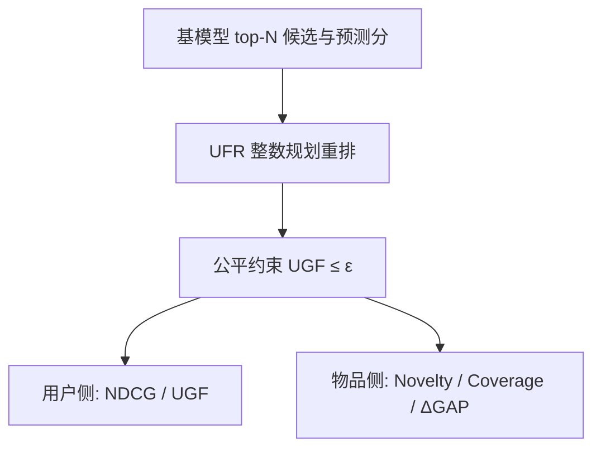

# Experiments on Generalizability of User-Oriented Fairness in Recommender Systems (用户导向公平推荐系统泛化性实验)

- **会议/期刊**: SIGIR 2022
- **作者与机构**: Hossein A. Rahmani (UCL)、Mohammadmehdi Naghiaei (USC)、Mahdi Dehghan (SBU)、Mohammad Aliannejadi (UvA)
- **推荐链路定位**: 重排 / 后处理
- **研究方向**: 去偏公平、可信隐私与工业架构
- **论文原文**: [https://arxiv.org/abs/2205.08289v1](https://arxiv.org/abs/2205.08289v1)
- **开源代码**: [https://github.com/rahmanidashti/FairRecSys](https://github.com/rahmanidashti/FairRecSys)

## TL;DR (1分钟核心速览)

本文不提出新推荐模型，而是复现 Li 等人的用户公平重排 UFR，并在 8 个数据集、6 个基础排序模型、2 种用户分组上做 96 组泛化实验。结果显示：UFR 平均提升 UGF 41.73%、NDCG 4.446%，但收益强依赖领域、基模型与分组方式，且不能消除流行度偏差。

## Background & Motivation (背景与核心矛盾)

- **主流范式**: 公平推荐多采用后处理重排，在不改动黑盒基模型的情况下，将 top-N 列表重排以满足用户组公平约束。
- **前人局限**: 原 UFR 仅在 Amazon eCommerce 等少量数据与基模型上验证；且多数后处理公平研究假设可访问真实 relevance，忽视基模型分布对重排的影响。
- **核心洞察**: 用户公平的“提升幅度”并非算法固有属性，而由领域稀疏度、基模型流行度偏好、优势/劣势用户定义共同决定。
- **本文切入点**: 用统一 Cornac + MIP/Gurobi 管线复现 UFR，系统拆解领域、基模型、分组假设与多边指标之间的交互。

## Method (核心方法设计)

### 1. 整体框架 (Overall Architecture)

输入各基模型给出的用户 top-N 候选及预测分 $\hat{s}_{ui}$，UFR 以整数规划选择每个用户长度为$K$的列表，在满足两组用户平均 NDCG 差不超过阈值$\epsilon$ 的约束下最大化总排序分；随后同时评估用户侧 NDCG/UGF 与物品侧 Novelty/Coverage/ΔGAP。该文核心不是新网络，而是把“公平重排”放入多领域、多基模型、多分组假设下做可复现审计。

### 2. 关键设计拆解 (Key Designs)

1. **用户公平约束重排 UFR**：痛点是无公平约束的基模型偏向高活跃用户；UFR 将每个用户的候选列表作为 0-1 选择变量，目标为 $\max_{\{L_u\}}\sum_u\sum_{i\in L_u}\hat{s}_{ui}$，约束为$|\mathrm{NDCG}_{g_a}-\mathrm{NDCG}_{g_d}|\le\epsilon$且$|L_u|=K$。直觉是用少量效用损失换取两组 NDCG 差距收缩。
2. **公平度量与分组假设**：定义 $\mathrm{UGF}=|\mathrm{NDCG}_{g_a}-\mathrm{NDCG}_{g_d}|$，$\Delta\%\mathrm{UGF}=(\mathrm{UGF}_{org}-\mathrm{UGF}_{fair})/\mathrm{UGF}_{org}\times100$。除原论文 G1（top 5% 交互用户为优势组）外，新增 G2（top 20% 流行物品消费用户为优势组），检验分组定义是否改变结论。
3. **训练、负采样与推理开销**：基模型沿用 Cornac 默认训练与负采样设置，嵌入维度 50，NeuMF MLP 为 32/16/8、TanH、Adam、lr=0.001；UFR 无需重训基模型，但需对每用户候选求解整数规划，在线开销主要来自优化求解而非前向推理。

## Experimental Setup & Evaluation Protocol (实验设置与评估协议)

- **数据集与预处理**: 8 个公开数据集覆盖 Movie、POI、Music、eCommerce、Book、Opinion；均做 $k$-core 过滤以保证用户/物品反馈量。

| 数据集 | #Users | #Items | #Interactions | 稀疏度 | 领域/反馈 |
| :--- | ---: | ---: | ---: | ---: | :--- |
| Epinions | 2,677 | 2,060 | 103,567 | 98.12% | Opinion/显式 |
| MovieLens | 943 | 1,349 | 99,287 | 92.19% | Movie/显式 |
| BookCrossing | 1,136 | 1,019 | 20,522 | 98.22% | Book/显式 |
| AmazonToy | 2,170 | 1,733 | 32,852 | 99.12% | eCommerce/显式 |
| AmazonOffice | 2,448 | 1,596 | 36,841 | 99.05% | eCommerce/显式 |
| Gowalla | 1,130 | 1,189 | 66,245 | 95.06% | POI/隐式 |
| Foursquare | 1,568 | 1,461 | 42,678 | 98.13% | POI/隐式 |
| Last.fm | 1,797 | 1,507 | 62,376 | 97.69% | Music/隐式 |

- **数据划分与防穿越**: 沿用 Cornac 复现管线的训练/测试拆分，按测试集 top-10 计算指标；原文未报告全局时间戳切分，细节以公开仓库为准。
- **排名评测协议**: 非全库 Full-Ranking，而是在基模型 top-10 候选上评估 NDCG@10、F1@10；重排 relevance 由基模型预测分估计，不使用测试真实标签。
- **对比基线与超参**: MostPop、BPR、PF、WMF、NeuMF、VAECF 六类基模型；显著性以 Pearson $r$与$p<0.05$ 报告相关性。

## Key Experimental Results (实验关键数据)

### 1. 主实验对比 (Main Results)

Epinions + G1 下 UFR 对六类基模型的重排结果（top-10，公平约束作用于 NDCG）：

| 基模型 | NDCG@10 Org. | NDCG@10 Fair | UGF Org.↓ | UGF Fair↓ | Δ%UGF↑ | Fair Nov.↑ |
| :--- | ---: | ---: | ---: | ---: | ---: | ---: |
| MostPop | 0.0302 | 0.0301 | 0.0278 | 0.0077 | 72.30 | 3.7123 |
| BPR | 0.0297 | 0.0316 | 0.0267 | 0.0071 | 73.41 | 3.6658 |
| PF | 0.0321 | 0.0364 | 0.0453 | 0.0148 | 67.33 | 5.0160 |
| WMF | 0.0235 | 0.0255 | 0.0360 | 0.0171 | 52.50 | 4.9588 |
| NeuMF | 0.0451 | **0.0488** | 0.0436 | 0.0062 | 85.78 | 3.9259 |
| VAECF | 0.0444 | 0.0461 | 0.0376 | **0.0029** | **92.29** | 4.4212 |

### 2. 消融实验 (Ablation Study)

本文无模块消融，以下为“分组假设替换”的因子级消融/泛化剖析：

| 数据集 | 基模型 | Δ%UGF (G1) | Δ%UGF (G2) | 观察 |
| :--- | :--- | ---: | ---: | :--- |
| Epinions | MostPop | 72.30 | 10.78 | G2 下骤降 |
| Epinions | WMF | 52.50 | 17.35 | 分组敏感 |
| Epinions | VAECF | 92.29 | 58.67 | 仍最优但缩水 |
| Last.fm | MostPop | 62.50 | 6.29 | 分组几乎失效 |
| Last.fm | PF | 0.00 | 97.16 | 反转 |
| Last.fm | VAECF | 0.00 | 96.76 | 反转 |
| Last.fm | WMF | 90.96 | 55.36 | 较稳健 |

### 3. 关键实验发现 (Key Findings)

- **领域与数据密度决定上限**：eCommerce/Amazon 的 UGF 提升最低，POI 较高；平均交互/用户与 UGF 提升的 $r=0.72$（G1）、$0.84$（G2），交互/物品为$0.81$、$0.88$，均$p<0.05$。
- **公平与精度可同向，但不是免费午餐**：Δ%UGF 与 Δ%NDCG 正相关（$r=0.550$、$0.602$），平均 UGF 升 41.73%、NDCG 升 4.446%、Novelty 升 0.304；但 ΔGAP 相关性不显著，UFR 不能缓解流行度校准偏差。
- **分组定义是一阶因素**：G1 下 WMF 平均 Δ%UGF 最高达 68.54%，VAECF 最低仅 41.9%；G2 下 VAECF 可升至 55.52%，而 MostPop/BPR 明显变差，说明 top-5% 活跃用户切分并不跨域稳健。

## Highlights & Limitations (亮点、对比与审稿批判)

- **与代表作对比**: 原 UFR 只在少量 eCommerce 数据与有限基模型上验证；本文扩展到 8 数据集、6 基模型、2 分组和双边指标，首次系统暴露其领域/分组敏感性。相比一般公平算法论文，本文价值在审计与评测规范。
- **可迁移亮点**: 重排阶段用基模型预测分代替真实 relevance，更贴近线上黑盒重排；同时报告用户公平、物品曝光、Novelty、ΔGAP，避免单边公平指标误导。
- **审稿级局限批判**: 仅审计 UFR 一个公平算法，未比较其他后处理公平方法；评测集中于 top-10 候选，缺少全库 Full-Ranking、时间切分与线上延迟/求解开销分析；G2 仍基于流行度分桶，分组定义本身可能引入领域偏差。

## Rating (四维评分)

- **方法创新性 (Novelty)**: ⭐⭐⭐ （新算法增量有限，但系统性泛化审计揭示分组与基模型依赖，问题价值高）
- **评估协议与实验扎实度 (Protocol & Experiments)**: ⭐⭐⭐⭐ （96 组实验、8 数据集、6 基模型、2 分组与多边指标较完整；缺全库排序与时间切分）
- **写作与数学规范度 (Clarity & Rigor)**: ⭐⭐⭐⭐ （UGF/ΔGAP/UFR 约束定义清楚，结论有相关性统计支撑；部分实现细节需查仓库）
- **工业落地与复现价值 (Industrial & Practical Value)**: ⭐⭐⭐⭐ （代码与管线开源，后处理无需重训，适合作为公平重排上线前审计基线；整数规划延迟需关注）

