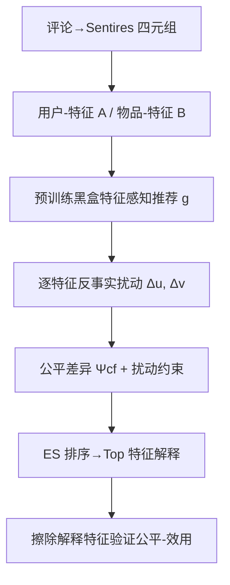
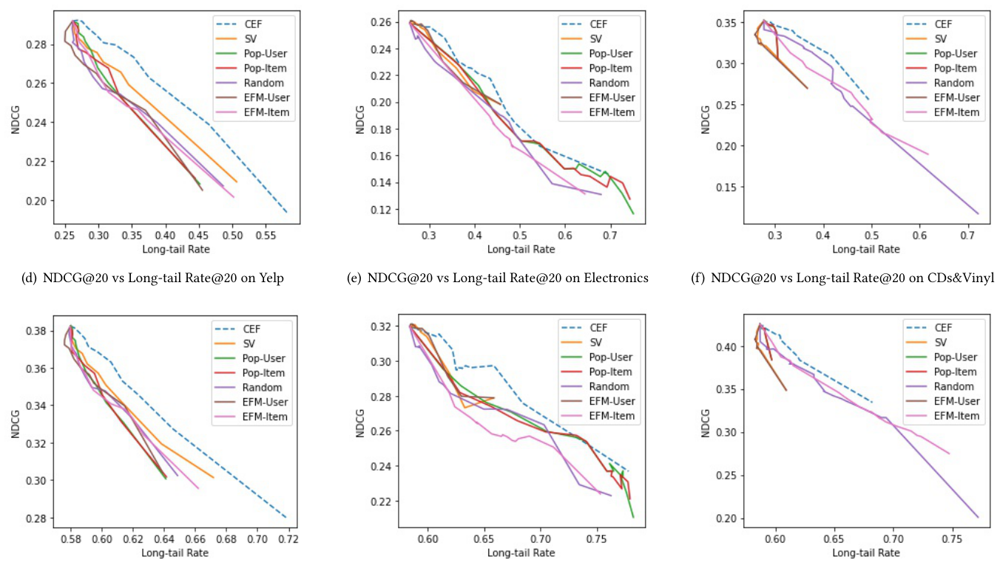
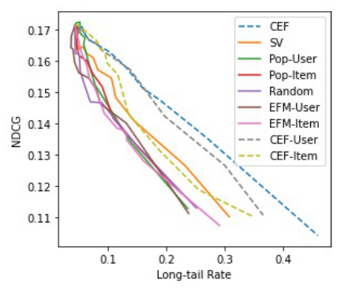

# Explainable Fairness in Recommendation (可解释公平性推荐)

- **会议/期刊**: SIGIR 2022
- **作者与机构**: Yingqiang Ge 等；Rutgers University、Meta、University of Rochester
- **推荐链路定位**: 精排解释（黑盒排序模型诊断）
- **研究方向**: 去偏公平、可信隐私与工业架构
- **论文原文**: [https://arxiv.org/abs/2204.11159v2](https://arxiv.org/abs/2204.11159v2)
- **开源代码**: [Sentires 特征抽取工具](https://github.com/evison/Sentires)（CEF 未开源）

## TL;DR (1分钟核心速览)

现有公平推荐多只量化或缓解偏差，却不回答“哪些输入特征导致曝光不公平”。本文提出 CEF：冻结黑盒特征感知推荐模型，对每个特征学习最小反事实扰动，使曝光差异下降，并以 $ES=\text{Validity}-\beta\cdot\text{Proximity}$ 排序特征解释。三数据集采用 Last-5+100 负样本评测、Top-5/20/50 擦除验证；Yelp 擦除 20 特征时 F1/NDCG/Long-tail/KL 均最优，跨数据集仅小幅损失 NDCG 即显著提升长尾曝光。

## Background & Motivation (背景与核心矛盾)

- **主流范式**: 公平推荐主要做公平性量化与公平模型设计；可解释推荐如 EFM 则对齐用户-物品特征以解释效用。
- **前人局限**: Shapley 类公平解释需枚举/采样特征联盟，特征多时开销大；且只解释公平或效用之一，忽略二者固有 trade-off。
- **核心洞察 (Key Insight)**: 若某特征只需极小扰动就能大幅改变曝光差异，它便是模型不公平的关键来源；解释应同时惩罚扰动成本与公平收益。
- **本文切入点**: 用反事实最小特征干预生成全局特征级公平解释，并以公平-效用折中分数排序。

## Method (核心方法设计)

### 1. 整体框架 (Overall Architecture)

先用 Sentires 从评论抽取四元组，构建用户-特征关注矩阵 $A$与物品-特征质量矩阵$B$；以特征感知 DNN 作为黑盒$g$训练并冻结。随后对每个特征$f$的用户列/物品列施加扰动$\Delta_u,\Delta_v$，得到反事实推荐列表$R_K^{cf}$，优化公平差异与扰动约束，最后按解释分数选出 Top 特征。擦除这些特征后重跑$g$，用 NDCG 与 Long-tail Rate 验证公平-效用曲线。

### 2. 关键设计拆解 (Key Designs)

1. **反事实最小扰动解释**：对特征 $f$的用户/物品列加$\Delta_u,\Delta_v$，令推荐结果变为$R_K^{cf}$；目标为$\min_{\Delta}\|\tilde{\Psi}^{cf}\|_2^2+\lambda\|\Delta\|_2^2$，其中$\Delta=[\Delta_u,\Delta_v]$。直觉：小扰动即可改变曝光差，说明该特征靠近不公平成因。
2. **可微公平差异松弛**：指示函数不可导，用排序分 $g(A_u^{cf},B_v^{cf})$替代曝光计数并归一化，DP 形式为$\tilde{\Psi}^{cf}_{DP}=\frac{\sum_u(\sum_{v\in G_0\cap R_K^{cf}}g-\frac{|G_0|}{|G_1|}\sum_{v\in G_1\cap R_K^{cf}}g)}{\sum_u\sum_{v\in R_K^{cf}}g}$。软曝光差保留梯度，使黑盒模型可被反传扰动。
3. **解释分数与训练推理**：$\text{Proximity}=\|\Delta\|_2^2$，$\text{Validity}$为归一化公平变化，$ES=\text{Validity}-\beta\cdot\text{Proximity}$；逐特征解优化后排序 Top。黑盒用交叉熵训练，CEF 用 Adam、$\lambda=1,K=5$；测试候选为每用户 5 正+100 随机负，未声明 hard negative。推理需对$r$ 个特征逐一优化，成本随特征数线性增长。

## Experimental Setup & Evaluation Protocol (实验设置与评估协议)

- **数据集与预处理**: 过滤交互数少于 20 的用户/物品：

| 数据集 | #Users | #Items | #Interactions | 稀疏度 | #Aspects |
| :--- | :---: | :---: | :---: | :---: | :---: |
| Yelp | 12,028 | 20,181 | 502,158 | 0.208% | 106 |
| CDs & Vinyl | 3,225 | 46,709 | 179,992 | 0.119% | 118 |
| Electronics | 2,762 | 19,449 | 51,777 | 0.096% | 77 |

- **数据划分与防穿越**: 每用户按时间排序，留出最后 5 个交互+100 随机负样本作测试；训练集最后 1 条作验证，属 Last-5 留出而非全库切分。
- **排名评测协议**: `Sampled Ranking`（每用户 5 正+100 负），非 Full-Ranking；主表报 @5，另评估 @20/@50。
- **公平分组与基线**: 按交互数 top 20% 为热门组 $G_0$、其余 80% 为长尾组$G_1$，DP 比例$|G_0|/|G_1|=1/4$。基线含 Random、Pop-User/Item、EFM-User/Item、Shapley Value（采样 100 联盟）。黑盒为融合层+3 层 FC {256,64,1}，SGD lr=0.01；CEF Adam lr=0.01。

## Key Experimental Results (实验关键数据)

### 1. 主实验对比 (Main Results)

Yelp、擦除 $E=20$ 个特征后的 Top-5 结果：

| 方法 | F1@5↑ | NDCG@5↑ | Long-tail@5↑ | KL@5↓ |
| :--- | :---: | :---: | :---: | :---: |
| Random | 14.809 | 15.674 | 5.2302 | 9.0410 |
| Pop-User | 14.956 | 15.983 | 6.6289 | 7.1107 |
| Pop-Item | 14.868 | 16.013 | 6.3580 | 7.4577 |
| EFM-User | 14.710 | 15.626 | 5.0086 | 9.3808 |
| EFM-Item | 13.533 | 14.320 | 9.3622 | 4.2092 |
| SV | 14.814 | 15.719 | 8.2688 | 5.2486 |
| **CEF** | **15.296** | **16.309** | **10.169** | **3.5328** |

CEF 相对各列最强基线：F1 **+2.27%**、NDCG **+1.85%**、Long-tail **+8.62%**、KL **-16.07%**（KL 越低越好）。

<figure class="paper-figure" markdown="span">
  <figcaption>图1：NDCG与Long-tail Rate在不同数据集上的准确率-公平性权衡曲线。每幅图右上角（高准确率、低差异）为更优。每个数据点通过累加移除解释方法提供的解释列表中的前5个特征生成。</figcaption>
</figure>

### 2. 消融实验 (Ablation Study)

| 变体 | 扰动参数 | Yelp 图2趋势 | 归因 |
| :--- | :---: | :--- | :--- |
| CEF-User | $\Delta_u$ | 优于多数基线，低于 CEF | 仅用户侧扰动，参数空间小 |
| CEF-Item | $\Delta_v$ | 低于 CEF-User/CEF | 物品侧单独解释不足 |
| CEF | $[\Delta_u,\Delta_v]$ | 曲线最靠右上 | 联合调用户关注与物品质量，公平-效用最优 |

原文图2未列精确数值，此处不伪造。

<figure class="paper-figure" markdown="span">
  <figcaption>图2：在Yelp数据集上的消融研究。</figcaption>
</figure>

### 3. 关键实验发现 (Key Findings)

- Yelp $E=20$ 时 CEF 四项指标同时最优：F1 15.296、NDCG 16.309、Long-tail 10.169、KL 3.5328，说明联合用户/物品特征扰动可实现 Pareto 改善。
- 作者报告 CEF 的 NDCG 相对损失仅 0.851%/2.682%/0.594%（Yelp/Electronics/CDs），Long-tail 相对提升 13.431%/25.73%/3.085%；最差基线 NDCG 损失达 2.119%/21.786%/7.072%，CEF 明显避免效用崩塌。
- 流行特征解释甚至可能差于随机；SV 只解释差异而忽略 trade-off；Electronics $E=20$ 的 EFM-Item 虽 Long-tail 16.857，但 NDCG 仅 10.976，低于 CEF 的 14.149（+28.9%），证明必须联合评分公平与效用。

## Highlights & Limitations (亮点、对比与审稿批判)

- **与代表作对比 (vs. Prior Work)**: EFM 解释效用但不解释公平；Shapley 公平解释只归因差异且联盟采样昂贵；公平推荐模型直接改结果/重排，CEF 则对黑盒模型做后验诊断。
- **可迁移亮点**: “最小反事实特征扰动+擦除式公平-效用曲线”可迁移到曝光偏差、位置偏差等黑盒审计；$ES$ 的扰动惩罚可防止为公平过度牺牲效用。
- **审稿级局限批判**: 解释是全局特征级，非用户/物品个性化；公平分组用交互数替代真实曝光/impression；逐特征优化成本随特征数增长，且软松弛与真实 Top-K 存在差距；未报告显著性检验，CEF 代码未开源。

## Rating (四维评分)

- **方法创新性 (Novelty)**: ⭐⭐⭐⭐ （首次将可解释公平引入推荐，反事实最小特征扰动视角清晰）
- **评估协议与实验扎实度 (Protocol & Experiments)**: ⭐⭐⭐⭐ （三数据集、六类基线、擦除式公平-效用曲线较完整，但采样排序与非全库评测限制结论）
- **写作与数学规范度 (Clarity & Rigor)**: ⭐⭐⭐⭐ （问题定义、公平度量与优化式清楚，松弛与超参细节略简）
- **工业落地与复现价值 (Industrial & Practical Value)**: ⭐⭐⭐ （诊断思路可审计黑盒系统，但逐特征优化开销大，CEF 未开源，依赖 Sentires 特征抽取）

