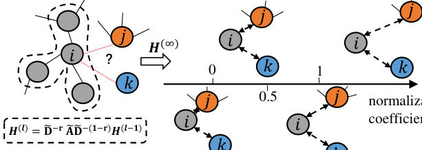
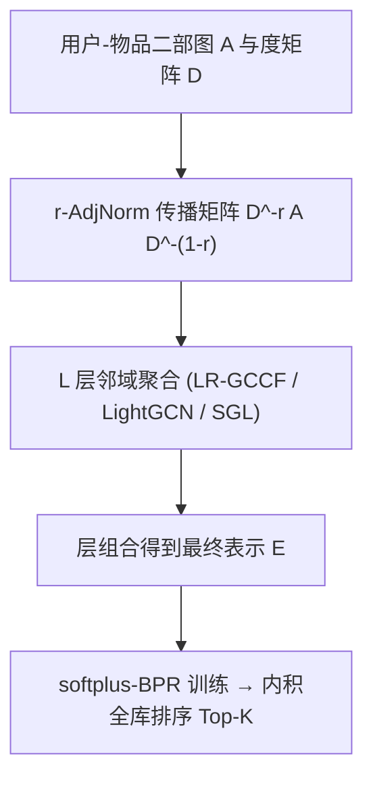

# Investigating Accuracy-Novelty Performance for Graph-based Collaborative Filtering (图协同过滤的准确性与新颖性权衡研究)

- **会议/期刊**: SIGIR 2022
- **作者与机构**: Minghao Zhao, Le Wu, Yile Liang 等（网易伏羲 AI Lab、合肥工业大学、浙江工业大学）
- **推荐链路定位**: 召回
- **研究方向**: 去偏公平、可信隐私与工业架构 / 图神经网络与知识图谱推荐
- **论文原文**: [https://arxiv.org/abs/2204.12326v2](https://arxiv.org/abs/2204.12326v2)
- **开源代码**: [https://github.com/fuxiAIlab/r-AdjNorm](https://github.com/fuxiAIlab/r-AdjNorm)

## TL;DR (1分钟核心速览)

图协同过滤（LightGCN 等）虽在 Recall 上领先，但本文实证发现其**对称邻域聚合反而放大流行度偏置**，且层数越深越严重。作者基于图极限定理证明归一化系数 $r$直接决定"高热度 vs 长尾节点"的偏好方向，提出零额外开销插件 **r-AdjNorm**：把传播矩阵改写为$\tilde{\mathbf{D}}^{-r}\tilde{\mathbf{A}}\tilde{\mathbf{D}}^{-(1-r)}$。在 3 个基准、3 种骨干（LR-GCCF / LightGCN / SGL）的**全库排序**评估下，调$r\in[0.5,1.25]$可在 Recall 几乎不降（$p>0.05$）的前提下把 Nov@20 提升 3%–6%、PRU@20 降低 4%–20%。

## Background & Motivation (背景与核心矛盾)

- **主流范式**: 将用户-物品交互视为二部图，用对称归一化 $\tilde{\mathbf{D}}^{-1/2}\tilde{\mathbf{A}}\tilde{\mathbf{D}}^{-1/2}$ 做多层邻域聚合（NA），再层组合（LC）+ BPR 训练。
- **前人局限**: ① 新颖性增强工作（重采样、重加权、正则、重排、因果去偏 MACR）几乎都在 **MF 范式或损失/后处理层**做再平衡，需牺牲精度换新颖性；② 图侧的多目标工作只盯 **多样性**，用启发式邻居选择，缺乏理论保证且改变图结构。
- **核心洞察 (Key Insight)**: 关键变量是 NA 的**归一化指数**而非图结构本身。若传播矩阵为 $\tilde{\mathbf{D}}^{-r}\tilde{\mathbf{A}}\tilde{\mathbf{D}}^{-(1-r)}$，则无穷层后$(\mathbf{h}_i^{(\infty)})^\top\mathbf{h}_j^{(\infty)}\propto[(d_i+1)(d_j+1)]^{1-r}$：$r<1$偏好高度节点（流行物），$r=1$完全无度偏置，$r>1$反转偏好长尾。而主流 LightGCN 恰取$r=0.5$。
- **本文切入点**: 不改骨干、不改损失、不加计算，只把归一化强度 $r$ 变成可调旋钮，实现精度-新颖性的连续可调。

<figure class="paper-figure" markdown="span">
  <figcaption>图1：随着𝑟增大，自我节点𝑖与其他节点的偏好分数变化趋势，其中节点𝑗的度大于节点𝑘。节点间双向箭头的长度表示偏好分数，长度越短分数越高。可以观察到，自我节点𝑖起初偏好节点𝑗，随着𝑟增大转而偏好节点𝑘。</figcaption>
</figure>

## Method (核心方法设计)

### 1. 整体框架 (Overall Architecture)

输入仅有用户-物品二部图 $\mathbf{A}$与度矩阵$\mathbf{D}$；在预处理阶段把每个 NA 层的归一化形式替换为$r$-AdjNorm，其余（层数$L$、LC 聚合方式、BPR 损失）完全沿用原骨干，因此插件对 LR-GCCF / LightGCN / SGL 均即插即用。训练后以用户-物品内积对**全库未交互物品**排序输出 Top-20。

### 2. 关键设计拆解 (Key Designs)

1. **$r$-AdjNorm 归一化算子（插件本体）**：以 LightGCN 骨干为例，把对称归一化改为非对称形式$ \mathbf{E}^{(l)}=\mathbf{D}^{-r}\mathbf{A}\mathbf{D}^{-(1-r)}\mathbf{E}^{(l-1)}$，向量形式为$\mathbf{E}_u^{(l)}=\sum_{i\in\mathcal{N}_u}|\mathcal{N}_u|^{-r}|\mathcal{N}_i|^{-(1-r)}\mathbf{E}_i^{(l-1)}$；LR-GCCF 版本额外保留自连接（$\tilde{\mathbf{A}}=\mathbf{A}+\mathbf{I}$）。直觉：调节"自我节点度"与"邻居度"的相对惩罚力度，即可移动聚合重心。原文$r=0.5$只是特例，$r=1$（左归一化）与$r=0$（随机游走右归一化）亦被统一进同一族。
2. **理论归因：极限偏好翻转定理**：借用 $\lim_{l\to\infty}(\tilde{\mathbf{D}}^{-r}\tilde{\mathbf{A}}\tilde{\mathbf{D}}^{-(1-r)})^l_{i,j}=\frac{(d_i+1)^{1-r}(d_j+1)^{r}}{2|E|+|V|}$，得到内积$\propto[(d_i+1)(d_j+1)]^{1-r}$的三段行为（$r<1$偏好高度、$r=1$中立、$r>1$ 偏好低度）。这解释了为何"对称归一化 = 内建流行度偏置"，也解释了层数加深时偏置被反复放大的现象——每层都在乘同一个度偏好因子。
3. **训练目标与推理开销**：沿用 BPR，但把 $\ln\sigma(\cdot)$换成数值更稳的 softplus 以规避 NAN：$\mathcal{L}=\frac{1}{|T|}\sum_{(u,i,j)\in T}\mathrm{softplus}(-\hat{y}_{ui}+\hat{y}_{uj})+\lambda\|\mathbf{E}\|_F^2$，负采样为均匀采样、负正比 1:1。推理零额外开销：$r$ 只在邻接矩阵预处理时改指数，不增参数、不增 FLOPs。

## Experimental Setup & Evaluation Protocol (实验设置与评估协议)

| 数据集 | #Users | #Items | #Interactions | 稀疏度 | 说明 |
| :--- | :---: | :---: | :---: | :---: | :--- |
| Amazon-Movie | 40,928 | 51,509 | 1,163,413 | 0.0552% | 过滤交互 <10 的用户/物品 |
| Amazon-Book | 52,643 | 91,599 | 2,984,108 | 0.0619% | LightGCN 发布版 |
| Yelp2018 | 31,668 | 38,048 | 1,561,406 | 0.130% | LightGCN 发布版 |

- **数据划分与防穿越**: 作者指出 LightGCN 发布的 Amazon-Book / Yelp2018 **不含验证集**，因此按 **7:1:2 比例重新划分**训练/验证/测试，早停仅看验证集 Recall@20（连续 5 次不升即停）。
- **排名评测协议**: 无偏 **Full-Ranking（全库未交互物品排序）**，$K=20$；精度用 Recall@20 / NDCG@20，新颖性用 Nov@20（归一化 surprisal，越高越新颖）与 PRU@20（排名位置与物品流行度的 Spearman 相关，越低越公平）。
- **对比基线与超参**: 覆盖重采样（NS，$p(j)\propto d_j^{\alpha}$）、重加权（PPNW）、正则（Reg）、后处理重排（PC）、因果去偏（MACR）、图增广（DegDrop），另加 MFBPR 作为新颖性参照。所有基线均**先调到与 MFBPR 同等新颖性水平**，再比精度下滑幅度；$d=64$、Adam、lr=1e-3、$\lambda$搜索$10^{-5}\sim10^{-1}$、$r$搜索$[0.5,1.5]$步长 0.05；结果取 5 次重复均值并做$p<0.05$ 显著性检验。

## Key Experimental Results (实验关键数据)

### 1. 主实验对比 (Main Results)

LightGCN 骨干（$r^*$ 为调优值，`Improv.` 相对最强基线 PC）：

| 方法 | Movie Recall | Movie Nov↑ | Movie PRU↓ | Book Recall | Book Nov↑ | Book PRU↓ | Yelp Recall | Yelp Nov↑ | Yelp PRU↓ |
| :--- | :---: | :---: | :---: | :---: | :---: | :---: | :---: | :---: | :---: |
| MFBPR | 0.0372 | 0.5967 | 0.1120 | 0.0247 | 0.6006 | 0.1581 | 0.0427 | 0.5337 | 0.2129 |
| LightGCN | 0.0502 | 0.5714 | 0.1854 | 0.0293 | 0.5876 | 0.2118 | 0.0521 | 0.5366 | 0.2485 |
| + NS | 0.0496 | 0.6067 | 0.1755 | 0.0283 | 0.6093 | 0.1705 | 0.0499 | 0.5593 | 0.2088 |
| + PPNW | 0.0493 | 0.5946 | 0.1540 | 0.0284 | 0.6063 | 0.1641 | 0.0503 | 0.5492 | 0.2388 |
| + Reg | 0.0465 | 0.5490 | 0.1344 | 0.0276 | 0.5823 | 0.1837 | 0.0488 | 0.5324 | 0.1899 |
| + PC | 0.0507 | 0.5765 | 0.1404 | 0.0289 | 0.5951 | 0.1491 | 0.0515 | 0.5362 | 0.2314 |
| + MACR | 0.0503 | 0.5499 | 0.2877 | 0.0232 | 0.4940 | 0.4151 | 0.0502 | 0.5373 | 0.2701 |
| + DegDrop | 0.0492 | 0.5737 | 0.1734 | 0.0291 | 0.5908 | 0.1966 | 0.0516 | 0.5406 | 0.2273 |
| **LightGCN$_{r\text{-}AdjNorm}$** | 0.0504 | **0.5959** | **0.1349** | **0.0296** | **0.6136** | **0.1529** | 0.0514 | **0.5559** | **0.1876** |
| `Improv.%` | -0.59% | +3.37% | +3.92% | +2.42% | +3.11% | -2.55% | -0.19% | +3.67% | **+18.93%** |

LR-GCCF 骨干上趋势一致：Yelp 的 PRU 相对 PC 降 **20.15%**（$p=1.79\text{e-}2$），Book 的 Recall +3.07%，Nov +4.38%。

### 2. 消融实验 (Ablation Study)

| 变体 (LightGCN) | Movie Recall | Movie Nov↑ | Movie PRU↓ | Book Recall | Book Nov↑ | Book PRU↓ | Yelp Nov↑ | Yelp PRU↓ |
| :--- | :---: | :---: | :---: | :---: | :---: | :---: | :---: | :---: |
| $0$-AdjNorm（右归一化） | 0.0421 | 0.5368 | 0.2694 | 0.0256 | 0.5557 | 0.3216 | 0.5103 | 0.3972 |
| $0.5$-AdjNorm（原骨干） | 0.0502 | 0.5714 | 0.1854 | 0.0293 | 0.5876 | 0.2118 | 0.5366 | 0.2485 |
| $1$-AdjNorm | 0.0512 | 0.5910 | 0.1423 | 0.0299 | 0.6013 | 0.1741 | 0.5438 | 0.2313 |
| $r^*$-AdjNorm（$0.75\sim1.2$） | 0.0504 | **0.5959** | **0.1349** | 0.0296 | **0.6136** | **0.1529** | **0.5559** | **0.1876** |

另：LightGCN 层深 $L=2\to32$时，Amazon-Movie 的 Nov 由 0.5701 降至 0.5119、PRU 由 0.1756 升至 0.3867；SGL 骨干上加插件（$r=0.75$）把 Movie 的 Nov 从 0.5950 提到 **0.6300**、PRU 从 0.1652 降到 **0.1265**，而 Recall（0.0572 vs 0.0574）基本持平。

### 3. 关键实验发现 (Key Findings)

1. **对称归一化本身就是偏置源**：$0\to0.5\to1$的单调变化（PRU 0.3972 → 0.2485 → 0.2313 on Yelp）实证了理论三段论——广泛使用的$r=0.5$天然偏向高热度物品，而$r>1$ 才反转为长尾偏好。
2. **零成本换公平而非换精度**：$r^*$相对最强基线 PC，在三个数据集上 Recall/NDCG 差异均不显著（$p=0.09\sim0.33$），但 PRU 最多降 18.93%（Yelp）且$p<0.01$；LR-GCCF 上亦取得 20.15% 的 PRU 降幅，说明"自连接"并非插件生效的前提。
3. **深度是偏置放大器，插件可解耦深度与公平**：$L$从 2 增至 32 使 PRU 翻倍（0.1756→0.3867），而$r^*$-AdjNorm 在$L\le8$时仍保持更低 PRU 与相近 NDCG；但$0$-AdjNorm 在$L>8$后 NDCG 明显崩塌，说明$r$ 的选择需与层数联合调节。

## Highlights & Limitations (亮点、对比与审稿批判)

- **与代表作对比**: 相对 **NS/PPNW/Reg**（在损失或采样层再平衡，必然牺牲精度）、**PC**（后处理重排，破坏打分单调性、需额外调参）、**MACR**（因果去偏，在未去偏测试集上反而恶化 PRU 至 0.2877），本文在**表征传播层**用一个标量解决，且不改变模型容量与推理路径。
- **可迁移亮点**: ① "把归一化指数当作可控超参"可迁移到任何带度归一化的 GNN 推荐（含 KGRec、社交推荐）；② PRU@20（排名-流行度 Spearman 相关）比 Nov@K 更能暴露排序级偏置，建议作为标准公平性指标。
- **审稿级局限批判**: ① 理论结论建立在**无穷层极限 + 训练/测试 IID**假设上，而实际最优 $r\approx0.75\sim1.2$、$L=2\sim4$，极限分析与有限层行为存在 gap，LC 层被有意保持不变未加分析；② 最优$r$依数据集与骨干变化，需网格搜索且文中未给出自适应选取准则；③ 评测仅三个公开数据集、离线全库排序，缺少长尾覆盖/多样性与线上 A/B 验证，也未讨论$r\neq0.5$ 后邻居度极小节点的梯度稳定性。

## Rating (四维评分)

- **方法创新性 (Novelty)**: ⭐⭐⭐⭐ （以图极限定理把"归一化指数"升格为可控的公平旋钮，洞察简洁但理论支撑扎实，非启发式调参）
- **评估协议与实验扎实度 (Protocol & Experiments)**: ⭐⭐⭐⭐ （3 数据集 × 3 骨干 × 6 类基线，重新划分 7:1:2 避免早停泄漏，含 $p$ 值检验；缺线上验证与多样性指标）
- **写作与数学规范度 (Clarity & Rigor)**: ⭐⭐⭐⭐ （三段 $r$ 区间推导清晰、图 1 直观解释偏好翻转；但极限分析与有限层实践的差异未充分讨论）
- **工业落地与复现价值 (Industrial & Practical Value)**: ⭐⭐⭐⭐⭐ （仅改预处理归一化指数，零参数零 FLOPs 增量，代码已开源，可直接作为现有 GNN 召回模型的公平性开关）

