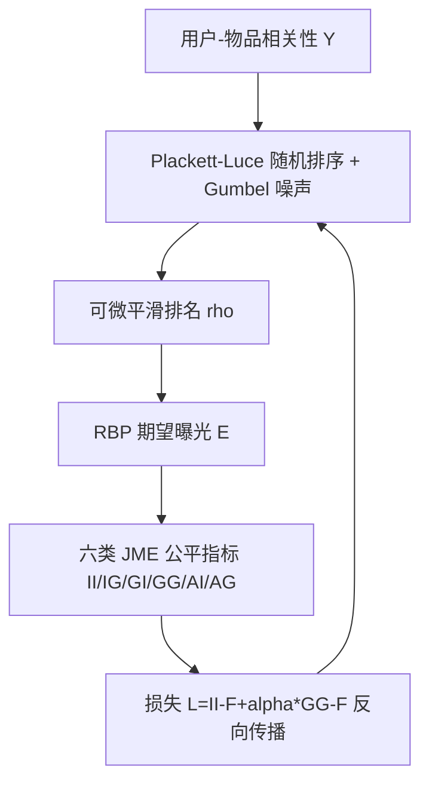
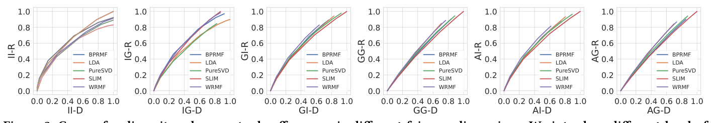

# Joint Multisided Exposure Fairness for Recommendation (推荐中的联合多边曝光公平)

- **会议/期刊**: SIGIR 2022
- **作者与机构**: Haolun Wu, Bhaskar Mitra, Chen Ma, Fernando Diaz, Xue Liu；McGill University / Microsoft / City University of Hong Kong / Google
- **推荐链路定位**: 排序/重排（曝光公平评测与随机排序优化）
- **研究方向**: 去偏公平、可信隐私与工业架构
- **论文原文**: [https://arxiv.org/abs/2205.00048v1](https://arxiv.org/abs/2205.00048v1)
- **开源代码**: [https://github.com/haolun-wu/JMEFairness](https://github.com/haolun-wu/JMEFairness)

## TL;DR (1分钟核心速览)

针对现有曝光公平仅覆盖单边/个体层面的痛点，本文把用户与物品两侧群体属性联合纳入期望曝光框架，形式化 II/IG/GI/GG/AI/AG 六类 JME-F 指标，并给出差异-相关性分解与 Plackett-Luce 可微随机排序优化。MovieLens 上 α=1 显著降低 GG-F（$p<0.01$），NDCG@50 仅降 0.0005–0.0011 且不显著。

## Background & Motivation (背景与核心矛盾)

- **主流范式**: 以 Diaz 等人的 expected exposure 框架为代表，用用户浏览模型衡量物品对用户的期望曝光偏差，主要关注 individual-user 到 individual/group-item 的 II-F、IG-F。
- **前人局限**: 现有工作多只建模消费者侧或生产者侧之一，难以刻画“某用户群体是否系统性地被少曝光某类物品”；同时，II-F 相同的系统可能在群体维度上呈现完全不同的不公平模式。
- **核心洞察 (Key Insight)**: 曝光偏差的聚合粒度决定公平语义。若把用户、物品两侧都做群体划分，可把 II/IG/GI/GG/AI/AG 统一为同一期望曝光偏差的不同聚合形式。
- **本文切入点**: 不新造推荐网络，而是形式化一组联合多边曝光公平指标，并用随机排序策略在多个公平目标间做可微权衡。

## Method (核心方法设计)

### 1. 整体框架 (Overall Architecture)

模型先由任意推荐器给出用户-物品相关性矩阵 $\mathbf{Y}$；用 Plackett-Luce 对每用户采样随机排序，并加入 Gumbel 噪声使采样可重参数化；再用平滑排名近似 RBP 期望曝光$\mathbf{E}$，与目标曝光$\mathbf{E}^{*}$比较得到六类 JME-F 指标；训练时以$\mathcal{L}=\text{II-F}+\alpha\cdot\text{GG-F}$反传，推理可按温度$\beta$ 调节随机化强度。

### 2. 关键设计拆解 (Key Designs)

1. **六类 JME-F 指标统一化**：痛点是个体级 II-F 无法暴露群体系统性偏差。本文定义以集团为聚合单元的偏差，例如 GG-F 为  
$\text{GG-F}=\frac{1}{|\mathcal{G}_d||\mathcal{G}_u|}\sum_{D\in\mathcal{G}_d}\sum_{U\in\mathcal{G}_u}\left(\sum_{j}\sum_{i}p(D_j|D)p(U_i|U)(E_{ij}-E^{*}_{ij})\right)^2$。  
IG-F/GI-F/AI-F/AG-F 分别是只分物品组、只分用户组、全体用户到单物品/物品组的特例；值越低越公平。

2. **差异-相关性分解**：令 $E^{\delta}_{ij}=E_{ij}-\tilde{E}_{ij}$、$E^{\Delta}_{ij}=E^{*}_{ij}-\tilde{E}_{ij}$，可把各指标拆成 disparity 平方项与 relevance 交叉项。随机化会压低 disparity，但也会损伤 relevance，因此公平提升并非无代价。  
<figure class="paper-figure" markdown="span">
  <figcaption>图3：六个不同公平性维度下差异性与相关性之间的权衡曲线。我们在来自六个不同推荐模型的静态排序基础上引入不同程度的随机性。</figcaption>
</figure>

3. **可微随机排序与训练目标**：PL 采样为 $p(D_j|U_i)=\frac{\exp(Y_{ij})}{\sum_k\exp(Y_{ik})}$，加入 Gumbel 噪声后用平滑排名  
$\rho_{D_j,\pi_{U_i}}=\sum_{k\ne j}\left[1+\exp\left(\frac{\tilde{p}(D_j|U_i)-\tilde{p}(D_k|U_i)}{\tau}\right)\right]^{-1}$近似 RBP 曝光。总损失$\mathcal{L}=\text{II-F}+\alpha\cdot\text{GG-F}$；无显式负采样，训练需采样多条排序估计期望曝光，推理成本高于静态 top-$k$。

## Experimental Setup & Evaluation Protocol (实验设置与评估协议)

- **数据集与预处理**:

| 数据集 | #Users | #Items | #Interactions | 稀疏度/密度 | 特征/场景说明 |
| :--- | :---: | :---: | :---: | :---: | :--- |
| MovieLens100K | 943 | 1,682 | 100,000 | 6.31% | 用户性别/年龄/职业，电影 genre |
| MovieLens1M | 6,040 | 3,706 | 1,000,000 | 4.47% | 用户人口属性，电影 genre；主公平分析 |

- **数据划分与防穿越 (Splitting Strategy)**: 每用户随机选 20% 评分作测试，其余按 70%/10% 作训练/验证；非全局时间戳切分，存在随机划分带来的乐观偏差。
- **排名评测协议 (Ranking Protocol)**: 推荐质量报告 NDCG@50；公平指标分析对每用户 top-100 重排并采样 100 条随机排序，RBP 耐心因子 $\gamma=0.8$。原文未声明负采样，不能视为严格 Full-Ranking。
- **对比基线与超参设置**: 使用 BPRMF、LDA、PureSVD、SLIM、WRMF 五个推荐器；MF 维度 $d=64$，Adam，batch=32，学习率/正则从$\{10^{-2},10^{-3},10^{-4}\}$选，$\alpha\in\{0,1,5,10,20,50\}$，$\tau=0.1$，$\beta\in\{1/8,\ldots,8\}$；显著性用 Student's$t$-test，$p<0.01$。

## Key Experimental Results (实验关键数据)

### 1. 主实验对比 (Main Results)

MovieLens1M 上各模型的 disparity-relevance 权衡 AUC（越高越好；加粗最优，<u>下划线</u>次优；`Improv.` 为最优相对次优）：

| 模型 | II-F AUC↑ | IG-F AUC↑ | GI-F AUC↑ | GG-F AUC↑ | AI-F AUC↑ | AG-F AUC↑ |
| :--- | ---: | ---: | ---: | ---: | ---: | ---: |
| BPRMF | <u>0.6331</u> | **0.4774** | 0.2904 | 0.2953 | 0.2712 | 0.2814 |
| LDA | 0.5664 | 0.4088 | 0.2837 | <u>0.3164</u> | 0.2687 | <u>0.3115</u> |
| PureSVD | 0.5830 | 0.4102 | <u>0.2921</u> | 0.3030 | <u>0.2755</u> | 0.2942 |
| SLIM | **0.6408** | 0.4654 | 0.2776 | 0.2851 | 0.2605 | 0.2752 |
| WRMF | 0.5996 | <u>0.4769</u> | **0.3135** | **0.3186** | **0.2957** | **0.3139** |
| Improv. over 2nd | 1.22% | 0.10% | 7.33% | 0.70% | 7.33% | 0.77% |

### 2. 消融实验 (Ablation Study)

原文未做“删模块”式消融；以下以 $\alpha$控制 GG-F 目标强度作核心消融，$\alpha=0$ 等价 w/o GG-F：

| 设置 | ML100K NDCG@50 | Δ | ML1M NDCG@50 | Δ |
| :--- | ---: | ---: | ---: | ---: |
| w/o GG-F ($\alpha=0$) | 0.3703 | — | 0.2741 | — |
| +GG-F ($\alpha=1$) | 0.3692 | -0.0011 | 0.2736 | -0.0005 |
| $\alpha=5$ | 0.3684 | -0.0019 | 0.2725 | -0.0016 |
| $\alpha=10$ | 0.3680 | -0.0023 | 0.2712 | -0.0029 |
| $\alpha=20$ | 0.3674 | -0.0029 | 0.2693 | -0.0048 |
| $\alpha=50$ | 0.3662 | -0.0041 | 0.2684 | -0.0057 |

### 3. 关键实验发现 (Key Findings)

- 随机化程度 $\beta$从$1/8$增至$8$ 时，六类 JME-F 及其 disparity/relevance 分量整体下降；静态 BPRMF 排序同时具有最高 relevance 与最高 disparity，验证“公平-相关性”硬权衡。
- Kendall 相关显示 II-F 与其他五类的相关性仅约 0.307–0.504；而 GI-F 与 AI-F 在 gender 分组下达 0.949，GG-F 与 AG-F 达 0.911（age 分组为 0.786），说明个体级指标不能替代群体级指标。
- 引入 $\alpha=1$后 GG-F 显著下降（$p<0.01$），而 II-F 上升与 NDCG@50 下降均不显著；ML1M 仅从 0.2741 降至 0.2736，表明多目标曝光公平可在近乎不损推荐质量下实现。

## Highlights & Limitations (亮点、对比与审稿批判)

- **与代表作对比 (vs. Prior Work)**: 相较 Diaz 等人的 II-F/生产者组框架，本文补全消费者侧群体与全用户侧聚合；相较 Singh & Joachims 的公平曝光约束，本文给出多边指标族与统一优化；相较 Burke/Ekstrand 的多边公平讨论，本文给出可计算、可微的形式化。
- **可迁移亮点**: “群体侧期望曝光 + 平滑排名重参数化”可直接迁移到搜索、POI、内容平台的多侧曝光审计与重排。
- **审稿级局限批判**: 目标曝光 $\mathbf{E}^{*}$ 依赖观测 relevance，历史偏差可能“bias-in-bias-out”；实验仅用单维敏感属性，未覆盖交叉性公平；每用户采样 100 条排序与平滑排名带来训练/评估开销，且缺少线上 A/B 与严格全库排序协议。

## Rating (四维评分)

- **方法创新性 (Novelty)**: ⭐⭐⭐⭐ （把六类曝光公平统一为期望曝光聚合特例，并给出可微随机排序优化，形式化贡献清晰。）
- **评估协议与实验扎实度 (Protocol & Experiments)**: ⭐⭐⭐⭐ （MovieLens 双数据集、5 个推荐器、15 个模型实例、Kendall 相关与 $t$-test 较完整，但缺线上验证。）
- **写作与数学规范度 (Clarity & Rigor)**: ⭐⭐⭐⭐ （指标定义、分解与 PL 重参数化链条完整；部分实现细节与 RBP 归一化需读者自行补全。）
- **工业落地与复现价值 (Industrial & Practical Value)**: ⭐⭐⭐ （开源代码利于复现，随机排序采样与公平约束调参带来线上延迟和工程成本。）

