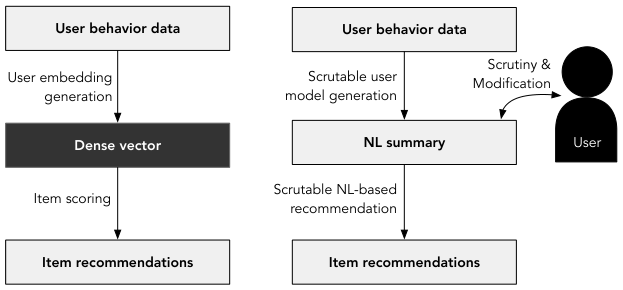
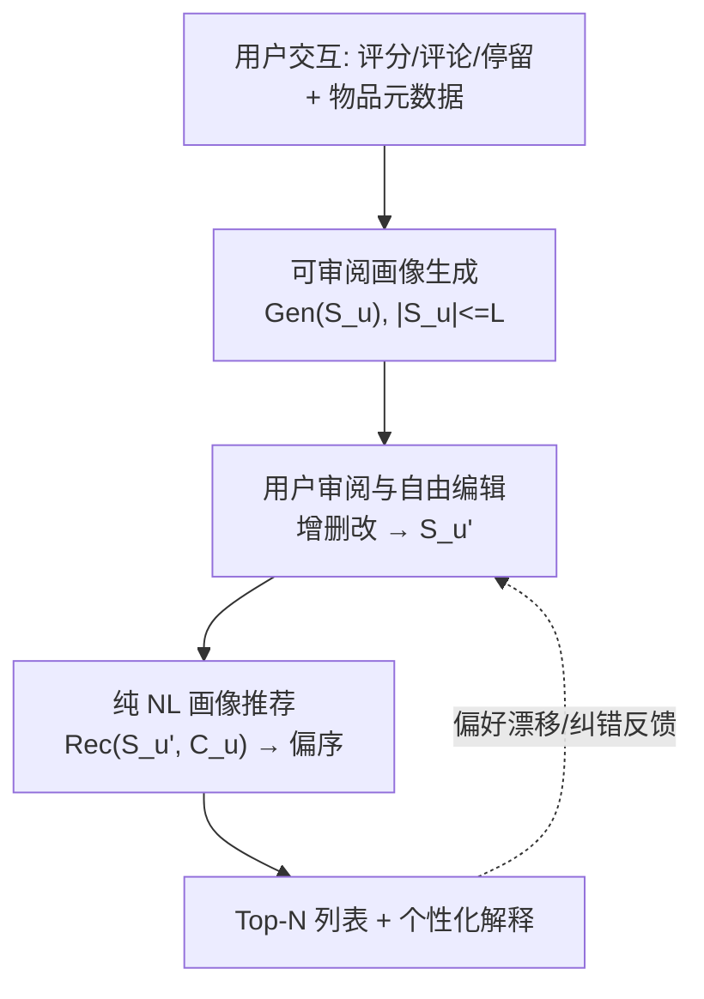

# On Natural Language User Profiles for Transparent and Scrutable Recommendation (论面向透明与可审阅推荐的自然语言用户画像)

- **会议/期刊**: SIGIR 2022 (Madrid, Spain)
- **作者与机构**: Filip Radlinski, Krisztian Balog, Fernando Diaz, Lucas Dixon, Ben Wedin（Google 伦敦/斯塔万格/蒙特利尔/巴黎/剑桥）
- **推荐链路定位**: 端到端（用户表征层重构，横跨画像生成与排序）
- **研究方向**: 去偏公平、可信隐私与工业架构 / LLM4Rec
- **论文原文**: [https://arxiv.org/abs/2205.09403v1](https://arxiv.org/abs/2205.09403v1)
- **开源代码**: 暂未开源

## TL;DR (1分钟核心速览)

本文是一篇**立场/愿景论文**：指出协同过滤依赖的稠密用户向量"不可读、不可改、不可解释"，借用大语言模型的生成能力，提出把用户兴趣压缩成**长度受限、可被人直接阅读并编辑的自然语言摘要**作为推荐的唯一中间表示。作者将难题拆解为「可审阅画像生成」与「纯 NL 画像推荐」两个可独立求解的子任务，并用 137B 的 LaMDA 以 **3-shot 提示（零微调）** 在电影域做了定性可行性验证：模型能从一句 NL 摘要直接产出合理推荐与个性化解释，但同时暴露幻觉、单侧面覆盖、新颖性失效等短板。**该文不含定量主实验与排行榜排名。**

## Background & Motivation (背景与核心矛盾)

- **主流范式**: 推荐与个性化检索统一采用 $u \mapsto \boldsymbol{e}_u \in \mathbb{R}^d$ 的稠密向量（矩阵分解、双塔），或细粒度关键词/标签加权画像；解释多为对已生成结果的**事后归因**。
- **前人局限**:
  - 稠密向量的语义不可解码，系统几乎不向用户展示；即便展示也无从理解，用户既无法**发现**被错误推断的兴趣（如一次临时好奇被长期固化），也无法对偏好漂移做**定向修正**。
  - 标签/关键词式画像虽可干预，但特征颗粒度杂、数量庞大，UI 认知负荷极高，用户改动后"收益延迟且不可见"，实际采纳率低（Jannach 等定义的控制机制要求**即时生效**）。
- **核心洞察 (Key Insight)**: 语言模型已同时具备 (i) 流畅生成、(ii) 少样本推理、(iii) 语义鲁棒匹配三项能力；同时 Balog 等的模板化 NL 画像研究表明，"自然语言兴趣摘要"给出的推荐质量已**不算远离**协同过滤。因此表示可读性与推荐精度之间不必是零和。
- **本文切入点**: 不再把 NL 当作解释的副产品，而把 **NL 摘要作为唯一知识载体**，把"生成"与"推荐"解耦为两个可独立优化、可分别评测的研究问题，并系统列出开放挑战。

<figure class="paper-figure" markdown="span">
  <figcaption>图1：传统方法与我们的方案的高层概览。我们不再依赖用户偏好的潜在表示，而是提出以自然语言作为显式、透明且可编辑的中间表示。</figcaption>
</figure>

## Method (核心方法设计)

### 1. 整体框架 (Overall Architecture)

论文把原系统中"隐向量生成 + 内积打分"的黑箱链条，替换为"**NL 摘要生成 → 用户审阅/编辑 → NL 条件排序**"的显式回路（图 1）。输入是用户的历史交互（评分、评论、曝光时长）与物品侧元数据文本；中间产物是长度受限的自然语言画像 $S_u$，它同时面向人和算法，可被直接删改；输出是候选集$\mathcal{C}_u$ 上的偏序与逐条个性化解释。作者强调该框架**不要求联合训练**：得益于 LLM 的能力，生成端与推荐端可分别借用 NLP 与 IR 的现成进展，从而降低落地门槛。

### 2. 关键设计拆解 (Key Designs)

1. **可审阅用户模型生成 (Scrutable User Model Generation)**：痛点是把行为压缩成向量后信息不可审。定义为一个**带长度上界的条件生成**问题：
$S_u=\operatorname{Gen}_\theta\big(\{(i_j,r_j)\}_{j=1}^{n},\,\mathcal{M}\big),\quad |S_u|\le L$其中$\mathcal{M}$为物品元数据文本，$L$既是信息容量约束也是**认知负荷约束**——篇幅越长覆盖越全，但用户越不可能读完并改对，故$L$ 与效用构成核心权衡。直觉：把"写偏好"这一高门槛任务转化为"**选择并校订**预生成短语"的低门槛任务。
2. **可审阅 NL 画像推荐 (Scrutable NL-based Recommendation)**：痛点在于这里的文本**不是查询**。检索中的 verbose query 是若干条件的**合取**（全部满足才相关），而用户画像承载的是跨情境兴趣的**析取**（多个重叠相关簇 + 新颖性/多样性偏好），且含否定与限定（"不喜欢…除非…"）。形式上要求输出
$\pi_u=\operatorname{Rec}_\phi(S_u,\mathcal{C}_u),\qquad \pi_u \text{ 按预测效用递减}$去噪约束是全库排序，而非样本内排序。附带产出：因$S_u$ 为自然语言，解释可直接引用用户自己的措辞，实现**解释与画像的同源对齐**。
3. **训练目标、更新机制与推理开销**：本文未训练模型。作者提出的联合目标是多目标折衷（可读、简洁、流畅、推荐准、新颖、多样），可写为 $\max_{\theta,\phi}\ \mathbb{E}[\mathrm{Util}(\pi_u)]-\lambda_1|S_u|-\lambda_2\,\mathrm{CognLoad}(S_u)-\lambda_3\,\mathrm{Inconsistency}(S_u,\mathcal{M})$；并给出两条实现路径：(a) **两阶段解耦**（生成用 LLM，排序用检索器/LLM）；(b) **端到端**训练，参照$\beta$-VAE 的属性可控生成，把"可审阅性"写进损失实现单模型可控。更新策略建议画像**双区维护**：用户确认/明示的部分 vs 系统推断待确认的部分，避免临时行为被固化。推理侧为 top-K 解码，成本随画像长度线性增长。

## Experimental Setup & Evaluation Protocol (实验设置与评估协议)

> 说明：本文是**立场论文**，主体为问题定义、文献综合与挑战清单，**不存在传统 #Users/#Items 统计表、划分协议与基线对比表**。作者提出的评测协议本身即为其贡献之一，故在此如实转述。

- **数据集与预处理**: 无新数据集。作者指出的可用资源包括：(i) TREC 过滤/adhoc 的 narrative 字段（含否定、限定等难语言，值得用现代语言模型重评）；(ii) 叙事驱动推荐数据（书籍 Bogers & Koolen、POI）；(iii) Balog & Radlinski 收集的"用户自述喜欢/不喜欢电影 + 具体条目"（60 候选、人工推荐）；(iv) Wizard-of-Oz 电影偏好诱导对话。关键缺口：缺少**同时含自然语言画像与真实交互**的大规模数据。
- **数据划分与防穿越 (Splitting Strategy)**: 未定义。作者建议按**历史交互数量分桶**评测（$|I_u|$ 从少到多），以便与基于评分的传统推荐器直接对比——因其性能随交互数增长，而 NL 摘要能否持续吸收增量信息是开放问题。
- **排名评测协议 (Ranking Protocol)**: 建议将子任务 2 视为 **Top-N 全库排序**，用 MRR / nDCG 等标准 IR 指标；但明确指出"相关性 $\neq$ 效用"：推荐场景中用户寻求**未体验过**的物品，故效用依赖该物品是否/多频繁被消费过，需引入新颖性约束，多样性亦应计入。
- **对比基线与超参设置**: 量化基线缺失。可审阅性本身建议用**编辑有效性**度量：$\Delta\text{Util}=f(S_u')-f(S_u)$（一次编辑带来的效用变化），并配以理解度、可编辑性、界面可用性的人工研究；同时须评估**语义歧义鲁棒性**（同义改写不应显著改变推荐结果，否则审阅失去意义）。
- **定性实验设置**: LaMDA（decoder-only Transformer，137B 参数，仅做 next-token 预训练），采用 **3-shot 提示模板**（表 2：给出 3 组「NL 摘要 → 3 条推荐 + 简短理由」示例，再拼接 `<NL-SUMMARY>`），**不微调**，以 top-K 解码逐 token 生成。

## Key Experimental Results (实验关键数据)

### 1. 主实验对比 (Main Results)

论文无定量主表。下图把其核心定性主张（表 1 的两个领域实例）与既往范式对照，可视为"设计层面的对照表"：

| 对照维度 | 传统稠密向量画像 | 标签/关键词画像 | 本文 NL 画像 |
| :--- | :--- | :--- | :--- |
| 用户可读性 | 几乎不可读 | 可读但零碎 | **整句自然语言，可直读** |
| 可编辑粒度 | 无接口 | 增删标签（粒度混杂） | **自由改写任意句** |
| 偏好漂移响应 | 慢，需大量新反馈 | 中 | **改一句即生效**（假设） |
| 区分"未来期望 vs 历史行为" | 不区分 | 不区分 | **可显式声明 aspired 偏好** |
| 冷启动 | 需先积累交互 | 需选标签体系 | **可直接自述或迁移摘要** |
| 逐条解释来源 | 事后归因 | 标签匹配 | **直接引用用户原句** |

表 1 电影实例：初始摘要为"I like dramas involving unique personalities… I don't like romantic comedies"，用户校订为"…don't like movies about drunken behaviour…除非有极佳摄影（如昆汀）"，推荐由 *Mission to Mars / The Waterboy* 变为 *Roman Holiday / Arrival / The Iron Giant*——**同一用户、同一交互历史，仅改文本即改变输出**，这正是"可审阅性"的操作化定义。

### 2. 消融实验 (Ablation Study)

不适用（无训练模型、无可消融组件）。作者以**失败案例清单**替代消融，逐项拆解该范式的失效来源（见表 3 后讨论），可视为"负向归因实验"。可行性样例（3 组摘要 × 各取前 4 条）：

| NL 摘要输入 | 生成的代表性推荐 | 是否给出个性化解释 | 观察到的失效 |
| :--- | :--- | :---: | :--- |
| movies where the murderer is involved from the beginning | The Usual Suspects / Se7en / Scream / Memento | 是 | **幻觉**：称 Se7en 的凶手一开始即揭晓（实际后半段） |
| space exploration movies that are funny | Guardians of the Galaxy / The Martian / Spaceballs / Hitchhiker's Guide | 是 | 与专业电影搜索引擎有部分重合，但后者无解释 |
| animated movies with creative and interesting fight scenes | Akira / The Incredibles / Kung Fu Panda / Sword of the Stranger | 是 | 解释正确抓住"creative fight scenes"而非动画风格本身 |

### 3. 关键实验发现 (Key Findings)

1. **零微调即可"跑通"两段式闭环，且解释与画像同源**：3-shot 的 LaMDA 在第三例中把理由锚定在用户写下的 "creative and interesting fight scenes" 上，而非泛泛的"动画风格"，说明 NL 中间表示天然支持**用户措辞级**的解释生成，这是向量画像难以做到的。
2. **大模型的能力"看起来像解决了问题"，实则在单向摘要上才成立**：所有样例摘要都只描述**单一侧面**（凶手早现/太空+搞笑/动画打斗），而真实用户的兴趣是跨情境的宽析取；作者据此判断 NL 画像的容量—可审阅性权衡（$L$ 的取值）才是真正的瓶颈，而非模型能力。
3. **三类系统性风险已被实证观察**：(i) **新颖性失效**——纯 NL 画像无法记录"已看过/已推荐过"的物品，需引入受限 side information 仅用于去重；(ii) **流行度偏置**——推荐明显偏向美国热门影片，对"精确年代"等硬约束不敏感；(iii) **事实幻觉**——如 Se7en 的剧情误述，直接损害解释可信度与信任。这三条把"幻觉/偏置/新颖性"从抽象担忧变成可测的具体失效模式。

## Highlights & Limitations (亮点、对比与审稿批判)

- **与代表作对比 (vs. Prior Work)**:
  - vs. **Balog 等模板化可解释画像**: 其画像仍是标签对加权、文本由模板拼接，编辑限于"删句"，且推荐器实际用的是**文本之外的标签权重**；本文要求推荐器**只**读文本，从而让编辑真正生效。
  - vs. **Zemlyanskiy 等 BERT 生成推荐**: 其输入是面向**当下单一需求**的自由描述；本文要求画像**整体刻画长期兴趣**，任务难度与评测口径均不同。
  - vs. **对话推荐 (CRS)**: CRS 多轮询问但通常不产出可审阅、可自由改写的持久摘要；本文把"摘要"本身作为一等公民。
- **可迁移亮点**:
  - **"编辑有效性" $\Delta\text{Util}$作为评测维度**：任何带用户可控表征的推荐系统（如标签控制、$\beta$-VAE 属性控制）都可直接借用这一操作化指标。
  - **画像双区维护（明示 vs 推断待确认）**：可直接移植到工业画像系统，兼顾新鲜度、可解释与纠错入口。
- **审稿级局限批判**:
  - **无定量证据支撑核心主张**：全文最关键的论断"NL 画像质量不比 CF 差多少"仅引用他人模板化实验，本文自身的 LaMDA 样例只有 3 组、各 4 条推荐，既无 nDCG/MRR、也无人工 A/B，说服力停留在 demo 级。
  - **成本与工程可行性未估算**：137B 模型对**每个用户 × 每个候选集**做生成式排序在在线场景不可行；作者亦未讨论延迟、缓存或蒸馏路径，而"可审阅性收益 vs 每请求算力开销"恰恰是工业落地的第一道门槛。

## Rating (四维评分)

- **方法创新性 (Novelty)**: ⭐⭐⭐⭐⭐ （把"用户表示"从向量换成可编辑自然语言，并给出干净的两段式问题分解，是范式级提法而非增量改进）
- **评估协议与实验扎实度 (Protocol & Experiments)**: ⭐⭐ （无数据集统计、无划分、无基线、无显著性检验；可行性研究仅 3 组样例，属 demo 而非实验）
- **写作与数学规范度 (Clarity & Rigor)**: ⭐⭐⭐⭐ （两个形式化定义清晰、挑战清单层层递进、实例表格极具说服力；但形式化仅止于定义，无推导与复杂度分析）
- **工业落地与复现价值 (Industrial & Practical Value)**: ⭐⭐⭐ （可审阅性与画像双区维护思路可直接落地；但无代码、无数据集、生成式排序成本未评估，短期复现价值有限）

