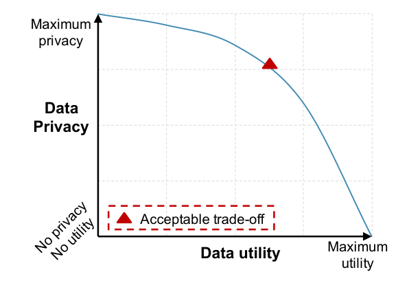
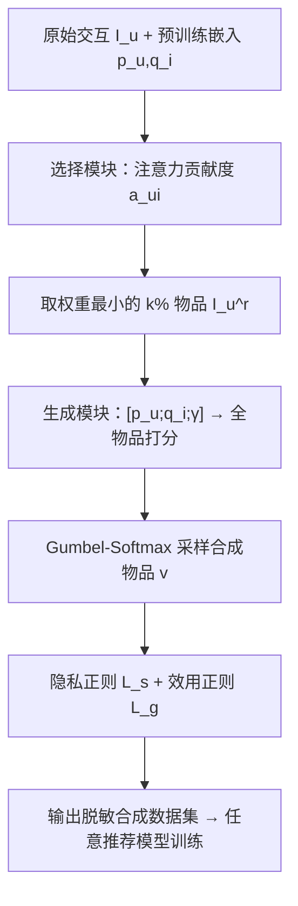

# Privacy-Preserving Synthetic Data Generation for Recommendation Systems (面向推荐系统的隐私保护合成数据生成)

- **会议/期刊**: SIGIR 2022 (45th ACM SIGIR, Madrid)
- **作者与机构**: Fan Liu, Yinwei Wei, Mohan Kankanhalli (NUS)；Zhiyong Cheng (齐鲁工大/山东省科学院)；Huilin Chen (天津理工)；Liqiang Nie (山东大学)
- **推荐链路定位**: 数据层（发布/共享前的交互数据脱敏与增强），不与具体模型耦合
- **研究方向**: 去偏公平、可信隐私与工业架构 / 生成式推荐与离散语义 ID
- **论文原文**: [https://arxiv.org/abs/2209.13133v1](https://arxiv.org/abs/2209.13133v1)
- **开源代码**: [https://github.com/HuilinChenJN/UPC_SDG](https://github.com/HuilinChenJN/UPC_SDG)

## TL;DR (1分钟核心速览)

现有隐私推荐方案（联邦学习、差分隐私）只保护**训练与结果收集**阶段的隐私，一旦原始交互数据被共享或公开发布，隐私泄露依然存在；且它们都忽略了**用户在各场景下隐私偏好不同**这一事实。本文提出 UPC-SDG：在数据层用注意力估计每个物品对用户偏好的贡献度，替换贡献最小的 $k\%$物品；在物品层用 Gumbel-Softmax 可微生成一个"像用户会喜欢、但与原物品相似度不超过$\gamma$"的合成物品。在 Office/Clothing/Gowalla 上，即便$k=0.8,\gamma=0.1$的强隐私设置下，LightGCN 的 Recall@20 仍保留原始数据的 17.8%，而$k=0.2,\gamma=0.9$ 弱隐私设置下保留 63.4%（Office: 0.1323→0.0839）。

## Background & Motivation (背景与核心矛盾)

- **主流范式**: 隐私推荐沿两条路线：一是联邦学习（Yang et al.）把原始数据留在本地只传梯度；二是差分隐私（Gao et al., Wang et al.）在训练或打分时加噪/混淆。
- **前人局限**: (1) 两者都建立在去中心化框架上，通信与本地算力开销大，难落地；(2) 二者都假设原始数据"可以不外流"，但企业间数据共享、公开数据集发布时**原始数据仍被直接交出**，隐私问题原封不动；(3) 用户隐私偏好被完全抹平——医疗/金融记录的敏感度远高于日用百货，统一强度加噪既过度保护又损伤效用。
- **核心洞察 (Key Insight)**: 隐私与效用不可兼得（图 1 的权衡曲线），但**隐私应当是"用户可控"的两个旋钮**：替换比例 $k$控制数据层"有多少条记录被换掉"，敏感度$\gamma$ 控制物品层"合成物品能有多像原物品"。只要保证"被换掉的都是对偏好贡献最小的物品"，就能在同等隐私预算下把效用损失压到最低。

<figure class="paper-figure" markdown="span">
  <figcaption>图1：数据隐私与数据效用之间的权衡。</figcaption>
</figure>

- **本文切入点**: 用"生成式替换"替代"加噪/加密"，把脱敏后的合成交互数据直接当成一份**可发布、可共享、可下发给任意中心化推荐模型训练**的数据集。

## Method (核心方法设计)

### 1. 整体框架 (Overall Architecture)

给定用户 $u$的交互集合$\mathcal{I}_u$，模型先由**选择模块**用注意力估计每个物品对用户偏好的贡献权重$a_{ui}$，取权重最小的$k\%$组成待替换集合$\mathcal{I}^r_u$；随后**生成模块**把$(p_u; q_i; \gamma_u)$拼接映射到隐空间，与全物品嵌入矩阵做内积得到打分分布，用 Gumbel-Softmax 从"用户未交互过"的物品中可微采样出合成物品$v$；最后由**隐私-效用权衡策略**用 hinge 隐私正则（$f_{sim}(q_i,q_v)\le\gamma$）与 BPR 式效用正则共同优化，端到端训练生成器。发布时仅用合成物品替换$\mathcal{I}^r_u$，其余原始交互保留，形成脱敏数据集。

### 2. 关键设计拆解 (Key Designs)

1. **贡献度感知选择模块（数据层隐私）**: 若随机替换，被删掉的可能是核心偏好信号，效用崩溃。本文用注意力聚合用户表征 $t_u=\frac{1}{|\mathcal{I}_u|}\sum_{i}a_{ui}q_i$，其中$a_{ui}=\frac{\exp(v_{ui})}{[\sum_{j'}\exp(v_{uj'})]^{\beta}}$，$v_{ui}=h^\top \mathrm{ReLU}(W_1[p_u:q_i]+b_1)$；并用$L_2$正则$\mathcal{L}_D=\sum_u\lVert f(t_u,\theta)-p_u\rVert^2$以$p_u$作监督信号学权重。平滑指数$\beta\in[0,1]$ 削弱 softmax 的尖峰，避免权重过度集中。直觉：既已被模型"学得差不多"的物品，换掉后信息损失最小。

2. **可微生成 + 隐私-效用权衡（物品层隐私）**: 直接 argmax 采样不可导。本文用 Gumbel-Max 重参数化 $\tilde{y}_{u,i}=\mathrm{softmax}\big(\frac{1}{\tau}(h_{u,i}+g_{u,i})\big)$，$g=-\log(-\log\mu),\ \mu\sim U(0,1)$，使"离散选品"可端到端反传。隐私侧定义相对相似度并用 hinge 约束：$\mathcal{L}_s=\sum_{(u,i,v)}[f_{sim}(q_i,q_v)-\gamma_u]_+$，$\gamma$越小强制合成物品离原物品越远；效用侧用$\mathcal{L}_g=\sum_{(u,v)}-\ln\sigma(p_u^\top q_v)$ 保证合成物品仍"讨用户喜欢"。

3. **训练目标与推理开销**: 总损失 $\mathcal{L}=\mathcal{L}_D+\lambda_s\mathcal{L}_s+\lambda_g\mathcal{L}_g$（Office/Gowalla 取$\lambda_s=3,\lambda_g=1$，Clothing 取$5,7$），Adam 优化，嵌入维度$d=64$，用户/物品嵌入由 BPRMF 预训练得到。负采样在生成阶段**无需显式负样本**（全物品 softmax 隐式对比，仅排除已交互物品）；下游推荐模型训练则沿用"每正例随机配 1 负例"的 pairwise 策略。推理时每个待替换物品仅需一次前向 + 全库打分，复杂度$O(|\mathcal{I}^r_u|\cdot N_i d)$，属离线一次性开销。

## Experimental Setup & Evaluation Protocol (实验设置与评估协议)

- **数据集与预处理**: 三个公开数据集，均按前人设置过滤，**保留交互数 ≥ 10 的用户与物品**（10-core）：

| 数据集 | #Users | #Items | #Interactions | 稀疏度 | 特征/场景说明 |
| :--- | :---: | :---: | :---: | :---: | :--- |
| Office (Amazon) | 4,874 | 2,405 | 52,957 | 99.55% | 办公品类，稠密度最高 |
| Clothing (Amazon) | 18,209 | 17,317 | 150,889 | 99.95% | 服饰品类，最稀疏 |
| Gowalla | 29,858 | 40,981 | 1,027,370 | 99.91% | LBS 签到，规模最大 |

- **数据划分与防穿越**: 对每个用户按 **80:10:10 比例随机划分**训练/验证/测试；生成任务仅使用训练集的观测交互作为输入，避免测试信息泄入合成数据。
- **排名评测协议**: **Full-Ranking（全库排序）**——测试时把该用户未交互过的所有物品均视为负例，报告 **PR@20 / Recall@20 / NDCG@20**，在全部测试用户上取平均。
- **对比基线**: Random、BPRMF（矩阵分解 + BPR）、NeuMF（神经协同过滤）、LightGCN（图卷积）。全部使用作者官方代码并调至最优；嵌入维度统一 $d=64$，batch=2048，$L_2$系数在$\{10^{-1},\dots,10^{-6}\}$搜索，早停策略与 LightGCN 一致。隐私网格$k\in\{0.2,0.4,0.6,0.8\}$、$\gamma\in\{0.1,0.3,0.5,0.7,0.9\}$；以$k=0.8,\gamma=0.1$记 `-`（强隐私），$k=0.2,\gamma=0.9$ 记 `+`（弱隐私）。

## Key Experimental Results (实验关键数据)

### 1. 主实验对比 (Main Results)

下游模型在原始 vs. 合成数据集上的表现（PR/Recall/NDCG@20，表中列 Recall 与 NDCG；Random 在原始与合成集上表现几乎相同，故以 `-` 省略）：

| 数据集 | BPRMF R@20 | BPRMF N@20 | NeuMF R@20 | NeuMF N@20 | LightGCN R@20 | LightGCN N@20 |
| :--- | :---: | :---: | :---: | :---: | :---: | :---: |
| Office (原始) | 0.1254 | 0.0740 | 0.0605 | 0.0710 | **0.1323** | **0.0752** |
| Office⁻ ($k$=.8,$\gamma$=.1) | 0.0176 | 0.0080 | 0.0316 | 0.0374 | 0.0235 | 0.0125 |
| Office⁺ ($k$=.2,$\gamma$=.9) | 0.0878 | 0.0506 | 0.0580 | 0.0702 | **0.0839** | 0.0496 |
| Clothing (原始) | 0.0526 | 0.0243 | 0.0668 | 0.0303 | **0.0692** | **0.0312** |
| Clothing⁻ | 0.0023 | 0.0026 | 0.0109 | 0.0044 | 0.0345 | 0.0148 |
| Clothing⁺ | 0.0422 | 0.0187 | 0.0553 | 0.0245 | **0.0639** | 0.0281 |
| Gowalla (原始) | 0.1565 | 0.1277 | 0.1017 | 0.1548 | **0.1823** | **0.1555** |
| Gowalla⁻ | 0.0121 | 0.0073 | 0.0088 | 0.0213 | 0.0148 | 0.0100 |
| Gowalla⁺ | 0.1051 | 0.0740 | 0.0736 | 0.0870 | **0.1257** | 0.0812 |

> 说明：原始数据集上 LightGCN 相对次优基线 BPRMF 在 Recall@20 上提升 5.5%(Office)/31.6%(Clothing)/16.5%(Gowalla)；合成数据上的排序结论与原始数据保持一致。

### 2. 消融实验 (Ablation Study)

基于 Office、$\gamma=0.9$，BPRMF 在各$k$ 下的合成数据上评测：

| 变体 | $k_1$=.2 (R/N) |$k_2$=.4 (R/N) |$k_3$=.6 (R/N) |$k_4$=.8 (R/N) |
| :--- | :---: | :---: | :---: | :---: |
| UPC-SDG$_{s}$ (随机选择替换物品) | 0.0466 / 0.0215 | 0.0356 / 0.0160 | 0.0261 / 0.0118 | 0.0143 / 0.0056 |
| UPC-SDG$_{r}$ (随机采样合成物品) | 0.0495 / 0.0227 | 0.0325 / 0.0151 | 0.0221 / 0.0098 | 0.0027 / 0.0012 |
| UPC-SDG$_{f}$ (固定相似度生成) | 0.0497 / 0.0229 | 0.0338 / 0.0154 | 0.0252 / 0.0109 | 0.0105 / 0.0047 |
| **UPC-SDG (完整)** | **0.0878 / 0.0506** | **0.0717 / 0.0399** | **0.0646 / 0.0362** | **0.0582 / 0.0326** |

### 3. 关键实验发现 (Key Findings)

1. **强隐私下效用衰减可控但幅度悬殊**：$k=0.8,\gamma=0.1$时 LightGCN 在 Office 上 Recall@20 从 0.1323 掉到 0.0235（−82.2%），Gowalla 从 0.1823 掉到 0.0148（−91.9%）；而$k=0.2,\gamma=0.9$时仅降至 0.0839（−36.6%）和 0.1257（−31.0%），说明**隐私预算一旦越过临界点，效用呈断崖式下降**，实际部署应停在$k\le0.4$ 区间。
2. **选择模块是效用主导项**：去掉贡献度感知（随机替换）后，$k_1$处 NDCG@20 从 0.0506 跌至 0.0215（−57.5%），$k_4$处从 0.0326 跌至 0.0056（−82.8%）；相比之下随机采样合成物品（$-$55.1%）与固定相似度（$-$54.7%）的损失相近。这印证了"**换谁**比"换成什么"更关键"这一核心假设。
3. **最优权衡点随场景迁移**：Office/Clothing/Gowalla 的最优 $\gamma$分别为 0.5/0.7/0.5——服饰品类用户须让渡更多隐私才能保住推荐精度；而稠密的 Office 对$k$最不敏感（交互充足时冗余信息多），稀疏的 Clothing 对$\gamma$最敏感，与"用户隐私偏好应场景化"的动机一致。可视化亦显示$\gamma$ 增大时合成物品从"跨品类"逐步回归"同品类配饰"。

## Highlights & Limitations (亮点、对比与审稿批判)

- **与代表作对比 (vs. Prior Work)**: 相对联邦学习方案（Yang et al.）与 DP 加噪方案（Gao et al., Wang et al.），本文的差异在于**保护位置前移到数据发布环节**——前者假设原始数据不离开本地，本文直接产出一份可公开、可交易的替代数据集；同时把隐私强度交由用户以 $(k,\gamma)$ 显式控制，是对"一刀切加噪"的精细化替代。与通用合成数据方法（Acs et al. 的私有 kernel k-means、Bindschaedler et al. 的 plausible deniability）相比，本文引入了推荐任务特有的**偏好贡献度**与**效用正则**，使合成数据"可训练"而非仅"统计分布接近"。
- **可迁移亮点**: (1) "按注意力贡献度挑选低信息量样本再替换"这一思路可直接迁移到**数据增强/难负样本合成**与**隐私受限的跨域数据共享**；(2) Gumbel-Softmax 让"从物品库中离散选品"可端到端训练，可作为生成式检索/语义 ID 采样的通用技巧。
- **审稿级局限批判**: (1) **隐私保证是经验性的**：$k$与$\gamma$只是替换比例与相对相似度阈值，缺乏$(\epsilon,\delta)$-DP 式的形式化保证，也没有成员推断/重识别攻击实验来量化真实泄露风险；(2) **生成开销与规模瓶颈**：生成模块对全物品库做 softmax 打分，$N_i$达 4 万时开销线性增长，且论文承认在 Gowalla 这类较大数据上$\gamma$ 的调节几乎失效、训练不稳定；(3) 评测仅覆盖 4 个（且 Random 无效）下游模型、单一 80:10:10 随机划分，缺少对时序切分与冷启动场景下合成数据可信度的检验。

## Rating (四维评分)

- **方法创新性 (Novelty)**: ⭐⭐⭐⭐ （将"合成数据发布"引入推荐隐私保护，并以贡献度选择+用户可控双旋钮重构隐私-效用权衡，视角新颖；但生成器本身为常规注意力+MLP+Gumbel 组合）
- **评估协议与实验扎实度 (Protocol & Experiments)**: ⭐⭐⭐ （采用无偏 Full-Ranking 与三个异构数据集、做了 $k\times\gamma$ 网格与三种消融，但缺形式化隐私度量与攻击实验，划分方式单一）
- **写作与数学规范度 (Clarity & Rigor)**: ⭐⭐⭐⭐ （公式与模块对应清晰、损失权重与超参交代完整；相对相似度 $f_{sim}$中$\min(\cdot)$ 的定义略含混）
- **工业落地与复现价值 (Industrial & Practical Value)**: ⭐⭐⭐⭐ （代码已开源、可直接作为数据发布前的脱敏中间件；离线一次性开销可接受，但全库打分与缺乏 DP 保证在企业合规场景仍需加固）

