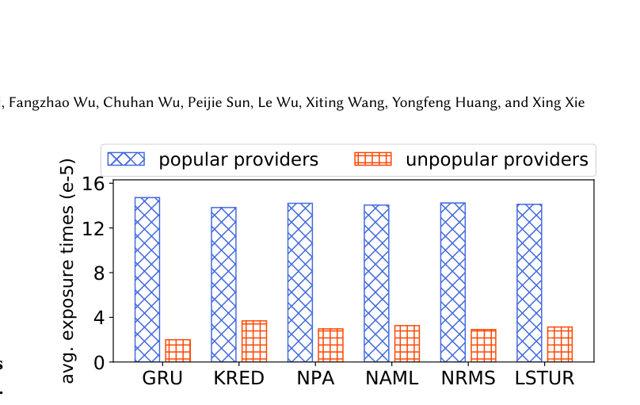
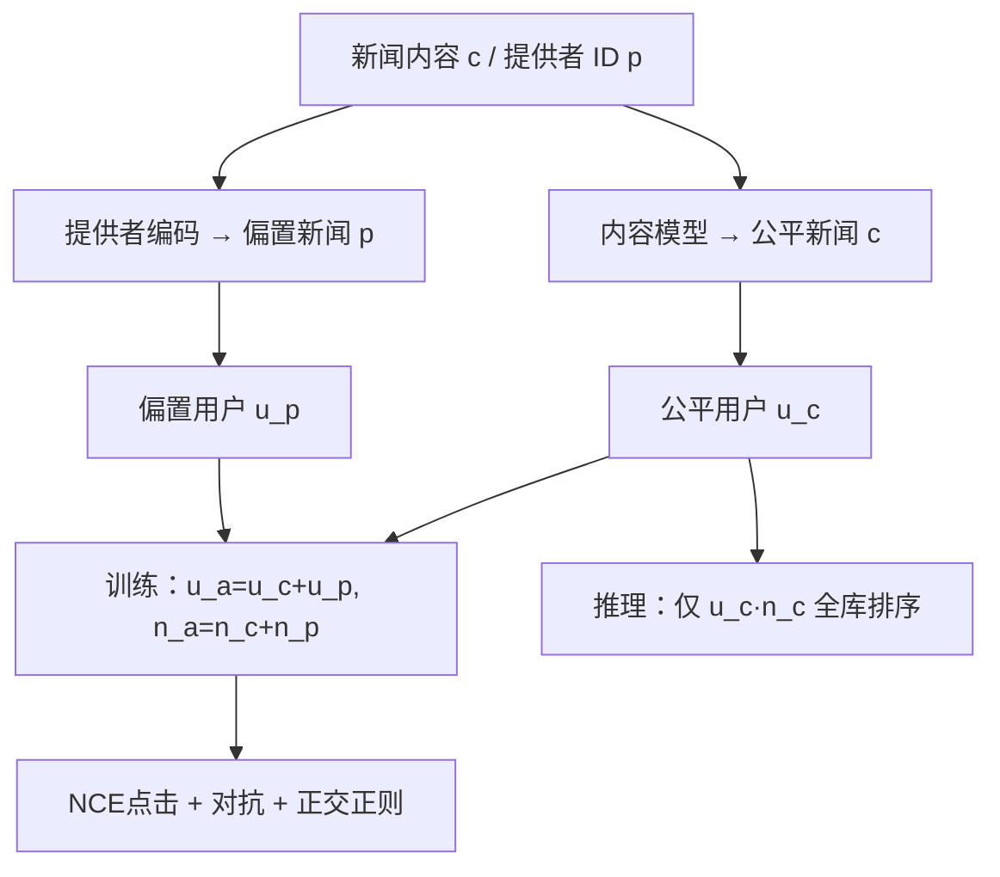
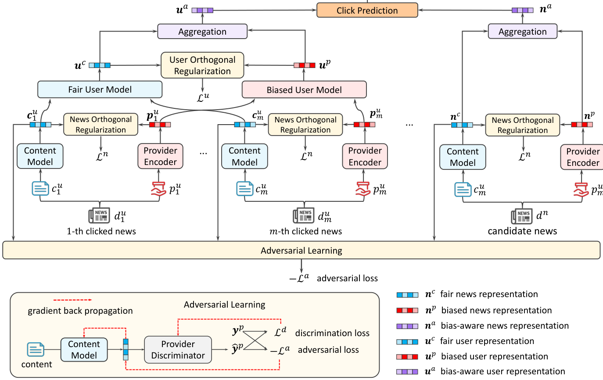

# ProFairRec: Provider Fairness-aware News Recommendation (提供者公平感知的新闻推荐)

- **会议/期刊**: SIGIR 2022
- **作者与机构**: Tao Qi 等，清华大学、微软亚洲研究院、合肥工业大学
- **推荐链路定位**: 精排（用户—新闻匹配与排序）
- **研究方向**: 去偏公平、可信隐私与工业架构
- **论文原文**: [论文原文链接](https://arxiv.org/abs/2204.04724v1)
- **开源代码**: [开源代码仓库链接](https://github.com/taoqi98/ProFairRec)

## TL;DR (1分钟核心速览)

本文针对新闻推荐中“热门提供者占据多数曝光、少数提供者被系统性低估”的提供者公平问题，提出 ProFairRec：将新闻/用户表征解耦为“公平分支”和“偏置分支”，训练时用偏置分支吸收数据中的提供者流行度捷径，推理时仅用公平分支匹配，并加入提供者判别对抗与正交正则。MIND 上以 NRMS 为骨干，ER@10 从 0.1237 提升至 0.3644，AUC 仅从 68.08 降至 67.64；公平性采用全库排序评估。

## Background & Motivation (背景与核心矛盾)

- **主流范式**: 新闻推荐通常从标题/正文学习新闻表征，从用户点击历史学习用户兴趣，再用内积匹配候选新闻，并在点击/非点击数据上训练。
- **前人局限**: 用户点击在不同提供者上天然偏置，模型会继承甚至放大热门提供者偏好；现有提供者公平方法多为后置重排规则，难以联合优化公平与精度。
- **核心洞察 (Key Insight)**: 点击数据同时包含“提供者流行度捷径”和“内容相关性”两类信号，单一表征很难只编码后者而不混入前者。
- **本文切入点**: 用双分支表征显式分离偏置与公平信息，只让公平分支参与线上排序。

<figure class="paper-figure" markdown="span">
  <figcaption>图 2：在 MIND 上，不同新闻推荐模型的前列推荐结果中，热门与冷门提供者的平均曝光机会。热门提供者定义为按历史数据中每篇新闻的平均点击次数排序的前 50% 提供者，其余视为冷门提供者。</figcaption>
</figure>
图 2：MIND 上主流新闻推荐模型对热门/冷门提供者的曝光差异。

## Method (核心方法设计)

### 1. 整体框架 (Overall Architecture)

ProFairRec 将新闻内容经内容模型编码为公平新闻表征 $\mathbf{c}$，将提供者 ID 经提供者编码器编码为偏置新闻表征$\mathbf{p}$；用户侧分别聚合其点击新闻的公平/偏置表征得到$\mathbf{u}_c$与$\mathbf{u}_p$。训练时用$\mathbf{u}_c+\mathbf{u}_p$与$\mathbf{n}_c+\mathbf{n}_p$做点击预测以拟合偏置数据；推理时仅用$\mathbf{u}_c^\top\mathbf{n}_c$ 排序，从而实现“训练吸收偏置、服务只用公平信息”。

<figure class="paper-figure" markdown="span">
  <figcaption>图 3：ProFairRec 的整体框架。</figcaption>
</figure>
图 3：ProFairRec 整体框架：双分支表征、对抗学习与正交正则。

### 2. 关键设计拆解 (Key Designs)

1. **公平/偏置表征解耦**：痛点在于偏置数据中的提供者流行度会污染内容兴趣；做法是 $\mathbf{c}=\Phi_{nc}(c)$、$\mathbf{p}=\Phi_{np}(p)$，用户侧同理聚合为$\mathbf{u}_c$、$\mathbf{u}_p$。训练打分$\hat y_c=(\mathbf{u}_c+\mathbf{u}_p)^\top(\mathbf{n}_c+\mathbf{n}_p)$，推理打分$\hat r_c=\sigma(\mathbf{u}_c^\top\mathbf{n}_c)$。直觉是让偏置分支专门承载“提供者捷径”，公平分支专注内容相关性。
2. **提供者判别对抗**：公平新闻表征仍可能泄漏提供者 ID；用判别器 $\hat{\mathbf{y}}_p=\mathrm{softmax}(\mathbf{W}_d\,\mathrm{MLP}(\mathbf{c})+\mathbf{b}_d)$预测提供者，判别损失$\mathcal{L}_d=\mathbb{E}[-\mathbf{y}_p^\top\log\hat{\mathbf{y}}_p]$。在最优判别器$\Psi^*$下计算对抗损失$\mathcal{L}_a$，整体目标以$-\lambda_a\mathcal{L}_a$ 惩罚公平表征的提供者可判别性。
3. **正交正则与训练目标**：为更好分离两类信息，约束公平/偏置表征余弦相似度绝对值最小：$\mathcal{L}_u=\mathbb{E}|\cos(\mathbf{u}_c,\mathbf{u}_p)|$、$\mathcal{L}_n=\mathbb{E}|\cos(\mathbf{n}_c,\mathbf{n}_p)|$。总损失$\mathcal{L}=\lambda_c\mathcal{L}_c+\lambda_u\mathcal{L}_u+\lambda_n\mathcal{L}_n-\lambda_a\mathcal{L}_a$；点击损失采用 NCE，每个正样本从同一次曝光中采 4 个负样本。推理仅走公平分支，额外提供者编码器与判别器只在训练期使用。

## Experimental Setup & Evaluation Protocol (实验设置与评估协议)

- **数据集与预处理**: MIND，标题取前 30 词，用户取最近 50 次点击；提供者 ID 由网页爬取补齐。

| 数据集 | #Users | #Items | #Interactions | 稀疏度/密度 | 特征/场景说明 |
| :--- | :---: | :---: | :---: | :---: | :--- |
| MIND | 1,000,000 | 130,379 | 7.58M 点击 / 183.12M 非点击 | 点击率约 3.98% | 1,705 个提供者；新闻标题与点击历史 |

- **数据划分与防穿越**: 时间切分；前 4 周构造点击历史，最后 1 周为测试集，其余为训练/验证。
- **排名评测协议**: 精度指标按曝光内候选排序；公平性指标采用 **Full-Ranking（全库未交互新闻排序）**，避免原始曝光偏置。公平性用 ER@K 与 rND@K，ER@K 越接近 1、rND@K 越接近 0 越公平；提供者按平均点击排序，底部 $r\%$为受保护组，报告$r=10\%,30\%,50\%$。
- **对比基线与超参**: 主流新闻推荐 GRU/DKN/HiFiArk/NAML/NPA/KRED/GNewsRec/LSTUR/NRMS；公平基线 OFAiR/TFORM 的后置重排策略迁移至 NRMS。骨干为 NRMS，GloVe 300 维、20 头 MHSA、400 维表征、4 个负样本，Adam $10^{-4}$，重复 5 次取均值。

## Key Experimental Results (实验关键数据)

### 1. 主实验对比 (Main Results)

| 方法 | AUC | MRR | nDCG@10 | ER@10 | rND@10 |
| :--- | ---: | ---: | ---: | ---: | ---: |
| NRMS | 68.08 | 33.43 | 42.07 | 0.1237 | 0.8734 |
| LSTUR | **68.35** | **33.48** | **42.16** | 0.1583 | 0.8381 |
| NAML | 67.22 | 33.01 | 41.54 | 0.1646 | 0.8316 |
| KRED | 67.55 | 33.27 | 41.83 | 0.1518 | 0.8447 |
| NPA | 67.13 | 32.90 | 41.45 | 0.1503 | 0.8462 |
| OFAiR | 67.46 | 33.08 | 41.62 | — | — |
| TFORM | 67.53 | 33.12 | 41.63 | — | — |
| ProFairRec (NRMS) | 67.64 | 33.08 | 41.67 | **0.3644** | **0.6295** |

相对 NRMS，ProFairRec 的 ER@10 提升 **194.6%**，rND@10 降低 **27.9%**，AUC 仅下降 0.44。LSTUR+ProFairRec 的 ER@10 从 0.1583 升至 0.3765（**+137.8%**），rND@10 从 0.8381 降至 0.6174（**-26.3%**），AUC 从 68.35 降至 67.46。

### 2. 消融实验 (Ablation Study)

| 变体 | 公平性趋势（图5） | 归因 |
| :--- | :--- | :--- |
| w/o 偏置表征 | 显著下降 | 单一表征同时混入提供者偏置与内容信号 |
| w/o 对抗学习 | 下降 | 公平表征仍可判别提供者 ID |
| w/o 正交正则 | 下降 | 公平/偏置信息未充分解耦 |

### 3. 关键实验发现 (Key Findings)

1. **公平增益主要来自双分支解耦**：NRMS 的 ER@10 从 0.1237 跃至 0.3644，说明让偏置分支吸收流行度捷径、推理仅用公平分支是核心贡献；AUC 只损失 0.44，证明“公平—精度”并非不可兼得。
2. **骨干越依赖提供者偏置，收益越明显**：LSTUR+ProFairRec 的 ER@10 提升 137.8%，但 AUC 下降 0.89；NRMS 提升 194.6%、AUC 仅降 0.44，说明公平增益与精度代价依赖骨干及 $\lambda_a$ 权衡。
3. **框架具有模型无关性**：在 NAML、KRED、NPA、NRMS、LSTUR 上均提升公平性；NPA 的 AUC 保持 67.13，说明在部分骨干上可近无损地注入提供者公平。

## Highlights & Limitations (亮点、对比与审稿批判)

- **与代表作对比**: 相比 NRMS 等仅优化点击精度的方法，本文首次把提供者公平纳入新闻推荐训练目标；相比 OFAiR/TFORM 的后置重排，ProFairRec 在训练期联合优化公平与精度，避免重排规则的手工折中。
- **可迁移亮点**: “偏置分支吸收捷径 + 公平分支服务”的解耦范式可迁移到创作者/商家/内容源公平；对抗判别与正交正则也可扩展到多敏感属性去偏。
- **审稿级局限批判**: 仅在 MIND 离线验证，提供者标签依赖爬虫且无线上 A/B；对抗训练与额外判别器带来训练开销，$\lambda_a$ 对公平—精度 trade-off 敏感；公平性仅按流行度分组，未覆盖用户侧公平或多属性公平。

## Rating (四维评分)

- **方法创新性 (Novelty)**: ⭐⭐⭐⭐ （首次系统建模新闻提供者公平，双分支解耦+对抗+正交的组合有明确增量）
- **评估协议与实验扎实度 (Protocol & Experiments)**: ⭐⭐⭐ （MIND 上 5 次重复、全库公平评估较规范，但仅单数据集、消融主要为趋势图）
- **写作与数学规范度 (Clarity & Rigor)**: ⭐⭐⭐⭐ （损失与模块定义清晰，公式简洁；复杂度与收敛分析略欠）
- **工业落地与复现价值 (Industrial & Practical Value)**: ⭐⭐⭐⭐ （模型无关、代码开源，训练期额外开销可控；需提供者元数据与公平超参调优）

