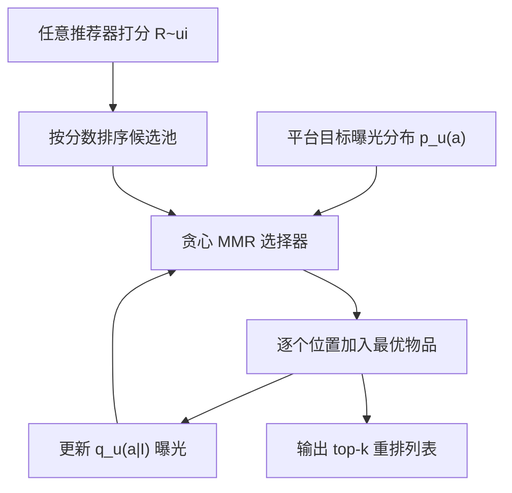

# Regulating Group Exposure for Item Providers in Recommendation (面向物品供应商的推荐群体曝光调控)

- **会议/期刊**: ACM SIGIR 2022（短文，5 页）
- **作者与机构**: Mirko Marras, Ludovico Boratto, Gianni Fenu（University of Cagliari）；Guilherme Ramos（University of Lisbon, LASIGE）
- **推荐链路定位**: 重排（对任意推荐器输出做后处理）
- **研究方向**: 去偏公平、可信隐私与工业架构 / 多任务学习与列表级重排
- **论文原文**: [https://arxiv.org/abs/2204.11243v1](https://arxiv.org/abs/2204.11243v1)
- **开源代码**: 暂未开源

## TL;DR (1分钟核心速览)

推荐系统通常只优化用户侧精度，导致供应商（尤其新进入者、少数群体）在目录和交互中的低占比进一步塌缩（ML-1M 中女性导演电影占目录 10%、交互 7%、BPR 推荐曝光仅 6%）。本文把供应商按属性分组，定义带对数位置折扣的曝光分布，用 **Hellinger 距离**度量实际曝光与平台目标分布的偏差，并把该距离并入 MMR 目标——证明其为次模函数后贪心求解。在 ML-1M 与 COCO 上以时间切分训练 BPR，Par 策略下少数群体曝光从 0.06 拉升至 0.47（目标 0.50），NDCG 仅降 0.02 且优于 LFRank/FA\*IR/FOEIR/GDE 四个基线，多样性与新颕性反而提升。

## Background & Motivation (背景与核心矛盾)

- **主流范式**: 多边平台上的公平推荐多为两类——（1）多样性重排（FA\*IR、LFRank）关注 top-k 前缀里群体*可见性*；（2）公平约束重排（FOEIR、GDE）追求公平或位置去偏。
- **前人局限**: ①多样性方法只看“存在与否”，忽略排序位置带来的注意力差异，少数群体物品被塞在 top-k 尾部；②公平方法依赖 rank-aware 质量指标或需要全用户联合求解（GDE 迭代），无法在单用户层面定制目标曝光；③FOEIR 类方法依赖规模为物品数平方的组合空间（ILP），且需预过滤假设。
- **核心洞察**: 平台对供应商的曝光诉求本质上是**一个目标分布**（可按目录占比、交互占比、均等、用户画像占比等不同规范定义），而非“越多越好”或“不得低于阈值”；因此问题可转化为最小化两个分布之间对称有界的距离。
- **本文切入点**: 把曝光调控写成 **Hellinger 距离**正则下的最大边际相关性（MMR）优化，并利用次模性用贪心高效近似。

## Method (核心方法设计)

### 1. 整体框架 (Overall Architecture)

输入任意推荐器给出的用户 $u$的全库打分$\tilde{R}_{ui}$，先按分排序得到候选池；对每个用户，以平台指定的目标曝光分布$p_u(a)$为参照，逐步贪心挑选 top-k 物品：每步同时权衡“物品相关性”和“当前列表曝光分布$q_u(a|\mathcal{I})$ 与目标的 Hellinger 距离”，使每一步选出的物品既准又能把曝光拉回目标。最终输出是一个有序列表，可在任意前缀处截断使用，天然适配用户滚动加载场景。

### 2. 关键设计拆解 (Key Designs)

1. **位置感知的群体曝光度量**：痛点在于传统方法把“出现”当“曝光”，忽视排序位置。本文用对数折扣定义实际曝光，把位置 1 的权重放大而尾部衰减：
$$q_u(a|k)=\frac{\sum_{p=1}^{k} \frac{1}{\log_2(p+1)}\cdot \mathbb{I}(F(i_p)=a)}{\sum_{p=1}^{k}\frac{1}{\log_2(p+1)}}$$
其中 $F(i)$返回物品$i$供应商的属性，$i_p$为位置$p$的物品。该式在$[0,1]$上取值且$\sum_a q_u(a|k)=1$，与目标分布$p_u(a)$ 同构，使“曝光差距”可被直接比较。位置折扣的物理直觉是：排序靠后的推荐几乎不再被浏览，因此低曝光等价于“名义上被推荐、实际上被忽略”。

2. **Hellinger 距离 + MMR 贪心**：直接做统计检验（如 KS 检验）会产生严格组合优化问题；KL 散度非对称且无界、L1 距离不直观。作者选 **Hellinger 距离**（对称、有界 $[0,1]$），并将其平方后嵌入 MMR：
$$\mathcal{I}^{*}(u|k)=\arg\max_{|\mathcal{I}|=k}\ \lambda\sum_{i\in\mathcal{I}}\tilde{R}_{ui}-(1-\lambda)H^{2}(p_u,q_u|\mathcal{I})$$
关键理论贡献：把 $H^2$ 展开化简为
$$H^{2}(p_u,q_u|\mathcal{I})=1-\sum_{a\in\mathcal{A}}\sqrt{p_u(a)\,q_u|\mathcal{I}(a)}$$
于是目标函数是**模函数之和**（线性项 + 常数 − 模函数），从而**次模**，贪心解具有 $(1-1/e)$ 近似保证。相较于 ILP 的平方级组合空间，贪心仅需线性级，且**无需知道其他用户**，逐用户独立优化即可。

3. **目标策略族与损失**：平台通过 $p_u(a)$定义政策——`Cat`（$p_u(a)=|I^a|/|I|$，目录等比例）、`Int`（交互占比）、`Par`（$1/|\mathcal{A}|$，统计均等）、`Per`（$|I_u^a|/|I_u|$，用户画像等比例）。总优化无独立训练损失（后处理方法），超参$\lambda\in[0,1]$控制精度–曝光权衡；$\lambda=1$退化为原推荐器，$\lambda=0$完全抛弃相关性。实验中平台设定“最多损失 10% NDCG”，据此反查最大$\lambda$。推理开销为每用户$O(k\cdot N\cdot|\mathcal{A}|)$ 的贪心打分，无需重训基座模型。

## Experimental Setup & Evaluation Protocol (实验设置与评估协议)

- **数据集与预处理**:

| 数据集 | #Users | #Items | #Interactions | 密度 | 特征/场景说明 |
| :--- | :---: | :---: | :---: | :---: | :--- |
| ML-1M | 6K | 3K | 1M | ~5.5% | 电影，供应商属性=导演性别；女性导演电影占目录 10%、交互 7% |
| COCO | 37K | 30K | 600K | ~0.05% | 在线课程，供应商属性=教师性别；女性教师课程占目录 19%、交互 12% |

两数据集少数群体占比均低于目录份额，构成典型代表性不足场景；敏感属性标签沿用文献 [2] 提供的标注。

- **数据划分与防穿越 (Splitting Strategy)**: 采用**每用户时间切分**——最近 20% 交互作测试集，其余训练，符合真实时序防穿越要求。
- **排名评测协议 (Ranking Protocol)**: 采用 `Full-Ranking` 全库未交互排序（正文明确“Given a user $u$, items$i\in I\setminus I_u$are ranked”），无采样、无负采样偏差；$k=10$。二值相关 + base-2 对数折扣 NDCG。
- **对比基线与超参设置**: 基座为 pairwise 的 **BPR**（隐维 $d=16$，Adam，lr=0.001，20 epoch，batch=1024，每观测项构造 10 个三元组）。基线：LFRank、FA\*IR、FOEIR、GDE 四个公平/多样性重排方法，均在最具挑战的 `Par` 策略下比较。显著性用 Kruskal–Wallis + Dunn's 事后检验，$p\le 0.05$。

## Key Experimental Results (实验关键数据)

### 1. 主实验对比 (Main Results)

| 数据集 | 方法 | 策略 | NDCG↑ | 少数曝光 $\tilde{E}_m$ | Cov↑ | Div↑ | Nov↑ |
| :--- | :--- | :--- | :---: | :---: | :---: | :---: | :---: |
| ML-1M | BPR | – | 0.13 | 0.06 | 0.53 | 0.22 | 0.09 |
| ML-1M | BPR+Ours | Cat ($E_m$=0.10) | 0.12 | 0.09 | 0.50 | 0.23 | 0.11 |
| ML-1M | BPR+Ours | Int ($E_m$=0.07) | **0.13** | 0.07 | 0.52 | 0.22 | 0.10 |
| ML-1M | BPR+Ours | Par ($E_m$=0.50) | **0.11** | **0.47** | 0.49 | **0.26*** | **0.13*** |
| ML-1M | BPR+LFRank | Par | 0.09* | 0.39 | **0.50** | 0.21 | 0.10 |
| ML-1M | BPR+FA\*IR | Par | 0.08* | 0.40 | **0.50** | 0.25* | 0.11 |
| ML-1M | BPR+FOEIR | Par | 0.07* | 0.55 | 0.48 | **0.26*** | **0.13*** |
| ML-1M | BPR+GDE | Par | 0.10* | 0.36 | 0.49 | 0.22 | 0.09 |
| COCO | BPR | – | 0.05 | 0.08 | 0.19 | 0.25 | 0.06 |
| COCO | BPR+Ours | Par ($E_m$=0.50) | 0.04 | 0.53 | 0.16 | **0.27*** | 0.14* |
| COCO | BPR+LFRank | Par | **0.05** | 0.41 | 0.16 | 0.26 | 0.10* |
| COCO | BPR+FOEIR | Par | 0.02* | 0.56 | 0.15 | **0.27*** | 0.13* |
| COCO | BPR+GDE | Par | 0.04 | 0.55 | 0.16 | **0.27*** | **0.15*** |

（`*` 表示相对原 BPR 显著 $p\le 0.05$；加粗为同列最优/并列最优。）

### 2. 消融实验 (Ablation Study)

原文未设严格组件消融，但通过**策略维度**（$\lambda$与$p_u$ 的组合）构成对目标分布的等价消融，下表汇总相对 BPR 的行为差异：

| 变体 | NDCG 变化 | 曝光达成 | 结论 |
| :--- | :---: | :--- | :--- |
| $\lambda=1$ (纯 BPR) | 基线 | 0.06 | 完全忽略曝光 |
| Cat | −0.01 | 0.09（目标 0.10） | 小改动，精度几乎无损 |
| Int | 0.00 | 0.07（目标 0.07） | 与交互分布一致，零代价 |
| Per | 0.00 | 0.07（目标 0.07） | 个性化校准，Div/Nov 最高 |
| Par | −0.02 | 0.47（目标 0.50） | 改动最大，损失最大仍可接受 |

### 3. 关键实验发现 (Key Findings)

1. **曝光提升与精度损失并非线性交换**：Int 与 Per 策略下 NDCG 与 BPR 完全相同（0.13），说明当目标分布接近原交互分布时，MMR 重排几乎不牺牲相关性；仅在 Par 这种“强制 50/50”的极端政策下才损失 0.02 NDCG，验证了 Hellinger 正则的平滑性。
2. **贪心 MMR 在同等曝光约束下优于专用公平重排**：ML-1M 的 Par 下，本文曝光 0.47 显著高于 GDE(0.36)、LFRank(0.39)、FA\*IR(0.40)，NDCG 0.11 也为最高；FOEIR 虽曝光达 0.55 但 NDCG 跌至 0.07，牺牲过大。COCO 上本文曝光 0.53 仅次于 GDE(0.55)，但 NDCG 与 GDE 持平（0.04）且多样性并列最优，综合权衡最佳。
3. **群体公平带来 beyond-accuracy 正向溢出**：Par 下 ML-1M 的 Div 从 0.22→0.26、Nov 从 0.09→0.13（均显著），COCO 的 Nov 从 0.06→0.14；代价是**全库级覆盖率 Cov 下降**（ML-1M 0.53→0.49，COCO 0.19→0.16），原因在于所有方法都反复推荐同一批已覆盖的少数群体物品以凑曝光，导致目录覆盖收缩——这是对“公平是否等于多样性”的重要反驳。

## Highlights & Limitations (亮点、对比与审稿批判)

- **与代表作对比 (vs. Prior Work)**: 相对 **FA\*IR / LFRank**，本文不只看 top-k 中群体“有没有”，而是用对数位置折扣度量“曝光多少”；相对 **FOEIR**，本文无需 ILP 与质量指标先验，组合空间从平方降到线性；相对 **GDE**，本文逐用户独立优化，无需知道其他用户排名，并且目标曝光可自由定制（Cat/Int/Par/Per 任意参数化）。
- **可迁移亮点**: ①“分布距离即公平正则”的范式和次模性证明可平移到多任务重排中的多目标权衡；②位置折扣曝光定义可直接嵌入工业重排的多目标融合层，作为一路可微/贪心信号。
- **审稿级局限批判**: ①仅在 BPR 单一基座 + 两个二分类属性（性别）数据集验证，$\lambda$需按数据集先验搜索，缺乏对其他推荐器（如 GNN）与多群体（$|\mathcal{A}|>2$）的鲁棒性证据；②后处理贪心为每用户$O(kN|\mathcal{A}|)$，大规模目录（$N$ 百万级）下的延迟未评估，且曝光约束仅作用于 top-k 列表，全局覆盖率下降问题未被约束建模。

## Rating (四维评分)

- **方法创新性 (Novelty)**: ⭐⭐⭐⭐ （把公平重排转化为有界 Hellinger 分布匹配并给出 MMR 次模性证明，理论清晰但组件均属已有工具组合）
- **评估协议与实验扎实度 (Protocol & Experiments)**: ⭐⭐⭐ （采用无偏全库排序与时间切分，但仅两数据集、单基座、单属性，缺多群体与线上验证）
- **写作与数学规范度 (Clarity & Rigor)**: ⭐⭐⭐⭐ （符号定义完整、次模性推导逐步可复核，仅曝光公式排版在原文中有乱码）
- **工业落地与复现价值 (Industrial & Practical Value)**: ⭐⭐⭐⭐ （后处理插件式设计、无需重训基座、目标分布可由业务方任意配置，不依赖其他用户信息，工程适配性强）

