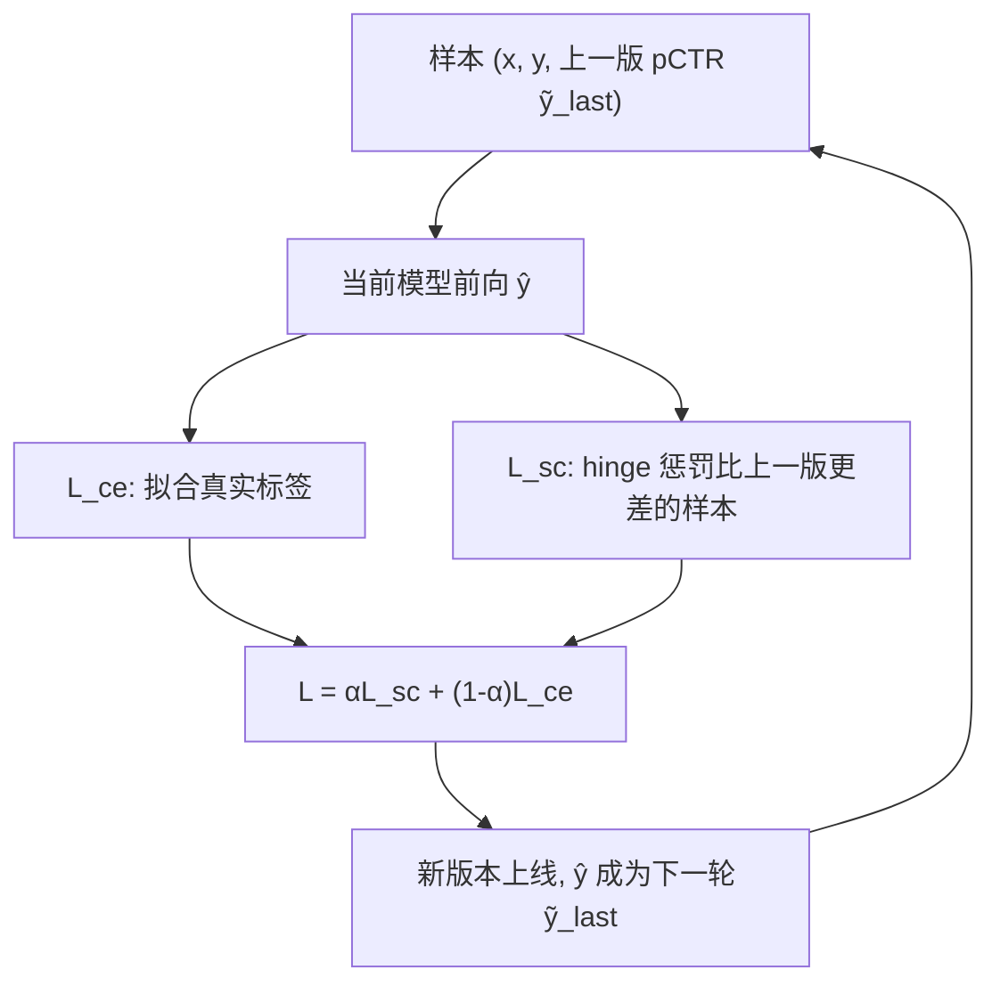
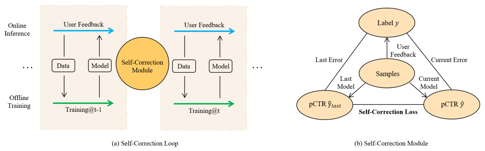
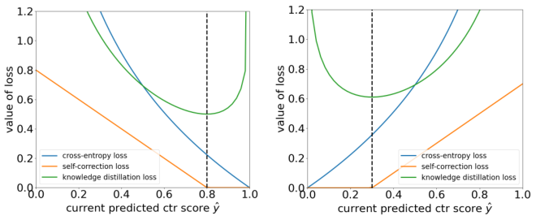

# ReLoop: A Self-Correction Continual Learning Loop for Recommender Systems (面向推荐系统的自校正持续学习闭环)

- **会议/期刊**: SIGIR 2022
- **作者与机构**: Guohao Cai, Jieming Zhu, Quanyu Dai, Zhenhua Dong, Xiuqiang He, Ruiming Tang (华为诺亚方舟实验室), Rui Zhang
- **推荐链路定位**: 精排（CTR 预估，模型迭代/增量训练环节）
- **研究方向**: 去偏公平与工业架构 / CTR 预估与特征交叉
- **论文原文**: [https://arxiv.org/abs/2204.11165v1](https://arxiv.org/abs/2204.11165v1)
- **开源代码**: 暂未开源

## TL;DR (1分钟核心速览)

工业推荐系统的“训练→上线→回收日志→再训练”闭环中，每一代模型只把点击标签当监督，完全丢弃了上一版模型在同一批样本上犯的错。ReLoop 提出一条 hinge 式自校正损失：当新模型对样本的预测误差大于上一版模型（记录于线上推理时的 pCTR）时施加惩罚，迫使每一版模型“不劣于前一代”。该方法模型无关、推理零开销、训练仅 +1.8% 时间；在 Criteo/Avazu/MovieLens/Frappe 四个公开集上 AUC 相对 backbone 最高提升 **4.69%**，大规模新闻流线上 A/B 一周平均 CTR **+1.46%**。

## Background & Motivation (背景与核心矛盾)

- **主流范式**: 精排侧研究几乎全部投入在模型结构（特征交叉 DCN/DeepFM/AFN+、行为序列建模、多任务 MTL），而“多轮迭代训练过程本身”被视为工程细节。
- **前人局限**: 相邻两次训练彼此独立，前一代模型的预测分数（线上推理时已产生，几乎免费）被直接丢弃；知识蒸馏（KD）虽能传递上一版模型的软标签，但它把上一版当“永远正确的教师”，而教师本身也会犯错，错误会被逐代继承放大。
- **核心洞察 (Key Insight)**: 每个样本天然自带两份监督——真实标签 $y$与上一版模型的预测$\tilde{y}_{last}$。二者的差即“上一版的错误”，新模型被要求在同一批样本上把该错误变小，就构成可长期累积的纠错闭环。
- **本文切入点**: 不改模型结构、不改线上服务，只在损失函数里加一项“不劣于前代”的铰链约束，即可让任何 CTR 模型获得持续自校正能力。

## Method (核心方法设计)

### 1. 整体框架 (Overall Architecture)

数据流为：线上服务记录曝光样本的 pCTR $\tilde{y}_{last}$与点击标签$y$→ 日志回流到训练侧，样本变成三元组$(x, y, \tilde{y}_{last})$→ 当前模型前向得到$\hat{y}$→ 损失由交叉熵$\mathcal{L}_{ce}$与自校正项$\mathcal{L}_{sc}$按$\alpha$加权 → 新版本模型替换线上 worker，其推理分数又成为下一轮的$\tilde{y}_{last}$，形成闭环。整个框架只挂在损失层，对 backbone（DCN/DeepFM 等）完全透明，线上 serving 无需任何改动。

<figure class="paper-figure" markdown="span">
  <figcaption>图1：(a) 展示了两个顺序训练过程，二者由自校正模块连接；(b) 详述了自校正模块，其中误差由模型预测分数和用户反馈标签定义。我们希望训练过程能减少这些误差，以获得更好的在线服务。</figcaption>
</figure>

### 2. 关键设计拆解 (Key Designs)

1. **自校正 Hinge 损失（把“不劣于前代”写成约束）**：以正样本为例，纠错目标即 $\hat{y} \ge \tilde{y}_{last}$；对负样本则要求$\hat{y} \le \tilde{y}_{last}$。将两式统一为单向惩罚：
$\mathcal{L}_{sc}=y\max(\tilde{y}_{last}-\hat{y},0)+(1-y)\max(\hat{y}-\tilde{y}_{last},0)$。
关键在于**只在“变差”时惩罚**：一旦当前模型已优于上一版，梯度即为 0，不会像 KD 那样强行把学生拉向教师的软标签，从而避免继承教师的偏差。

2. **与知识蒸馏的本质区别（教师也会犯错）**：KD 损失 $\mathcal{L}_{kd}=-\tilde{y}_{last}\log\hat{y}-(1-\tilde{y}_{last})\log(1-\hat{y})$对每个样本都施加拉力。如图 2 所示，正样本$\tilde{y}_{last}=0.8$时，$\mathcal{L}_{kd}$会持续奖励“逼近 0.8”，即使样本可被预测得更高；而$\mathcal{L}_{sc}$在$\hat{y}>0.8$ 后归零。这把“模仿历史”改造成“超越历史的单向目标”，是本文最本质的增量。

3. **训练目标与部署成本**：总损失为
$\mathcal{L}=\alpha\mathcal{L}_{sc}+(1-\alpha)\mathcal{L}_{ce}$，
无需额外负采样（沿用日志中的曝光负样本），$\tilde{y}_{last}$由日志/线上 pCTR 直接读取，训练开销仅 +1.8%，推理 0 开销。$\alpha\in[0,1]$为唯一新增超参，$\alpha=0$ 退化为普通交叉熵。

<figure class="paper-figure" markdown="span">
  <figcaption>图2：交叉熵损失、知识蒸馏损失与我们提出的自校正损失的损失函数。</figcaption>
</figure>

## Experimental Setup & Evaluation Protocol (实验设置与评估协议)

- **数据集与预处理**:

| 数据集 | 规模 (#Instances) | 特征域 | 说明 |
| :--- | :---: | :---: | :--- |
| Criteo | 45M | 13 数值 + 26 类别 | 经典 CTR 基准 |
| Avazu | 40M | 22 | 移动广告点击 |
| MovieLens | 2M | 标签记录 | 个性化标签推荐 |
| Frappe | 288k | 10 | 上下文感知 App 发现 |
| Production | >500M | >100 | 工业新闻流产品采样 |

- **数据划分与防穿越 (Splitting Strategy)**: 公开集按 **8:1:1 随机比例划分** 训练/验证/测试；为模拟线上，额外用训练集的 **90%** 训练“上一版模型”，再对全部训练集推理生成 $\tilde{y}_{last}$，避免同代模型自比造成的信息泄漏（但仍是单代模拟，非真实多轮）。
- **排名评测协议 (Ranking Protocol)**: 本文为 pointwise CTR 任务，**不涉及 Full-Ranking/Sampled Ranking**，采用 **AUC** 与 **Logloss**；负样本直接取自曝光未点击日志。
- **对比基线与超参设置**: 对比 LR/FM/NFM/IPNN/Wide&Deep/DCN/DeepFM/xDeepFM/FmFM/AFN+ 及 KD+DCN、KD+DeepFM；ReLoop 以 DCN 与 DeepFM 为 backbone，$\alpha$在$[0,1]$ 上做敏感性分析（图 3）。

## Key Experimental Results (实验关键数据)

### 1. 主实验对比 (Main Results)

| 模型 | Criteo AUC | Criteo Logloss | Avazu AUC | Avazu Logloss | MovieLens AUC | MovieLens Logloss | Frappe AUC | Frappe Logloss |
| :--- | :---: | :---: | :---: | :---: | :---: | :---: | :---: | :---: |
| FM | 0.7933 | 0.4574 | 0.7496 | 0.3740 | 0.9388 | 0.2797 | 0.9641 | 0.2143 |
| NFM | 0.7968 | 0.4537 | 0.7531 | 0.3761 | 0.9441 | 0.3004 | 0.9727 | 0.2079 |
| Wide&Deep | 0.8062 | 0.4453 | 0.7529 | 0.3744 | 0.9381 | 0.3310 | 0.9728 | 0.2038 |
| DCN | 0.8059 | 0.4463 | 0.7550 | 0.3721 | 0.9419 | 0.2791 | 0.9402 | 0.2808 |
| DeepFM | 0.8025 | 0.4501 | 0.7535 | 0.3742 | 0.9424 | 0.3131 | 0.9719 | 0.2108 |
| xDeepFM | 0.8070 | 0.4443 | 0.7535 | 0.3737 | 0.9448 | 0.2717 | 0.9738 | 0.2098 |
| FmFM | 0.8056 | 0.4462 | 0.7603 | 0.3685 | 0.9465 | 0.2714 | 0.9749 | 0.2004 |
| AFN+ | 0.8074 | 0.4451 | 0.7555 | 0.3718 | 0.9500 | 0.2585 | 0.9783 | 0.1762 |
| KD+DCN | 0.8136 | 0.4473 | 0.7653 | 0.3906 | 0.9648 | 0.2164 | 0.9837 | 0.1672 |
| RLP+DCN | 0.8138 | **0.4381** | 0.7648 | **0.3667** | **0.9693** | 0.2189 | 0.9843 | 0.1660 |
| **RLP+DeepFM** | **0.8139** | 0.4382 | **0.7659** | 0.3750 | 0.9687 | **0.2160** | **0.9848** | **0.1549** |
| **Improv. (vs. backbone)** | **+1.42%** | — | **+1.65%** | — | **+2.91%** | — | **+4.69%** | — |

### 2. 消融实验 (Ablation Study)

| 配置（Production 数据集） | AUC | AUC Improv. | Logloss | Logloss Improv. | 训练耗时 |
| :--- | :---: | :---: | :---: | :---: | :---: |
| Baseline | 0.7394 | — | 0.2959 | — | — |
| KD + Baseline | 0.7458 | +0.87% | 0.2743 | +7.30% | +1.8% |
| **RLP + Baseline** | **0.7483** | **+1.20%** | **0.2313** | **+21.83%** | +1.8% |

> 组件层面：$\alpha=0$即退化为 Baseline；图 3 显示在$[0,1]$全区间内 ReLoop 曲线都位于 baseline 之上（原文未给最优$\alpha$ 具体数值）。

### 3. 关键实验发现 (Key Findings)

1. **增益随 backbone 变弱而放大**：Frappe 上 DCN 0.9402 → 0.9843（+4.69%），而 Criteo 上 DeepFM 仅 0.8025 → 0.8139（+1.42%）。说明当模型本身欠拟合/数据量小（288k）时，“不劣于前代”的铰链约束起到了类似难样本加权的正则作用；在 45M 级强 backbone 上收益被压缩但仍显著。
2. **ReLoop 优于“把前代当教师”的 KD**：公开集上两者 AUC 接近（Criteo 0.8138 vs 0.8136），但 MovieLens 上 0.9693 vs 0.9648、Frappe 上 0.9843 vs 0.9837，且工业集 Logloss 从 KD 的 0.2743 降到 0.2313（额外 14.5 个千分点相对改善），印证软标签会继承教师偏差、损害概率校准。
3. **闭环增益可持续且成本可接受**：线上 A/B（每组 >30 万活跃用户，先做一周 A/A 校正）7 天 CTR 提升分别为 +1.38%/+2.01%/+1.34%/+0.64%/+2.61%/+1.13%/+1.09%，平均 **+1.46%**，无衰减趋势；训练仅 +1.8%、推理零开销，工程侧几乎零改造成本。

## Highlights & Limitations (亮点、对比与审稿批判)

- **与代表作对比 (vs. Prior Work)**: 与 FwFM/AFN+ 等特征交叉工作相比，ReLoop 不改结构、只改损失，属于正交增益（可直接叠加于任意 backbone）；与 KD/自蒸馏（KD+DCN）相比，把“模仿教师”换成“只惩罚退步”，方向是单向的、不会被教师错误反噬；与持续学习（EWC 类）相比，不追求抗遗忘，而追求在新分布上逐代变好。
- **可迁移亮点**: (1) “样本级 hinge 不劣化约束”可直接搬到双塔召回的多轮增量训练、延迟反馈纠偏与蒸馏式召回里；(2) 把线上 pCTR 落盘为训练特征列，是极低成本的“模型记忆化”手段，可复用于校准修正与难样本挖掘。
- **审稿级局限批判**: (1) 公开集上的 $\tilde{y}_{last}$由训练集 90% 子集模拟，只模拟“单代”而非真实多轮闭环，长期累积效应缺乏离线证据；(2) 错误定义为 pointwise 的 pCTR 差值，对列表级效用、曝光位置偏差、延迟反馈均未建模，且$\alpha$ 需人工调参，图 3 仅给定性曲线未报告最优值；(3) 线上只报 CTR 单一指标，未给停留时长、多样性等生态指标，A/A 检验细节与显著性水平描述偏简。

## Rating (四维评分)

- **方法创新性 (Novelty)**: ⭐⭐⭐⭐ （把“人类复盘错题”转成 hinge 单向约束，形式极简但洞察准确，清楚界定了与 KD 的边界）
- **评估协议与实验扎实度 (Protocol & Experiments)**: ⭐⭐⭐⭐ （4 个公开集 + 5 亿级工业集 + 7 天线上 A/B，KD 对照充分；扣分在单代模拟与单指标线上评估）
- **写作与数学规范度 (Clarity & Rigor)**: ⭐⭐⭐⭐ （公式仅 5 个却讲透动机与差异，图 2 的损失曲线对比很有说服力；缺少梯度/收敛性分析）
- **工业落地与复现价值 (Industrial & Practical Value)**: ⭐⭐⭐⭐⭐ （推理零开销、训练 +1.8%、模型无关可插拔，是少有能立刻搬进生产训练管线的改动；可惜未开源代码）

