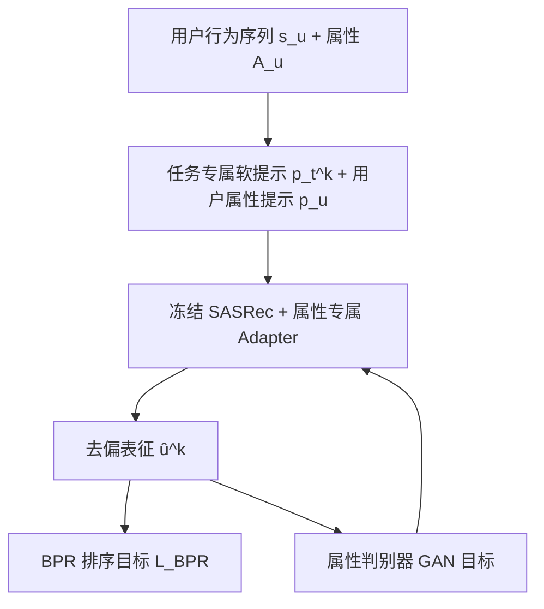
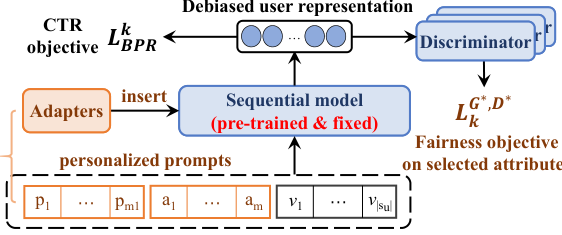

# Selective Fairness in Recommendation via Prompts (基于提示的选择性公平推荐)

- **会议/期刊**: SIGIR 2022 (短论文, 6 页)
- **作者与机构**: Yiqing Wu, Ruobing Xie, Yongchun Zhu, Fuzhen Zhuang, Xiang Ao, Xu Zhang, Leyu Lin, Qing He（中科院计算所 / 腾讯微信搜索应用部 / 北航）
- **推荐链路定位**: 精排（序列推荐打分）+ 表征级去偏中间件
- **研究方向**: 去偏公平、可信隐私与工业架构 / 序列与会话推荐
- **论文原文**: [https://arxiv.org/abs/2205.04682v2](https://arxiv.org/abs/2205.04682v2)
- **开源代码**: [https://github.com/wyqing20/PFRec](https://github.com/wyqing20/PFRec)

## TL;DR (1分钟核心速览)

真实系统中用户有多重敏感属性（年龄、性别、消费等级），且"哪些属性该被去偏"因人因时而异，传统做法需为 $2^m$ 种属性组合各训一个公平模型，成本爆炸。本文定义 **选择性公平 (Selective Fairness)** 任务，提出 PFRec：冻结预训练 SASRec，仅用**任务专属软提示 + 用户属性提示 + Adapter** 构成的轻量 eliminator，配合判别器对抗训练逐组合去偏。在 CIKM / AliEC 上采用 Leave-One-Out + 99 负采样协议，单属性 F1 相对 SASRec 下降 12%–41%，精度仅小幅回落。

## Background & Motivation (背景与核心矛盾)

- **主流范式**: 用户侧公平推荐多采用帕累托多目标、对抗训练（如 Li et al. 的因果式个性化公平）或图模型，为**某一固定**敏感属性组合训练专用去偏模块。
- **前人局限**: ①属性数 $m$增大时组合数为$2^m$，为每种组合存一份完整模型在工业上不可行；②敏感属性本身是强个性化信号，粗暴抹除全部属性会显著损伤精度，而现有方法缺乏"按需开关"能力。
- **核心洞察 (Key Insight)**: 用户真正需要的不是"全局公平模型"，而是**可插拔的属性级公平开关**；而 NLP 中 prompt 的"小参数适配多下游任务"特性，恰好与"多属性组合"的稀疏多任务结构同构。
- **本文切入点**: 用预训练+提示微调 (pre-train + prompt-tuning) 范式把"$2^m$个模型"压缩为"$2^m$ 组共享主干、各自轻量 eliminator"，从而以极少参数实现组合级选择性公平。

## Method (核心方法设计)

### 1. 整体框架 (Overall Architecture)

先在全部用户历史行为上预训练一个不考虑任何公平性的 SASRec（参数 $\Theta$），作为共享主干并**全程冻结**；微调阶段针对第$k$个属性组合构建属性专属提示式去偏器（eliminator）：把任务提示与用户属性提示拼接到行为序列前端，再在 Transformer 每层的多头注意力与 FFN 之后插入 Adapter 注入属性专属可训练参数$\vartheta_k$；输出用户表征$\hat{\boldsymbol{u}}^k$送入属性判别器做对抗博弈，同时保留 BPR 推荐目标。训练时只有$\vartheta_k$与判别器更新，$2^m$ 种组合共用一份主干。

<figure class="paper-figure" markdown="span">
  <figcaption>图1：PFRec的整体架构。</figcaption>
</figure>

### 2. 关键设计拆解 (Key Designs)

1. **属性专属双层软提示 (Task-specific + User-specific Prompt)**：痛点在于单一去偏器无法区分"本次该消除哪个属性"。作者将 $m_1=10$个随机初始化 token$\boldsymbol{p}^k_t$（标识第$k$种组合）与$m$个用户属性嵌入$\boldsymbol{p}_u=\{\boldsymbol{a}^u_1,\dots,\boldsymbol{a}^u_m\}$ 直接前插，拼接序列为
   $\hat{s}^k_u=\{\boldsymbol{p}^k_t,\boldsymbol{p}_u,\boldsymbol{v}^u_1,\dots,\boldsymbol{v}^u_{|s_u|}\}$。
   直觉：提示既不覆盖原始行为（保留个性化信号），又给冻结主干一个显式的"关注哪些敏感维度"的条件编码。
2. **Adapter 内部注入 + 对抗去偏**：仅靠输入侧提示难以扭转深层表征中的属性泄漏，故在每层插入瓶颈 Adapter：
   $\mathrm{Adapter}^k(\boldsymbol{X})=\mathrm{LayerNorm}(\boldsymbol{X}\boldsymbol{W}^k_d)\boldsymbol{W}^k_u+\boldsymbol{X}$，
   并在第 $k$组合下用分类判别器$P(a_i|\hat{\boldsymbol{u}}^k,\phi_k)$ 做交替极小极大博弈：
   $\mathcal{L}^{G^*,D^*}_k=\min_{\phi_k}\max_{\vartheta_k}\sum_{B}\sum_{u\in B}\sum_{a_i\in Q_k}-\mathbb{E}_{\hat{\boldsymbol{u}}^k}\big[\log P(a_i|\hat{\boldsymbol{u}}^k,\phi_k)\big]$。
   判别器最小化负对数似然以强化属性可辨识度，生成器侧（仅 $\vartheta_k$）最大化该项以"混淆"判别器，从而剥离$\hat{\boldsymbol{u}}^k$中$Q_k$ 属性信息而保留其余属性与行为偏好。
3. **训练目标与推理开销**：$\mathcal{L}_k=\mathcal{L}^{\text{BPR}}_k+\lambda\mathcal{L}^{G^*,D^*}_k$，$\lambda=1$；主干$\Theta$冻结，故在线切换公平开关只需装载对应$(\vartheta_k,\phi_k)$小参数集（prompt 与 Adapter），无需存$2^m$ 份大模型——这正是"参数高效"的工程价值所在。

## Experimental Setup & Evaluation Protocol (实验设置与评估协议)

- **数据集与预处理**（过滤交互 <10 的用户）：

| 数据集 | #Users | #Items | #Interactions | 稀疏度/密度 | 特征/场景说明 |
| :--- | :---: | :---: | :---: | :---: | :--- |
| CIKM | 60k | 88k | 2.1M | 密度 ≈ 4.0e-4 | 电商点击；3 个敏感属性：性别/年龄/消费等级 |
| AliEC | ~100k | — | 8.8M | — | 电商点击；2 个敏感属性：性别/年龄 |

- **数据划分与防穿越 (Splitting Strategy)**: `Leave-One-Out`——每用户最近一次交互作测试、次近一次作验证。
- **排名评测协议 (Ranking Protocol)**: `Sampled Ranking (采样排序)`，每测试实例随机采 99 个该用户未点击物品作负样本（1:99），非 Full-Ranking；报告 AUC、HIT@10、NDCG@10。公平性用与判别器同构同容量的独立**攻击者 (attacker)** 的属性预测 micro-F1 衡量，**F1 越低越公平**（沿用 [21] 设定）。
- **对比基线与超参设置**: SASRec（预训练主干）、BERT4Rec（强序列基线）、Li et al. [14]\*（SOTA 个性化公平模型，按属性逐一训练过滤器，同损失）；嵌入维度 $d=64$、batch=256、Adam 学习率 1e-4（GAN 部分用 RMSprop）、L2=1e-6、$\lambda=1.0$；提升显著性$p<0.05$。

## Key Experimental Results (实验关键数据)

### 1. 主实验对比 (Main Results)

**表 1 单属性公平 + 精度（CIKM，$↑$越大越好 /$↓$ 越小越好）**

| 模型 | F1-G↓ | F1-A↓ | F1-C↓ | AUC↑ | H@10↑ | N@10↑ |
| :--- | :---: | :---: | :---: | :---: | :---: | :---: |
| SASRec | 0.8998 | 0.4491 | 0.1900 | 0.8857 | **0.7092** | **0.5444** |
| BERT4Rec | 0.9104 | 0.4931 | 0.2114 | 0.8713 | 0.6625 | 0.4913 |
| Li et al. [14]\* | 0.7975 | 0.2818 | 0.1414 | 0.8386 | 0.5830 | 0.3830 |
| **PFRec** | **0.7843** | **0.2661** | **0.1289** | **0.8504** | 0.6319 | 0.4748 |
| Improv.% (F1 vs SASRec) | −12.8% | −40.7% | −32.1% | — | — | — |

**表 2 单属性公平 + 精度（AliEC）**

| 模型 | F1-A↓ | F1-G↓ | AUC↑ | H@10↑ | N@10↑ |
| :--- | :---: | :---: | :---: | :---: | :---: |
| SASRec | 0.4310 | 0.8444 | **0.9060** | **0.7499** | **0.5412** |
| BERT4Rec | 0.4420 | 0.8623 | 0.8923 | 0.6993 | 0.4754 |
| Li et al. [14]\* | 0.3978 | 0.8353 | 0.8898 | 0.6995 | 0.4756 |
| **PFRec** | **0.2774** | **0.7315** | 0.8890 | 0.7042 | 0.4938 |
| Improv.% (F1 vs SASRec) | −35.6% | −13.4% | — | — | — |

**多属性（全属性联合去偏）**：CIKM 上 PFRec 三属性 F1 = 0.7903 / 0.2418 / 0.1057，AUC 0.8504（优于 Li et al. 0.8386）；AliEC 上 F1-G 由 0.8444 降至 **0.6872**、F1-A 由 0.4310 降至 **0.2661**，为全部方法最优。

### 2. 消融实验 (Ablation Study)

图 2（AliEC，相对预训练模型的百分比变化，读数为近似区间）：

| 变体 | F1 相对下降 (公平性↑) | AUC 相对提升 | 部署可行性 |
| :--- | :---: | :---: | :--- |
| Fine-tuning（全参数 Θ 更新） | 约 −29% ~ −30% | 约 +2.9% | 需存 $2^m$ 份大模型，不可行 |
| **PFRec**（Prompt+Adapter） | 约 −27% | 约 +2.6% | 仅存轻量 eliminator，最优 |
| PFRec w/o Prompt（仅 Adapter） | 约 −22% | 约 +2.4% | 可行但公平性不足 |

### 3. 关键实验发现 (Key Findings)

1. **提示与 Adapter 缺一不可，且收益主要在公平侧**：去掉 prompt 后 F1 改善从约 −27% 衰减到约 −22%，说明任务/用户双层提示提供了"该去哪个属性"的条件信号，而 Adapter 负责深层表征纠偏；PFRec 精度仅比全参数 fine-tuning 低约 0.3 个百分点，却省下 $2^m$ 份存储。
2. **不同属性的可去偏程度差异巨大**：CIKM 上"消费等级"的基线 F1 仅 0.1900（行为本身几乎不泄漏该属性），继续去偏把它压到 0.1289；而"年龄"从 0.4491 降到 0.2661（−40.7%）是最大战场，说明去偏收益集中在与行为强耦合的属性上。
3. **公平—精度折中可控且优于专用公平模型**：CIKM 上 PFRec 相比 Li et al. 在三个属性上 F1 全面更低，同时 AUC 反升 (+0.0118)、H@10 (+0.0489)、N@10 (+0.0918) 全面领先——提示微调保留了 SASRec 预训练的行为建模能力，避免"为公平牺牲个性化"的常见塌陷。

## Highlights & Limitations (亮点、对比与审稿批判)

- **与代表作对比 (vs. Prior Work)**: 相比 Li et al. [14] 的"每属性一个因果过滤器"，PFRec 把去偏粒度从"属性级"提升到"**属性组合级**"且共享冻结主干；相比 SASRec/BERT4Rec 这类纯精度模型，它在精度损失可控（AUC −0.035 / −0.017）的前提下换取 12%–41% 的公平性提升。
- **可迁移亮点**: ①"冻结主干 + 属性组合提示 + Adapter"是一种通用的**多目标/多场景开关**范式，可直接迁移到多业务场景（多租户）推荐与多任务精排；②用攻击者 F1 作为公平度量并配合对抗判别器，形成"训练—评估"同构的闭环，值得在曝光公平、地域公平上复用。
- **审稿级局限批判**: ①**评估协议偏弱**——仅 1:99 采样排序而非 Full-Ranking，且实验只覆盖"单属性"与"全部属性"两类设置，未真正验证 $2^m$组合空间下的一致性与参数增量；②**公平度量单一**——只用攻击者 F1（属性可推断性），未报告 DP/EO 类群体公平或曝光不均，且攻击者容量与判别器相同可能低估残余偏差；③短论文仅 3 个基线、缺少方差/多次运行报告，$m_1=10$与$\lambda=1$ 的敏感性未做网格分析，线上延迟（每组合一次前向 + Adapter 开销）亦未量化。

## Rating (四维评分)

- **方法创新性 (Novelty)**: ⭐⭐⭐⭐ （首次把 prompt/Adapter 参数高效微调引入推荐公平，将 $2^m$ 组合问题重构为轻量 eliminator 选择问题，"选择性公平"任务定义本身具有独立价值）
- **评估协议与实验扎实度 (Protocol & Experiments)**: ⭐⭐⭐ （两个真实数据集 + 攻击者 F1 与精度双维度、$p<0.05$ 显著性，但仅采样排序、基线少、组合空间验证不充分）
- **写作与数学规范度 (Clarity & Rigor)**: ⭐⭐⭐⭐ （提示拼接、Adapter 与极小极大目标定义清晰、符号一致；GAN 目标的 min/max 方向对读者略有歧义，缺复杂度分析）
- **工业落地与复现价值 (Industrial & Practical Value)**: ⭐⭐⭐⭐ （代码开源且基于 ReChorus，主干冻结 + 小参数切换的"公平开关"设计与工业多业务场景天然契合，落地成本低）

