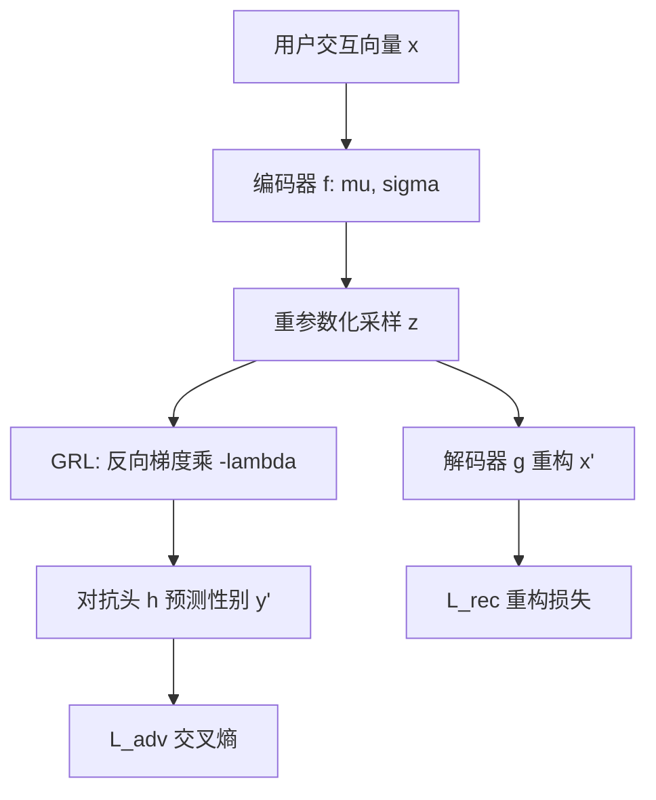
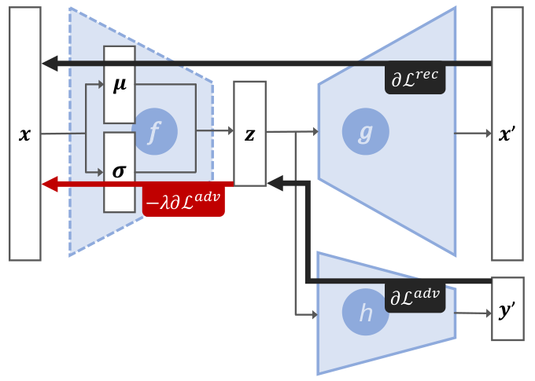

# Unlearning Protected User Attributes in Recommendations with Adversarial Training (基于对抗训练的推荐系统中受保护用户属性遗忘)

- **会议/期刊**: SIGIR 2022 (ACM SIGIR, Madrid, 6 pages, short paper)
- **作者与机构**: Christian Ganhör, David Penz, Navid Rekabsaz, Oleg Lesota, Markus Schedl（Johannes Kepler University Linz / Linz Institute of Technology / TU Wien）
- **推荐链路定位**: 召回（用户表征学习侧，VAE 协同过滤）
- **研究方向**: 去偏公平、可信隐私与工业架构 / 协同过滤与双塔召回
- **论文原文**: [https://arxiv.org/abs/2206.04500v1](https://arxiv.org/abs/2206.04500v1)
- **开源代码**: [https://github.com/CPJKU/adv-multvae](https://github.com/CPJKU/adv-multvae)

## TL;DR (1分钟核心速览)

协同过滤虽不显式使用性别等受保护属性，却会把它隐式编码进用户潜在向量，既加剧"过滤气泡"也带来隐私泄露风险。本文在 SOTA 的 MultVAE 潜在空间上挂一个受保护属性分类头，用梯度反转层（GRL）把分类梯度取反回传，形成"推荐损失最小化 + 属性可分性最大化"的 min-max 博弈，得到 Adv-MultVAE。在 ML-1M 与 LFM2b-DB 上采用 5 折用户划分、全物品排序评测，外部攻击者探针的平衡准确率 BAcc 由 0.707/0.717 降至 0.572/0.609（相对降 19.1%/15.1%），NDCG@10 仅从 0.621 降至 0.593，且与末轮 MultVAE 基线无显著差异。

## Background & Motivation (背景与核心矛盾)

- **主流范式**: 以 MultVAE 为代表的 VAE 协同过滤把用户交互向量 $\boldsymbol{x}$变分编码为低维$\boldsymbol{z}$ 再解码重构，是深度召回中的强基线。
- **前人局限**: 一是在输出空间做扰动/过滤（如 BPR+攻击者、embedding 过滤层）只能切断"推荐结果"层面的泄露，潜空间中仍保留属性相关簇；二是面向物品侧流行度去偏的工作（如 Zhu 等的对抗去偏排序）不处理用户侧人口属性。
- **核心洞察 (Key Insight)**: 作者用攻击者网络可视化潜在空间，发现男女用户形成相当分离的簇（图 1a），说明性别信息确实被消费模式"顺带"学进去了；即使用户交互向量中从未出现性别字段。
- **本文切入点**: 与其事后过滤，不如在训练目标里就让 $\boldsymbol{z}$对$\boldsymbol{y}$ 不变（invariant），即"从源头不学"而非"学完再删"。

<figure class="paper-figure" markdown="span">
  ![图 1：攻击者网络从在 LFM-2b-DemoBias \[21\] 数据集上训练的 MultVAE 和 Adv-MultVAE 模型的潜在嵌入中推断用户性别的输出。蓝色和橙色标记分别对应男性和女性用户。](../../../../assets/papers/2206.04500v1/figure_1.png)<figcaption>图 1：攻击者网络从在 LFM-2b-DemoBias [21] 数据集上训练的 MultVAE 和 Adv-MultVAE 模型的潜在嵌入中推断用户性别的输出。蓝色和橙色标记分别对应男性和女性用户。</figcaption>
</figure>

## Method (核心方法设计)

### 1. 整体框架 (Overall Architecture)

输入用户二值交互向量 $\boldsymbol{x}$，编码器$f$输出$\boldsymbol{\mu},\boldsymbol{\sigma}$，经重参数化采样得$\boldsymbol{z}$；$\boldsymbol{z}$分两路：一路进解码器$g$重构$\boldsymbol{x}'$计算重构损失，一路经梯度反转层$\mathrm{grl}(\cdot)$进对抗头$h$预测性别$\boldsymbol{y}'$。前向传播时 GRL 是恒等映射，反向传播时把来自$h$的梯度乘以$-\lambda$再灌回编码器，从而一边压低$\mathcal{L}_{\text{rec}}$、一边抬高对抗头的分类损失，等价于让$\boldsymbol{z}$逐步丧失性别可分性。推理阶段直接丢弃$h$ 与 GRL，模型结构与 MultVAE 完全一致，零额外线上开销。

<figure class="paper-figure" markdown="span">
  <figcaption>图 2：Adv-MultVAE 的概览。粗箭头表示反向传播时的梯度流，其中红色表示用于学习对受保护属性（𝒚）不变的潜在嵌入（𝒛）的逆转梯度。</figcaption>
</figure>

### 2. 关键设计拆解 (Key Designs)

1. **对抗式属性不变表征（GRL 替代 min-max 交替优化）**：直接解 $\arg\min_{f,g}\arg\max_{h}\mathcal{L}_{\text{rec}}-\mathcal{L}_{\text{adv}}$的鞍点问题不稳定、需交替训练两套参数。本文引入 GRL 将其折叠为单一风险最小化：$\mathcal{L}=\mathcal{L}_{\text{rec}}(\boldsymbol{x})+\mathcal{L}_{\text{CE}}\big(h(\mathrm{grl}(\boldsymbol{z})),\boldsymbol{y}\big)$，其中反向传播满足$\partial\,\mathrm{grl}(\boldsymbol{z})/\partial\boldsymbol{z}=-\lambda\mathbf{I}$。物理直觉：编码器收到的梯度是"让属性分类变差"的方向，于是删掉一切仅对区分性别有用、对重构无用的维度；而被重构损失强约束的维度得以保留，形成"删隐私不删偏好"的软性权衡。
2. **隐空间级而非输出级去偏**：与在推荐列表上加噪或对 embedding 做后处理过滤不同，本文的约束直接作用于 $\boldsymbol{z}$，因此下游任何用该表征的模块（召回、相似用户、画像推断）都不再泄漏属性，防护面更广。
3. **训练目标、负采样与推理效率**：总损失沿用 MultVAE，$\mathcal{L}_{\text{rec}}=\mathcal{L}_{\text{MULT}}(g(\boldsymbol{z}),\boldsymbol{x})-\beta\mathcal{L}_{\text{KL}}(\mathcal{N}(\boldsymbol{\mu},\boldsymbol{\sigma}),\mathcal{N}(\mathbf{0},\mathbf{I}))$；由于是全物品重构（multinomial likelihood），**天然免负采样**，每个用户对全部物品做 softmax。训练在 ML-1M/LFM2b-DB 上分别 100/200 epoch，额外成本仅一个 MLP 对抗头。

## Experimental Setup & Evaluation Protocol (实验设置与评估协议)

- **数据集与预处理**: ML-1M 保留评分 ≥5 的用户与 ≥5 次交互的电影并二值化；LFM2b-DB 保留 play count ≥2 的记录、随机采样 10 万曲目后再做 5-core 过滤；受保护属性取性别（二元）。

| 数据集 | #Users | #Items | #Interactions | 稀疏度/密度 | 特征/场景说明 |
| :--- | :---: | :---: | :---: | :---: | :--- |
| ML-1M (All) | 6,040 | 3,416 | 999,611 | 4.84% | 电影评分；男 4,331 / 女 1,709 |
| ML-1M (Male/Female) | 4,331 / 1,709 | — | 753,313 / 246,298 | — | 女性为少数群体 |
| LFM2b-DB (All) | 19,972 | 99,639 | 2,829,503 | 0.14% | 音乐收听；男 15,557 / 女 4,415 |
| LFM2b-DB (Male/Female) | 15,557 / 4,415 | — | 2,385,427 / 444,076 | — | 长尾更极端 |

- **数据划分与防穿越 (Splitting Strategy)**: 沿用 Melchiorre 等的**用户级 5 折交叉验证**（3 折训练 / 1 折验证 / 1 折测试，用户及其全部交互不跨折），训练集对女性做随机上采样至类别均衡；验证/测试折内再按 80%/20% 切分为"模型输入"与"待预测目标"，杜绝交互穿越。
- **排名评测协议 (Ranking Protocol)**: **Full-Ranking 全库排序**（对全部未交互物品打分），报告 recall@10 与 NDCG@10；去偏效果用攻击者网络 $h_{\text{atk}}$（模型参数冻结、仅训练探针）的 Acc 与 BAcc 衡量，BAcc=0.50 表示完全不可分。性能差异用 Wilcoxon signed-rank 检验（95% 置信），攻击者差异用 McNemar 检验（$p<0.05$）。
- **对比基线与超参设置**: 基线为 MultVAE 的两种模型选择口径——`MultVAE_Best`（按验证 NDCG 选最优 epoch）与 `MultVAE_Last`（取末轮，与 Adv-MultVAE 同口径）；超参在 embedding size、$\beta$、dropout、学习率、weight decay 与$\lambda$ 上网格搜索。

## Key Experimental Results (实验关键数据)

### 1. 主实验对比 (Main Results)

| 数据集 | 模型 | Acc↓ | BAcc↓ | NDCG@10↑ | Recall@10↑ |
| :--- | :--- | :---: | :---: | :---: | :---: |
| ML-1M | MultVAE_Best | 0.692 | 0.707 | **0.621** | **0.596** |
| ML-1M | MultVAE_Last | 0.699 | 0.693 | 0.591† | 0.566† |
| ML-1M | **Adv-MultVAE** | **0.565** | **0.572** | 0.593† | 0.569† |
| LFM2b-DB | MultVAE_Best | 0.703 | 0.717 | **0.211** | **0.192** |
| LFM2b-DB | MultVAE_Last | 0.709 | 0.717 | 0.206† | 0.189† |
| LFM2b-DB | **Adv-MultVAE** | **0.631** | **0.609** | 0.206† | 0.189† |

（† 表示相对 `MultVAE_Best` 显著下降；BAcc 相对降幅：ML-1M 19.1%，LFM2b-DB 15.1%）

### 2. 消融实验 (Ablation Study)

本文未做常规模块消融，而是用"移除对抗头 = MultVAE"与"统一模型选择口径"两种对照，并扫描梯度反转系数 $\lambda$：

| 配置 | 关键变化 | BAcc | NDCG@10 (ML-1M) | 结论 |
| :--- | :--- | :---: | :---: | :--- |
| MultVAE_Best | 无对抗头 | 0.707 | 0.621 | 性别高度可分 |
| MultVAE_Last | 无对抗头、末轮 | 0.693 | 0.591 | 仅过拟合即降 0.030 |
| Adv-MultVAE | 加对抗头（$\lambda$ 固定） | 0.572 | 0.593 | 相对 Last 无显著差异 |
| $\lambda \uparrow$ | 梯度反转增强 | 单调下降并饱和 | 未报告显著劣化 | ML-1M 更早逼近 0.50 |

### 3. 关键实验发现 (Key Findings)

1. **去偏有效但未"清零"**：BAcc 从 0.707/0.717 降到 0.572/0.609，仍显著高于随机 0.50；图 3 显示**外部攻击者的 BAcc 始终高于对抗头自身的 BAcc**，说明对抗网络并未发现并抹除全部敏感信息，"遗忘"是部分遗忘。
2. **性能损失主要来自模型选择而非对抗训练本身**：Adv-MultVAE 按最低 BAcc 选轮次，而 BAcc 恰在 NDCG 已因过拟合下滑的后段才收敛（图 4），因此与同口径 `MultVAE_Last` 相比，NDCG/Recall（0.593 vs 0.591、0.569 vs 0.566）无显著差异——对抗训练的"真实代价"被选模策略放大了。
3. **数据集难度差异明显**：ML-1M 上 $\lambda$ 增大后对抗头 BAcc 很早饱和至近 0.50，而音乐域 LFM2b-DB（9.9 万曲目、密度 0.14%、男女交互量比约 5.4:1）去偏更困难，剩余 BAcc 仍达 0.609，表明属性信息更深度地纠缠在稀疏长尾消费模式中。

## Highlights & Limitations (亮点、对比与审稿批判)

- **与代表作对比 (vs. Prior Work)**: 相比 Beigi 等在 BPR 输出空间用攻击者网络防推断，本文把约束前移到潜空间，防护面覆盖所有下游表征使用方；相比 Zhu 等的对抗去偏排序针对物品侧流行度，本文聚焦用户侧人口属性；相比直接在 embedding 上叠过滤层，本文是"训练时不学"而非"学完再删"，避免信息已被编码后再损失的不可逆性。
- **可迁移亮点**: (1) GRL 单目标化 min-max 的写法可直接嵌入任意双塔/序列编码器，推理零开销；(2) "冻结模型 + 探针 + BAcc"的攻击者评测协议可作为推荐系统隐私审计的标准化下游探针，适用于公平性/隐私合规验收。
- **审稿级局限批判**: (1) **选模困境未解**：BAcc 与 NDCG 的最优 epoch 不一致，本文只指出问题而未给出帕累托选模或多目标早停方案，导致"性能损失"结论存在解释歧义；(2) **评估面窄**：仅二元性别单一属性、仅两个数据集、未报告任何列表级公平指标（如性别间 exposure/NDCG 差异）与用户主观感知，也未验证 OOD/跨域泛化；此外基线仅 MultVAE 家族，缺少与 BPR、LightGCN、以及 DP/正则化类去偏方法的横向对比，说服力受限。

## Rating (四维评分)

- **方法创新性 (Novelty)**: ⭐⭐⭐ （GRL 本身非新，创新在于把"潜空间属性不变性"引入 VAE 协同过滤并给出清晰的 min-max 折叠推导，属扎实的组合式增量而非范式突破）
- **评估协议与实验扎实度 (Protocol & Experiments)**: ⭐⭐⭐ （用户级 5 折 + Full-Ranking + 显著性检验较规范，且区分了 Best/Last 两种选模口径；但基线单一、缺列表级公平指标与消融表）
- **写作与数学规范度 (Clarity & Rigor)**: ⭐⭐⭐⭐ （损失式、GRL 梯度定义、攻击者冻结流程交代清楚，6 页短文信息密度高；对 min-max 优化困难与选模偏差的自省尤为诚实）
- **工业落地与复现价值 (Industrial & Practical Value)**: ⭐⭐⭐⭐ （代码与切分全开源，推理阶段零额外参数与延迟，只在训练期加一个 MLP 头，落地成本极低；但需先具备可靠的性别等属性标注）

