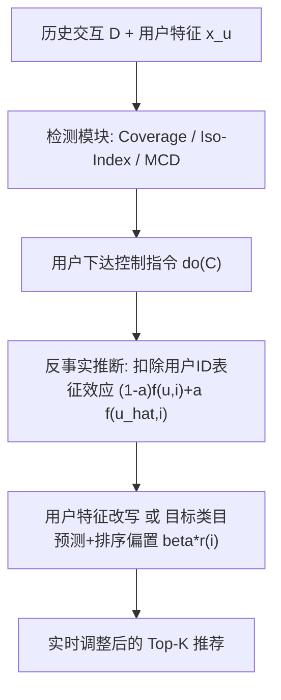
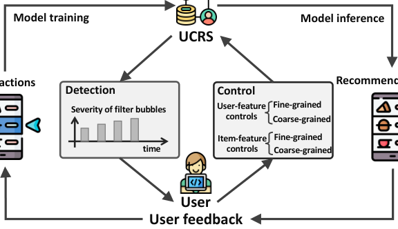
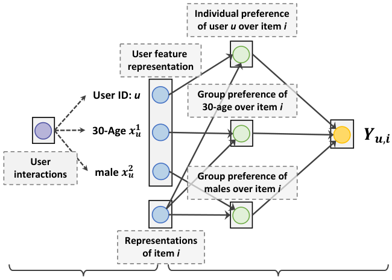

# User-controllable Recommendation Against Filter Bubbles (面向过滤气泡的用户可控推荐)

- **会议/期刊**: SIGIR 2022（第45届国际 ACM SIGIR 会议）
- **作者与机构**: Wenjie Wang, Fuli Feng, Liqiang Nie, Tat-Seng Chua（Sea-NExT 联合实验室/NUS、中科大、山东大学）
- **推荐链路定位**: 重排 / 推理阶段实时干预（模型无关，可挂载于任意打分模型之上）
- **研究方向**: 去偏与可信推荐 / 多任务与列表级重排
- **论文原文**: [https://arxiv.org/abs/2204.13844v1](https://arxiv.org/abs/2204.13844v1)
- **开源代码**: [https://github.com/WenjieWWJ/UCRS](https://github.com/WenjieWWJ/UCRS)

## TL;DR (1分钟核心速览)

现有去气泡方法（多样性、公平性、校准）靠追加目标做全局权衡，普遍以精度换多样性，且用户只能被动地反复点赞/点踩、反馈时延高。本文提出 UCRS 原型与因果增强的 UCI 推理框架：在因果图上把"用户 ID 表征"视为携带过时偏好的混杂路径，用反事实推断 $Y_{u,i}-\alpha(Y_{u,i}-Y_{\hat{u},i})$ 在推理期直接扣除其效应，并配合四级控制指令与可控排序策略。在 10-core、时间戳 80/10/10 划分、全库排序（all-ranking, top-10）协议下，DIGIX-Video 上 Iso-Index 相对 FM 下降 28.2%，ML-1M 上 W-NDCG 提升 29.9%，同时 Recall 不降反升。

## Background & Motivation (背景与核心矛盾)

- **主流范式**: 用 FM/NFM 等从用户特征与历史交互学表征打分；去气泡则靠追加多样性、公平性或校准（calibration）目标，或后处理重排。
- **前人局限**: ① 多目标权衡必然牺牲精度，Fairco 在细粒度控制下 NDCG 掉 15.4%，且会推入大量无关物品；② 用户只能通过持续反馈被动影响策略，滞后且低效，无法表达"我现在想跳出哪个气泡"。
- **核心洞察 (Key Insight)**: 作者用 FM 做预实验发现**偏置放大**——男性用户历史中 Action 占比高于女性，推荐列表进一步放大该比例；Amazon-Book 上历史最大类目在推荐中被进一步推高。气泡同时存在于**用户特征侧**（群体隔离）与**物品特征侧**（多数类目支配），因此需要两种粒度的控制。
- **本文切入点**: 把"是否去气泡、去哪个气泡"的决策权交还用户，模型侧只需解决"如何在不重训的前提下实时响应指令"——关键障碍是用户 ID 表征里仍编码着与控制指令相悖的过时偏好。

## Method (核心方法设计)

### 1. 整体框架 (Overall Architecture)

UCRS 在原有"交互→训练→推理"回路之外增加一条**检测-控制回路**：检测模块按时间窗计算 Coverage、Isolation Index、MCD 三类指标，给出气泡严重度并告警；用户在收到告警后下达四类指令（细/粗粒度 × 用户特征/物品特征）；控制模块在**推理阶段**即时改写推荐，不训练、不微调。其形式化为从 $P(R\mid D)$转为干预分布$P(R\mid D, do(C))$。用户特征类指令走"改/删特征 + 反事实去混杂"两段式；物品特征类指令走"反事实去混杂 + 目标类目预测 + 可控排序"三段式。

<figure class="paper-figure" markdown="span">
  <figcaption>图3：所提出的 UCRS 示意图，它在用户与推荐系统之间引入另一个回路，用于检测过滤气泡和用户控制。</figcaption>
</figure>

### 2. 关键设计拆解 (Key Designs)

1. **反事实用户 ID 去偏（Counterfactual Inference）**：痛点在于历史交互是混杂因子，同时决定了 ID 表征与群体特征表征，故仅"改 age=30→18"或"屏蔽该特征"后，ID 表征仍把旧偏好带回打分。作者避开需要估计混杂效应的后门调整，转而想象一个"用户无 ID 表征"的反事实世界 $\hat{u}$，把 ID 效应估计为$Y_{u,i}-Y_{\hat{u},i}$ 并整体扣除：

$$Y'_{u,i}=Y_{u,i}-\alpha\,(Y_{u,i}-Y_{\hat{u},i})=(1-\alpha)f(u,i)+\alpha f(\hat{u},i)$$

直觉上 $\alpha$就是"个体偏好 vs 群体偏好"的连续旋钮，$\alpha=0$退化为原模型，$\alpha=1$ 完全按群体特征打分，无需知道优化器与训练细节，模型无关且零重训成本。

2. **四类控制指令 + 目标类目预测的可控排序**：细粒度用户特征指令 $do(C=c_u(+\hat{x},\alpha))$要求用户不具备$\hat{x}$，即"多推另一群体喜欢的物品"；粗粒度$do(C=c_u(-\bar{x},\alpha))$ 则剔除自身群体特征。物品侧则用排序偏置：

$$Y'_{u,i}=Y_{u,i}+\beta\cdot r(i),\quad r(i)=\begin{cases}2,&\hat{h}_i=1\ (\text{细粒度目标类目})\\0,&\bar{h}_i=1\ (\text{粗粒度压制历史最大类目})\\1,&\text{otherwise}\end{cases}$$

为免除用户逐一指定类目，作者把交互序列按时间切两段，用 MLP 从第一段类目分布预测第二段（学到"动作片→犯罪片"这类类目转移），并对历史最大类目施加 $do(\bar{h}=0)$干预后取 Top-$K$ 作为目标类目。

3. **训练目标、负采样与推理效率**：UCI 本身不引入新损失，主干仍用 FM/NFM 的常规 pairwise/BPR 式优化，每交互随机采 1 个未观测负样本；创新全部发生在打分函数后处理，故在线开销仅为一次额外前向（$f(\hat{u},i)$）与一次排序偏置加法，$O(|\mathcal{I}|)$ 量级，满足"实时响应"要求。

<figure class="paper-figure" markdown="span">
  <figcaption>图4：推荐生成过程背后的因果图。</figcaption>
</figure>

## Experimental Setup & Evaluation Protocol (实验设置与评估协议)

- **数据集与预处理**: 统一采用 **10-core** 过滤，评分 $\ge 4$ 记为正反馈。

| 数据集 | #Users | #Items | #Interactions | 稀疏度/密度 | 特征/场景说明 |
| :--- | :---: | :---: | :---: | :---: | :--- |
| DIGIX-Video | 7,643 | 15,526 | 316,045 | 0.0027 | 短视频；含 age/gender，135 个类目 |
| ML-1M | 6,040 | 3,883 | 575,276 | 0.0245 | 电影；多标签类目，18 类 |
| Amazon-Book | 29,115 | 16,845 | 1,712,409 | 0.0035 | 图书；**仅 ID 特征**，单标签类目，29 类 |

- **数据划分与防穿越**: 按时间戳排序后 **80%/10%/10% 比例划分**（训练/验证/测试），测试集为未来交互，避免穿越。
- **排名评测协议**: 采用 **all-ranking 全库未交互排序**（非采样排序），返回 Top-10；训练期每正样本随机采 1 个负样本。
- **对比基线与超参设置**: 主干为 FM 与 NFM（表征维度 $d=64$，Adagrad，batch 1024，lr∈{0.001,0.01,0.05}）；基线含移除用户/物品特征（woUF/woIF）、推理期改特征（changeUF）、掩码特征（maskUF）、公平重排 Fairco、多样性重排 Diversity、纯排序偏置 Reranking，以及知道真实目标类目的 F-UCI（上界）。$K\in\{1..5\}$，$\alpha\in[0,0.5]$，$\beta\in[0,0.1]$，按验证集 Recall 选模。
- **气泡度量**: Coverage（类目覆盖）、Isolation Index（群体隔离，$s=\sum_i\frac{a_i}{a_n}\frac{a_i}{a_i+b_i}-\sum_i\frac{b_i}{b_n}\frac{a_i}{a_i+b_i}$）、MCD（历史最大类目占比）、TCD（目标类目占比）、DIS-EUC（用户推荐分布到目标群体与自身群体的欧氏距离差$\text{dis}(d_u,\hat{g}_u)-\text{dis}(d_u,\bar{g}_u)$）、W-NDCG（目标类目正样本权重 2）。

## Key Experimental Results (实验关键数据)

### 1. 主实验对比 (Main Results)

**表1 粗粒度用户特征控制（DIGIX-Video，FM/NFM 主干）**

| 方法 | Recall↑ | NDCG↑ | Iso-Index↓ | Coverage↑ |
| :--- | :---: | :---: | :---: | :---: |
| Random | 0.0008 | 0.0005 | 0.0008 | 11.6185 |
| FM | 0.0758 | 0.0584 | 0.1082 | 9.5191 |
| FM-woUF | 0.0757 | 0.0582 | 0.1195 | 9.9211 |
| FM-maskUF | 0.0756 | 0.0577 | 0.1048 | 9.6185 |
| FM-Fairco | 0.0728 | 0.0534 | 0.1050 | 9.9241 |
| FM-Diversity | 0.0756 | 0.0574 | 0.1025 | 9.8742 |
| **FM-UCI** | **0.0767** | **0.0592** | **0.0777** | 9.8802 |
| NFM | 0.0774 | 0.0585 | 0.1144 | 10.2670 |
| **NFM-UCI** | 0.0767 | **0.0596** | **0.0760** | 9.9000 |
| *Improv. (Iso-Index)* | — | +1.4% | **−28.2%/−33.6%** | — |

**表2 物品特征控制（ML-1M，FM 主干，C-UCI 为粗粒度自动版）**

| 方法 | Recall↑ | NDCG↑ | W-NDCG↑ | MCD↓ | TCD↑ | Coverage↑ |
| :--- | :---: | :---: | :---: | :---: | :---: | :---: |
| FM | 0.0659 | 0.0536 | 0.0485 | 0.5994 | 0.2222 | 8.6600 |
| FM-woIF | 0.0649 | 0.0529 | 0.0481 | 0.5952 | 0.2238 | 8.6755 |
| FM-Fairco | 0.0605 | 0.0506 | 0.0459 | 0.3812 | 0.2417 | 9.3799 |
| FM-Diversity | 0.0531 | 0.0473 | 0.0428 | 0.5597 | 0.2351 | 9.5407 |
| FM-Reranking | 0.0761 | 0.0637 | 0.0603 | **0.1000** | 0.3099 | 8.9409 |
| **FM-C-UCI** | **0.0770** | **0.0665** | **0.0630** | 0.2466 | **0.3334** | 9.1206 |
| FM-F-UCI (UB) | 0.2095 | 0.1704 | 0.1792 | 0.3544 | 1.0000 | 8.0712 |
| *Improv. (vs FM)* | +16.8% | +24.1% | **+29.9%** | — | **+50.0%** | — |

### 2. 消融实验 (Ablation Study)

**表3 反事实推断（CI）消融（ML-1M，F-UCI 设定）**

| 变体 | Recall | NDCG | W-NDCG | MCD↓ | Coverage |
| :--- | :---: | :---: | :---: | :---: | :---: |
| FM-F-UCI w/o CI（即 $\alpha=0$） | 0.2094 | 0.1689 | 0.1777 | 0.3587 | 7.9519 |
| FM-F-UCI w/ CI | **0.2095** | **0.1704** | **0.1792** | **0.3544** | **8.0712** |
| NFM-F-UCI w/o CI | 0.2094 | 0.1687 | 0.1775 | 0.3525 | 8.0155 |
| NFM-F-UCI w/ CI | **0.2125** | **0.1729** | **0.1820** | **0.3319** | **8.2299** |

### 3. 关键实验发现 (Key Findings)

1. **真正的收益来自"去混杂"，而非"改特征"**：woUF、maskUF、changeUF 这类只操作用户特征的做法，Iso-Index 仍停在 0.1048–0.1195（与 FM 的 0.1082 无显著差异，woUF 甚至更差），精度还微跌；而 UCI 把 Iso-Index 压到 0.0777 的同时 NDCG 从 0.0584 升到 0.0592——说明用户 ID 表征确实是过时偏好回流的通道，堵住它比删特征更有效。
2. **精度-多样性权衡被打破，但依赖"有混杂可去"这一前提**：ML-1M 上 Fairco 虽把 MCD 从 0.5994 降到 0.3812，代价是 NDCG 掉 5.6%；C-UCI 在 MCD 降到 0.2466 的同时 W-NDCG 反升 29.9%。但 Amazon-Book 只有 ID 特征、CI 几乎无效（C-UCI 0.0173 vs Reranking 0.0178），增益主要来自目标类目预测（TCD 0.5348→0.6310），暴露了方法对用户特征丰富度的强依赖。
3. **排序偏置会"过度压制"，须与因果扣除配合**：纯 Reranking 把 MCD 压到 0.1000（远低于 C-UCI 的 0.2466），却使 W-NDCG 落后 C-UCI 4.5%，即无差别打压历史最大类目会误伤真实兴趣；$\alpha$扫描显示 Iso-Index 与 Coverage 随$\alpha$单调改善而 NDCG 先升后降（甜点约$\alpha\in[0.1,0.2]$），$\beta$ 在 0–0.1 内可同时提升 W-NDCG 并压低 MCD。

## Highlights & Limitations (亮点、对比与审稿批判)

- **与代表作对比 (vs. Prior Work)**: 与 Fairco/Diversity 的"训练期追加目标或后处理全局权衡"不同，UCRS 把权衡系数 $\alpha,\beta$ 直接交给用户，且完全在推理期生效、无需重训；与已有可控推荐（critiquing、对话式偏好获取）相比，本文首次指出"控制指令与过时 ID 表征的不一致"这一被忽略的冲突，并用反事实扣除而非重新学习来解决；与标准因果去偏（IPS/后门调整）相比，它绕开了对动态高维混杂效应的估计。
- **可迁移亮点**: ① 推理期残差改写 $f'=(1-\alpha)f(u,i)+\alpha f(\hat{u},i)$ 可直接套到双塔/CTR 模型上做"兴趣遗忘"或"探索注入"，成本近乎为零；② Isolation Index 与 DIS-EUC 可作为线上治理类指标，把"群体隔离"从社会学概念落成可监控的 A/B 看板指标。
- **审稿级局限批判**: ① 全程离线模拟"用户愿意下达控制指令"，缺少在线 A/B 与真实交互成本评估，控制面板的可用性、指令理解偏误均未验证；② 因果图只建模了用户 ID 这一条混杂路径，未考虑物品侧流行度/曝光位置混杂，且 Amazon-Book 单标签类目下 Coverage 从 3.02 跌至 2.08，说明"追目标类目"会反噬多样性；③ $\alpha,\beta,K$ 需按数据集网格搜索，个体层面的最优控制强度差异未建模。

## Rating (四维评分)

- **方法创新性 (Novelty)**: ⭐⭐⭐⭐ （把"用户可控"与"反事实去混杂"嫁接，指出控制指令与过时 ID 表征的冲突，视角新颖，但反事实残差扣除本身较朴素）
- **评估协议与实验扎实度 (Protocol & Experiments)**: ⭐⭐⭐⭐ （三数据集、all-ranking 全库排序、10-core 过滤规范，且自建 Iso-Index/DIS-EUC/TCD 多角度度量；扣分在缺少在线验证与显著性检验）
- **写作与数学规范度 (Clarity & Rigor)**: ⭐⭐⭐⭐ （因果图清晰、公式极简可复现，四级指令定义完备；但对反事实世界 $\hat{u}$ 的可识别性假设论述偏薄）
- **工业落地与复现价值 (Industrial & Practical Value)**: ⭐⭐⭐⭐⭐ （模型无关、零重训、单次额外前向即可上线，代码与数据已开源，天然适配"推荐控制面板"类产品需求）

