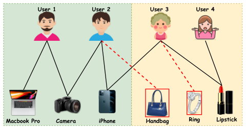
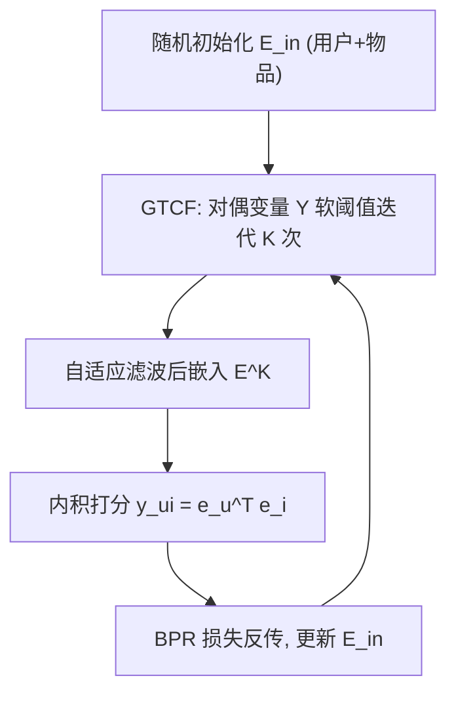
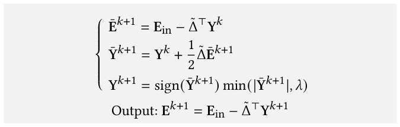

# Graph Trend Filtering Networks for Recommendations (面向推荐的图趋势滤波网络)

- **会议/期刊**: SIGIR 2022 (45th International ACM SIGIR)
- **作者与机构**: Wenqi Fan, Xiaorui Liu, Wei Jin, Xiangyu Zhao, Jiliang Tang, Qing Li（香港理工大学 / 密歇根州立大学 / 香港城市大学）
- **推荐链路定位**: 召回（图嵌入传播 + 内积全库排序）
- **研究方向**: 图神经网络与知识图谱推荐 / 自监督对比学习与交互去噪
- **论文原文**: [https://arxiv.org/abs/2108.05552v2](https://arxiv.org/abs/2108.05552v2)
- **开源代码**: [https://github.com/wenqifan03/GTN-SIGIR2022](https://github.com/wenqifan03/GTN-SIGIR2022)

## TL;DR (1分钟核心速览)

主流 GNN 协同过滤（NGCF/LightGCN）的嵌入传播等价于在用户-物品图上做**等权拉普拉斯平滑**，会把误点、标题党点击等不可靠交互与真实偏好一视同仁地拉近，导致"非自适应传播"与"非鲁棒"。本文把传播目标从 L2 平滑改为 **L1 图趋势滤波** $\lambda\|\tilde{\Delta}\mathbf{E}\|_1$，其等价于以$W_{ij}=\|\cdot\|_1/\|\cdot\|_2^2$对每条边重加权，并用原始-对偶算法（GTCF）在$O(|\mathcal{E}|d)$ 内求解。四个基准、Full-Ranking、Recall/NDCG@20 上全面超越 LightGCN，LastFM 上 Recall +9.61%、NDCG +12.77%，且在 50% 随机噪声注入下几乎不退化。

## Background & Motivation (背景与核心矛盾)

- **主流范式**: 将交互视作二部图，用 $\mathbf{E}^{k+1}=\tilde{\mathbf{A}}\mathbf{E}^k$做多层邻域聚合，$\tilde{\mathbf{A}}=\hat{\mathbf{D}}^{-1/2}\hat{\mathbf{A}}\hat{\mathbf{D}}^{-1/2}$，最后内积打分。
- **前人局限**: 该传播等价于最小化 $\mathrm{tr}(\mathbf{E}^\top(\mathbf{I}-\tilde{\mathbf{A}})\mathbf{E})=\sum_{(i,j)\in\mathcal{E}}\|\frac{\mathbf{e}_i}{\sqrt{d_i+1}}-\frac{\mathbf{e}_j}{\sqrt{d_j+1}}\|_2^2$，即**每条边平滑强度相同**；一旦存在随机点击/标题党购买（图 1 中 User 2 买一次性手袋、User 3 被封面诱导点戒指），系统被迫把无关物品排到用户 top 位。
- **核心洞察 (Key Insight)**: 用 LightGCN 做扰动实验（图 2），随噪声比例从 0 升到 50%，Gowalla/Yelp 的 Recall@20 单调下滑，证实"等权平滑"是脆弱性根源；而真实交互的可靠性是**异质**的，应被自适应加权。
- **本文切入点**: 引入图趋势滤波的 L1 差分惩罚，让"嵌入差异大"的边自动降权、"差异小"的边更强平滑，从而得到分段常数（piecewise constant）式的鲁棒传播。

<figure class="paper-figure" markdown="span">
  <figcaption>图1：不可靠用户-物品交互示意图。用户2为母亲的生日礼物购买了一件一次性物品（即Handbag）；用户3受标题党问题影响，被物品有吸引力的曝光特征（如物品标题或封面）“欺骗”而与一件物品（即Ring）产生交互。</figcaption>
</figure>

## Method (核心方法设计)

### 1. 整体框架 (Overall Architecture)

GTN 由四步构成：(1) 随机初始化用户/物品嵌入 $\mathbf{E}_{in}\in\mathbb{R}^{(n+m)\times d}$（有特征时可拼接）；(2) 以 GTCF 迭代$K$次对$\mathbf{E}_{in}$做趋势滤波，得到编码了高阶协同信号的$\mathbf{E}^K$；(3) 用内积$\hat{y}_{ui}=(\mathbf{e}^K_u)^\top\mathbf{e}^K_i$作为排序分；(4) 仅以$\mathbf{E}_{in}$ 为可学习参数、用 BPR 损失反传训练。滤波过程本身无参数、无激活、无特征变换，训练与推理均保持与 LightGCN 同阶开销。

### 2. 关键设计拆解 (Key Designs)

1. **L1 图趋势滤波替代 L2 拉普拉斯平滑（自适应边权）**：痛点是把式 (6) 的等权欧氏惩罚换成 $\ell_1$惩罚后，$\|\tilde{\Delta}\mathbf{E}\|_1=\sum_{(i,j)\in\mathcal{E}}W_{ij}\|\frac{\mathbf{e}_i}{\sqrt{d_i+1}}-\frac{\mathbf{e}_j}{\sqrt{d_j+1}}\|_2^2$，其中$W_{ij}=\|\frac{\mathbf{e}_i}{\sqrt{d_i+1}}-\frac{\mathbf{e}_j}{\sqrt{d_j+1}}\|_1\big/\|\frac{\mathbf{e}_i}{\sqrt{d_i+1}}-\frac{\mathbf{e}_j}{\sqrt{d_j+1}}\|_2^2$。物理直觉：二者差异大$\Rightarrow W_{ij}$小$\Rightarrow$该边被抑制（视为不可靠交互）；差异小$\Rightarrow W_{ij}$大$\Rightarrow$更强收缩；同时$\ell_1$ 的稀疏性允许大量边的差异精确为 0，**容忍**而非惩罚大差异，避免"不当平滑"。优化目标为
$$\min_{\mathbf{E}}\ \tfrac{1}{2}\|\mathbf{E}-\mathbf{E}_{in}\|_F^2+\lambda\|\tilde{\Delta}\mathbf{E}\|_1,\quad \tilde{\Delta}=\Delta\tilde{\mathbf{D}}^{-1/2}.$$
2. **GTCF：原始-对偶近端求解（可落地为 4 行迭代）**：目标由光滑项与非光滑项经 $\tilde{\Delta}$耦合，引入分裂变量$\mathbf{F}=\tilde{\Delta}\mathbf{E}$与乘子$\mathbf{Y}\in\mathbb{R}^{|\mathcal{E}|\times d}$，用 PAPC 迭代；对偶近端算子经 Moreau 分解化为**软阈值**$\mathrm{prox}_{\beta g^*}(\mathbf{X})=\mathrm{sign}(\mathbf{X})\min(|\mathbf{X}|,\lambda)$。定理 1 证明取$\gamma=1,\beta=1/2$（因$\|\tilde{\Delta}\tilde{\Delta}^\top\|_2\le 2$）即收敛，于是迭代简化为：$\bar{\mathbf{E}}=\mathbf{E}_{in}-\tilde{\Delta}^\top\mathbf{Y}$；$\bar{\mathbf{Y}}=\mathbf{Y}+\tfrac12\tilde{\Delta}\bar{\mathbf{E}}$；$\mathbf{Y}=\mathrm{sign}(\bar{\mathbf{Y}})\min(|\bar{\mathbf{Y}}|,\lambda)$；输出$\mathbf{E}=\mathbf{E}_{in}-\tilde{\Delta}^\top\mathbf{Y}$。每轮仅 2–3 次稀疏矩阵乘，复杂度$O(|\mathcal{E}|d)$，与 LightGCN 传播同阶。
3. **训练目标、负采样与推理效率**：采用 pairwise BPR $\mathcal{L}=\sum_{(u,i,j)\in O}-\ln\sigma(\hat{y}_{ui}-\hat{y}_{uj})+\alpha\|\mathbf{E}_{in}\|_F^2$，每个正样本**均匀采样 1 个未交互物品**作负例（无 hard negative、无额外自监督损失）；推理为一次预计算$\mathbf{E}^K$ 后内积 + 全库排序，线上仅需 ANN 检索，无额外时延。

<figure class="paper-figure" markdown="span">
  <figcaption>图3：图趋势协同过滤（GTCF）。</figcaption>
</figure>

## Experimental Setup & Evaluation Protocol (实验设置与评估协议)

- **数据集与预处理**: 沿用 NGCF/LightGCN 发布的版本，未额外 k-core 过滤；仅用交互、无侧特征。

| 数据集 | #Users | #Items | #Interactions | 稀疏度/密度 | 特征/场景说明 |
| :--- | :---: | :---: | :---: | :---: | :--- |
| Gowalla | 29,858 | 40,981 | 1,027,370 | 密度 ≈ 8.4e-4 | LBS 签到 |
| Yelp2018 | 31,668 | 38,048 | 1,561,406 | 密度 ≈ 1.3e-3 | 本地商户评论 |
| Amazon-Book | 52,643 | 91,599 | 2,984,108 | 密度 ≈ 6.2e-4 | 电商图书 |
| LastFM | 23,566 | 48,123 | 3,034,796 | 密度 ≈ 2.7e-3 | 音乐社交 |

- **数据划分与防穿越 (Splitting Strategy)**: 严格遵循 LightGCN 的**随机比例划分**（每用户 80% 训练 / 10% 验证 / 10% 测试），未使用全局时间戳切分，因此不存在未来交互泄漏，但也未评估时序泛化。
- **排名评测协议 (Ranking Protocol)**: 无偏 **Full-Ranking**——对测试用户在全库所有未交互物品上打分排序（训练期只用 1:1 均匀负采样，测试期不采样），指标 Recall@20 与 NDCG@20，对所有测试用户取平均。
- **对比基线与超参设置**: MF、NeuCF、GC-MC、Mult-VAE、NGCF、DGCF、LightGCN 共 7 个基线，均取原文默认超参；嵌入维度 $d\in\{16,\dots,512\}$、batch$\in\{128,\dots,2048\}$、学习率$\{5e\text{-}4,\dots,0.1\}$网格搜索，Adam 优化；$\lambda$在$[0,9]$搜索（$\lambda\ge2$ 后性能平稳）。

## Key Experimental Results (实验关键数据)

### 1. 主实验对比 (Main Results)

| 方法 | Gowalla R@20 | NDCG@20 | Yelp2018 R@20 | NDCG@20 | Amazon-Book R@20 | NDCG@20 | LastFM R@20 | NDCG@20 |
| :--- | :---: | :---: | :---: | :---: | :---: | :---: | :---: | :---: |
| MF | 0.1299 | 0.1110 | 0.0436 | 0.0353 | 0.0252 | 0.0198 | 0.0725 | 0.0614 |
| NeuCF | 0.1406 | 0.1211 | 0.0450 | 0.0364 | 0.0259 | 0.0202 | 0.0723 | 0.0637 |
| GC-MC | 0.1395 | 0.1204 | 0.0462 | 0.0379 | 0.0288 | 0.0224 | 0.0804 | 0.0736 |
| NGCF | 0.1560 | 0.1324 | 0.0581 | 0.0475 | 0.0338 | 0.0266 | 0.0774 | 0.0693 |
| Mult-VAE | 0.1641 | 0.1335 | 0.0584 | 0.0450 | 0.0407 | 0.0315 | 0.0780 | 0.0700 |
| DGCF | 0.1794 | 0.1521 | 0.0640 | 0.0522 | 0.0399 | 0.0308 | 0.0794 | 0.0748 |
| LightGCN | 0.1823 | 0.1553 | 0.0649 | 0.0525 | 0.0420 | 0.0327 | 0.0850 | 0.0760 |
| **GTN (Ours)** | **0.1870** | **0.1588** | **0.0679** | **0.0554** | **0.0450** | **0.0346** | **0.0932** | **0.0857** |
| **Improv.%** | +2.59 | +2.26 | +4.62 | +5.59 | +7.15 | +5.95 | +9.61 | +12.77 |

### 2. 消融实验 (Ablation Study)

| #层数 | Gowalla (LG → GTN) | Yelp2018 (LG → GTN) | Amazon-Book (LG → GTN) | LastFM (LG → GTN) |
| :--- | :---: | :---: | :---: | :---: |
| 1 | 0.1753 → 0.1789 | 0.0628 → 0.0600 | 0.0381 → **0.0443** | 0.0865 → 0.0888 |
| 2 | 0.1752 → **0.1863** | 0.0622 → 0.0647 | 0.0413 → 0.0455 | 0.0874 → 0.0913 |
| 3 | 0.1823 → 0.1870 | 0.0649 → 0.0679 | 0.0420 → 0.0450 | 0.0850 → 0.0932 |
| 4 | 0.1818 → 0.1842 | 0.0650 → 0.0663 | 0.0404 → 0.0418 | 0.0822 → 0.0928 |
| 5 | 0.1742 → 0.1789 | 0.0627 → 0.0637 | 0.0388 → 0.0391 | 0.0768 → **0.0921** |

（Recall@20；LG = LightGCN。另：$\lambda$从 0 增到 1 性能跃升，$\lambda\ge2$ 后平稳，说明滤波项确实在起作用；稀疏率实验见下。）

### 3. 关键实验发现 (Key Findings)

1. **噪声越重的域收益越大**：LastFM/Yelp2018（签到、评论等低动机交互多）分别拿到 +9.61%/+5.59% NDCG，而强偏好信号主导的 Gowalla 仅 +2.26%，与"抑制不可靠边"的机制假设一致——收益来自去噪而非表达能力。
2. **L1 先验真实落地为分段常数嵌入**：$\tilde{\Delta}\mathbf{E}^K$ 中绝对值 <0.2 的元素占比，GTN 为 0.1241/0.1424/0.2612/0.2282，是 LightGCN（0.017/0.017/0.0233/0.0218）的 **7–12 倍**，直接证明软阈值把大量可靠边的差异压为 0，同时保留大差异。
3. **缓解过平滑，深层不塌陷**：LightGCN 在 LastFM 上从 3 层的 0.0850 掉到 5 层的 0.0768（−9.6%），而 GTN 5 层仍有 0.0921（相对 LightGCN +19% Recall、+23% NDCG）；在 50% 随机噪声注入下 LightGCN 在扰动率 >20% 后显著下滑，GTN 曲线几乎持平，鲁棒性优势随噪声增大而扩大。

## Highlights & Limitations (亮点、对比与审稿批判)

- **与代表作对比 (vs. Prior Work)**: 相较 LightGCN，本文把固定等权低通滤波器换成含软阈值的自适应低通，复杂度同为 $O(|\mathcal{E}|d)$ 却具备边级可靠性判别；相较 Elastic GNN 的图对抗鲁棒，本文首次把图趋势滤波引入推荐的隐式反馈去噪；与 SGL 等损失层对比增广正交（作者也明确未做组合实验）。
- **可迁移亮点**: (1) L1 差分惩罚可作即插即用传播算子替换 NGCF/DGCF 的 $\tilde{\mathbf{A}}$层；(2) 软阈值$\mathrm{sign}(\cdot)\min(|\cdot|,\lambda)$ 可解释为"逐边门控"，可进一步参数化为可学习边权，与注意力/去噪目标融合。
- **审稿级局限批判**: (1) 引入与边数同规模的对偶变量 $\mathbf{Y}\in\mathbb{R}^{|\mathcal{E}|\times d}$，显存约为 LightGCN 的 2 倍，且$\lambda$ 为**全局标量**，不同噪声水平的边共享同一阈值，缺乏逐边自适应；(2) 仅在 4 个中小规模静态 benchmark 上验证，划分非时序、评测止于 20、未与 SGL 类自监督损失或工业级线上 A/B 结合，鲁棒性结论对真实标题党噪声的外部有效性仍待检验。

## Rating (四维评分)

- **方法创新性 (Novelty)**: ⭐⭐⭐⭐ （把图趋势滤波的 L1 分段常数先验首次落到推荐嵌入传播，理论链条从拉普拉斯平滑缺陷到重加权解释完整闭环）
- **评估协议与实验扎实度 (Protocol & Experiments)**: ⭐⭐⭐⭐ （Full-Ranking + 四数据集 + 7 基线 + 层数/λ/稀疏率/扰动率多维消融，但缺显著性检验与更大规模数据）
- **写作与数学规范度 (Clarity & Rigor)**: ⭐⭐⭐⭐ （从式 (6) 到式 (9) 的重加权等价推导清晰，定理 1 给出步长充分条件，复杂度分析到位）
- **工业落地与复现价值 (Industrial & Practical Value)**: ⭐⭐⭐⭐ （PyTorch 代码开源、迭代可预计算、复杂度同阶易替换，但额外对偶变量存储需在亿级图上做工程优化）

