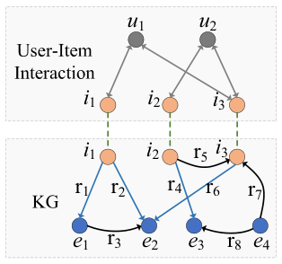
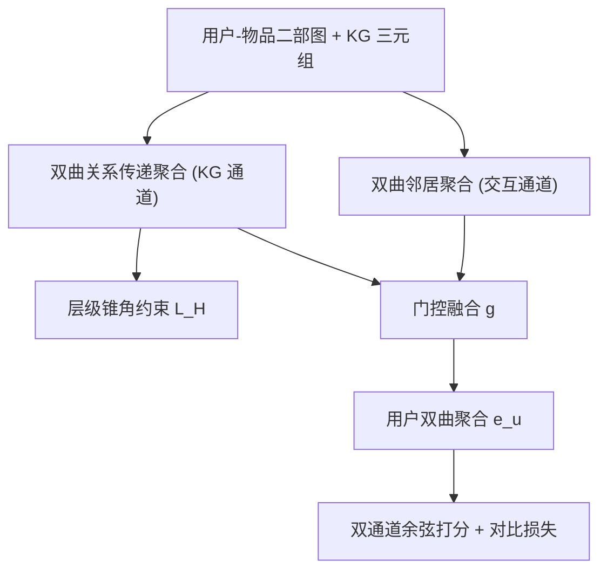
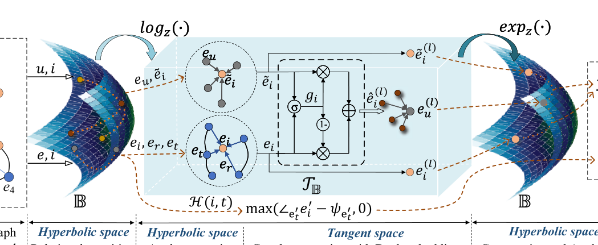

# HAKG: Hierarchy-Aware Knowledge Gated Network for Recommendation (层级感知知识门控推荐网络)

- **会议/期刊**: SIGIR 2022 (45th International ACM SIGIR Conference)
- **作者与机构**: Yuntao Du, Xinjun Zhu, Lu Chen, Baihua Zheng, Yunjun Gao（浙江大学、新加坡管理大学）
- **推荐链路定位**: 召回（用户/物品表征学习与 Top-K 排序）
- **研究方向**: 图神经网络与知识图谱推荐 / 协同过滤
- **论文原文**: [https://arxiv.org/abs/2204.04959v1](https://arxiv.org/abs/2204.04959v1)
- **开源代码**: [https://github.com/Scottdyt/HAKG](https://github.com/Scottdyt/HAKG)

## TL;DR (1分钟核心速览)

现有知识图谱推荐（KGAT/CKAN/KGIN）把用户-物品图与 KG 一律塞进欧氏空间做均值聚合，既无法压缩幂律分布带来的层级失真，也把"层级关系（品牌/品类）"与"非层级关系（搭配/相似）"一锅炖，同时丢掉物品的高阶协同信号。HAKG 将两类图整体搬到 Poincaré 球，设计双曲关系传递聚合、双曲蕴含锥角约束与"知识/协同"双物品嵌入 + 门控融合。在三个基准上采用 **Full-Ranking（全库未交互排序）** 评估，Recall@20/nDCG@20 相对最强基线 KGIN 最高提升 **15.43%**（Alibaba-iFashion nDCG）。

## Background & Motivation (背景与核心矛盾)

- **主流范式**: 基于信息传播的端到端 GNN 模型（KGAT 统一图注意力、CKAN 异质聚合、KGIN 意图解耦）在 KG 上迭代聚合多跳邻居，已取代元路径与纯 KGE 方案。
- **前人局限 1（几何失真）**: 交互度分布服从幂律（图 1(b)），KG 本身也是层级组织，但欧氏空间对树状/层级数据嵌入失真高，且现有方法把所有 KG 关系按同等粒度处理，忽视层级关系刻画"物品属性"、非层级关系仅刻画"实体相关性"这一语义差异。
- **前人局限 2（协同信号缺失）**: 物品聚合要么纯 KG 导向（KGIN 完全忽略协同），要么在统一图中盲目混合用户与实体邻居（KGAT），无法显式编码 $i_1\!\to\!u_1\!\to\!i_3\!\to\!u_2\!\to\!i_2$ 这类长程共现语义。
- **核心洞察 (Key Insight)**: 双曲空间体积随半径指数扩张，可视为"连续版树"，天然低失真地容纳层级；而双曲蕴含锥的嵌套角结构恰好能把"$i$ 是牛仔裤"这种属性包含关系写成几何约束。
- **本文切入点**: 用双曲几何负责"层级"，用双通道 + 门控负责"协同 vs 知识"的解耦与自适应蒸馏。

<figure class="paper-figure" markdown="span">
  <figcaption>图 1：(a) 知识感知推荐的一个示例。蓝线表示层次关系，黑线表示非层次关系。(b) Alibaba-iFashion 数据集的度分布。</figcaption>
</figure>

## Method (核心方法设计)

### 1. 整体框架 (Overall Architecture)

输入为隐式反馈二部图 $\mathcal{G}_b$与 KG 三元组$\mathcal{G}_k$（物品均为 KG 实体）。所有 ID 嵌入（用户、协同物品、KG 实体与关系）定义在 Poincaré 球$\mathbb{B}^d$（曲率$-1$）。KG 侧用双曲关系传递聚合得到知识物品嵌入$\mathbf{e}_i$，并施加层级三元组的锥角约束；交互侧用双曲邻居聚合得到协同物品嵌入$\tilde{\mathbf{e}}_i$；两者经 sigmoid 门控融合为$\hat{\mathbf{e}}_i$ 后再聚合为用户表示。预测时用"知识 + 协同"两条余弦相似度之和打分。训练用带 margin 的对比损失叠加角度正则，参数实际在原点切空间优化后用指数映射映回双曲空间。

<figure class="paper-figure" markdown="span">
  <figcaption>图 3：所提出的 HAKG 框架示意图。</figcaption>
</figure>

### 2. 关键设计拆解 (Key Designs)

1. **双曲关系传递聚合（把"关系"当平移算子）**：欧氏均值聚合在双曲空间对应 Fréchet 均值，无闭式解且无法区分关系路径。HAKG 先将邻居三元组做 Möbius 平移 $\mathbf{e}_t^{(0)}\oplus\mathbf{e}_r$（关系即平移向量），再映射到切空间求均值，最后映回球面：$\mathbf{e}_i^{(l)}=\exp_0\big(\frac{1}{|\mathcal{N}_i|}\sum_{(r,t)\in\mathcal{N}_i}\log_{\mathbf{e}_i^{(l-1)}}(\mathbf{e}_t^{(l-1)}\oplus\mathbf{e}_r)\big)$。在切空间做平均既避开复杂双曲均值，又保留关系依赖。

2. **层级锥角约束（用几何嵌套刻画属性）**：聚合会把属性信息淹没。作者借双曲蕴含锥，定义锥半角 $\psi_x=\arcsin\big(K\frac{1-\|x\|^2}{\|x\|}\big)$与夹角$\angle_{\mathbf{e}_t}\mathbf{e}_i$，要求物品嵌入落在属性实体锥内：$\mathcal{L}_H=\sum_{(i,t)\in\mathcal{H}}\max(\angle_{\mathbf{e}_t}\mathbf{e}_i-\psi_{\mathbf{e}_t},0)$。因物品常有数十个层级关系，锥交集过小会导致表征塌缩，故以 0.5 概率随机掩码维度、仅在子空间施加约束$\mathcal{L}'_H$，为"相关性语义"留出自由度。

3. **双物品嵌入 + 门控融合与训练目标**：物品同时承载协同与知识两种语义，单嵌入必然信息损失。门控 $\mathbf{g}_i^{(l)}=\sigma(W_1\log_0(\mathbf{e}_i^{(l)})+W_2\log_0(\tilde{\mathbf{e}}_i^{(l)}))$，融合$\hat{\mathbf{e}}_i^{(l)}=\exp_0(\mathbf{g}_i^{(l)}\!\cdot\!\mathbf{e}_i^{(l)}+(1-\mathbf{g}_i^{(l)})\!\cdot\!\tilde{\mathbf{e}}_i^{(l)})$——门值高代表用户因"属性"而点击。打分为双通道余弦和$\hat{y}_{ui}=\cos(\mathbf{e}_u,\tilde{\mathbf{e}}_i)+\cos(\mathbf{e}_u,\mathbf{e}_i)$；总损失$\mathcal{L}=\sum_{(u,i)}[2-\hat{y}_{ui}+\frac{1}{|\mathcal{M}_u|}\sum_{j\in\mathcal{M}_u}(\hat{y}_{uj}-m)_+]+\lambda\mathcal{L}'_H$，每用户采 200/400/400 个未观测负样本（免采样不可行），复杂度$O((|\mathcal{G}_k|+|\mathcal{G}_b|)dL)$，与 KGAT/CKAN/KGIN 同阶。

## Experimental Setup & Evaluation Protocol (实验设置与评估协议)

- **数据集与预处理**: 采用 `10-core` 过滤（用户/物品 ≥10 次交互，KG 实体 ≥10 个三元组），仅保留物品二跳邻居实体构图；层级关系默认取"物品直连关系"（不可得时用 Krackhardt score 推断）。

| 数据集 | #Users | #Items | #Interactions | 稀疏度/密度 | 特征/场景说明 |
| :--- | :---: | :---: | :---: | :---: | :--- |
| Alibaba-iFashion | 114,737 | 30,040 | 1,781,093 | 5.17e-4 | 服饰搭配，59,156 实体 / 51 关系 / 279,155 三元组 |
| Yelp2018 | 45,919 | 45,538 | 1,185,068 | 5.67e-4 | 本地生活，90,961 实体 / 42 关系 / 1,853,704 三元组 |
| Last-FM | 23,566 | 48,123 | 3,034,796 | 2.68e-3 | 音乐收听，58,266 实体 / 9 关系 / 464,567 三元组 |

- **数据划分与防穿越**: 沿用 KGIN/KGAT 的 `比例划分`（训练/验证/测试 = 80%/10%/10%），非时间戳切分（存在轻度未来信息泄漏风险）。
- **排名评测协议**: 无偏 `Full-Ranking`——测试集正样本 vs 全部未交互物品，指标 Recall@20、nDCG@20，对全部测试用户取平均。
- **对比基线与超参**: 基线含 MF、CKE、UGRec（嵌入类），KGNN-LS、KGAT、CKAN、KGIN（传播类），Hyper-Know、LKGR（双曲类）；嵌入维度 $d=64$，Adam，batch 4096，层数$L\in\{1,2,3\}$，$\lambda\in\{10^{-5},\dots,10^{-1}\}$，margin$m$ 分别取 0.6/0.8/0.7，早停（Recall@20 十轮不升）。

## Key Experimental Results (实验关键数据)

### 1. 主实验对比 (Main Results)

| 模型 | iFashion R@20 | iFashion N@20 | Yelp R@20 | Yelp N@20 | Last-FM R@20 | Last-FM N@20 |
| :--- | :---: | :---: | :---: | :---: | :---: | :---: |
| MF | 0.1095 | 0.0670 | 0.0627 | 0.0413 | 0.0724 | 0.0617 |
| CKE | 0.1103 | 0.0676 | 0.0653 | 0.0423 | 0.0732 | 0.0630 |
| KGAT | 0.1030 | 0.0627 | 0.0705 | 0.0463 | 0.0873 | 0.0744 |
| CKAN | 0.0970 | 0.0509 | 0.0646 | 0.0441 | 0.0812 | 0.0660 |
| KGIN | 0.1147 | 0.0716 | 0.0698 | 0.0451 | **0.0978** | 0.0848 |
| Hyper-Know | 0.1057 | 0.0648 | 0.0685 | 0.0447 | 0.0948 | 0.0812 |
| LKGR | 0.1033 | 0.0612 | 0.0679 | 0.0438 | 0.0883 | 0.0675 |
| **HAKG** | **0.1319** | **0.0848** | **0.0778** | **0.0501** | **0.1008** | **0.0931** |
| Improv.% | +14.99% | +15.43% | +10.35% | +8.21% | +3.07% | +9.79% |

### 2. 消融实验 (Ablation Study)

| 变体 | iFashion R@20 | iFashion N@20 | Yelp R@20 | Yelp N@20 | Last-FM R@20 | Last-FM N@20 |
| :--- | :---: | :---: | :---: | :---: | :---: | :---: |
| w/o Angle & Gate | 0.1218 | 0.0799 | 0.0737 | 0.0458 | 0.0946 | 0.0872 |
| w/o Angle loss | 0.1272 | 0.0825 | 0.0763 | 0.0485 | 0.0963 | 0.0907 |
| w/o Gate (改为加和) | 0.1253 | 0.0817 | 0.0758 | 0.0471 | 0.0959 | 0.0894 |
| Euclidean 替换全部双曲算子 | 0.1231 | 0.0798 | 0.0756 | 0.0484 | 0.0981 | 0.0916 |
| Single 单物品嵌入 | 0.1186 | 0.0755 | 0.0769 | 0.0492 | 0.0989 | 0.0904 |
| **HAKG (full)** | **0.1319** | **0.0848** | **0.0778** | **0.0501** | **0.1008** | **0.0931** |

### 3. 关键实验发现 (Key Findings)

1. **双物品嵌入是最大增益源，且在 KG 最弱的数据集上收益最陡**：改为单嵌入后 iFashion nDCG 从 0.0847 掉到 0.0755（−10.9%），而 Yelp/Last-FM 仅 −1.8%/−2.9%；这正印证"KG 辅助信息越少，越必须靠独立协同通道补足高阶共现信号"。
2. **双曲几何与角约束是互补的两层增益**：整体退回欧氏空间使 iFashion nDCG 降 5.9%（0.0848→0.0798），而仅去掉角约束降 2.7%、仅去掉门控降 3.7%；说明"空间选择"贡献大于"约束设计"，二者叠加才达到 +15.43%。
3. **模型对层数不敏感、收敛深度浅**：$L=1$时 iFashion 已达 0.1313/0.0845，逼近$L=3$的 0.1319/0.0848；Last-FM 则随$L$ 单调上升到 0.1008，说明双通道分离聚合让低阶即可抽取判别信号，避免了统一图上"混合信息需多跳才能厘清"的困境。可视化（图 4）进一步显示嵌入到原点距离随流行度呈指数变化，且 bottoms→pants/jeans/skirt 形成清晰嵌套锥。

## Highlights & Limitations (亮点、对比与审稿批判)

- **与代表作对比**: 相较 KGAT（统一图上注意力混合异质信息）与 KGIN（纯 KG 导向、丢弃协同信号），HAKG 显式拆出交互/知识两条通道并加门控；相较 Hyper-Know（双曲空间直接优化三元组、无高阶传播）与 LKGR（在双曲实体上套欧氏注意力、破坏局部相似性），HAKG 的双曲切空间聚合真正保留了球面局部几何。
- **可迁移亮点**: ①"切空间求均值 + 指数映射回球面"是绕开双曲 Fréchet 均值无闭式解的通用工程技巧；②子空间随机掩码施加锥约束，可直接迁移到任何"多父节点蕴含关系导致表征塌缩"的层级建模任务（如类目体系、技能树）。
- **审稿级局限批判**: ①层级/非层级关系靠先验或 Krackhardt 分数硬划分二值，真实 KG 中大量关系介于两者之间，缺软性建模；②80/10/10 随机划分而非全局时间戳切分，物品侧存在信息穿越，离线指标可能偏乐观；③在 Last-FM 上相对 KGIN 仅 +3.07% Recall，且未报告方差与显著性检验，增益稳定性存疑；④双曲算子（Möbius 加法、exp/log 映射）在 $|\mathbf{x}|\to1$ 时数值不稳定，论文仅在结论中承认该风险。

## Rating (四维评分)

- **方法创新性 (Novelty)**: ⭐⭐⭐⭐ （首次把"层级关系 vs 非层级关系"的语义差异写成双曲蕴含锥角约束，并以双通道双嵌入解耦协同与知识，机制新颖且几何动机自洽）
- **评估协议与实验扎实度 (Protocol & Experiments)**: ⭐⭐⭐⭐ （三域数据集 + Full-Ranking + 9 个强基线 + 五组消融与层级可视化完整，但缺时间戳切分与显著性检验）
- **写作与数学规范度 (Clarity & Rigor)**: ⭐⭐⭐⭐ （双曲映射与锥角公式定义清晰、复杂度分析到位，掩码子空间的动机解释充分；个别符号如 $\hat{y}$ 与锥半角的排版略有瑕疵）
- **工业落地与复现价值 (Industrial & Practical Value)**: ⭐⭐⭐⭐ （代码已开源、复杂度与 KGAT/CKAN 同阶、$L=1$ 即可用，适合类目体系强的电商场景；但双曲算子的数值稳定性与工程实现成本需额外投入）

