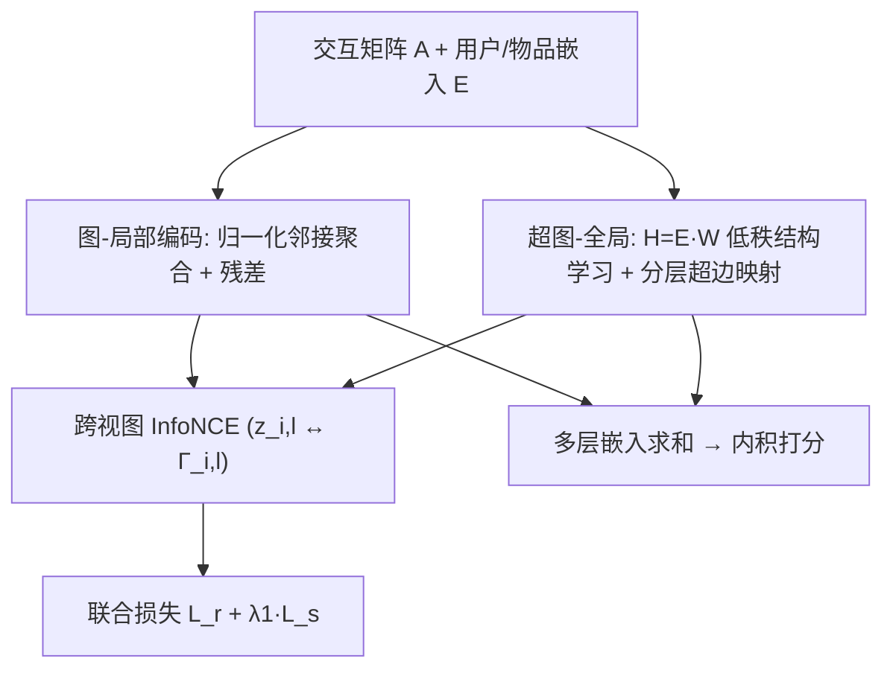

# Hypergraph Contrastive Collaborative Filtering (超图对比协同过滤)

- **会议/期刊**: SIGIR 2022 (Full Paper)
- **作者与机构**: Lianghao Xia, Chao Huang (通讯), Yong Xu, Jiashu Zhao, Dawei Yin, Jimmy Xiangji Huang — 香港大学 / 华南理工 / Wilfrid Laurier / 百度 / York University
- **推荐链路定位**: 召回（用户-物品表征学习）
- **研究方向**: 图神经网络与知识图谱推荐 / 自监督对比学习与交互去噪
- **论文原文**: [https://arxiv.org/abs/2204.12200v2](https://arxiv.org/abs/2204.12200v2)
- **开源代码**: [https://github.com/akaxlh/HCCF](https://github.com/akaxlh/HCCF)

## TL;DR (1分钟核心速览)

针对 GNN 协同过滤的两个痛点——深层图传播导致的**过平滑**（用户表征趋于不可分）与**交互监督信号稀疏且含噪**——HCCF 提出「参数化低秩超图结构学习 + 局部-全局跨视图对比学习」框架：用可学习超边把任意用户无跳数限制地连成高阶依赖，再把「交互图局部视图」与「超图全局视图」作为正负对做 InfoNCE 自蒸馏。在 Yelp / MovieLens / Amazon-book 上按 7:1:2 划分、**全库 Full-Ranking** 评测，NDCG@20 相对 LightGCN 平均提升 24.7%、相对 SGL 提升 14.8%（Amazon 稀疏集上增益最大）。

## Background & Motivation (背景与核心矛盾)

- **主流范式**: LightGCN 类简化的图卷积在用户-物品二部图上做多跳邻域聚合，以交互标签（BPR）监督学习用户/物品嵌入。
- **前人局限 1（过平滑）**: 堆叠更多传播层后信息过度混合，用户向量彼此趋同。图 1 用 MAD 指标量化：LightGCN 从 0.934 降到 0.434，NDCG@20 同步下降；仅靠更深的局部聚合无法编码可区分的偏好。
- **前人局限 2（稀疏与噪声）**: 监督信号仅来自稀疏交互，长尾物品学不动；且显式点击/浏览边本身含误点击噪声，而超图方案 DHCF / MHCN 的超边仍由原始交互或预定义模体生成，同样继承噪声与不完整性。
- **核心洞察 (Key Insight)**: 用户间的高阶依赖不应被"已观测边"限制——只有跨过局部邻域、在隐空间中学习全局软关联，才能同时带来判别性与抗噪性；对比学习则可在无额外标签下把这种全局结构当作自监督信号。

## Method (核心方法设计)

### 1. 整体框架 (Overall Architecture)

输入为用户-物品交互矩阵 $\mathbf{A}$。**图-局部**分支按 LightGCN 式归一化邻接聚合邻居信息并加残差；**超图-全局**分支用低秩参数化的超边结构矩阵$\mathbf{H}$让每个用户通过$H$ 个超边与其他用户全连通聚合；两分支逐层相加得到多层嵌入，求和后内积打分。训练时以 BPR 为主损失，并叠加局部视图与全局视图之间的跨视图 InfoNCE 与边丢弃增广；推理阶段只需一次前向得到最终嵌入，无采样开销。

### 2. 关键设计拆解 (Key Designs)

1. **低秩参数化超图结构学习（用 $O(Hd)$参数换全局依赖）**: 若直接学习稠密$\mathbf{H}^{(u)}\in\mathbb{R}^{I\times H}$参数爆炸。作者改为$\mathbf{H}^{(u)}=\mathbf{E}^{(u)}\mathbf{W}^{(u)}$，$\mathbf{W}^{(u)}\in\mathbb{R}^{d\times H}$，超图消息传递为$\boldsymbol{\Gamma}_{l}=\sigma(\mathbf{H}\mathbf{H}^{\top}\mathbf{E}_{l-1})$。$\mathbf{H}\mathbf{H}^{\top}$ 天然给出**用户-用户全对全软邻接**，跳数不受限，同时低秩分解起到正则化抑制过拟合的作用。
2. **分层超边映射（超边之间也做非线性交互）**: 单层超边表达力有限，先用 $\boldsymbol{\Lambda}=\mathbf{H}^{\top}\mathbf{E}\in\mathbb{R}^{H\times d}$得到超边嵌入，再堆叠$c$层残差映射$\psi(\mathbf{X})=\sigma(\mathbf{V}\mathbf{X})+\mathbf{X}$，最终$\boldsymbol{\Gamma}_{l}=\sigma(\mathbf{H}\cdot\psi_{c}(\mathbf{H}^{\top}\mathbf{E}))$。这使"兴趣簇"本身可以组合出更高阶语义，提升判别力。
3. **跨视图对比 + 边丢弃增广**: 同一节点的局部嵌入 $\mathbf{z}_{i,l}$与全局嵌入$\boldsymbol{\Gamma}_{i,l}$构成正对，批内其他节点为负对，$\mathcal{L}^{(u)}_{s}=\sum_{i}\sum_{l}-\log\frac{\exp(s(\mathbf{z}_{i,l},\boldsymbol{\Gamma}_{i,l})/\tau)}{\sum_{i'}\exp(s(\mathbf{z}_{i,l},\boldsymbol{\Gamma}_{i',l})/\tau)}$（$s$为余弦相似度）。**与 SGL 的关键差异**：不做随机节点/边丢弃制造视图（会丢真实兴趣信号），而是让"学出来的隐式全局结构"与"显式交互图"互为视图；仅在$\bar{\mathbf{A}}$与$\mathbf{H}$ 上做轻量 edge dropout 防过拟合。
4. **训练目标与开销**: $\mathcal{L}=\mathcal{L}_{r}+\lambda_{1}(\mathcal{L}^{(u)}_{s}+\mathcal{L}^{(v)}_{s})+\lambda_{2}\|\Theta\|_{F}^{2}$，$\mathcal{L}_{r}$为每用户采$S$正$S$负的 BPR 成对损失。复杂度$O(L|\mathcal{A}|d)$（局部）$+O(L(I+J)Hd)$（超图）$+O(LB(I+J)d)$（对比），额外参数仅$O(Hd)$。
5. **理论支撑**: 负样本梯度范数 $\|c(i')\|_{2}\propto\sqrt{1-x^{2}}\cdot\exp(x/\tau)$（$x$ 为两视图余弦相似度），即相似度越高（难负样本）梯度越大——超图全局视图恰好制造了大量"相似但不同"的难负样本，从而改善优化。

## Experimental Setup & Evaluation Protocol (实验设置与评估协议)

- **数据集与预处理**:

| 数据集 | #Users | #Items | #Interactions | 密度 | 过滤/场景 |
| :--- | :---: | :---: | :---: | :---: | :--- |
| Yelp | 29,601 | 24,734 | 1,517,326 | 2.1e-3 | 商户推荐 |
| MovieLens | 69,878 | 10,196 | 9,988,816 | 1.4e-2 | **10-core** |
| Amazon-book | 78,578 | 77,801 | 3,190,224 | 5.2e-4 | **20-core** |

- **数据划分与防穿越**: 按 **7:1:2 比例随机划分** train/valid/test（沿用 NGCF、SLRec 惯例），非时间戳切分，存在轻度未来信息泄漏风险。
- **排名评测协议**: **Full-Ranking 全库排序**（对全部未交互物品打分，规避负采样偏差），指标 Recall@{20,40} 与 NDCG@{20,40}。
- **对比基线与超参**: 15 个基线覆盖 MF(BiasMF)、MLP(NCF)、AE(AutoR)、GNN(GC-MC/PinSage/NGCF/ST-GCN/LightGCN/GCCF)、解耦(DGCF)、超图(HyRec/DHCF)、自监督(MHCN/SLRec/SGL)；嵌入维 $d{=}32$，图传播 2 层，超边数$H{=}128$，超图层数$c{=}3$，$\tau{=}1.0$，并报告配对$t$检验$p$值（均$<10^{-2}$）。

## Key Experimental Results (实验关键数据)

### 1. 主实验对比 (Main Results)

| 数据集 | 指标 | BiasMF | NCF | PinSage | LightGCN | DGCF | DHCF | MHCN | SGL | **HCCF** | Improv.(vs 最强基线) |
| :--- | :--- | :---: | :---: | :---: | :---: | :---: | :---: | :---: | :---: | :---: | :---: |
| Yelp | R@20 | 0.0190 | 0.0252 | 0.0345 | 0.0482 | 0.0466 | 0.0449 | 0.0503 | 0.0526 | **0.0607** | +15.4% (SGL) |
| Yelp | N@20 | 0.0161 | 0.0202 | 0.0288 | 0.0409 | 0.0395 | 0.0381 | 0.0424 | 0.0444 | **0.0510** | +14.9% (SGL) |
| MLens | R@20 | 0.0878 | 0.1097 | 0.1706 | 0.1789 | 0.1763 | 0.1363 | 0.1497 | 0.1833 | **0.2048** | +11.7% (SGL) |
| MLens | N@20 | 0.1197 | 0.1297 | 0.2108 | 0.2128 | 0.2101 | 0.1726 | 0.1814 | 0.2205 | **0.2467** | +11.9% (SGL) |
| Amazon | R@20 | 0.0093 | 0.0142 | 0.0213 | 0.0319 | 0.0211 | 0.0280 | 0.0296 | 0.0327 | **0.0344** | +5.2% (SGL) |
| Amazon | N@20 | 0.0049 | 0.0085 | 0.0158 | 0.0236 | 0.0154 | 0.0202 | 0.0219 | 0.0249 | **0.0258** | +3.6% (SGL) |

### 2. 消融实验 (Ablation Study)

| 变体 (Yelp / MLens / Amazon, R@20 & N@20) | Yelp R | Yelp N | MLens R | MLens N | Amazon R | Amazon N |
| :--- | :---: | :---: | :---: | :---: | :---: | :---: |
| -LowR（退化稠密结构矩阵） | 0.0587 | 0.0496 | 0.1937 | 0.2317 | 0.0319 | 0.0236 |
| -HHM（去分层超边映射） | 0.0599 | 0.0505 | 0.1891 | 0.2319 | 0.0305 | 0.0230 |
| -Hyper（去整个超图分支） | 0.0584 | 0.0490 | 0.1847 | 0.2233 | 0.0257 | 0.0188 |
| -CCL（去跨视图对比） | 0.0566 | 0.0484 | 0.1984 | 0.2397 | 0.0282 | 0.0217 |
| **HCCF** | **0.0607** | **0.0510** | **0.2048** | **0.2467** | **0.0344** | **0.0258** |

### 3. 关键实验发现 (Key Findings)

1. **稀疏场景收益最大，正对应动机**：Amazon（密度 5.2e-4）上去掉超图分支降幅最剧烈（N@20 0.0258→0.0188，**-27%**），而 Yelp 仅 -3.9%；说明全局高阶依赖带来的增益与交互稀疏度正相关，稠密集上局部图本身已足够。
2. **对比损失的增益在稠密集更显著，超图结构在稀疏集更关键**：MovieLens 上 -CCL 降幅最大（0.2467→0.2397），Amazon 上 -CCL 只降 0.0041，而 -Hyper 降 0.0070——两者承担互补角色：稠密图需自监督正则防止过平滑，稀疏图需超图补全缺失连接。
3. **对比学习确实缓解过平滑**：MAD 指标上 HCCF 用户侧 0.9747 / 物品侧 0.9671，均高于 -CCL（0.9106/0.9498）与 -Hyper（0.9505/0.7673）；案例研究图 8 中，-Hyper 把紧连子图的用户几乎压成一团，HCCF 仍能按交互量（<50 vs ≥100）分出两组，证明表征保留了个体差异。

## Highlights & Limitations (亮点、对比与审稿批判)

- **与代表作对比**: vs **LightGCN**：不再只做固定邻接的多跳聚合，而是额外引入可学习超图实现无跳数限制的全局依赖，并加残差缓解平滑；vs **SGL**：SGL 用随机节点/边丢弃"造视图"，会丢掉真实交互信号且训练不稳定（图 4 中稀疏桶波动明显），HCCF 用「显式交互图 vs 隐式超图」这一有语义的两视图替代随机增广；vs **DHCF/MHCN**：超边由原始交互或预定义模体给定，HCCF 把超边结构本身参数化并端到端学习，抗噪性更强。
- **可迁移亮点**: (1) 低秩分解 $\mathbf{H}=\mathbf{E}\mathbf{W}$把任意$I\times H$结构矩阵参数化为$O(Hd)$，可直接迁移到其他"结构不可知"的软聚类/元路径学习；(2) 以"不同建模视角"而非"随机扰动"构造对比视图，是自监督推荐中更稳的增广范式。
- **审稿级局限批判**: (1) 超图全局分支需 $O(L(I+J)Hd)$，且$\mathbf{H}\mathbf{H}^{\top}$语义上稠密，工业级千万用户下即使交换乘法顺序仍有可观开销，论文未给大规模训练实测；(2) 7:1:2 随机划分对时序推荐存在信息穿越，且未与时间戳切分协议对比；(3)$H{=}128$、$c{=}3$、$\tau{=}1.0$等超参在三数据集上均取同一组值，论文图 5 显示性能对$d$与$H$敏感（$H$ 超过 128 明显下降），跨域迁移需重调。

## Rating (四维评分)

- **方法创新性 (Novelty)**: ⭐⭐⭐⭐ （把超图结构从"预定义"升级为"低秩可学习"，并以局部-全局双视图替代随机增广，虽属 SGL+DHCF 的组合式推进，但梯度难负样本分析给了可信理论解释）
- **评估协议与实验扎实度 (Protocol & Experiments)**: ⭐⭐⭐⭐ （15 个基线、三数据集、Full-Ranking、$p$ 值检验、消融+MAD+稀疏分桶+案例研究齐备，扣分在随机划分而非时间切分、缺少线上或大规模验证）
- **写作与数学规范度 (Clarity & Rigor)**: ⭐⭐⭐ （整体脉络清晰，但 $\mathbf{H}\mathbf{H}^{\top}$的$l$层下标与$\mathbf{E}_{l-1}$的衔接在正文中不够统一，超边与超图层的符号复用$H$、$h$ 易混）
- **工业落地与复现价值 (Industrial & Practical Value)**: ⭐⭐⭐⭐ （代码开源、额外参数仅 $O(Hd)$、两图两层即可收敛，工程改动小；主要顾虑是超图分支的显存与多超参敏感性）

