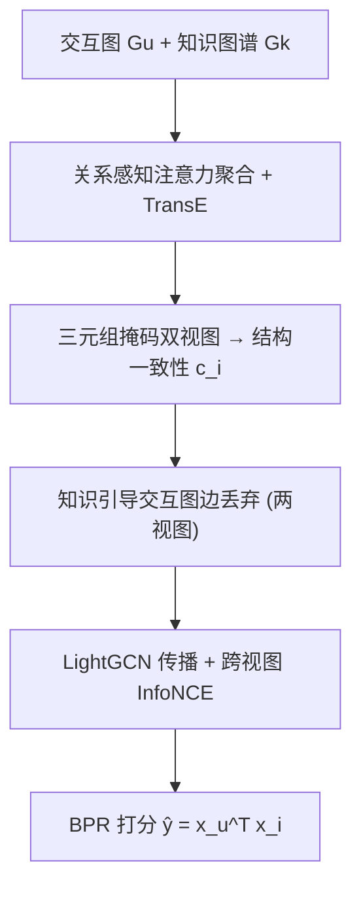
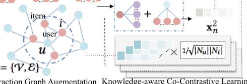

# Knowledge Graph Contrastive Learning for Recommendation (面向推荐的知识图谱对比学习)

- **会议/期刊**: SIGIR 2022 (Full Paper)
- **作者与机构**: Yuhao Yang, Chao Huang, Lianghao Xia (香港大学), Chenliang Li (武汉大学)
- **推荐链路定位**: 召回 (KG 增强的图协同过滤表征学习)
- **研究方向**: 图神经网络与知识图谱推荐 / 自监督对比学习与交互去噪
- **论文原文**: [https://arxiv.org/abs/2205.00976v2](https://arxiv.org/abs/2205.00976v2)
- **开源代码**: [https://github.com/yuh-yang/KGCL-SIGIR22](https://github.com/yuh-yang/KGCL-SIGIR22)

## TL;DR (1分钟核心速览)

KG 增强推荐长期默认知识图谱"干净可信"，但真实 KG 既有实体长尾稀疏监督，又有与物品主题无关的边（如棒球投手 Zack Wheeler 连到出生地 Smyrna, GA 与旧伤手术 UCL Reconstruction）。KGCL 提出：先以关系感知注意力聚合实体，再用两次随机三元组掩码得到的 item 表征一致性 $c_i$ 作为"抗噪程度"打分，并将其转成用户—物品边的保留概率指导交互图增广，最后做跨视图 InfoNCE 对比。在 Yelp2018/Amazon-Book/MIND 三数据集全库排序（Recall@20）下，相对最强 KG 基线 KGIN 分别提升 6.2%/4.2%/2.8%。

## Background & Motivation (背景与核心矛盾)

- **主流范式**: KG 增强推荐分三支——TransE/TransR 预训练实体嵌入 (CKE)、meta-path 路径传播 (RippleNet)、GNN 高阶消息聚合 (KGAT/KGIN/CKAN/MVIN)，后者靠注意力区分邻居重要性。
- **前人局限**: (i) KG 实体服从长尾分布（图 1：三个平台绝大多数实体曝光数 <10），Trans 系列难以学到准确语义偏移；(ii) 实体—关系常与物品主题无关，局部聚合即引入偏置，全局又经热门实体（地名、机构名）向目标节点过度传播导致过平滑。
- **核心洞察 (Key Insight)**: 若一个物品对 KG 拓扑扰动不敏感（两次掩码视图下表征高度一致），说明其语义由稳固的实体支撑；反之则被噪声主导。该一致性可作为"可学习质量分"反向约束交互图。
- **本文切入点**: 把 KG 去噪从"改聚合器"转为"造自监督信号"，用 KG 侧一致性去指导交互侧边丢弃，形成知识感知的协同对比学习。

<figure class="paper-figure" markdown="span">
  <figcaption>图2：从 MIND 数据集知识图谱中提取的与新闻主题无关实体的示例。</figcaption>
</figure>

## Method (核心方法设计)

### 1. 整体框架 (Overall Architecture)

输入为用户—物品交互图 $G_u$与物品知识图谱$G_k$。首先关系感知注意力聚合把每个物品的 KG 邻居压缩为知识增强初始表征，并与 TransE 交替训练保持关系语义；随后对$G_k$施加两次伯努利三元组掩码得两个增强子图，各自前向聚合得到两套物品表征，其余弦相似度即结构一致性$c_i$。$c_i$ 经 min-max 归一化转为边保留权重，生成两张知识引导的交互增广图，再用 LightGCN 传播编码；两视图共享同一嵌入空间，通过 InfoNCE 互为正样本，与 BPR 主损失联合端到端优化，推理时仅用原图一次前向。

<figure class="paper-figure" markdown="span">
  <figcaption>图3：我们提出的 KGCL 总体架构。在知识图谱 𝜂(·) 和用户-物品交互图 𝜑(·) 上均施加增强函数的知识感知协同对比学习。我们的对比目标 L𝑐 与知识图谱聚合和基于图的 CF 编码器共享的主嵌入空间联合优化。</figcaption>
</figure>

### 2. 关键设计拆解 (Key Designs)

1. **关系感知知识聚合 (Relation-aware Aggregation)**：为免去 meta-path 的人工设计，用带关系向量的注意力对异构邻居加权，$\alpha(e,r_{e,i},i)=\mathrm{softmax}_{e}\big(\mathrm{LeakyReLU}(\mathbf{r}_{e,i}^{\top}\mathbf{W}[x_e\|x_i])\big)$，$x_i \leftarrow x_i+\sum_{e\in N_i}\alpha(\cdot)x_e$。关系嵌入进入打分使同一实体经不同关系贡献不同权重，直观上把"出生地/曾效力球队"这类边缘事实与"项目类别/主题"区分开。辅以 TransE 排序损失$\mathcal{L}_{TE}$交替更新，保证$x_h+x_r\approx x_t$ 的平移结构不被注意力聚合破坏。
2. **KG 结构一致性打分与知识引导交互增广**：随机边丢弃 (SGL) 对所有边一视同仁，会把噪声边与关键边同时删掉。KGCL 先定义 $c_i=s\big(f_k(x_i,\eta_1(G_k)),f_k(x_i,\eta_2(G_k))\big)$，再令$w_{u,i}=\exp(c_i)$，$p'_{u,i}=\max\big(\tfrac{w_{u,i}-w_{\min}}{w_{\max}-w_{\min}},p_\tau\big)$，$p_{u,i}=p_a\cdot\mu_{p'}\cdot p'_{u,i}$，按伯努利采样生成两套边掩码。物理直觉：高一致性物品承载可靠语义，其交互边更应被保留；低一致性物品的边更易被丢弃，从而在对比中自然弱化噪声监督。
3. **协同对比目标、负采样与开销**：总损失 $\mathcal{L}=\mathcal{L}_{b}+\lambda_1\mathcal{L}_{c}+\lambda_2\|\Theta\|_2^2$，其中$\mathcal{L}_{c}=\sum_{n\in V}-\log\frac{\exp(s(x_n^{1},x_n^{2})/\tau)}{\sum_{n'\neq n}\exp(s(x_n^{1},x_{n'}^{2})/\tau)}$采用批内负样本（in-batch，无需显式难负采样），$\mathcal{L}_b$为 BPR。作者给出梯度分析$g(s)=\sqrt{1-s^2}\exp(s/\tau)$：在$0.7\le s\le0.9$区间的"假难负样本"梯度可近 40，远大于易负样本，去噪增广恰好把假难负样本拉离$s_0$，从而改善难负判别。复杂度$O(|E_k|d+|E|d+B_{id}(|U|+|I|)d)$，与 KGAT 等同量级，推理无额外开销。

## Experimental Setup & Evaluation Protocol (实验设置与评估协议)

- **数据集与预处理**: Yelp2018/Amazon-Book 按 KGAT 设定映射到 Freebase（仅取 2-hop 内实体），MIND 用 spaCy-entity-linker + Wikidata 构建。

| 数据集 | #Users | #Items | #Interactions | 密度 | 场景 / KG 规模 |
| :--- | :---: | :---: | :---: | :---: | :--- |
| Yelp2018 | 45,919 | 45,538 | 1,183,610 | 5.7e-4 | 本地商户；42 关系 / 47,472 实体 / 869,603 三元组 |
| Amazon-Book | 70,679 | 24,915 | 846,434 | 4.8e-4 | 图书电商；39 关系 / 29,714 实体 / 686,516 三元组 |
| MIND | 300,000 | 48,957 | 2,545,327 | 1.7e-4 | 新闻；90 关系 / 106,500 实体 / 746,270 三元组 |

- **数据划分与防穿越 (Splitting Strategy)**: 沿用 KGAT/KGIN 的固定 train/valid/test 划分（非本文重划），测试集物品在训练中可观测，属常规全库评测而非严格冷启动划分。
- **排名评测协议 (Ranking Protocol)**: 无偏 `Full-Ranking`——对每个测试用户，将其所有未交互物品作为候选负样本参与排序；指标 Recall@20 与 NDCG@20，全用户平均。
- **对比基线与超参**: 12 个基线覆盖 BPR/NCF、GC-MC/LightGCN、SGL、CKE/RippleNet、KGCN/KGAT/KGIN/CKAN/MVIN；统一 $d=64$、lr$1\text{e-}3$、batch 2048，hop=2、memory=8；$\tau\in\{0.1..1.0\}$、$\lambda_1\in\{10^{-1},10^{-2},10^{-3}\}$、$p_\tau,p_a\in\{0.6..0.9\}$；显著性$p<0.01$。

## Key Experimental Results (实验关键数据)

### 1. 主实验对比 (Main Results)

| Model | Yelp2018 R@20 | Yelp NDCG | Amazon R@20 | Amazon NDCG | MIND R@20 | MIND NDCG |
| :--- | :---: | :---: | :---: | :---: | :---: | :---: |
| BPR | 5.55 | 0.0375 | 12.44 | 0.0658 | 9.38 | 0.0469 |
| LightGCN | 6.82 | 0.0443 | 13.98 | 0.0736 | 10.33 | 0.0520 |
| SGL | 7.19 | 0.0475 | 14.45 | 0.0766 | 10.32 | 0.0539 |
| CKE | 6.86 | 0.0431 | 13.75 | 0.0685 | 9.01 | 0.0382 |
| KGAT | 6.75 | 0.0432 | 13.90 | 0.0739 | 9.07 | 0.0442 |
| CKAN | 6.89 | 0.0441 | 13.80 | 0.0726 | 9.91 | 0.0499 |
| MVIN | 6.91 | 0.0441 | 13.98 | 0.0742 | 9.62 | 0.0487 |
| KGIN | 7.12 | 0.0462 | 14.36 | 0.0748 | 10.44 | 0.0527 |
| **KGCL** | **7.56** | **0.0493** | **14.96** | **0.0793** | **10.73** | **0.0551** |
| Improv. vs 最强基线 | +6.2% | +6.7% | +4.2% | +3.6% | +2.8% | +4.6% |

### 2. 消融实验 (Ablation Study)

| 变体 | Amazon R@20 | Amazon NDCG | MIND R@20 | MIND NDCG |
| :--- | :---: | :---: | :---: | :---: |
| KGCL 完整 | **14.96** | **0.0793** | **10.73** | **0.0551** |
| w/o KGA（交互图改随机丢弃） | 14.85 | 0.0788 | 10.57 | 0.0546 |
| w/o KGC（去掉 KG 侧对比） | 14.68 | 0.0771 | 10.35 | 0.0537 |

### 3. 关键实验发现 (Key Findings)

1. **去噪比去稀疏更关键**：注入 10% 随机噪声三元组后，KGAT/KGIN/MVIN 的 Recall 平均掉 13.6%/3.4%/8.8%，KGCL 仅降 0.58%，说明一致性打分把噪声边隔离在对比视图之外，而非靠更大容量硬拟合。
2. **KG 侧对比信号优于交互侧增广**：去掉 KGC 使 Amazon NDCG 从 0.0793 降至 0.0771（-2.8%），降幅大于 w/o KGA 的 0.0788（-0.6%），且 KGCL 在长尾物品分桶（图 5）与稀疏实体物品（图 7）上均保持最优，验证增益主要来自 KG 语义而非单纯边扰动正则。
3. **长尾与冷启动同等受益**：在交互数 <20 的稀疏用户组（图 6）与低频物品组，KGCL 相对 LightGCN/SGL 的相对 Recall 曲线始终最高且衰减小；超参上 $\lambda_1=0.1,\tau=0.2$最优（Amazon Recall 14.96%），$\tau$增大至 0.5 或$\lambda_1$增至$10^{-2}$ 均明显退化，说明对比项应作为轻量正则而非主监督。

## Highlights & Limitations (亮点、对比与审稿批判)

- **与代表作对比 (vs. Prior Work)**: 相比 KGAT/KGIN 靠更精细的注意力或意图路径"被动加权"噪声邻居，KGCL 直接把噪声问题转成自监督去噪任务；相比 SGL 的随机边丢弃，其丢弃概率由 KG 结构一致性内生决定，实现语义引导而非均匀扰动。
- **可迁移亮点**: (1) "两次掩码视图一致性 → 置信度权重"的范式可直接移植到跨域/多行为图，作为边级噪声打分；(2) 用辅助视图的一致性调节主图增广强度，是低改造成本的正则插件。
- **审稿级局限批判**: (1) 训练需额外两次 KG 聚合前向 + 逐 epoch 计算 $c_i$并做 min-max 归一化，$p_\tau,p_a,\tau,\lambda_1$ 四个超参耦合，调参成本偏高；(2) 评测仅在 2-hop KG 与常规划分下进行，缺乏严格零样本冷启动协议与线上 A/B，且图 8 的案例分析为定性证据，噪声鲁棒性结论仍以人工注入噪声为主。

## Rating (四维评分)

- **方法创新性 (Novelty)**: ⭐⭐⭐⭐ （把 KG 拓扑一致性转为边级去噪置信度并驱动双视图对比，配合 $g(s)$ 难负梯度分析，机制新颖且有理论佐证）
- **评估协议与实验扎实度 (Protocol & Experiments)**: ⭐⭐⭐⭐ （三域数据集 + 无偏全库排序 + 12 基线 + 稀疏/长尾/注噪三组鲁棒性分析完整，但缺严格冷启动划分）
- **写作与数学规范度 (Clarity & Rigor)**: ⭐⭐⭐⭐ （公式链条清晰、符号统一，复杂度与梯度推导齐备；仅增广概率的归一化细节略显经验化）
- **工业落地与复现价值 (Industrial & Practical Value)**: ⭐⭐⭐⭐ （模型无关可插入任意 GNN 协同过滤，推理零额外开销，代码开源且统一 RecBole 基线，工程迁移门槛低）

