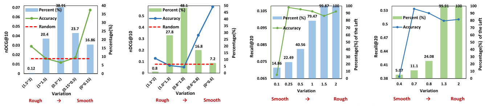
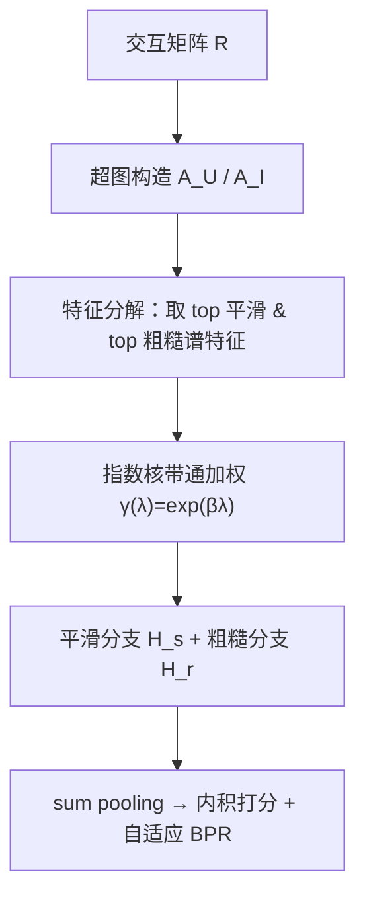
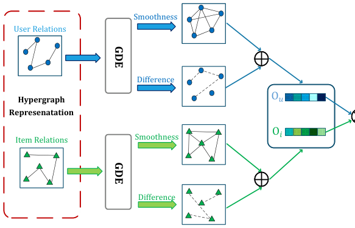

# Less is More: Reweighting Important Spectral Graph Features for Recommendation (少即是多：为重加权的关键谱图特征做推荐)

- **会议/期刊**: SIGIR 2022
- **作者与机构**: Shaowen Peng, Kazunari Sugiyama (Kyoto University); Tsunenori Mine (Kyushu University)
- **推荐链路定位**: 召回（图协同过滤表征学习）
- **研究方向**: 图神经网络与知识图谱推荐 / 协同过滤与双塔召回
- **论文原文**: [https://arxiv.org/abs/2204.11346v1](https://arxiv.org/abs/2204.11346v1)
- **开源代码**: [https://github.com/tanatosuu/GDE](https://github.com/tanatosuu/GDE)

## TL;DR (1分钟核心速览)

本文追问「GCN 的邻域聚合究竟为何在推荐中有效」，从谱域证明：只有极少数**最平滑（同质性）与最粗糙（异质性）**的谱特征真正贡献精度，中间 76%–83% 的特征近似噪声；而堆叠层只是用多项式滤波器反复放大平滑分量、去噪效率极低。作者提出 **GDE**，直接用指数核带通滤波器挑选并重加权 top-$m$ 谱特征，摆脱层堆叠，并可等价视为无穷层 GCN；配合负样本梯度自适应损失。在 5 个真实数据集、20% 训练的全库排序协议下全面超越 SGL-ED/ELGN/LightGCN，最高 +16.5% nDCG@20，训练总耗时约为 LightGCN 的 1/12。

## Background & Motivation (背景与核心矛盾)

- **主流范式**: LightGCN/NGCF 一类工作把 GCN 简化到只剩「邻接矩阵乘」的邻域聚合，靠堆叠 $K$ 层捕获高阶协同信号，在稀疏场景优于 MF。
- **前人局限**: ① 提纯平滑特征依赖反复乘 $\hat{\mathbf{A}}$，计算昂贵且需多轮收敛；② 多项式系数$\alpha_k=1/(K+1)$ 是启发式设定，且**即使堆 100 层，无用特征仍原封不动保留**，去噪能力差；③ 深堆叠必然过平滑，同时几乎完全压制刻画「异质性」的粗糙特征。
- **核心洞察 (Key Insight)**: 用裁剪邻接 $\hat{\mathbf{A}}'=\sum_t\mathcal{M}(\lambda_t)\mathbf{v}_t\mathbf{v}_t^{\top}$ 逐组保留特征实验（图 1）发现：CiteULike 上 83%、MovieLens 上 76% 的中间区特征贡献与随机初始化邻接相当甚至更差；剔除最粗糙特征精度小幅下降、剔除最平滑特征精度大幅下降、剔除其余特征反而**涨点**。即推荐精度由「同质+异质」两类极端特征主导，平滑特征更重要。
- **本文切入点**: 既然堆层本质上只是在给谱特征重新加权，不如把这套权重显式化——设计一个**单层、带通（band-pass）**的编码器，只保留有用特征并按重要性重加权。

<figure class="paper-figure" markdown="span">
  <figcaption>图1：在(a)和(b)中，我们根据谱特征的变化将其划分为不同组，展示不同组中特征的百分比及其在普通GCN上测试时对准确率的贡献；作为基准，“random”使用随机初始化的邻接矩阵。(c)和(d)展示在LightGCN上移除变化≥𝑥的特征后的准确率（例如，𝑥=2的结果是在包含所有特征的原始图上得到的）。</figcaption>
</figure>

## Method (核心方法设计)

### 1. 整体框架 (Overall Architecture)

输入用户-物品交互矩阵 $\mathbf{R}$，先构造成**超图**形式$\mathbf{A}_U=\mathbf{D}_u^{-1/2}\mathbf{R}\mathbf{D}_i^{-1}\mathbf{R}^{\top}\mathbf{D}_u^{-1/2}$（物品视为超边）、$\mathbf{A}_I$对称定义；对$\mathbf{A}_U,\mathbf{A}_I$做特征分解，只取 top-$m_1$（最平滑）与 top-$m_2$（最粗糙）特征向量/特征值；用指数核$\gamma$ 对每类特征加权，一次矩阵乘即得平滑/粗糙两路表征，求和池化后内积打分。训练用自适应 BPR 损失，推理仅一次前向，无多层传播。

<figure class="paper-figure" markdown="span">
  <figcaption>图3：我们提出的GDE的框架。</figcaption>
</figure>

### 2. 关键设计拆解 (Key Designs)

1. **谱域诊断：堆层 = 多项式低通滤波**：把 LightGCN 写成 $\mathbf{O}=\sum_{k=0}^{K}\hat{\mathbf{A}}^k\mathbf{E}/(K+1)=\sum_t\big(\sum_k\lambda_t^k/(K+1)\big)\mathbf{v}_t\mathbf{v}_t^{\top}\mathbf{E}$，可见每个谱特征的权重是$\lambda_t$的多项式函数，$K$ 增大时粗糙特征权重被压向 0——这解释了「堆层≈放大同质性」，也暴露其无法显式建模异质性的缺陷。

2. **图去噪编码器 GDE（带通滤波 + 免堆层）**：把多项式滤波换成可设计的 $\gamma(\cdot)$，一次投影完成加权：
$\mathbf{H}_U^{(s)}=\big(\mathbf{P}^{(s)}\odot\gamma(U,\pi^{(s)})\big)\mathbf{P}^{(s)\top}\mathbf{E}_U$，粗糙分支同理取$\mathbf{P}^{(r)}$；最终$\mathbf{O}_U=\mathbf{H}_U^{(s)}+\mathbf{H}_U^{(r)}$。作者进一步论证$\gamma$需满足「单调递增、泰勒系数全正、无穷可微」，据此选指数核并按度自适应：$\gamma(u,\pi_g)=e^{(\beta-\log d_u)\pi_g}$。由$\sum_k\beta^k\bar{\mathbf{A}}_U^k/k!$可知 GDE 等价于**无穷层 GCN 但系数可正**，且$e^{\beta\pi_g}/e^{\beta\pi_{\max}}\neq 0$，从定义上不会过平滑；低度节点自动获得更强的平滑补偿。

3. **负样本梯度自适应与复杂度**：BPR 中长尾正样本被打分过快，$\big(1-\sigma(\hat{r}_{ui}-\hat{r}_{uj})\big)$迅速衰减导致收敛慢（图 4）。本文给负样本项加自步系数$\delta_{uj}=1-\log\big(1-\min(\sigma(\hat{r}_{uj}),\xi)\big)$，$\xi=0.99$防爆，损失为$\mathcal{L}_{adapt}=-\sum_{(u,i,j)\in T}\ln\sigma(\hat{r}_{ui}-\delta_{uj}\hat{r}_{uj})+\lambda\|\Theta\|^2$。负采样为均匀采样（每正样本 1 负样本），无额外参数。总开销：预处理用 Lanczos 取少量特征$O(m^2M+m|E_{A_U}|)$，训练$O((1-p)(M+N)dc|R^+|)$，与 MF 同级。

## Experimental Setup & Evaluation Protocol (实验设置与评估协议)

- **数据集与预处理**: 全部转为**隐式反馈**（MovieLens 隐去评分），保留原始交互：

| 数据集 | #Users | #Items | #Interactions | 密度 | 场景说明 |
| :--- | :---: | :---: | :---: | :---: | :--- |
| CiteULike-a | 5,551 | 16,981 | 210,537 | 0.223% | 论文收藏，极稀疏 |
| Pinterest | 37,501 | 9,836 | 1,025,709 | 0.278% | 图像 pin 隐式反馈 |
| MovieLens-1M | 6,040 | 3,952 | 1,000,209 | 4.190% | 稠密电影评分 |
| Gowalla | 29,858 | 40,981 | 1,027,370 | 0.084% | 签到 POI |
| MovieLens-100K | 943 | 1,682 | 100,000 | 6.305% | 稠密小规模 |

- **数据划分与防穿越 (Splitting Strategy)**: 刻意采用**极端稀疏划分**——仅取 20% 用户-物品对训练、其余 80% 测试，再从训练集随机抽 5% 作验证集调参；论文未声明时间戳切分，属随机比例划分，故不存在未来信息穿越，但对时序推荐不适用。
- **排名评测协议 (Ranking Protocol)**: **Full-Ranking（全库未交互物品排序）**，截断 $K=20$，指标 Recall@20 / nDCG@20，报告测试集平均精度。
- **对比基线与超参**: BPR、EASE、LCFN、GF-CF、ELGN、LightGCN、SGL-ED 共 7 个基线；$d=64$，$d_1=16$，正则 0.01，batch 256，SGD；特征比例$m/M\in\{0.01,0.05,0.1,0.2\}$，$\beta\in\{1,1.5,2,2.5,4.5\}$；以$p$-value 报告显著性（均$\ll0.05$）。

## Key Experimental Results (实验关键数据)

### 1. 主实验对比 (Main Results)

| 方法 | CiteULike nDCG | CiteULike R@20 | Pinterest nDCG | Pinterest R@20 | ML-1M nDCG | ML-1M R@20 | Gowalla nDCG | Gowalla R@20 | ML-100K nDCG | ML-100K R@20 |
| :--- | :---: | :---: | :---: | :---: | :---: | :---: | :---: | :---: | :---: | :---: |
| BPR | 0.0591 | 0.0527 | 0.0861 | 0.0809 | 0.4849 | 0.4578 | 0.0907 | 0.0743 | 0.4935 | 0.4641 |
| EASE | 0.0846 | 0.0801 | 0.0695 | 0.0639 | 0.3249 | 0.3000 | 0.0670 | 0.0642 | 0.3523 | 0.3214 |
| LCFN | 0.0662 | 0.0590 | 0.0937 | 0.0873 | 0.5197 | 0.4898 | 0.1132 | 0.0980 | 0.5199 | 0.4898 |
| GF-CF | 0.0836 | 0.0811 | 0.0776 | 0.0755 | 0.4789 | 0.4562 | 0.0537 | 0.0567 | 0.4048 | 0.3793 |
| ELGN | 0.1125 | 0.1027 | 0.1176 | 0.1098 | 0.5418 | 0.5133 | 0.1249 | 0.1138 | 0.5347 | 0.5100 |
| LightGCN | 0.1149 | 0.1066 | 0.1143 | 0.1069 | 0.5261 | 0.5031 | 0.1327 | 0.1224 | 0.5418 | 0.5133 |
| SGL-ED | 0.1070 | 0.0985 | 0.1185 | 0.1094 | 0.5314 | 0.5035 | 0.1561 | 0.1353 | 0.5321 | 0.5044 |
| GDE-d (动态注意力) | 0.1126 | 0.1026 | 0.1157 | 0.1080 | 0.5578 | 0.5306 | 0.1462 | 0.1341 | 0.5582 | 0.5280 |
| **GDE** | **0.1339** | **0.1224** | **0.1240** | **0.1147** | **0.5715** | **0.5423** | **0.1632** | **0.1449** | **0.5731** | **0.5400** |
| Improv.% | +16.54 | +14.82 | +3.29 | +4.46 | +5.48 | +5.65 | +4.55 | +7.10 | +5.77 | +5.20 |
| $p$-value | 4.1e-9 | 2.8e-8 | 2.9e-4 | 3.7e-7 | 6.7e-7 | 5.4e-4 | 6.2e-5 | 5.4e-4 | 3.9e-6 | 4.3e-6 |

效率：Gowalla 上每 epoch 训练耗时 GDE 3.1s（120 epoch，总 502s）vs LightGCN 9.8s（600 epoch，5880s）vs ELGN 770.1s，即相对 LightGCN **约 12× 加速**、相对 BPR 约 3×。

### 2. 消融实验 (Ablation Study)

Recall@20 紧凑对比（消融各组件）+ 加权核函数设计（CiteULike nDCG@10）：

| 变体 | CiteULike | Pinterest | ML-1M | Gowalla | ML-100K | | $\gamma$ 设计 | nDCG@10 |
| :--- | :---: | :---: | :---: | :---: | :---: | :--- | :--- | :---: |
| plain (仅 BPR) | 0.1146 | 0.1109 | 0.5303 | 0.1353 | 0.5287 | | $\log(\alpha\lambda_t)$ | 0.1343 |
| + drop (边丢弃) | 0.1198 | 0.1116 | 0.5390 | 0.1382 | 0.5400 | | 多项式 $\sum_k\alpha_k\lambda_t^k$ | 0.1434 |
| + adaptive (本文) | **0.1224** | **0.1147** | **0.5423** | **0.1449** | 0.5275 | | 有理 $1/(1-\alpha\lambda_t)$ | 0.1464 |
| LightGCN 参照 | 0.1066 | 0.1069 | 0.5031 | 0.1224 | 0.5133 | | 指数 $e^{\beta\lambda_t},\beta>0$ | **0.1518** |
| — | — | — | — | — | — | | 指数 $\beta<0$ / 注意力 | 0.0322 / 0.1296 |

### 3. 关键实验发现 (Key Findings)

1. **稀疏度越大收益越显著，且只需极少谱特征**：GDE 相对 LightGCN 在 Gowalla（密度 0.084%）提升约 23.0% nDCG@20，在 ML-100K（6.3%）仅 5.8%；同时仅用 <10%/5%/1%/5% 的谱特征即可超越最佳基线（CiteULike/Pinterest/ML-1M/Gowalla），从工程上验证了「少即是多」。
2. **平滑分支是主力、粗糙分支是增益，且增益随密度上升**：固定平滑分支时移除粗糙特征的掉点明显（ML-1M 上可见），作者据此经验设定 $m_2\le0.1m_1$；图 6 显示粗糙特征几乎不依赖训练即可贡献精度（更像图的内在属性），平滑特征则随训练快速涨点——稠密图上异质性更关键，稀疏图节点本就孤立故作用有限。
3. **静态权重优于可学习注意力，负样本自适应主要买速度**：$e^{\beta\lambda_t}(\beta>0)$的 0.1518 远高于参数化注意力 0.1296（且后者训练耗时高一个量级并在 100K 掉点 0.5133→0.5275 之外的 4/5 数据集涨点）；dropout 在稠密数据增益更大；$\beta$最优约 4.5，$\beta=1$ 时 CiteULike 掉 9.4%，说明稀疏数据更依赖平滑。

## Highlights & Limitations (亮点、对比与审稿批判)

- **与代表作对比 (vs. Prior Work)**: 相较 LightGCN 的「隐式低通 + 堆层」，GDE 显式做**带通**并保留异质性，且等价无穷层而不受层数限制；相较同样从谱域切入的 GF-CF（纯低通、无参数学习、稀疏下不稳，Gowalla R@20 仅 0.0567），GDE 在极端稀疏下大幅领先；相较 SGL-ED 的对比学习增广，GDE 从滤波器设计源头去噪，无需多视图开销。
- **可迁移亮点**: ①「先做小规模谱诊断、再据特征重要性裁剪」的流程可直接用于任何图推荐模型的数据/结构预处理；② 负样本梯度自步缩放 $\delta_{uj}$ 是即插即用的收敛加速器，可用于任意 BPR 系模型。
- **审稿级局限批判**: ① 需要**一次性特征分解/部分特征求解**，超图 $\mathbf{A}_U$稠密化后对千万级用户规模仍需近似求解，论文未给出大规模工业验证；② 评估仅 20% 随机划分 + 全库排序，未做时间切分与在线 A/B，且$m_1,m_2,\beta$ 需按数据密度手工调参，缺少自动选择机制。

## Rating (四维评分)

- **方法创新性 (Novelty)**: ⭐⭐⭐⭐⭐ （谱域「同质/异质双端特征」诊断扎实，用指数核带通滤波等价无穷层 GCN 的推导兼具直觉与理论，且从定义上规避过平滑）
- **评估协议与实验扎实度 (Protocol & Experiments)**: ⭐⭐⭐⭐ （5 数据集 + 全库排序 + $p$ 值 + 20% 极端稀疏设定很有说服力，但缺时间切分与线上验证）
- **写作与数学规范度 (Clarity & Rigor)**: ⭐⭐⭐⭐ （谱分析与复杂度分析清晰，$\gamma$设计的三条性质论证严谨；个别公式符号如$\mathbf{Q}^{(s)}$ 排版有小瑕疵）
- **工业落地与复现价值 (Industrial & Practical Value)**: ⭐⭐⭐⭐ （代码开源，训练与 BPR 同级、比 LightGCN 快 12×，但预处理特征分解的可扩展性仍需工程验证）

