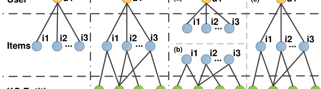
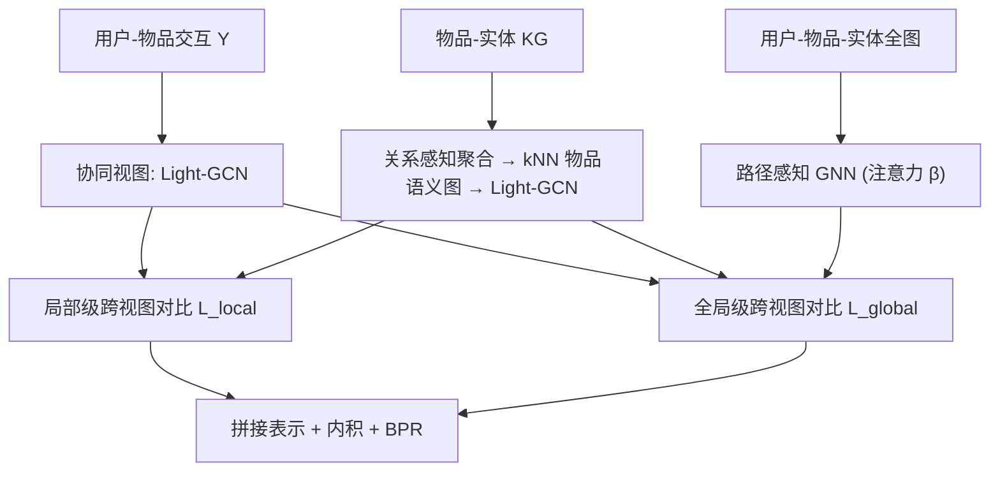

# Multi-level Cross-view Contrastive Learning for Knowledge-aware Recommender System (面向知识感知推荐的多层级跨视图对比学习)

- **会议/期刊**: SIGIR 2022
- **作者与机构**: Ding Zou, Wei Wei, Xian-Ling Mao 等（华中科技大学 CCIIP 实验室、北京理工大学、阿里巴巴、新加坡管理大学、UNSW）
- **推荐链路定位**: 召回（用户/物品表征学习 + 内积打分）
- **研究方向**: 图神经网络与知识图谱推荐 / 自监督对比学习
- **论文原文**: [https://arxiv.org/abs/2204.08807v1](https://arxiv.org/abs/2204.08807v1)
- **开源代码**: [https://github.com/CCIIPLab/MCCLK](https://github.com/CCIIPLab/MCCLK)

## TL;DR (1分钟核心速览)

GNN 类知识图谱推荐（KGR）受制于监督信号极度稀疏，且易出现表征退化（嵌入塌缩成窄锥）。MCCLK 不再用"随机扰动造两视图"的常规图对比范式，而是把用户-物品-实体图显式拆成 **协同视图（用户-物品）、语义视图（kNN 物品-物品语义图）、结构视图（全图路径）**，做局部级（协同↔语义）与全局级（结构↔局部）双层跨视图对比。在 Book-Crossing/MovieLens-1M/Last.FM 三数据集上，AUC 分别达 0.7625/0.9351/0.8763，较最强基线 KGIN 提升 3.11/1.61/2.77 个百分点（$p<0.001$）。

## Background & Motivation (背景与核心矛盾)

- **主流范式**: KGR 已从 KGE 预训练（CKE/RippleNet）过渡到 GNN 聚合（KGCN、KGAT、KGIN），在用户-物品-实体异构图上做多跳邻居聚合。
- **前人局限**: ① GNN 类模型仅靠稀疏交互做监督，训练标签不足，导致表征退化；② 单一全局视图（user-item-entity）在粗粒度上无法同时刻画 item-user-item 协同共现与 item-entity-item 语义共现，语义视图长期被忽略。
- **核心洞察 (Key Insight)**: "如何造视图"比"如何对比"更关键。KGR 天然自带三类异质关系，可无需数据增广即得到互补视图；但视图粒度不同（局部 vs 全局），不能在同一层级直接对齐。
- **本文切入点**: 用多视图 + 多层级交叉对比替代人工增广，并额外显式构造物品-物品语义图补上被遗漏的语义相似性。

<figure class="paper-figure" markdown="span">
  <figcaption>图1：我们所选多视图的简单示例。(i) 传统基于CF的推荐从协同视图学习。(ii) 先前的KGR方法从结构视图学习。(iii) MCCLK从三个选定视图学习，包括局部级协同视图(a)和语义视图(b)、全局级结构视图(c)。</figcaption>
</figure>

## Method (核心方法设计)

### 1. 整体框架 (Overall Architecture)

输入为交互矩阵 $\mathbf{Y}$与知识图谱$\mathcal{G}$。MCCLK 先按关系类型把 user-item-entity 全图切成三份：协同视图$\mathbf{Y}$、语义视图$\mathbf{S}$、结构视图（全图）。协同/语义视图用无特征变换的 Light-GCN 编码（轻、快、强调共现），结构视图用带关系注意力的路径感知 GNN 编码（保留 user→item→entity 长程路径）。随后先在局部级对齐协同与语义表示、再在全局级对齐结构与"协同+语义"融合表示，最后把各视图表示拼接后内积打分，与 BPR 损失多任务联合训练。

### 2. 关键设计拆解 (Key Designs)

1. **kNN 物品-物品语义图构建（补上被忽视的 item-item 语义关系）**：前人把 item-entity 图直接当聚合边，物品间语义相似度被稀释。本文先在 KG 上递归做关系感知聚合 $\mathbf{e}_i^{(k+1)}=\frac{1}{|\mathcal{N}_i|}\sum_{(r,v)\in\mathcal{N}_i}\mathbf{e}_r\odot\mathbf{e}_v^{(k)}$（$\odot$隐式实现 TransR 式投影/旋转），再用余弦相似度$S_{ij}=\frac{\mathbf{e}_i^{(K')\top}\mathbf{e}_j^{(K')}}{\|\mathbf{e}_i^{(K')}\|\|\mathbf{e}_j^{(K')}\|}$建全连接图，取 top-$k$稀疏化并做$D^{-1/2}\hat{S}D^{-1/2}$ 归一化。直觉：把"实体共现→物品相似"从隐式变成显式邻接，语义相似的物品在同一空间内被拉近但仍保留独立 ID 嵌入。

2. **多层级跨视图对比（Local + Global 双监督）**：单一层级对比无法同时兼顾特征与结构。局部级对同一物品的 $(\mathbf{z}^c_i,\mathbf{z}^s_i)$ 构造正对，负样本同时来自视图内与视图间：
$\mathcal{L}_{local}=-\log\frac{e^{s(\mathbf{z}^s_{i-p},\mathbf{z}^c_{i-p})/\tau}}{\sum_{k}e^{s(\mathbf{z}^s_{i-p},\mathbf{z}^s_{k-p})/\tau}+\sum_{k}e^{s(\mathbf{z}^s_{i-p},\mathbf{z}^c_{k-p})/\tau}}$。
全局级则让结构视图 $\mathbf{z}^g$与局部融合$\mathbf{z}^l=\mathbf{z}^c+\mathbf{z}^s$互为监督，双向计算$\mathcal{L}^g_i$与$\mathcal{L}^l_i$后取均值$\mathcal{L}_{global}$。结构视图的聚合用注意力$\beta(i,r,v)=\mathrm{softmax}\big((\mathbf{e}_i\|\mathbf{e}_r)^\top(\mathbf{e}_v\|\mathbf{e}_r)\big)$，即在保留路径的同时对关系与实体加权，避免等权聚合被噪声路径污染。

3. **训练目标与推理开销**：总损失 $\mathcal{L}=\mathcal{L}_{BPR}+\beta(\alpha\mathcal{L}_{local}+(1-\alpha)\mathcal{L}_{global})+\lambda\|\Theta\|_2^2$，其中$\alpha=0.2,\beta=0.1$。负采样沿用 BPR 式均匀采样（每用户 1:1 采未交互样本），对比学习的负样本免费取自 batch 内其他节点，无需额外难负样本挖掘。推理阶段仅用拼接表示$\mathbf{z}^*_u=\mathbf{z}^g_u\|\mathbf{z}^c_u$、$\mathbf{z}^*_i=\mathbf{z}^g_i\|(\mathbf{z}^c_i+\mathbf{z}^s_i)$ 做内积，对比分支只在训练期存在，线上打分与 LightGCN 同量级。

## Experimental Setup & Evaluation Protocol (实验设置与评估协议)

- **数据集与预处理**: 沿用 RippleNet 的 Satori 子图（置信度 > 0.9）；显式评分二值化为隐式反馈（ML-1M 阈值 4，Book/Last.FM 因稀疏不设阈值）。

| 数据集 | #Users | #Items | #Interactions | #Entities / #Relations / #Triplets | 场景 |
| :--- | :---: | :---: | :---: | :---: | :--- |
| Book-Crossing | 17,860 | 14,967 | 139,746 | 77,903 / 25 / 151,500 | 图书，最稀疏 |
| MovieLens-1M | 6,036 | 2,445 | 753,772 | 182,011 / 12 / 1,241,996 | 电影，最稠密 |
| Last.FM | 1,872 | 3,846 | 42,346 | 9,366 / 60 / 15,518 | 音乐 |

- **数据划分与防穿越**: 沿用 RippleNet 的处理与划分流程（训练/验证/测试比例划分，**未采用 LOO**，也未做全局时间戳切分，属该系列工作的历史遗留问题）。
- **排名评测协议**: **非全库 Full-Ranking**。CTR 场景对测试集逐条交互打分报 AUC/F1，评分为**负样本 1:1 采样的采样排序**；top-$K$ 场景报 Recall@{5,10,20,50,100}，候选集同样是采样后的集合，故数值不能与全库排序直接横比。
- **对比基线与超参**: CF 类 BPRMF；KGE 类 CKE、RippleNet；路径类 PER；GNN 类 KGCN、KGNN-LS、KGAT、KGIN。所有模型嵌入维度统一 $d=64$，Xavier 初始化，Adam 优化，batch=2048，网格搜索$\eta\in\{10^{-4}\!\sim\!3\times10^{-3}\}$、$\lambda\in\{10^{-7}\!\sim\!10^{-3}\}$；MCCLK 取$K=2/2/3$、$K'=2$、$L=1/1/2$、$L'=2$。显著性用无配对双样本$t$检验，$p<0.001$。

## Key Experimental Results (实验关键数据)

### 1. 主实验对比 (Main Results)

| 模型 | Book AUC | Book F1 | ML-1M AUC | ML-1M F1 | Last.FM AUC | Last.FM F1 |
| :--- | :---: | :---: | :---: | :---: | :---: | :---: |
| BPRMF | 0.6583 | 0.6117 | 0.8920 | 0.7921 | 0.7563 | 0.7010 |
| CKE | 0.6759 | 0.6235 | 0.9065 | 0.8024 | 0.7471 | 0.6740 |
| PER | 0.6048 | 0.5726 | 0.7124 | 0.6670 | 0.6414 | 0.6033 |
| RippleNet | 0.7211 | 0.6472 | 0.9190 | 0.8422 | 0.7762 | 0.7025 |
| KGCN | 0.6841 | 0.6313 | 0.9090 | 0.8366 | 0.8027 | 0.7086 |
| KGAT | 0.7314 | 0.6544 | 0.9140 | 0.8440 | 0.8293 | 0.7424 |
| KGIN | 0.7273 | 0.6614 | 0.9190 | 0.8441 | 0.8486 | 0.7602 |
| **MCCLK** | **0.7625** | **0.6777** | **0.9351** | **0.8631** | **0.8763** | **0.8008** |
| **Improv.（vs 最强基线, pp）** | **+3.11** | **+1.63** | **+1.61** | **+1.90** | **+2.77** | **+4.06** |

### 2. 消融实验 (Ablation Study)

| 变体 | Book AUC | ML-1M AUC | Last.FM AUC | 说明 |
| :--- | :---: | :---: | :---: | :--- |
| MCCLK 完整模型 | 0.7625 | 0.9351 | 0.8763 | — |
| w/o Global（去全局级对比） | ≈0.754 | ≈0.9335 | ≈0.871 | 仅剩两局部视图，结构长程信息丢失（数值读自原文图 4） |
| w/o Local（去局部级对比） | ≈0.749 | ≈0.932 | ≈0.860 | 稀疏集上退化最明显（数值读自原文图 4） |
| 对比损失权重 $\beta=1$ | 0.7520 | 0.9337 | 0.8735 | 自监督任务压过主任务 |
| 结构视图深度 $L'=3$ | 0.7550 | 0.9334 | 0.8713 | 过深聚合引入噪声路径 |

### 3. 关键实验发现 (Key Findings)

1. **局部级对比比全局级更"值钱"，但两者不可替代**：移除局部级对比在 Book/ML-1M 上掉点最多（Book AUC 由 0.7625 降至约 0.749，降幅约为移除全局级的 2 倍），说明协同-语义跨视图判别信号是主要增益来源；而移除全局级在 Last.FM 上掉点显著，印证结构路径对稀疏音乐域更关键。
2. **对比损失必须"配角化"**：$\beta=0.1$最优，$\beta=1$时 Book AUC 从 0.7625 掉到 0.7520（−1.05pp），$\beta$太小又退化为纯 BPR；$\alpha=0.2$时$0.2\mathcal{L}_{local}+0.8\mathcal{L}_{global}$最佳，$\alpha=1$（只用局部）与$\alpha=0$（只用全局）均明显劣化，证明两层监督互补。
3. **视图深度宜浅不宜深**：语义视图 $L=2$在 Last.FM 最优（AUC 0.8742 / F1 0.7945），堆到$L=3$即回落；结构视图$L'=2$在三数据集全面最优，$L'=3$ 时 Book AUC 掉到 0.7550——两跳足以覆盖 item-entity-item 与 user-item-entity 语义闭环，更深只会放大 KG 噪声。SVD 二维可视化进一步显示 MCCLK 嵌入分布显著比 KGIN/RippleNet 更分散，验证其缓解了窄锥退化。

## Highlights & Limitations (亮点、对比与审稿批判)

- **与代表作对比 (vs. Prior Work)**: 对比 SGL（只在 user-item 图上做随机扰动造两视图）与 KGAT/KGIN（只用单一全局异构图做监督聚合），MCCLK 的本质差异是 **"视图来自异质关系切分而非随机增广"**，且对比发生在**跨粒度层级**；相比 KGIN 的意图解耦，它不引入额外意图隐变量却获得了更强的判别性表征。
- **可迁移亮点**: ① "kNN 语义图 + 浅层 Light-GCN"可低成本移植到任何带边信息的召回模型（如多模态、跨域对齐）；② 全局-局部双向对比损失的对称写法（$\mathcal{L}^g_i$与$\mathcal{L}^l_i$ 各算一次再平均）能有效防止某一侧视图主导优化。
- **审稿级局限批判**: ① 评测采用 **1:1 采样的 AUC/F1 与采样 Recall@K**，未做全库 Full-Ranking，负样本量对结论影响未讨论，与当下主流无偏排序协议不完全可比；② 训练需维护三套图编码器 + 额外语义图构建（$O(N^2)$ 余弦相似度 + kNN），在 10 万级物品上开销显著，论文未给复杂度或时延分析；③ 三个数据集均无时间戳切分，存在潜在穿越风险。

## Rating (四维评分)

- **方法创新性 (Novelty)**: ⭐⭐⭐⭐ （"异质关系切分即视图 + 跨粒度对比"思路新颖，kNN 语义图补位语义信号的动机清晰，但缺乏理论/谱域分析支撑）
- **评估协议与实验扎实度 (Protocol & Experiments)**: ⭐⭐⭐ （三数据集 + 8 基线 + 显著性检验完整，但采样排序协议与比例划分削弱了结论的工业可迁移性）
- **写作与数学规范度 (Clarity & Rigor)**: ⭐⭐⭐⭐ （三视图与两层级定义干净，损失公式推导完整，复杂度与超参搜索成本未交代）
- **工业落地与复现价值 (Industrial & Practical Value)**: ⭐⭐⭐⭐ （代码已开源，对比分支仅训练期生效、线上打分与 LightGCN 同量级；但 kNN 语义图与三路编码的离线构建成本需工程裁剪）

