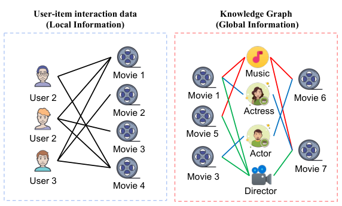
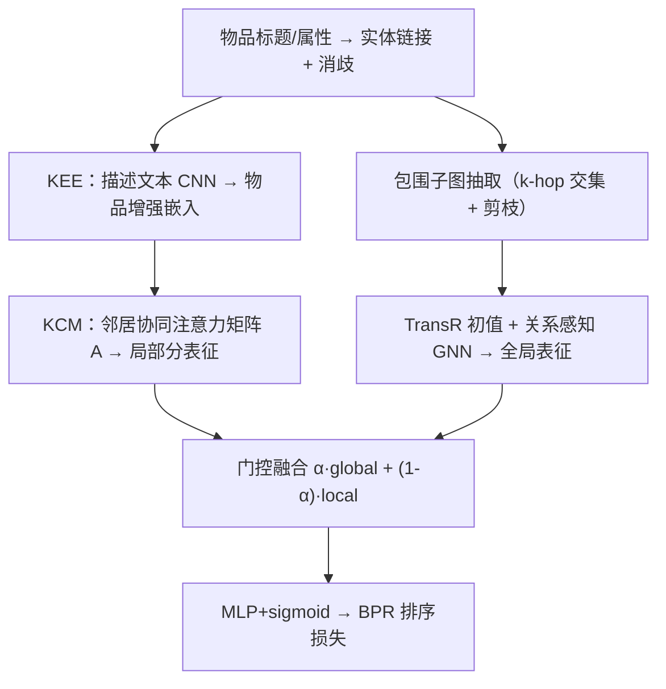
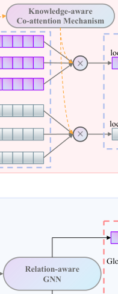

# Unify Local and Global Information for Top-$N$Recommendation (统一局部与全局信息用于 Top-$N$ 推荐)

- **会议/期刊**: SIGIR 2022（arXiv 2020 预印）
- **作者与机构**: Xiaoming Liu, Shaocong Wu, Zhaohan Zhang, Chao Shen（西安交通大学 智能网络与网络安全教育部重点实验室）
- **推荐链路定位**: 端到端召回/排序（无粗精排级联，直接输出用户-物品偏好分）
- **研究方向**: 图神经网络与知识图谱推荐 / 协同过滤
- **论文原文**: [https://arxiv.org/abs/2012.01635v2](https://arxiv.org/abs/2012.01635v2)
- **开源代码**: [https://github.com/scwu1008/KADM](https://github.com/scwu1008/KADM)

## TL;DR (1分钟核心速览)

KG 推荐的主流做法是在整张知识图谱上做信息传播，既忽略了用户-物品二部图中的协同信号，又把无关实体与全部关系路径等权聚合，引入噪声。本文提出双分支模型 KADM：局部模型用知识感知协同注意力（KCM）从历史邻居与协同邻居中抽取交互内蕴关联，全局模型在"用户-物品对"诱导的包围子图上用关系感知 GNN 编码知识关联，最后以门控网络按上下文动态加权融合。在 MovieLens-1M 与 Last.FM 的 1:100 采样排序下，Recall@20/NDCG@20 相对最强基线 CKAN 提升 3.1%/4.3% 与 7.3%/5.9%。

## Background & Motivation (背景与核心矛盾)

- **主流范式**: 以 KG 为 side information 的推荐分三支——embedding 类（CKE 把结构/文本/视觉知识并入 MF）、path 类（在元路径上做推理）、propagation 类（KGAT/CKAN/MVIN 在统一图或 KG 上做多跳消息传递），后者普遍是当前 SOTA。
- **前人局限**: ① 绝大多数方法只在 KG 上传播，未显式编码用户-物品交互中的协同信号（"同一用户共同购买"这一最直接的偏好证据）；② 在全图上做递归传播，随图变稠密无关实体的负噪声被同步放大，且不同关系路径（如"同导演"与"同演员"）被等权处理，与真实决策不符。
- **核心洞察 (Key Insight)**: 交互二部图（局部）与 KG（全局）刻画偏好的是两个正交视角——局部刻画"与你历史物品相似/被别人共同选择"的物品级协同效应，全局刻画"同演员、同厂牌"的属性级语义关联；二者互补，且对不同的用户-物品对贡献权重不同。
- **本文切入点**: 用双分支各司其职（局部管交互、全局管知识），全局侧只在与该用户-物品对相关的**包围子图**上传播以掐断噪声，末端用门控网络缓解两类表征的语义鸿沟。

<figure class="paper-figure" markdown="span">
  <figcaption>图1：局部信息与全局信息示意图。局部信息为用户-物品交互数据，是由用户、物品及交互构成的二部图。全局信息为包含多种关系类型和实体的异构知识图谱。</figcaption>
</figure>

## Method (核心方法设计)

### 1. 整体框架 (Overall Architecture)

输入为用户-物品隐式反馈矩阵与外部 KG。先做知识补充链接：以物品标题检索 Freebase 实体，用 IMDB ID/作者名等属性消歧，抽取出实体描述文本与中心子图。局部模型以 KEE 生成物品初始嵌入，再以 KCM 对"用户历史邻居 × 物品协同邻居"的注意力矩阵做行列池化，得到局部表征；全局模型先抽取该 (u,v) 的包围子图，用 TransR 预训练实体/关系向量作初值，经关系感知 GNN 迭代传播得到全局表征；最后由门控网络按上下文加权融合两组表征，送 MLP + sigmoid 输出偏好概率，BPR 损失端到端联合训练两个子模型。

<figure class="paper-figure" markdown="span">
  <figcaption>图2：知识感知双模型 KADM 示意图，包含四个组件：i) 知识补充链接（橙色背景，左侧），将物品映射到外部实体，以捕获 KG 中丰富的语义信息。ii) 局部模型（红色背景，中部），从局部信息中学习用户和物品的局部表示。iii) 全局模型（蓝色背景，中部），基于全局信息学习用户和物品的全局表示。iv) 预测（绿色背景，右侧），缓解局部与全局之间的语义鸿沟。</figcaption>
</figure>

### 2. 关键设计拆解 (Key Designs)

1. **知识感知协同注意力 KCM（替代单侧浅层协同建模）**：传统 CF 只从用户侧或用物品侧单向建模，捕捉不到"用户邻居-物品邻居"的交叉相关性。KCM 先取用户的历史邻居矩阵 $\mathbf{X}_u\in\mathbb{R}^{K\times d}$与物品的协同邻居矩阵$\mathbf{X}_v\in\mathbb{R}^{K\times d}$（物品相似度用共同交互用户占比$s_{ij}$加阈值$\tau$ 筛选），再计算交叉注意力矩阵并池化：
$A_{ij}=\text{Attention}(\mathbf{x}_u^i,\mathbf{x}_v^j),\quad \mathbf{a}_u=\text{MeanPool}(\{A_{i\cdot}\}),\ \mathbf{a}_v=\text{MeanPool}(\{A_{\cdot j}\}),\quad \mathbf{u}^{Local}=\mathbf{a}_u'^{\top}\mathbf{X}_u$其中$\mathbf{a}'=\text{softmax}(\mathbf{a})$ 提供邻居权重。直觉：行列池化让每个邻居的权重由"它对另一侧全部邻居的总体匹配度"决定，等价于一次双向可解释的软对齐。

2. **包围子图 + 关系感知 GNN（替代全图传播）**：在全图传播必然混入无关实体。本文取用户交互物品实体集 $E(u)$与目标实体$e$的$k$-hop 邻居交集$\mathcal{N}^k(e_i)\cap\mathcal{N}^k(e)$，剪掉孤立点后合并为包围子图；子图内用关系级注意力加权聚合：
$\mathbf{a}_t^{k+1}=\sum_{r=1}^{R}\sum_{s\in\mathcal{N}_r(t)}\omega_{rst}^{k+1}\mathbf{W}_r^{k+1}\mathbf{h}_s^k,\qquad \omega_{rst}^{k+1}=\sigma(\mathbf{W}_2\,\text{ReLU}(\mathbf{W}_1[\mathbf{h}_s^k\oplus\mathbf{h}_t^k\oplus\mathbf{e}_r]+\mathbf{b}_1)+\mathbf{b}_2)$
$\omega$ 让"同演员"路径压过"同导演"路径；配合关系变换矩阵的 basis 共享与 triplet dropout 控制参数量与过拟合。子图还顺带把复杂度从全图规模降到局部规模。

3. **门控语义融合、训练目标与推理开销**：直接拼接两类表征会掩盖二者权重随场景变化的事实。门控按对计算 $\alpha=\sigma(\mathbf{W}_{gate}[\mathbf{u}^{Global}\sqcup\mathbf{u}^{Local}])$，$\mathbf{u}^{Final}=\alpha\odot\mathbf{u}^{Global}+(1-\alpha)\odot\mathbf{u}^{Local}$（物品同理），$\alpha$高说明该对更依赖知识关联，低则更依赖协同邻居。总损失为 BPR 加$L_2$：
$\mathcal{L}=\sum_{(u,v_i,v_j)\in\mathcal{O}}-\ln\sigma(\hat{y}_{uv_i}-\hat{y}_{uv_j})+\lambda\|\Theta\|_2^2$训练时每个正样本配 1 个均匀采样负样本（无硬负采样、无 in-batch 负采样）；KG 侧另用 margin 排序损失预训练 TransR。推理需在线抽取 2-hop 包围子图并跑$L$ 层 GNN，是该模型的主要时延来源（原文未给出线上时延数据）。

## Experimental Setup & Evaluation Protocol (实验设置与评估协议)

- **数据集与预处理**: 两数据集均做 `10-core` 过滤；ML-1M 以评分 $\ge 4$ 二值化为正反馈，Last.FM 无阈值。KG 由 Freebase 标题匹配构建，链接失败物品**直接丢弃**（故 ML-1M 仅剩 3,389 物品），并过滤出现次数低于 10 的实体与三元组数少于 50 的关系。

| 数据集 | #Users | #Items | #Interactions | KG #Entities / #Relations / #Triplets | 场景 |
| :--- | :---: | :---: | :---: | :---: | :--- |
| MovieLens-1M | 6,040 | 3,389 | 997,024 | 392,966 / 49 / 2,112,838 | 电影评分（$\ge 4$ 为正） |
| Last.FM | 1,851 | 2,315 | 59,781 | 10,367 / 63 / 245,043 | 音乐收听（隐式） |

- **数据划分与防穿越**: 按用户随机保留 80% 交互为训练集、20% 为测试集，训练集内再随机取 20% 作验证集调参；属 `比例划分`，**非全局时间戳切分**，未严格防未来交互泄漏。
- **排名评测协议**: `Sampled Ranking` —— 测试阶段为每个用户随机抽 100 个未交互物品，与真实正例混排后打分，正负比约 1:100；指标为 Recall@20 与 NDCG@20。注意该协议绝对数值偏高，与 Full-Ranking 结果不可直接横向比较。
- **对比基线与超参设置**: 基线覆盖 CF 类（FM、NFM）、正则化类（CKE、CFKG）、GNN 类（KGAT、MVIN、CKAN）。批大小 512，Adam，学习率 $\{0.05,0.01,0.005,0.001\}$网格搜索，$L_2$系数$\{10^{-5},\dots,10^{-2}\}$，dropout$\{0.2,\dots,0.8\}$；邻居规模 ML-1M 取 40、Last.FM 取 20，描述长度 30/40，词嵌入 64 维，TransR 实体/关系 128 维，子图保留 2-hop、三元组上限 1,000（Last.FM）/100（ML-1M）。原文未报告显著性检验（如配对$t$ 检验）。

## Key Experimental Results (实验关键数据)

### 1. 主实验对比 (Main Results)

| Model | Last.FM R@20 | Last.FM N@20 | ML-1M R@20 | ML-1M N@20 |
| :--- | :---: | :---: | :---: | :---: |
| FM | 0.568 | 0.448 | 0.534 | 0.610 |
| NFM | 0.535 | 0.412 | 0.590 | 0.620 |
| CKE | 0.553 | 0.483 | 0.635 | 0.670 |
| CFKG | 0.577 | 0.484 | 0.621 | 0.672 |
| KGAT | 0.657 | 0.550 | 0.652 | 0.701 |
| MVIN | 0.672 | 0.583 | 0.658 | 0.713 |
| CKAN | 0.686 | 0.590 | 0.673 | 0.721 |
| **KADM** | **0.736** | **0.625** | **0.694** | **0.752** |
| Improv.% vs 最优基线 | +7.29% | +5.93% | +3.12% | +4.30% |

### 2. 消融实验 (Ablation Study)

| 配置 | Last.FM R@20 | Last.FM N@20 | ML-1M R@20 | ML-1M N@20 |
| :--- | :---: | :---: | :---: | :---: |
| KADM-co（注意力权重固定为 $1/K$） | 0.704 | 0.613 | 0.669 | 0.719 |
| KADM-rel（关系聚合退化为均值） | 0.695 | 0.607 | 0.662 | 0.714 |
| KADM-local（仅局部，去门控） | 0.674 | 0.572 | 0.654 | 0.708 |
| KADM-global（仅全局，去门控） | 0.689 | 0.603 | 0.663 | 0.716 |
| **KADM 完整** | **0.736** | **0.625** | **0.694** | **0.752** |

### 3. 关键实验发现 (Key Findings)

1. **双分支互补是最大增益来源**：单用局部（0.674）或单用全局（0.689）都明显弱于门控融合（0.736），融合相对最强单分支 Recall 增益 6.8%（Last.FM）；且全局分支单独也优于 CKAN（0.689 vs 0.686），说明"包围子图 + 关系注意力"本身即已构成对全图传播的改进。
2. **两处注意力各自贡献可剥离**：去掉 KCM 的邻居加权（固定 $1/K$）掉 4.3% Recall，把关系感知聚合换成均值掉 5.6%（Last.FM），说明"谁更重要"的建模比"聚合多少邻居"更关键；关系注意力在稀疏的 Last.FM 上收益（−0.018 NDCG）大于稠密的 ML-1M（−0.007），即关系路径噪声在图稀疏时危害更大。
3. **数据密度决定收益上限**：ML-1M 相对最优基线的提升（+3.1%）明显小于 Last.FM（+7.3%），作者归因为 ML-1M 交互与 KG 连接都更稠密、基线已接近饱和；同时超参实验显示描述长度与邻居规模均呈"先升后降"倒 U 型（描述过长引入噪声、邻居过多引入冗余），说明增益对局部信息质量敏感而非规模堆叠。

## Highlights & Limitations (亮点、对比与审稿批判)

- **与代表作对比 (vs. Prior Work)**: 相较 KGAT（统一图上节点级注意力，仍被全图噪声影响）与 CKAN（把协同信号作为 KG 实体初始化、本质仍是单图传播），KADM 把两类信息放到**结构不对称的两个子模型**里分别建模，再用门控而非拼接融合；相较 MVIN 的 user-view/entity-view 双视角，本文额外引入了"用户邻居 × 物品邻居"的交叉注意力和子图级关系权重。
- **可迁移亮点**: ① **包围子图抽取**是一个与模型无关的通用降噪/降复杂度技巧，可直接移植到任何 KG 增强的 GNN 召回中做在线裁剪；② **门控按对加权融合两路表征**可复用到多源召回（行为序列 + 图谱 + 多模态）的分数/表征融合；③ KEE 用描述文本初始化物品嵌入，天然给出冷启动物品的兜底表征。
- **审稿级局限批判**: ① 评估仅用 1:100 采样排序，未做 Full-Ranking，且无显著性检验与方差报告，绝对数值偏高、结论稳健性存疑；② "缓解冷启动"只是由 KEE 机制推出的主张，全文**没有冷启动物品/用户的划分实验**加以验证；③ 训练负采样为均匀 1:1，与强负采样基线（如 KGAT 的难度采样）不完全对等；④ 在线推理需实时抽 2-hop 子图并跑 GNN，论文只给了理论复杂度、无 wall-clock 时延与吞吐，工业落地成本未量化；⑤ 物品链接失败即丢弃，ML-1M 仅剩 3,389 物品，实际覆盖率与长尾偏差未讨论。

## Rating (四维评分)

- **方法创新性 (Novelty)**: ⭐⭐⭐⭐ （双分支非对称结构 + 包围子图 + 门控融合组合新颖，但 KCM、R-GCN 式关系注意力、gating 均为已有组件的针对性拼装）
- **评估协议与实验扎实度 (Protocol & Experiments)**: ⭐⭐⭐ （两数据集 + 7 个基线 + 四组消融齐全，但仅 1:100 采样排序、无显著性检验、无冷启动与效率实验）
- **写作与数学规范度 (Clarity & Rigor)**: ⭐⭐⭐⭐ （四模块与公式推导清晰可复现，但符号层面部分矩阵维度标注省略，超参敏感性以曲线呈现缺少数值表）
- **工业落地与复现价值 (Industrial & Practical Value)**: ⭐⭐⭐ （代码已开源、子图裁剪显著降复杂度，但需在线构图与 GNN 推理，且依赖 Freebase 实体链接流水线，端到端部署成本偏高）

