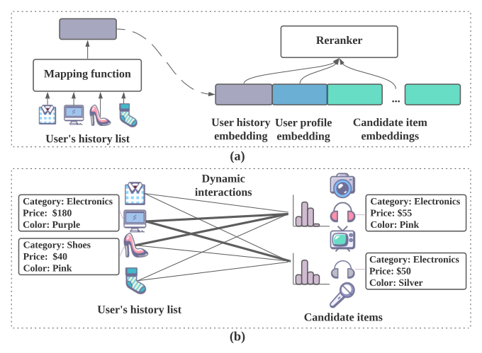
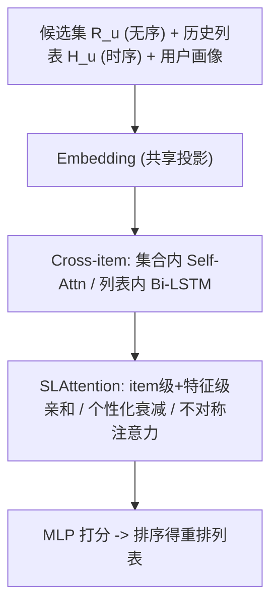
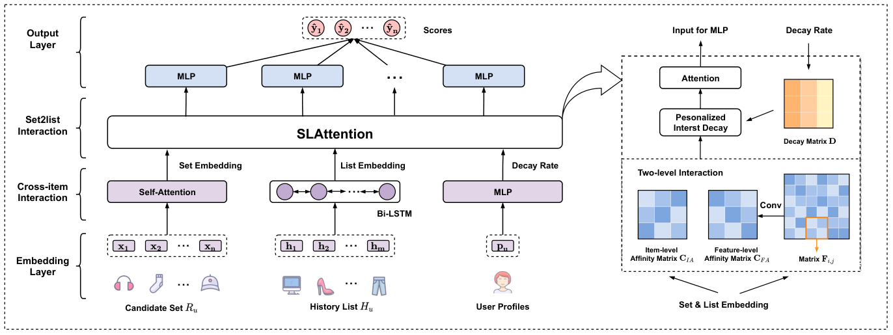

# Multi-Level Interaction Reranking with User Behavior History (融合用户行为历史的多层级交互重排)

- **会议/期刊**: SIGIR 2022
- **作者与机构**: Yunjia Xi, Weiwen Liu, Jieming Zhu 等（上海交通大学 & 华为诺亚方舟实验室）
- **推荐链路定位**: 重排（Reranking，多阶段推荐系统末级）
- **研究方向**: 多任务学习与列表级重排 / CTR 特征交叉
- **论文原文**: [论文原文链接](https://arxiv.org/abs/2204.09370v1)
- **开源代码**: [开源代码仓库链接](https://github.com/rank2rec/rerank)

## TL;DR (1分钟核心速览)

针对重排阶段三大痛点——历史行为被压成单一用户向量且忽视长短期兴趣、只建模 item 级交互而缺特征级交叉、基于初始列表提前打分导致 early scoring，本文提出 MIR：候选集建模为无序集合、历史按时间建模为列表，用 SLAttention 同时抽取 item 级与特征级亲和矩阵，并乘上由用户 embedding 学出的个性化指数时间衰减；模型被证明对候选集排列等变，因此重排结果排列不变。在 PRM Public / Ad / App Store 三数据集、MAP、NDCG、IPS 去偏 deNDCG 与 Utility 全指标上相对最强基线 PRM 提升 0.9%–5.12%（Utility 最高 +6.52%），$p<0.05$ 显著。

## Background & Motivation (背景与核心矛盾)

- **主流范式**: 重排模型（DLCM、PRM、SetRank、MIDNN、GSF）以初始列表为上下文，用 RNN/Transformer/GNN 编码 item 间互影响，输出重排分数并排序。
- **前人局限 1**: 历史列表通常被映射成固定 history embedding 作为用户特征，与候选无关、且历史 item 一视同仁，无法刻画"买过笔记本→才点耳机"这种随候选变化的动态偏好；同时忽视长短期兴趣的时序演化。
- **前人局限 2**: 只学 item 级交互（整条 item 向量相似度），丢失 category/color 等细粒度类别语义的交叉信号；而 generator-evaluator 方案（PRS/GRN/URCM）推理是多项式复杂度。
- **核心洞察 (Key Insight)**: 只要重排模型对候选集是**排列等变 (permutation-equivariant)** 的，那么对输出分数排序即可得到**排列不变**的结果——同一集合不论初始如何排列都产出同一重排列表，从而根治 early scoring。
- **本文切入点**: 在 SetRank 式集合建模基础上，补上"历史列表 ↔ 候选集合"的异构 set2list 交互与特征级交叉。

<figure class="paper-figure" markdown="span">
  <figcaption>图1：用户历史列表的使用方式。(a) 用户历史列表与重排列表中的候选物品相互独立。(b) 用户历史列表与候选物品动态交互。</figcaption>
</figure>

## Method (核心方法设计)

### 1. 整体框架 (Overall Architecture)

MIR 端到端四段式：① Embedding 层把候选 item、历史 item、用户画像的稀疏特征投影为稠密向量（候选与历史共享投影矩阵）；② Cross-item Interaction 层在候选集内做多头自注意力（排列等变）、在历史列表上用 Bi-LSTM 编码时序演化；③ Set2list Interaction 层用 SLAttention 计算双向亲和矩阵、个性化兴趣衰减与不对称注意力，得到交互表征 $\hat{\mathbf{s}}_v$与$\hat{\mathbf{l}}_v$；④ Output 层把$[\mathbf{p}_u \oplus \mathbf{x}_v \oplus \hat{\mathbf{s}}_v \oplus \hat{\mathbf{l}}_v]$送入 MLP 打分，按分数排序即得最终列表。训练用 BCE，推理只需一次前向 + 排序，复杂度$O(mn)$。

<figure class="paper-figure" markdown="span">
  <figcaption>图2：MIR的整体框架及其子模块。</figcaption>
</figure>

### 2. 关键设计拆解 (Key Designs)

1. **SLAttention：set2list 双粒度亲和矩阵**：痛点是把历史压成单向量、且只看 item 级语义。做法是并行算两条亲和：item 级 $C_{IA}=\tanh(\mathbf{S}\mathbf{W}_{IA}\mathbf{L}^{\top})$，特征级则先逐类别对交互再卷积聚合$F^{i,j}=\tanh(\mathbf{E}^S_i\mathbf{W}_{FA}(\mathbf{E}^L_j)^{\top})$、$C_{FA}(i,j)=\sum_{s,t}F^{i,j}(s,t)W_c(s,t)$，最终$C_A=C_{IA}+C_{FA}$。直觉：item 级抓高阶整体相似，特征级显式捕获"同类目/同颜色"的细粒度偏好传导，二者互补。

2. **个性化兴趣衰减 (Personalized Interest Decay)**：痛点在于不同用户兴趣漂移速度不同。由用户向量学出正衰减率 $\theta_u=g(\mathbf{p}_u)$，对时间间隔$\mathbf{t}_u$构造$\mathbf{d}=e^{-\theta_u \mathbf{t}_u}$，复制成与候选数同行的矩阵$\mathbf{D}$，得$C=C_A+C_A\odot\mathbf{D}$。这样长时兴趣保留全局亲和、短时兴趣被近期行为放大，且因$\mathbf{D}$ 逐行复制而对候选集保持排列等变。

3. **不对称注意力、损失与推理**：重排只需要"历史→候选"的单向信息流，故 $\mathbf{Q}_S=\tanh(\mathbf{S}\mathbf{W}_s+C(\mathbf{L}\mathbf{W}_l))$、$\mathbf{Q}_L=\tanh(\mathbf{S}\mathbf{W}_s C)$，$\hat{\mathbf{S}}=A_S\mathbf{S}$、$\hat{\mathbf{L}}=A_L\mathbf{L}$，其中$A_S$用双侧信息、$A_L$只用候选侧。损失为 BCE$\mathcal{L}=\sum_u\sum_{v\in R_u}[y_v\log\hat{y}_v+(1-y_v)\log(1-\hat{y}_v)]$，无额外负采样（列表内曝光/点击天然构正负）；推理一次前向，$O(mn)$ 而非 generator-evaluator 的多项式枚举。

## Experimental Setup & Evaluation Protocol (实验设置与评估协议)

- **数据集与预处理**:

| 数据集 | #Users | #Items | #Interactions | 稀疏度/密度 | 特征/场景说明 |
| :--- | :---: | :---: | :---: | :---: | :--- |
| PRM Public | 743,720 | 7,246,323 | 14,350,968 | 极稀疏 | 电商推荐，3 用户画像 + 5 类别 + 19 稠密 item 特征，列表定长 30 |
| Ad | 1,140,000 | — | 26M 曝光/点击 | 极稀疏 | 广告，9 用户画像 + 6 item 特征，5 分钟窗口切片成列表 |
| App Store | — | 111,063 | 33,646,680 请求 | 稀疏 | 商用应用商店，每 App 32 特征，点击/下载行为历史 |

- **数据划分与防穿越 (Splitting Strategy)**: 按用户取**最后一条交互列表**做重排测试，其之前正反馈 item 依时间构建历史列表（严格时序、不使用未来行为）；历史长度取最近 30 条。
- **排名评测协议 (Ranking Protocol)**: 无偏 **Full-Ranking**——对给定候选列表（PRM 30 / Ad 取初始 top-10 / App Store top-20）内部全序重排；指标 MAP@K、NDCG@K，并额外报告 **IPS 去偏的 deNDCG@K** 与 Utility@K（公库为去偏期望点击数，App Store 为期望收入）。
- **对比基线与超参设置**: 初始排序器三种范式各一（DIN pointwise / SVMRank pairwise / LambdaMART listwise）；重排基线 MIDNN、DLCM、GSF、PRM、SetRank。类别 embedding $d_e=16$、隐层 64、MLP$[500,200,80]$、batch 16、lr$\in\{2\text{e-}5,\dots,2\text{e-}4\}$、L2$\in\{1\text{e-}5,\dots,5\text{e-}5\}$；显著性用 t-test$p<0.05$。

## Key Experimental Results (实验关键数据)

### 1. 主实验对比 (Main Results)

以 DIN 为初始排序器的 @10（PRM）/ @5（Ad、App Store）结果：

| 模型 | PRM MAP | PRM NDCG | PRM deNDCG | PRM Utility | Ad MAP | Ad deNDCG | Ad Utility | AS MAP | AS Utility |
| :--- | :---: | :---: | :---: | :---: | :---: | :---: | :---: | :---: | :---: |
| initial | 0.1929 | 0.2290 | 0.2298 | 1.2289 | 0.5930 | 0.6654 | 2.2416 | 0.1855 | 2.4671 |
| MIDNN | 0.2986 | 0.3399 | 0.3124 | 1.3267 | 0.5991 | 0.6710 | 2.2174 | 0.2352 | 3.5379 |
| DLCM | 0.3002 | 0.3422 | 0.3146 | 1.3431 | 0.5998 | 0.6715 | 2.3126 | 0.3205 | 3.9615 |
| GSF | 0.2989 | 0.3402 | 0.3127 | 1.3283 | 0.5995 | 0.6713 | 2.2341 | 0.2271 | 3.4690 |
| PRM | 0.3026 | 0.3446 | 0.3161 | 1.3423 | 0.6014 | 0.6725 | 2.2350 | 0.3281 | 3.9945 |
| SetRank | 0.3003 | 0.3413 | 0.3118 | 1.3192 | 0.6007 | 0.6719 | 2.2457 | 0.2591 | 3.6234 |
| **MIR** | **0.3087** | **0.3511** | **0.3239** | **1.3906** | **0.6068** | **0.6771** | **2.3807** | **0.3449** | **4.0964** |
| Improv. | +2.02% | +1.89% | +2.47% | +3.60% | +0.90% | +0.67% | +6.52% | +5.12% | +2.55% |

### 2. 消融实验 (Ablation Study)

| 变体 | PRM MAP@10 | PRM NDCG@10 | PRM Utility@10 | Ad MAP@5 | Ad Utility@5 |
| :--- | :---: | :---: | :---: | :---: | :---: |
| MIR (full) | **0.3087** | **0.3511** | **1.3906** | **0.6068** | **2.3807** |
| w/o feature-level (MIR-fi) | 0.3072 | 0.3503 | 1.3836 | 0.6030 | 2.2957 |
| w/o item-level (MIR-ii) | 0.3067 | 0.3500 | 1.3834 | 0.6040 | 2.3181 |
| w/o decay (MIR-dcy) | 0.3060 | 0.3490 | 1.3733 | 0.6029 | 2.2831 |
| SLAttention→self-attn (MIR-SLA) | 0.3026 | 0.3447 | 1.3406 | 0.6009 | 2.2713 |
| w/o intra-set (MIR-set) | 0.3071 | 0.3497 | 1.3828 | 0.6034 | 2.3231 |
| w/o intra-list (MIR-lst) | 0.3073 | 0.3508 | 1.3879 | 0.6038 | 2.3486 |
| 相似用户历史替代 (MIR-hst) | 0.3054 | 0.3487 | 1.3879 | 0.6044 | 2.3783 |

### 3. 关键实验发现 (Key Findings)

1. **结构比注意力本身更关键**：把 SLAttention 换成朴素 self-attention（MIR-SLA）后 MAP@10 掉到 0.3026，几乎退化到 PRM 水平（0.3026），说明增益来自 set2list 的亲和矩阵 + 衰减设计而非"再叠一层 attention"。
2. **个性化衰减是单项最大贡献**：去掉衰减使 Utility@10 从 1.3906 降至 1.3733（-1.24%）、MAP@10 -0.87%，在 SLAttention 内部各组件中跌幅最大，验证了不同用户兴趣漂移速率差异确实可学。
3. **两级交叉的收益依赖特征构成**：PRM Public 含 19 个稠密特征时去掉 item 级（0.3067）比去掉特征级（0.3072）更伤；只有类别特征的 Ad 恰好相反（MIR-fi 0.6030 < MIR-ii 0.6040），证明两级亲和互为补充。
4. **排列不变性与冷启动鲁棒性**：PRM 上三种初始排序器下 MIR MAP@10 分别为 0.3087/0.3084/0.3083，几乎不随初始排列变化；用相似用户历史替换（MIR-hst）仍全面超过 PRM，Ad 上 Utility 2.3783 已接近完整模型 2.3807。

## Highlights & Limitations (亮点、对比与审稿批判)

- **与代表作对比 (vs. Prior Work)**: 相比 PRM（只编码候选列表互影响 + 静态用户表征）与 SetRank（只做候选集集合建模、完全不用历史），MIR 首次把历史列表作为独立时序结构引入并做**非对称** set2list 交互；相比 PRS/GRN/URCM 的 generator-evaluator 两段式，MIR 单次前向 $O(mn)$ 即解决 early scoring。
- **可迁移亮点**: ① 用"排列等变函数 + 输出排序"获得排列不变性的工程范式，可直接搬到列表级重排/生成式重排的去偏；② 特征级亲和矩阵（逐类别对交互 + 卷积求和聚合）可作为任意双塔/双序列结构的低成本交叉插件。
- **审稿级局限批判**: ① 衰减依赖历史时间戳，缺失时间戳时只能用位置近似，且历史长度 30 是收益/成本折中（图 3 显示 30→40 增益饱和），超参敏感；② 评估全为离线日志 + IPS 去偏，无线上 A/B；作者亦承认 Eg-rerank+/URCM 在稀疏真实数据上复现后劣于初始排序，说明"外部基线不可复现"这一对比缺口削弱了 SOTA 说服力。

## Rating (四维评分)

- **方法创新性 (Novelty)**: ⭐⭐⭐⭐ （set2list 非对称交互 + 特征级亲和 + 个性化指数衰减三者组合为首创，并给出排列等变性的理论证明）
- **评估协议与实验扎实度 (Protocol & Experiments)**: ⭐⭐⭐⭐ （三数据集覆盖公有+商用、三种初始排序器、IPS 去偏指标与 t-test，消融完整；欠缺线上 A/B）
- **写作与数学规范度 (Clarity & Rigor)**: ⭐⭐⭐⭐ （公式与复杂度分析清晰、等变性证明置于附录，代价是部分符号在正文与图中复用略易混）
- **工业落地与复现价值 (Industrial & Practical Value)**: ⭐⭐⭐⭐ （代码开源、$O(mn)$ 单次前向、可直接接在精排之后，历史序列长度与时间戳依赖是主要部署约束）

