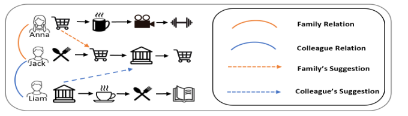
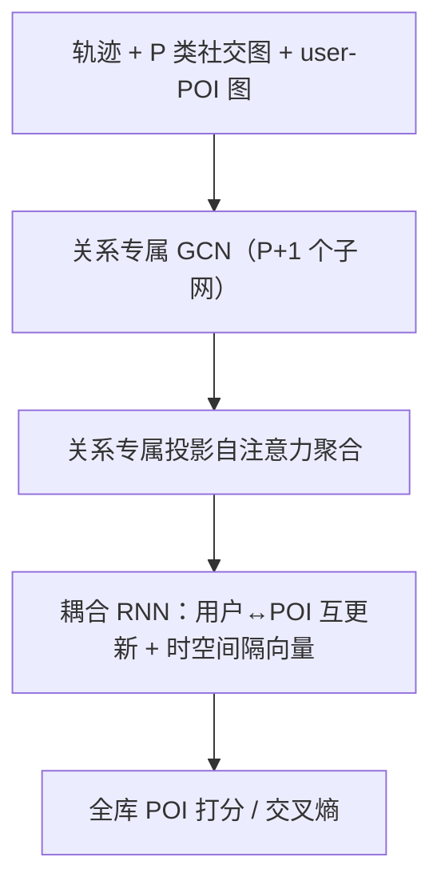
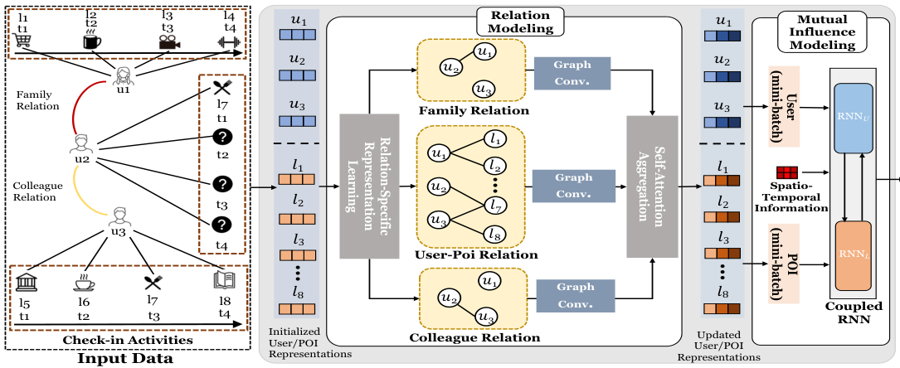

# Empowering Next POI Recommendation with Multi-Relational Modeling (多关系建模驱动的下一兴趣点推荐)

- **会议/期刊**: SIGIR 2022 (short paper, 5 pages)
- **作者与机构**: Zheng Huang, Jing Ma, Yushun Dong, Natasha Zhang Foutz, Jundong Li (University of Virginia)
- **推荐链路定位**: 召回（Next-POI 全库打分）
- **研究方向**: 时空轨迹与 POI 本地生活推荐 / 图神经网络与知识图谱推荐
- **论文原文**: [https://arxiv.org/abs/2204.12288v1](https://arxiv.org/abs/2204.12288v1)
- **开源代码**: 暂未开源

## TL;DR (1分钟核心速览)

Next-POI 推荐长期只吃用户轨迹或单一 user-POI 图，忽略了**异质社交关系**（家人 vs 同事对购物/培训类 POI 的影响不同）与**用户-POI 随时间的双向互影响**。MEMO 为每种关系建独立 GCN 子网得到关系专属表征，再用关系专属投影的自注意力做跨关系聚合，最后用耦合 RNN 让用户与 POI 表征互相更新、并注入时空间隔向量。三个真实 LBSN 数据集在 80/10/10 划分下做全 POI 多分类排序，Recall@10 达 0.891/0.831/0.840，相对最强基线 STAN 提升 2.7%–3.0%，MRR@10 提升 2.1%–5.6%。

## Background & Motivation (背景与核心矛盾)

- **主流范式**: 从 Markov 序列统计 → 图方法（把 user-POI 访问建成图，如 LightGCN）→ RNN 轨迹建模（GRU4Rec、DeepMove）→ 自注意力时空模型（SASRec、TiSASRec、STAN）。
- **前人局限**: 其一，绝大多数方法只用 user-POI 访问关系，或把 P 种社交关系揉进同一张图，**假设不同关系子网的节点表征共享同一隐空间**，抹平了关系异质性；其二，user 与 POI 被当作静态表征分别学习，无法刻画"用户打卡提升 POI 声誉、POI 声誉又反过来影响用户下次到访"的时序互反馈。
- **核心洞察 (Key Insight)**: 不同社交关系对 POI 类别偏好具有**分工性**——家人主导商场类决策、同事主导培训机构类决策（图 1），因此关系必须"先分后合"：分关系编码、再跨关系注意力聚合。
- **本文切入点**: 用 $P+1$ 张关系子图 + 关系专属投影自注意力解决异质性，用耦合 RNN 解决时序互影响。

<figure class="paper-figure" markdown="span">
  <figcaption>图1：异构社交关系：Jack 采纳姐妹 Anna 对购物中心的推荐，以及同事 Liam 对培训机构的推荐。</figcaption>
</figure>

## Method (核心方法设计)

### 1. 整体框架 (Overall Architecture)

输入为用户的时空轨迹 $C(u_i)=\{(l_k,t_k)\}$与$P$类对称社交邻接矩阵$\mathbf{A}_1,\dots,\mathbf{A}_P$、一张 user-POI 二部图$\mathbf{A}_C\in\mathbb{R}^{(U+L)\times(U+L)}$。先为每个节点初始化通用嵌入$\mathbf{x}_i$，经关系专属映射$\Phi_p$投到各关系子空间并在对应子图上做带注意力的 GCN 聚合，得到$\mathbf{h}_i^p$；随后用关系专属 Q/K/M 投影的自注意力把$P+1$个表征融合成统一表征$\mathbf{h}_i$；该表征作为初态喂入耦合 RNN，用户 RNN 与 POI RNN 在每个时间戳互相读取对方状态并注入时间/距离间隔向量，最终由全连接层对全库 POI 打分、交叉熵训练。

<figure class="paper-figure" markdown="span">
  <figcaption>图2：用于下一 POI 推荐的 MEMO 概览。</figcaption>
</figure>

### 2. 关键设计拆解 (Key Designs)

1. **关系专属表征 + 跨关系自注意力聚合**：痛点是把多关系压到同一隐空间会互相污染。先做 $\mathbf{x}_i^p=\Phi_p(\mathbf{x}_i)$，在子图$\mathcal{G}_p$上聚合邻居得$\mathbf{h}_i^p$；聚合阶段每个关系用**自己的**投影矩阵生成$q_p,k_p,m_p$，从而允许跨隐空间对齐：
$\alpha(p_1,p_2)=\mathrm{Softmax}_{p_2\in[P+1]}\left(\boldsymbol{k}_{p_2}^{\top}\boldsymbol{q}_{p_1}/\sqrt{d}\right),\quad \mathbf{h}_i=\mathrm{MLP}\big(\,\|_{\,p}\tilde{\mathbf{h}}_i^{p}\big)$其中$\tilde{\mathbf{h}}_i^{p}=\oplus_{p'}\alpha(p,p')\cdot m_{p'}$。直觉：注意力权重自动学到"哪类关系对哪类用户更重要"，而关系专属投影避免了强行同空间的语义失真。

2. **耦合 RNN 的用户-POI 时序互影响**：痛点是静态 embedding 无法表达互反馈。用户状态更新显式读取其所访问 POI 的状态：
$\mathbf{h}_u^{t+1}=\sigma\!\left(\mathbf{W}^{U}_{1}\mathbf{h}_u^{t}+\mathbf{W}^{U}_{2}\mathbf{h}_l^{t}+\mathbf{W}^{U}_{3}\mathbf{z}_{\Delta t}+\mathbf{W}^{U}_{4}\mathbf{z}_{\Delta d}\right)$POI 侧对称地由$\mathcal{U}(l,t)$中所有访问者表征递归更新$\mathbf{h}_l^{t+1}=\mathrm{RNN}_L(\mathbf{h}_l^t,\mathbf{h}^t_{\mathcal{U}(l,t)})$，按访问时序重复$|\mathcal{U}(l,t)|$ 次。这使热门/高声誉 POI 与活跃用户形成正反馈闭环。

3. **时空间隔软阈值编码 + 训练目标**：把时间间隔与 Haversine 距离各离散为短/长两个可学习向量 $\mathbf{t}_s,\mathbf{t}_l$，以$\mathbf{z}_{\Delta t}=\mathbf{t}\odot\tanh(\mathbf{t})$（超过阈值$\theta_t$取长向量，距离同理$\theta_d$）连续化表达"附近/短时间内"的出行惯性。总损失为对全库 POI 的多分类交叉熵：$\mathcal{L}=-\sum_{(u,t)}\log\frac{\exp(s_{u,l^{*}})}{\sum_{l\in\mathcal{L}}\exp(s_{u,l})}$，**未使用负采样**（分母覆盖全部 POI）。为兼顾并行与时间依赖，每个 mini-batch 只挑选互不共享用户/POI 的独立访问样本，避免同批次内状态竞争。

## Experimental Setup & Evaluation Protocol (实验设置与评估协议)

- **数据集与预处理**: 来源于覆盖 400+ App SDK 的聚合位置流（人均 5 分钟一次采样），用 Infostop 停驻点检测识别"工作日夜间家"与"白天公司"停驻点，进而**推断**家人/同事两类社交关系（非显式社交平台好友）：

| 数据集 | #Users | #POIs | #Interactions | 稀疏度/密度 | 特征/场景说明 |
| :--- | :---: | :---: | :---: | :---: | :--- |
| B'more July | 17,892 | 559 | 1,753,382 | 密度≈0.175 | Baltimore 7 月，559 个 POI 的小词表高密度场景 |
| DC July | 7,517 | 4,213 | 262,679 | 密度≈0.0083 | DC 7 月，家人 1,100 / 同事 12,316 条关系 |
| DC August | 3,418 | 3,450 | 277,093 | 密度≈0.0235 | DC 8 月，跨月泛化检验 |

- **数据划分与防穿越 (Splitting Strategy)**: `比例划分` —— 每条轨迹按 80%/10%/10% 切分训练/验证/测试（非严格全局时间戳切分，存在轻度时序泄漏风险）。
- **排名评测协议 (Ranking Protocol)**: 训练为全 POI softmax 多分类，评估等价于 `Full-Ranking`（分母为全部 POI，无需负采样），报告 Recall@10 与 MRR@10。
- **对比基线与超参设置**: 基线覆盖统计（Markov）、图（LightGCN）、RNN（GRU4Rec、DeepMove）、自注意力（SASRec、TiSASRec、STAN）四类；$d=128$、学习率 0.001、50 epoch、Adam、$\theta_t=3600$s、$\theta_d=200$m，结果取 10 次重复的均值±标准差。

## Key Experimental Results (实验关键数据)

### 1. 主实验对比 (Main Results)

| 模型 | B'more R@10 | B'more MRR | DC July R@10 | DC July MRR | DC Aug R@10 | DC Aug MRR |
| :--- | :---: | :---: | :---: | :---: | :---: | :---: |
| Markov | 0.257 | 0.088 | 0.471 | 0.224 | 0.431 | 0.224 |
| LightGCN | 0.650 | 0.392 | 0.609 | 0.291 | 0.622 | 0.311 |
| GRU4Rec | 0.657 | 0.384 | 0.617 | 0.300 | 0.624 | 0.306 |
| DeepMove | 0.715 | 0.402 | 0.660 | 0.333 | 0.648 | 0.331 |
| SASRec | 0.738 | 0.415 | 0.694 | 0.335 | 0.687 | 0.353 |
| TiSASRec | 0.836 | 0.420 | 0.760 | 0.353 | 0.763 | 0.379 |
| STAN | 0.868 | 0.426 | 0.807 | 0.360 | 0.816 | 0.426 |
| **MEMO** | **0.891** | **0.446** | **0.831** | **0.380** | **0.840** | **0.435** |
| Improv. vs STAN | +2.65% | +4.69% | +2.98% | +5.56% | +2.94% | +2.11% |

### 2. 消融实验 (Ablation Study)

原文以图 3（柱状图）报告，未给出表格数值，此处按"组件移除 → 性能方向"整理：

| 变体 | 移除内容 | 相对 MEMO 的变化 | 归因 |
| :--- | :--- | :---: | :--- |
| MEMO-NG | 全部关系建模模块 | 显著下降（最大） | 退化为纯轨迹模型，丢失社交/二部图信息 |
| MEMO-NA | 关系专属自注意力 → 双线性普通注意力 | 明显下降 | 强行同隐空间聚合，跨关系语义被抹平 |
| MEMO-NR | 耦合 RNN 互影响模块 | 中等下降 | 无法刻画 user↔POI 声望/偏好的时序反馈 |
| MEMO-NTS | 时空间隔表征 $\mathbf{z}_{\Delta t},\mathbf{z}_{\Delta d}$ | 小幅下降 | 丢失"近处/短时间内"的出行惯性先验 |
| MEMO | — | 最优 | 四组件互补 |

### 3. 关键实验发现 (Key Findings)

1. **图方法不如序列方法，说明静态图结构不足**：LightGCN 在 B'more 上 R@10=0.650，低于同数据 GRU4Rec 的 0.657 与 TiSASRec 的 0.836，证明"只有 user-POI 静态关系"难以刻画兴趣漂移，必须叠加时序建模。
2. **关系异质性是主要增益来源**：MEMO 相对仅用轨迹最强基线 STAN 在 MRR 上提升 4.7%/5.6%，而消融中移除关系建模（MEMO-NG）跌幅最大，二者互为印证——社交关系信息是 Recall 提升的核心，而排序质量的提升更依赖互影响模块。
3. **高密度小 POI 场景收益更稳、跨月更鲁棒**：B'more（559 POI、175 万访问）与 DC Aug 上 MRR 增益分别为 +4.69% 与 +2.11%，说明当 POI 词表扩大（DC 4,213）时互影响模块的边际收益被稀释；参数研究显示 $d\in\{32,\dots,128\}$、$\theta_t\in[600,21600]$s、$\theta_d\in[50,1000]$m 范围内曲线平缓，模型不敏感。

## Highlights & Limitations (亮点、对比与审稿批判)

- **与代表作对比 (vs. Prior Work)**: 相较 STAN/TiSASRec（只用轨迹 + 时空自注意力，且 STAN 仅学用户侧个性化），MEMO 额外吃进多类社交图并显式建模 POI 侧状态演化；相较 LightGCN（单张 user-POI 图 + 静态嵌入），MEMO 的"分关系编码 + 专属投影聚合"直接针对关系异质性，且 POI 表征随时间可更新。
- **可迁移亮点**: ① 关系专属 Q/K/M 投影 + 注意力聚合是处理异构多图（如多行为推荐、跨域多场景）的通用轻量插件；② "同批次内挑选互不共享实体"的 mini-batch 构造，可直接迁移到任何需要并行化时序状态更新的序列/循环推荐模型。
- **审稿级局限批判**: ① **关系标签靠推断**：家人/同事关系由家/公司停驻点启发式推断，未与真实社交图谱核验，噪声关系可能被 GCN 放大，且"对称关系"假设过强；② **划分与评估偏弱**：80/10/10 比例划分未做严格时间戳切分，存在信息泄漏；仅报告 R@10/MRR@10，缺少对长尾 POI、冷启动用户的分桶分析与在线 A/B；③ POI 侧 RNN 需按访问时序递归更新 $|\mathcal{U}(l,t)|$ 次，工业级高并发场景下的训练/推理开销未讨论。

## Rating (四维评分)

- **方法创新性 (Novelty)**: ⭐⭐⭐⭐ （把"关系异质性 + user-POI 时序互影响"两件事首次同时引入 Next-POI，关系专属投影自注意力是清晰可复用的机制，但组件本身均为已有技术的组合式创新）
- **评估协议与实验扎实度 (Protocol & Experiments)**: ⭐⭐⭐ （三个大规模真实数据集、10 次重复并报标准差，但 80/10/10 划分非严格时序、消融仅以图形呈现无具体数值、缺显著性检验与分桶分析）
- **写作与数学规范度 (Clarity & Rigor)**: ⭐⭐⭐ （整体结构清晰、图示到位，但部分公式排版有明显笔误如 $\mathbf{z}_{\Delta t}=\mathbf{t}\odot\tanh(\mathbf{t})$中的$\mathbf{t}$ 指代不清，且 5 页篇幅下对 GCN 层与 POI 侧更新的推导略过简）
- **工业落地与复现价值 (Industrial & Practical Value)**: ⭐⭐⭐ （思路易落地位于召回侧，但未开源、关系推断依赖专有 SDK 数据、耦合 RNN 的顺序更新在超大规模 LBSN 上存在工程瓶颈）

