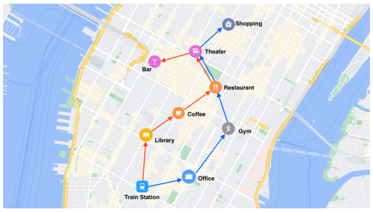
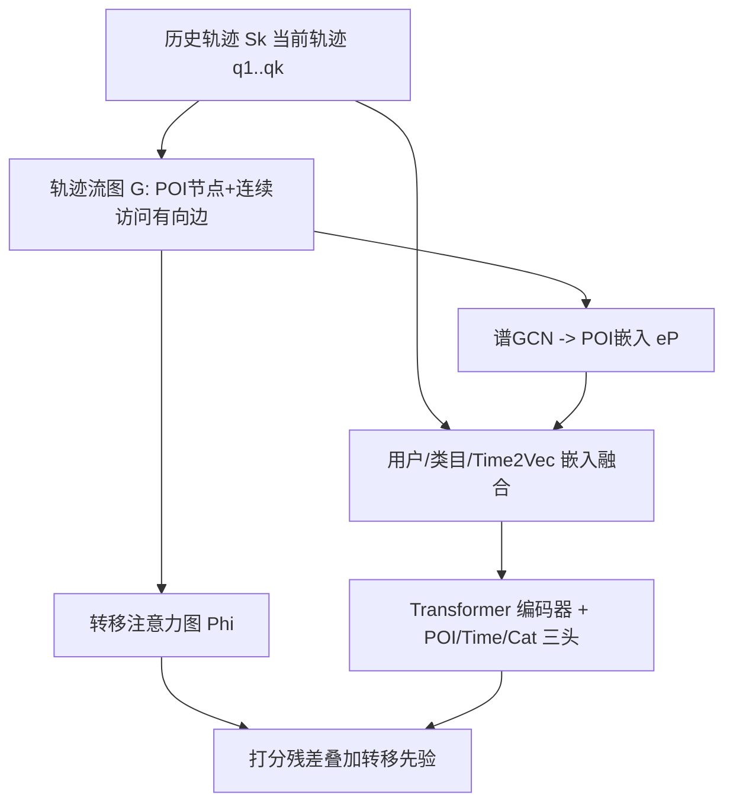
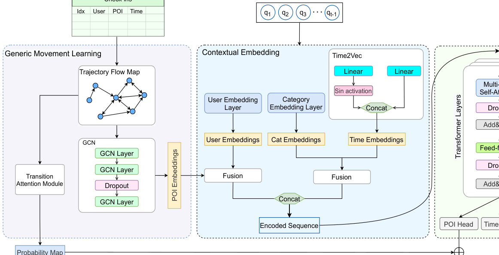

# GETNext: Trajectory Flow Map Enhanced Transformer for Next POI Recommendation (轨迹流图增强 Transformer 的下一兴趣点推荐)

- **会议/期刊**: SIGIR 2022
- **作者与机构**: Song Yang, Jiamou Liu, Kaiqi Zhao（The University of Auckland）
- **推荐链路定位**: 召回（Next-POI 候选全库排序）
- **研究方向**: 时空轨迹与 POI 本地生活推荐 / 图神经网络推荐
- **论文原文**: [https://arxiv.org/abs/2303.04741v1](https://arxiv.org/abs/2303.04741v1)
- **开源代码**: [https://github.com/songyangco/GETNext](https://github.com/songyangco/GETNext)

## TL;DR (1分钟核心速览)

现有 Next-POI 方法把问题当作纯用户自身序列预测（RNN/LSTM/自注意力），完全丢弃跨用户的协同转移信号，导致短轨迹与非活跃用户（冷启动）性能崩塌。本文提出**用户无关的全局轨迹流图**（POI 为节点、连续访问为带权有向边），用谱 GCN 隐式编码全局转移、用转移动注意力图 $\Phi$ 显式注入转移概率，再与用户/时间/类目嵌入一起送入 Transformer 编码器与多 MLP 头。在 NYC/TKY/CA 三数据集全库排序下，NYC Acc@5 从 45.82% 提升至 50.89%（+11.1%），非活跃用户 Acc@10 从 31.24% 升至 43.94%。

## Background & Motivation (背景与核心矛盾)

- **主流范式**: 将 Next-POI 视作序列预测，用 ST-RNN / STGN / PLSPL / STAN 等循环或自注意力结构建模单个用户轨迹的时空上下文。
- **前人局限**: ①短轨迹（1–2 个 check-in）时空上下文不足，STGN 在短轨迹上 Acc@1 仅 7.23%；②非活跃用户历史稀疏，模型无法学到个性化转移；③POI 类目与时间强相关（火车站早晚高峰 vs 酒吧夜间），现有模型未把「时间—类目」显式桥接。
- **核心洞察 (Key Insight)**: 不同用户会复现相同的轨迹片段（同一餐厅$\to$同一剧院），这些片段构成跨用户的**集体轨迹流**；即使不知道用户历史，仅凭当前 POI 的出边分布也能把随机猜测显著拉高——尤其对$k$较大的 top-$k$ 更有效。
- **本文切入点**: 把全体用户轨迹压成一张「用户无关」的有向带权 POI 转移图，让图结构承担协同信号，Transformer 只需在其之上做个性化微调。

<figure class="paper-figure" markdown="span">
  <figcaption>图1：两个用户在不同日期的两条轨迹（红色和蓝色）在Manhattan, NYC共享同一片段（餐厅到剧院）</figcaption>
</figure>

## Method (核心方法设计)

### 1. 整体框架 (Overall Architecture)

模型有两条并行的图通路与一条序列通路。图通路：由全部历史轨迹构建轨迹流图 $\mathcal{G}$，谱 GCN 逐层聚合入邻居得到 POI 嵌入$\mathbf{e}_P$（编码全局转移，且注入经纬度、类目、签到频次属性）；同时以节点特征与$\tilde{L}$生成$N\times N$转移动注意力图$\Phi$保存显式转移概率。序列通路：每个 check-in 由$[\mathbf{e}_{p,u};\mathbf{e}_{c,t}]$表示——POI 嵌入与用户嵌入经门控融合，时间（Time2Vec）与类目嵌入经另一融合层拼接，得到$d=2(\Omega+\Psi)$维向量；轨迹送入两层 Transformer 编码器，三个 MLP 头分别预测下一 POI、下一签到时间与下一类目；最终 POI 打分叠加当前 POI 在$\Phi$ 中对应行的转移先验（残差式注入），联合损失端到端训练。

<figure class="paper-figure" markdown="span">
  <figcaption>图2：所提出的GETNext模型概览</figcaption>
</figure>

### 2. 关键设计拆解 (Key Designs)

1. **轨迹流图 + 谱 GCN 编码全局转移**：前人只建模 user-item 关联或单跳随机采样邻居，缺乏多跳全局转移。本文把边权设为共现次数 $w(p_1,p_2)$，用行归一化拉普拉斯$\tilde{L}=(D+I_N)^{-1}(A+I_N)$传播：$H^{(l)}=\sigma(\tilde{L}H^{(l-1)}W^{(l)}+b^{(l)})$。节点聚合「前驱」信息，故 POI 嵌入天然编码「我从哪里来、通常去哪里」，使零历史用户也可被推荐当前 POI 的高频出边。
2. **转移动注意力图 $\Phi$（显式概率先验）**：GCN 只是隐式携带转移信息，本文再加一条显式通道：$\Phi_1=(XW_1)a_1,\ \Phi_2=(XW_2)a_2$，$\Phi=(\Phi_1\mathbf{1}^{\top}+\mathbf{1}\Phi_2^{\top})\odot(\tilde{L}+J_N)$。广播加构成非对称$N\times N$矩阵，$\tilde{L}+J_N$把取值范围从$[0,1]$平移到$[1,2]$以避免零值并注入图拓扑；最终$\hat{y}_{poi}=\hat{Y}_{poi}^{(k\cdot)}+\Phi^{(p_k\cdot)}$，即用最后一步 POI 的出边分布直接校正打分，等价于一个可学习的「全局转移残差」。
3. **时间—类目融合与训练目标**：类目级时间规律比单 POI 稳定（NYC 单 POI 平均不足 6 次签到，类目级超 570 次），故用 $\mathbf{e}_{c,t}=\sigma(w_{c,t}[\mathbf{e}_t;\mathbf{e}_c]+b_{c,t})$建模「早 8 点该推火车站而非酒吧」。总损失$\mathcal{L}=\mathcal{L}_{poi}+10\mathcal{L}_{time}+\mathcal{L}_{cat}$（POI/类目用交叉熵，时间用 MSE 并放大 10 倍对齐梯度量级），时间与类目头充当正则项。负采样：全库 softmax，无显式负采样；推理仅需一次编码+矩阵乘，开销与序列长度线性相关。

## Experimental Setup & Evaluation Protocol (实验设置与评估协议)

- **数据集与预处理**: 过滤签到数 <10 的 POI 与用户，按 24 小时间隔切分为轨迹，剔除单点轨迹：

| 数据集 | #Users | #Items(POI) | #Interactions | #Cat | 特征/场景说明 |
| :--- | :---: | :---: | :---: | :---: | :--- |
| NYC | 1,075 | 5,099 | 104,074 | 318 | Foursquare，纽约市区，14,160 条轨迹 |
| TKY | 2,281 | 7,844 | 361,430 | 291 | Foursquare，东京，44,692 条轨迹 |
| CA | 4,318 | 9,923 | 250,780 | 301 | Gowalla，加州+内华达，32,920 条轨迹，空间最稀疏（>40 万 km²） |

- **数据划分与防穿越**: **全局时间戳切分**（chronological 80%/10%/10%）；轨迹流图仅用训练集前 80% 构建，严格防穿越；测试集中出现但训练未见的用户/POI 直接跳过不参与评测。
- **排名评测协议**: 无偏 **Full-Ranking（全库 $N$个 POI 排序，无负采样）**，指标 Acc@$\{1,5,10,20\}$ 与 MRR。
- **对比基线与超参设置**: 9 个基线，覆盖 MF / FPMC / PRME（矩阵分解与马尔可夫）与 LSTM / ST-RNN / STGN / STGCN / PLSPL / STAN（序列与注意力 SOTA）。嵌入维度 $\Omega=128$、$\Psi=32$，GCN 三层（32/64/128），Transformer 两层、2 头、FFN 1024，Adam$10^{-3}$、dropout 0.3、batch 20、200 epochs。

## Key Experimental Results (实验关键数据)

### 1. 主实验对比 (Main Results)

| 数据集 | 方法 | Acc@1 | Acc@5 | Acc@10 | Acc@20 | MRR |
| :--- | :--- | :---: | :---: | :---: | :---: | :---: |
| NYC | FPMC | 0.1003 | 0.2126 | 0.2970 | 0.3323 | 0.1701 |
| NYC | LSTM | 0.1305 | 0.2719 | 0.3283 | 0.3568 | 0.1857 |
| NYC | ST-RNN | 0.1483 | 0.2923 | 0.3622 | 0.4502 | 0.2198 |
| NYC | STGN | 0.1716 | 0.3381 | 0.4122 | 0.5017 | 0.2598 |
| NYC | STGCN | 0.1799 | 0.3425 | 0.4279 | 0.5214 | 0.2788 |
| NYC | PLSPL | 0.1917 | 0.3678 | 0.4523 | 0.5370 | 0.2806 |
| NYC | STAN | 0.2231 | 0.4582 | 0.5734 | 0.6328 | 0.3253 |
| NYC | **GETNext** | **0.2435** | **0.5089** | **0.6143** | **0.6880** | **0.3621** |
| NYC | Improv. | +9.1% | +11.1% | +7.1% | +8.7% | +11.3% |
| TKY | STAN | 0.1963 | 0.3798 | 0.4464 | 0.5119 | 0.2852 |
| TKY | **GETNext** | **0.2254** | **0.4417** | **0.5287** | **0.5829** | **0.3262** |
| TKY | Improv. | +14.8% | +16.3% | +18.4% | +13.9% | +14.4% |
| CA | STAN | 0.1104 | 0.2348 | 0.3018 | 0.3502 | 0.1869 |
| CA | **GETNext** | **0.1357** | **0.2852** | **0.3590** | **0.4241** | **0.2103** |
| CA | Improv. | +22.9% | +21.5% | +19.0% | +21.1% | +12.5% |

### 2. 消融实验 (Ablation Study)

| 变体 (NYC) | Acc@1 | Acc@5 | Acc@10 | Acc@20 | MRR |
| :--- | :---: | :---: | :---: | :---: | :---: |
| Full GETNext | **0.2435** | **0.5089** | **0.6143** | **0.6880** | **0.3621** |
| w/o Graph（改嵌入层） | 0.2163 | 0.4512 | 0.5248 | 0.6402 | 0.3398 |
| w/o GCN（随机游走替代） | 0.2062 | 0.4582 | 0.5601 | 0.6589 | 0.3187 |
| w/o Transformer（换 LSTM） | 0.2221 | 0.4617 | 0.5520 | 0.6261 | 0.3317 |
| w/o Time&Cat | 0.2296 | 0.4804 | 0.5489 | 0.6484 | 0.3495 |
| w/o Fusion（直接拼接） | 0.2355 | 0.4731 | 0.5726 | 0.6614 | 0.3533 |
| Single decoder（仅 POI 头） | 0.2207 | 0.4721 | 0.5722 | 0.6591 | 0.3443 |

### 3. 关键实验发现 (Key Findings)

1. **图通路是最大增益源，且主要收益体现在大 $k$**：去掉轨迹流图 Acc@1 只掉 2.7 个点，但 Acc@10 从 61.43% 跌到 52.48%；用随机游走替代 GCN 更差（Acc@1 仅 20.62%），说明「谱聚合 + 属性注入」比单纯共现统计更能刻画转移。这与作者假设一致——全局流提供的是「候选池级的粗筛纠偏」而非精确 top-1。
2. **冷启动缓解被直接量化**：非活跃用户（<13 条轨迹）Acc@1/@10 从 STGN 的 9.26%/31.24% 提升到 12.24%/43.94%；短轨迹（最短 15%）Acc@1 从 7.23% 跃升到 21.86%，已接近长轨迹组（24.52%）——说明性能对轨迹长度不再敏感，这是纯序列模型的固有短板。
3. **多任务头与时间类目嵌入是「廉价但稳定」的增益**：移除 Time&Cat 使 Acc@1 降 1.4 点、MRR 降 0.013；退化到单 POI 头（去掉时间/类目辅助任务）损失 2.3 点 Acc@1，证明时间头对签到间隔波动（0.5–6 小时）的校准作用不可忽视。

## Highlights & Limitations (亮点、对比与审稿批判)

- **与代表作对比 (vs. Prior Work)**: 相比 STGN/ST-RNN 仅用时间门与距离门建模单用户序列，本文把「跨用户集体流」作为一等公民；相比 STAN 的自注意力只做轨迹内非相邻点交互，本文额外引入图外部的全局先验；相比 GTAG/GGLR 等 POI 图工作（面向非序列推荐、引入 session 节点导致图爆炸），本文的轨迹流图仅含 POI 节点、规模可控（NYC 4,980 节点 / 37,756 边，平均聚类系数 0.1866）。
- **可迁移亮点**: ①「隐式 GCN 嵌入 + 显式转移注意力残差」的双通道注入范式，可平移到会话推荐与电商 next-item；②用类目级统计替代稀疏 item 级统计来做时间建模，是低资源场景的通用技巧。
- **审稿级局限批判**: ①轨迹流图是「用户无关」的静态图，无法区分工作日/周末或人群类型，作者也在 future work 中承认；②实验缺少显著性检验与多次运行方差，且 w/o Graph 与正文报告的冷启动数字（42.11% vs 43.94%）存在轻微口径不一致；③CA 数据集上仍大幅低于 NYC/TKY（Acc@1 13.57%），说明空间稀疏场景下的图构建（边权仅用共现次数、无地理距离衰减）仍有改进空间。

## Rating (四维评分)

- **方法创新性 (Novelty)**: ⭐⭐⭐⭐ （首个把全局轨迹流图用于 Next-POI，双通道图信息注入设计清晰且有物理直觉）
- **评估协议与实验扎实度 (Protocol & Experiments)**: ⭐⭐⭐⭐ （三数据集全库排序、9 个强基线、含冷启动与轨迹长度分桶分析，但缺显著性检验与方差报告）
- **写作与数学规范度 (Clarity & Rigor)**: ⭐⭐⭐⭐ （公式与模块对应清楚，$\Phi$ 的构造与残差注入推导完整，个别符号与实验数字口径略有出入）
- **工业落地与复现价值 (Industrial & Practical Value)**: ⭐⭐⭐⭐⭐ （代码开源，图为离线可预构建的静态图，在线仅需 Transformer 前向+一次查表，工程成本极低）

