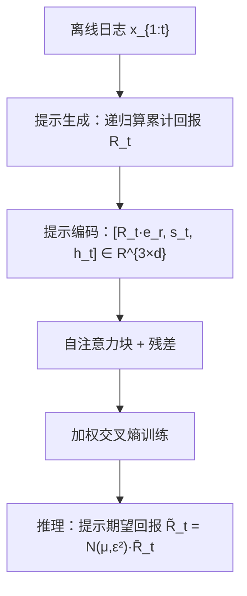

# Rethinking Reinforcement Learning for Recommendation: A Prompt Perspective (反思推荐系统中的强化学习：提示视角)

- **会议/期刊**: SIGIR 2022
- **作者与机构**: Xin Xin、Pengjie Ren、Zhaochun Ren（山东大学），Tiago Pimentel（剑桥大学），Alexandros Karatzoglou（Google Research），Konstantina Christakopoulou（Google）
- **推荐链路定位**: 精排 / 会话级 Next-Item 预测（离线训练范式）
- **研究方向**: 强化学习与动态探索推荐 / 序列与会话推荐
- **论文原文**: [https://arxiv.org/abs/2206.07353v1](https://arxiv.org/abs/2206.07353v1)
- **开源代码**: 暂未开源（论文脚注给出数据与代码的 Google Drive 链接）

## TL;DR (1分钟核心速览)

离线 RL 推荐的核心矛盾是：历史日志由未知行为策略产生，而 Q-learning 需自采探索刷新回放池、IPS 又面临无界高方差。本文提出 PRL，把传统 RL 的「(状态, 动作)→期望回报」映射**反转为「(状态, 累计回报, 步数)→动作」**，用纯监督交叉熵训练，推理时只需提示一个期望回报即可直接生成推荐。在 Challenge15 / RetailRocket 两电商数据集、全库排序协议下，以 GRU/Caser/NItNet/SASRec 四种骨干实例化，购买 HR@5 相对提升最高 +13.0%（GRU）与 +51.2%（Caser，RetailRocket）。

## Background & Motivation (背景与核心矛盾)

- **主流范式**: 以 GRU/Caser/NItNet/SASRec 等序列模型做自回归的 next-item 预测，或叠加 Q-learning（SQN/SAC）、IPS 校正、用户模拟器来引入长期回报目标。
- **前人局限**: ① On-policy/off-policy 方法都要求智能体自身大量在线试错，推荐场景无法承担「错误」的用户体验代价，离线日志又来自异策略分布，Eq.(6) 的 TD 更新天然有偏；② IPS 需估计行为策略 $\beta$ 且方差无界，模型式 RL 受模拟器偏差与状态转移难建模拖累。
- **核心洞察 (Key Insight)**: 离线日志中每一步的累计回报 $R_t$ 是**可精确计算**的，因此历史数据天然可组织成「{状态, 累计回报} → 观测动作」的知识库；把回报当作提示条件输入，就把 RL 的控制问题化归为一个带条件的监督检索问题。
- **本文切入点**: 不做策略评估/策略改进两段式，直接用 prompt 条件化的监督学习替代 Q 值回归与 argmax 选动作。

## Method (核心方法设计)

### 1. 整体框架 (Overall Architecture)

离线训练分三步：首先由日志生成提示元组 $\{R_t, x_{1:t}, t\}$，其中$R_t$为 t 步起的折扣累计回报；随后用任意序列骨干把$x_{1:t}$编码为用户状态$\mathbf{s}_t$，并将回报与步数编码后与之堆叠成$3\times d$的提示矩阵$\mathbf{P}_t$；最后由自注意力块学习「提示→动作」映射，以即时回报加权的交叉熵监督训练。推理阶段不再计算 Q 值，而是把期望回报$\tilde{R}_t$ 作为提示送入模型，直接输出候选物品分布；调节提示回报即可控制推荐目标的激进程度。

### 2. 关键设计拆解 (Key Designs)

1. **提示反转 (State-Reward → Action)**：传统 SR 模型学 $P(x_{t+1}\mid x_{1:t})$，本文学$P(x_{t+1}\mid x_{1:t}, R_t, t)$。累计回报定义为$R_t=\sum_{t'=t}^{|\tau|}\lambda^{t'}r_{t'}$，并利用$R_{t+1}=R_t-\lambda^{t}r_t$递归计算，把朴素$O(|\tau|^2)$降到$O(|\tau|)$。直觉上，回报成为「检索键」，模型学到的是「想要多少回报→应取什么物品」的单调条件映射。
2. **回报与步数的连续编码**：不用离散分桶，而是 $\mathbf{e}_{R_t}=R_t\cdot \mathbf{e}_r$ 做标量缩放，使回报大小关系被连续保持（这是调节 $\mu$能平滑改变推荐的前提）；再加可学习的步嵌入$\mathbf{h}_t$捕获会话内位置效应，最终$\mathbf{P}_t=[\mathbf{e}_{R_t},\mathbf{s}_t,\mathbf{h}_t]$。
3. **自注意力映射与奖励重加权损失**：$\tilde{\mathbf{P}}_t=\mathbf{P}_t+\mathrm{Attention}(W_q\mathbf{P}_t,W_k\mathbf{P}_t,W_v\mathbf{P}_t)$，残差保留原始提示；仅取$\tilde{\mathbf{s}}_t$接全连接层得 logits。损失$\mathcal{L}=-r_t\sum_{i=1}^{n}Y_i\log p_i$，用**即时奖励**而非累计回报加权，避免高方差；训练负采样采用全库 softmax（免负采样），推理时复杂度仅与骨干网络+一次注意力相当，无额外 rollout 开销。

## Experimental Setup & Evaluation Protocol (实验设置与评估协议)

- **数据集与预处理**: 序列长度 <3 或 >50 一律剔除，RetailRocket 另剔除交互 <3 的物品；Challenge15 随机采样 20 万会话。

| 数据集 | #Sequences | #Items | #Clicks | #Purchases | 特征/场景说明 |
| :--- | :---: | :---: | :---: | :---: | :--- |
| Challenge15 | 200,000 | 26,702 | 1,110,965 | 43,946 | RecSys'15 电商点击/购买会话 |
| RetailRocket | 195,523 | 70,852 | 1,176,680 | 57,269 | 浏览=点击，加购=购买 |

- **数据划分与防穿越**: `比例划分` 8:1:1（沿用 SQN 的同一划分以保证可比），无用户级时间戳切分，属离线回放评估。
- **排名评测协议**: `Full-Ranking`，在**全物品集**上对下一时刻真值物品排序；指标 HR@k、NDCG@k（$k=5,10,20$），点击/购买分别统计，重复 3 次取均值，显著性$p<0.1$。
- **对比基线与超参**: 骨干 GRU/Caser/NItNet/SASRec × 训练方式 {Normal, SQN, SAC, PRL} 共 16 组；输入最近 10 个物品，嵌入 $d=64$，batch 256，lr 0.01(Challenge15)/0.005(RetailRocket)；奖励$r_p=1.0$、$r_c=0.2$，推理$\mu=2,\epsilon=0$。

## Key Experimental Results (实验关键数据)

### 1. 主实验对比 (Main Results)

购买（purchase）预测为主指标，全库排序：

| 数据集 | 模型 | HR@5 | NDCG@5 | HR@10 | NDCG@10 |
| :--- | :--- | :---: | :---: | :---: | :---: |
| Challenge15 | GRU | 0.3994 | 0.2824 | 0.5183 | 0.3204 |
| Challenge15 | GRU-SAC | 0.4394 | 0.3154 | 0.5525 | 0.3521 |
| Challenge15 | **GRU-PRL** | **0.4514** | **0.3214** | **0.5673** | **0.3593** |
| Challenge15 | Caser-SAC | 0.4866 | 0.3527 | 0.5914 | 0.3868 |
| Challenge15 | **Caser-PRL** | **0.4938** | **0.3555** | **0.6052** | **0.3920** |
| Challenge15 | SASRec-SAC | 0.4540 | 0.3246 | 0.5701 | 0.3623 |
| Challenge15 | **SASRec-PRL** | **0.4681** | **0.3360** | **0.5927** | **0.3768** |
| RetailRocket | NItNet-SAC | 0.5895 | 0.4985 | 0.6358 | 0.5162 |
| RetailRocket | **NItNet-PRL** | **0.5976** | **0.5095** | **0.6386** | **0.5229** |
| RetailRocket | Caser | 0.3491 | 0.2935 | 0.3857 | 0.3053 |
| RetailRocket | **Caser-PRL** | **0.5277** | **0.4403** | **0.5742** | **0.4554** |

其中 GRU-PRL 相对 GRU 购买 HR@5 提升 `+13.0%`，Caser-PRL 相对 Caser 提升 `+51.2%`（RetailRocket），NItNet-PRL 相对 NItNet 提升 `+6.1%`。

### 2. 消融实验 (Ablation Study)

以 GRU 为骨干（Challenge15）：

| 变体 | 购买 HR@5 | 购买 NDCG@5 | 点击 HR@5 | 点击 NDCG@5 |
| :--- | :---: | :---: | :---: | :---: |
| PRL-mean（均值池化替注意力） | 0.4389 | 0.3128 | 0.2914 | 0.2028 |
| PRL-MLP（MLP 替注意力） | 0.4481 | 0.3198 | 0.2840 | 0.1962 |
| PRL-w/o（无奖励重加权） | 0.4143 | 0.2905 | **0.3135** | **0.2166** |
| PRL-cumu（累计回报重加权） | 0.4026 | 0.2769 | 0.2887 | 0.1984 |
| **PRL（完整）** | **0.4514** | **0.3214** | 0.3027 | 0.2086 |

### 3. 关键实验发现 (Key Findings)

1. **收益集中在高奖励目标**：PRL 的重加权项使购买 HR@5 从 PRL-w/o 的 0.4143 升至 0.4514（+9.0%），但点击 HR@5 反由 0.3135 降至 0.3027——即 PRL 主动牺牲低奖励的点击排序来换取购买排序，这正是奖励驱动目标函数的预期行为，也说明其「可控性」是真实的而非指标噪声。
2. **自注意力映射不可替代**：把注意力块换成均值池化后购买 HR@5 降 2.8%、点击 HR@5 降 3.7%；换成 MLP 在 RetailRocket 购买 HR@5 从 0.5486 暴跌至 0.4890（−10.9%），证明提示三元组之间的交互关系需要 token 级注意力建模，而非简单拼接。
3. **回报提示可调即探索可控**：$\mu$在 Challenge15 上先升后降、在 RetailRocket 上单调下降；$\epsilon$增大在 Challenge15 有害、在 RetailRocket 略有益，提示两个数据集的用户对「高回报 vs 探索多样性」偏好不同，$\epsilon$ 实质上充当可解释的探索旋钮。

## Highlights & Limitations (亮点、对比与审稿批判)

- **与代表作对比 (vs. Prior Work)**: 相较 SQN/SAC（Chen et al.）在监督模型上**并联**一个 Q 学习头、用 Q 值作 actor 的 critic，PRL 彻底移除 Q 网络，把回报前置为输入条件；相较 IPS 类方法规避了行为策略估计与方差爆炸；相较 upside-down RL / Decision Transformer 类序列化 RL，PRL 显式保留会话状态编码器与步嵌入，更贴合推荐的高动态状态与大动作空间。
- **可迁移亮点**: ①「把奖励信号搬进输入侧而非损失输出侧」的条件生成范式，可直接迁移到多目标（GMV/停留时长）可控推荐与多样性可调重排；②用即时奖励而非累计回报做样本重加权，是一条低成本稳定训练经验。
- **审稿级局限批判**: ① 全程仅离线回放评估（8:1:1 比例划分、无时间切分），未做线上 A/B，异策略分布偏移下 Full-Ranking 数字可能偏乐观；② 推理时的期望回报 $\tilde{R}_t$需取训练集该步平均累计回报$\bar{R}_t$，依赖步对齐，冷启动或长尾会话步缺失时难以确定；③ 显著性阈值仅$p<0.1$，且部分格点（如 RetailRocket 上 SASRec-PRL 购买 HR@5 0.5612 略低于 SASRec-SAC 0.5623）并非全面最优。

## Rating (四维评分)

- **方法创新性 (Novelty)**: ⭐⭐⭐⭐ （把 RL 的 state-action→Q 反转为 state-reward→action 的提示式监督，视角新颖且概念简洁，但本质仍是条件监督学习，理论新意有限）
- **评估协议与实验扎实度 (Protocol & Experiments)**: ⭐⭐⭐⭐ （两数据集 × 四骨干 × 四训练范式的全交叉矩阵较完整、全库排序且重复 3 次，但仅 $p<0.1$、缺时间切分与线上验证）
- **写作与数学规范度 (Clarity & Rigor)**: ⭐⭐⭐⭐ （MDP 到离线偏置的推导链条清晰、复杂度从 $O(|\tau|^2)$优化到$O(|\tau|)$ 有交代，但 prompt 与 NLP prompting 的类比略显松散）
- **工业落地与复现价值 (Industrial & Practical Value)**: ⭐⭐⭐⭐ （免负采样全库 softmax、无在线探索、可与任意序列骨干即插即用，训练成本与普通监督模型持平，工程落地门槛低）

