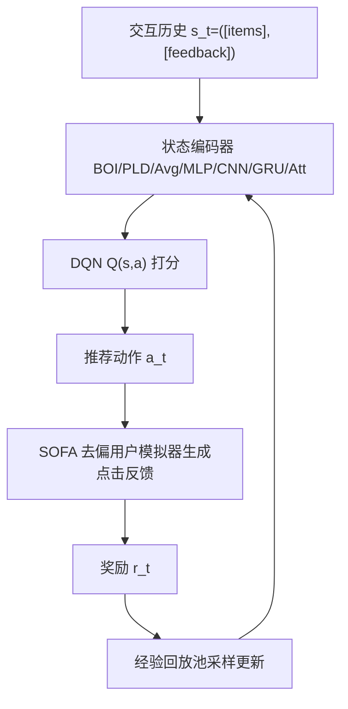
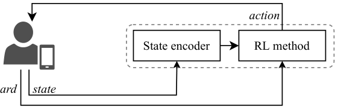

# State Encoders in Reinforcement Learning for Recommendation: A Reproducibility Study (推荐系统强化学习中的状态编码器：一项可复现性研究)

- **会议/期刊**: SIGIR 2022
- **作者与机构**: Jin Huang, Harrie Oosterhuis, Bunyamin Cetinkaya, Thijs Rood, Maarten de Rijke（阿姆斯特丹大学 / Radboud 大学）
- **推荐链路定位**: 端到端在线强化学习决策（状态编码 + DQN 策略）
- **研究方向**: 强化学习与动态探索推荐 / 序列与会话推荐
- **论文原文**: [论文原文链接](https://arxiv.org/abs/2205.04797v2)
- **开源代码**: [开源代码仓库链接](https://github.com/BetsyHJ/RL4Rec)

## TL;DR (1分钟核心速览)

本文针对"注意力状态编码器是 RL4Rec 最优选择"这一结论缺乏稳健性验证的痛点，用**去偏 SOFA 模拟器**、**DQN**（替代 actor-critic）、**7 种状态编码器**与**Coat shopping 新数据集**做系统复现。结论：该发现在 Yahoo! R3 的去偏模拟上成立（注意力累计点击数最高），但在 Coat 数据集上失效——MLP 与 Avg 反而更优，且无单一编码器跨数据集普适，激活函数选择亦显著影响性能。

## Background & Motivation (背景与核心矛盾)

- **主流范式**: RL4Rec 框架由两部分组成——(1) 状态编码器将用户交互历史 $s_t=([i_1..i_t],[f_1..f_t])$编码为稠密向量；(2) RL 方法（DQN 或 actor-critic）基于状态表示预测状态-动作价值$\hat{Q}(s,a)$ 并选择推荐动作，目标最大化 10 轮累计奖励。
- **前人局限**: Liu 等人的开创性比较存在三点局限：(1) 仅用 actor-critic 一种 RL 方法；(2) 仅比较 4 种编码器（DRR-p/u/ave/att）；(3) **评估模拟器直接由有偏日志数据生成**，用户选择偏置（流行度偏置）会污染结论。
- **核心洞察 (Key Insight)**: Huang 等人已指出，未经去偏的模拟器会把日志偏置注入 RL4Rec 模型，导致结论本身失真。因此必须用基于 IPS 的去偏模拟器（SOFA）重新检验；同时 DQN 作为 RL4Rec 中最常用的 RL 方法，仅优化单一目标，结构更简洁，其结论是否与 actor-critic 一致有待验证。
- **本文切入点**: 沿四个维度（去偏模拟器 / 换成 DQN / 增加 3 种编码器 / 换成 Coat 数据集）系统复现与扩展 Liu 等人的比较。

## Method (核心方法设计)

### 1. 整体框架 (Overall Architecture)

系统闭环为：RL4Rec 代理在每一轮 $t$观察状态$s_{t-1}$（历史推荐物品及对应反馈序列）→ 状态编码器输出稠密表示 → DQN 的$\hat{Q}(s,a;\theta)$对所有候选物品打分 → 选取最高分物品推荐 → SOFA 模拟器依据去偏偏好采样用户点击反馈作为奖励$r_t$ → 新交互追加进状态并写入经验回放池 → 定期从回放池采样批量更新行为网络参数，目标网络周期软更新。评估时在由无偏测试集生成的无偏模拟中统计 10 轮累计点击数。

<figure class="paper-figure" markdown="span">
  <figcaption>图1：RL4Rec 的总体框架。</figcaption>
</figure>

### 2. 关键设计拆解 (Key Designs)

1. **去偏 SOFA 模拟器 + IPS 加权（消除选择偏置）**: 痛点在于日志数据被流行度/自选择偏置污染，直接拟合会高估热门物品。SOFA 将观察概率分解为 $P(o_{u,i},y_{u,i})=P(o_{u,i})P(y_{u,i})$，并用 IPS 逆概率加权预测器：
$$\mathbb{E}[\mathcal{L}_{\text{IPS}}]\propto \mathbb{E}\!\left[\frac{\delta(y_{u,i},\hat{y}_{u,i})}{P(o_{u,i}=1)}\right]$$
使每个用户-物品对在期望上等权，从而学到去偏用户偏好矩阵，作为模拟交互的"真值"。

2. **DQN 替代 actor-critic（验证 RL 方法泛化性）**: DQN 只优化单一 Q 目标，用平滑 L1 损失稳梯度：
$$\delta_{\text{TD}}=r_t+\gamma\max_{a}\hat{Q}'(s_t,a;\theta')-\hat{Q}(s_{t-1},a_t;\theta),$$
$$\mathcal{L}(\theta)=\mathbb{E}_{(s,a,r,s')\sim\mathcal{D}}\big[\text{smooth}_{L1}(\delta_{\text{TD}})\big]$$
行为网络参数 $\theta$每步更新，目标网络$\theta'$每 20 步从$\theta$ 复制一次；结合经验回放（池容量 6000）稳定训练。

3. **七种状态编码器对比与训练开销**: 除原 4 种（PLD/BOI/Avg/Att，为隐私去掉用户嵌入改用物品-反馈逐元素积 $\boldsymbol{q}_i\otimes\boldsymbol{f}_i$），新增 MLP（Avg 后接非线性$\sigma$）、CNN（1 卷积 + 1 池化 + 全连接）、GRU（序列建模）三种。注意力编码器定义为 GRU 隐状态上的加权聚合：
$$a_k=\frac{\exp\big((W_A^\top h_t)^\top h_k\big)}{\sum_{k'}\exp\big((W_A^\top h_t)^\top h_{k'}\big)},\quad \hat{Q}=W^\top\!\Big[\sum_k a_k h_k,\,h_t\Big]+b$$
损失采用 Adam 优化，采样策略为经验回放内随机小批量（非硬负采样）。

## Experimental Setup & Evaluation Protocol (实验设置与评估协议)

- **数据集与预处理**: 仅采用同时含"有偏训练集"与"**均匀随机无偏测试集**"的两个公开数据集，可显式支持去偏评估：

| 数据集 | #Users | #Items | 特点 | 训练/评估来源 |
| :--- | :---: | :---: | :---: | :--- |
| Yahoo! R3 | 15,400 | 1,000 | 音乐评分，规模较大 | 有偏训练集建 SOFA 训练模拟；无偏测试集建评估模拟 |
| Coat shopping | 290 | 300 | 服装评分，规模小、购物场景 | 同上 |

- **数据划分与防穿越 (Splitting Strategy)**: 采用**有偏/无偏双集划分**：训练时 SOFA 在**有偏训练集**上经 IPS 学习去偏偏好；评估时在**无偏测试集**生成的独立模拟中在线交互 10 轮，避免穿越。
- **排名评测协议 (Ranking Protocol)**: 非静态排序，而是**在线模拟交互评估**——10 轮推荐后统计**累计点击数**（累计点击数越高越优），每次交互仅推 1 个物品。
- **对比基线与超参设置**: 7 种状态编码器（BOI/PLD/Avg/MLP/CNN/GRU/Att）互相对比；DQN 超参固定（$\gamma=0.9$、$\epsilon$从 0.8 衰减至 0.1、回放池 6000、目标网 20 步更新、Batch 128）；编码器超参按网格调优（学习率$\in\{10^{-5},10^{-4},10^{-3}\}$、嵌入维度$d\in\{16,32,64\}$）。

## Key Experimental Results (实验关键数据)

### 1. 主实验对比 (Main Results)

下表为 10 轮评估模拟的平均累计点击数（数值由原文图 2 曲线近似读取，反映相对排序）：

| 状态编码器 | Yahoo! R3 | Coat shopping | 训练耗时/千步 (Yahoo/Coat, s) |
| :--- | :---: | :---: | :---: |
| BOI | ≈0.90 | ≈1.50 | 9.0 / 6.6 |
| PLD | ≈0.87 | ≈1.75 | 9.6 / 7.0 |
| Avg | ≈1.00 | ≈2.15 | 8.4 / 6.4 |
| MLP | ≈0.93 | **≈2.45** | 9.4 / 6.4 |
| CNN | ≈1.00 | ≈1.75（高方差） | 10.8 / 7.6 |
| GRU | ≈1.10 | ≈1.80 | 26.8 / 23.4 |
| Attention | **≈1.12** | ≈1.85 | 30.4 / 25.4 |

### 2. 消融实验 (Ablation Study)

针对 MLP 的激活函数选择（对应 RQ3）与编码器复杂度影响：

| 配置 | Yahoo! R3 | Coat shopping | 结论 |
| :--- | :---: | :---: | :--- |
| Avg（无激活，基线） | ≈1.00 | ≈2.15 | 低参数、快收敛 |
| MLP-tanh | ≈0.88 | **≈2.45** | Coat 最优 |
| MLP-ReLU | **≈0.97** | ≈2.15 | Yahoo 相对较优 |
| MLP-sigmoid | ≈0.80 | ≈1.70 | 两数据集均最差（梯度消失） |

### 3. 关键实验发现 (Key Findings)

1. **Yahoo! R3 上 Liu 等人结论可复现**：注意力编码器泛化到 DQN 后依然最高（≈1.12，较 Avg 提升约 12%、较 BOI/PLD 提升约 24%），且 GRU 与之接近，证明序列建模比池化更重要。
2. **Coat 数据集结论反转**：注意力（≈1.85）反而**落后于 Avg（≈2.15）与 MLP（≈2.45）**，MLP 较注意力提升约 32%；且注意力训练耗时（Yahoo 30.4s/千步）约为 Avg（8.4s）的 3.6 倍，性价比最低——说明小数据/购物场景下低参数编码器更有效。
3. **激活函数与数据集强耦合**：sigmoid 在两数据集均最差；tanh 在 Coat 最优但 Yahoo 上反不如 ReLU，表明编码器选型必须配合数据规模与场景共同调优。

## Highlights & Limitations (亮点、对比与审稿批判)

- **与代表作对比 (vs. Prior Work)**: 相较 Liu 等人（actor-critic + 无去偏模拟 + 4 编码器 + 单数据集），本文本质是把"编码器最优性"从**有偏、窄设定下的经验结论**升级为**去偏、多设定下的失效边界刻画**；相较 Huang 等人（仅提出 SOFA 去偏模拟器），本文首次将 SOFA 用于状态编码器的可复现性诊断，揭示结论不可跨数据集泛化的硬约束。
- **可迁移亮点**: (1) "去偏模拟器优先于有偏日志模拟"的评测原则可直接迁移至 offline RL 推荐基准构建；(2) 隐私约束下用**反馈嵌入 $\boldsymbol{f}_i$ 替代用户嵌入**构造状态的技巧，可在无 user id 场景复用。
- **审稿级局限批判**: (1) 仅两个可去偏数据集（Yahoo! R3 与 Coat），Coat 用户量仅 290、规模小，MLP 优势可能源于小样本方差而非本质优势；(2) 主实验以**曲线近似**呈现而非精确表值，显著性检验与置信区间报告不足，削弱统计严谨性。

## Rating (四维评分)

- **方法创新性 (Novelty)**: ⭐⭐⭐ （复现/批判性研究属性，方法层面无新算子，但在去偏 + DQN + 新数据集四维度的系统拓展有诊断价值）
- **评估协议与实验扎实度 (Protocol & Experiments)**: ⭐⭐⭐⭐ （采用唯一公开去偏 SOFA 与无偏测试集在线模拟，7 编码器 + 激活函数消融完整，但缺显著性检验与精确表值）
- **写作与数学规范度 (Clarity & Rigor)**: ⭐⭐⭐⭐ （编码器公式与 IPS/DQN 推导清晰，含训练耗时与收敛曲线，符号统一，可读性好）
- **工业落地与复现价值 (Industrial & Practical Value)**: ⭐⭐⭐⭐⭐ （代码全开源、超参完整，"无单一最优编码器、需按数据规模调参"的结论对线上 RL4Rec 选型极具实操指导意义）

