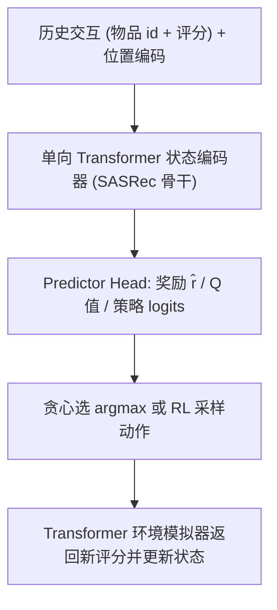
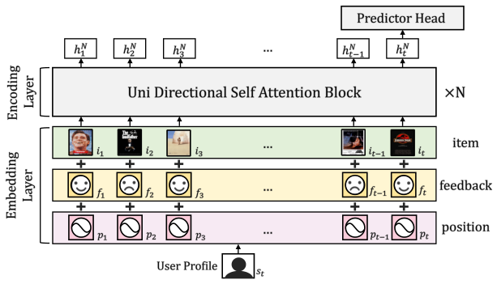
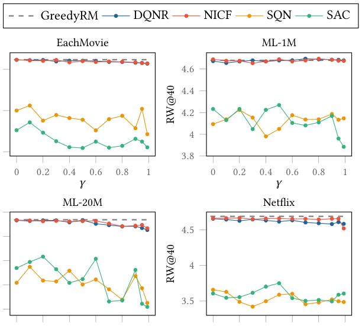

# Towards Validating Long-Term User Feedbacks in Interactive Recommendation Systems (面向交互式推荐系统中长期用户反馈的有效性验证)

- **会议/期刊**: SIGIR 2022 (Short Paper, 5 pages)
- **作者与机构**: Hojoon Lee, Dongyoon Hwang, Kyushik Min (KAKAO Enterprise), Jaegul Choo — KAIST / KAKAO Enterprise
- **推荐链路定位**: 重排 / 交互式序贯决策（端到端会话式推荐策略）
- **研究方向**: 强化学习与动态探索推荐 (rl_bandit_rec) / 工业级评测基准
- **论文原文**: [https://arxiv.org/abs/2308.11137v1](https://arxiv.org/abs/2308.11137v1)
- **开源代码**: 暂未开源（正文承诺将公开）

## TL;DR (1分钟核心速览)

本文质疑"用公共评论数据集 (EachMovie/ML-1M/ML-20M/Netflix) 评测 RL 交互推荐 (IRS) 是否合理"。作者在统一 Transformer 状态编码器下，把 RL 模型与一个仅最大化单步奖励的贪心基线 `GreedyRM`（即 $\gamma=0$的 DQNR）正面对比：`GreedyRM` 在 3/4 数据集上取得最优 `RW@40`、`PR@40`、`RC@40`（如 ML-20M 的 `RW@40` 4.536 vs. DQNR 4.483，+1.18%）；且$\gamma$越大性能越差，beam search$(k=10)$相对 greedy$(k=1)$ 的增益不足 1.6%，说明这些数据集几乎不存在可利用的长期反馈效应。

## Background & Motivation (背景与核心矛盾)

- **主流范式**: 交互式推荐被建模为 MDP $(S,A,R,P,\gamma)$，用 DQN / NICF / SQN / SAC / DDPGR 等 RL 算法最大化累积奖励$\mathbb{E}\big[\sum_{u}\sum_{t} r(s_t^u,a_t^u)\big]$，状态$s_t^u$ 为用户历史交互序列。
- **前人局限**: ① 工业成功案例（Alibaba、TikTok、YouTube）依赖含"停留时长 / LTV"等延迟反馈的私有数据，而学界只能用仅含即时评分（instant rating）的公开评论数据集，二者反馈结构根本不匹配；② 这些数据集若长期效应可忽略，则单步贪心即可最优，RL 的复杂度与调参成本沦为"无源之水"。
- **核心洞察 (Key Insight)**: 若 $r(s_t,a_t)$与未来状态近乎独立，则$Q^\pi(s_t,a)=r(s_t,a)$，即$\gamma=0$ 的退化策略就是最优策略；作者因此可用"贪心 vs. RL"与"贪心 vs. beam search 近似最优策略"两组对比，反向**检验数据集本身的长期效应强度**。
- **本文切入点**: 不做新模型，而是统一架构、对齐超参后做严格的**受控复检 (revisited experiments)**，给出可操作的基准准入流程建议。

## Method (核心方法设计)

### 1. 整体框架 (Overall Architecture)

为排除"性能差异来自骨干网络不同"的干扰，所有模型共享一个 SASRec 式单向 Transformer 状态编码器：将历史物品 $[i_1..i_t]$、反馈（评分）$[f_1..f_t]$与正弦位置编码求和后送入自注意力块得到$[h_1..h_t]$，取末位$h_t$经两层 FC 投影到物品嵌入空间，得到每个候选物品的标量分。**唯一区别在 Predictor Head**：该分在 `GreedyRM` 中是单步奖励$\hat{r}$，在 DQNR/NICF 中是 Q 值，在 SASRec 中为未归一化对数概率，SQN/SAC/DDPGR 则用双头（policy + Q）。训练用 Adam + 梯度裁剪（$\ell_2>5$），$N=2$层、$d=64$、最大序列长度$s=200$、batch 256，学习率与$l_2$ 权重网格搜索。

<figure class="paper-figure" markdown="span">
  <figcaption>图1：推荐模型的统一架构。各模型仅在 Predictor Head 上不同。</figcaption>
</figure>

### 2. 关键设计拆解 (Key Designs)

1. **GreedyRM：把 $\gamma=0$ 当作一等公民基线**：既有 IRS 工作把"考虑未来"当作默认前提，从未报告退化版本。本文定义
$\hat{r}(s_t,a)=\text{Head}(h_t)^\top e_a,\qquad a_t^{\text{greedy}}=\arg\max_{a\in\mathcal{A}}\hat{r}(s_t,a)$，
它与 DQNR 的 Bellman 目标 $Q(s_t,a)=r(s_t,a)+\gamma\max_{a'}Q(s_{t+1},a')$在$\gamma=0$ 时严格等价。直觉：当数据集无长期耦合时，多步 bootstrap 只引入方差与自举偏差，反而降低排序质量。
2. **Transformer 环境模拟器替代 MF 模拟器**：离线评测必须仿真用户反馈，但矩阵分解无法刻画偏好随推荐序列的动态漂移。作者改用与策略网同构的自注意力模拟器预测下一步评分，RMSE 全面优于 MF（EachMovie 1.184 vs. 1.402；Netflix 0.852 vs. 1.073），使"贪心 vs. beam"的比较不被仿真器误差掩盖。
3. **Beam-search 近似最优策略以量化长期效应**：精确最优需搜 $|\mathcal{A}|^{40}$（ML-20M 的$|\mathcal{A}|=18345$），不可行；改用 beam search，$k=1$ 即贪心。定义相对增益
$\rho=\text{RW}_{k=1}/\text{RW}_{k=10}$，
$\rho\to 1$即证明"看得更远毫无收益"。训练目标为各模型原始损失（回归/策略梯度/PG），负采样沿用户历史内交互（NICF）或全库打分，推理为单次前向$O(|\mathcal{A}|d)$，无额外在线开销。

## Experimental Setup & Evaluation Protocol (实验设置与评估协议)

- **数据集与预处理**: 遵循 5-core 过滤（用户与物品至少 5 次交互），交互按用户分组并按时间戳排序：

| 数据集 | #Users | #Items | #Interactions | Avg.Int | 特征/场景说明 |
| :--- | :---: | :---: | :---: | :---: | :--- |
| EachMovie | 56,071 | 1,613 | 2,798,088 | 49.90 | 显式 5 分制评分 |
| ML-1M | 6,040 | 3,416 | 999,611 | 165.50 | 显式评分 |
| ML-20M | 138,493 | 18,345 | 19,984,024 | 144.30 | 大规模、动作空间最大 |
| Netflix | 472,987 | 17,769 | 100,461,928 | 212.40 | 最大规模、最稠密 |

- **数据划分与防穿越 (Splitting Strategy)**: **用户级划分**（85% 用户训练 / 5% 验证 / 10% 测试），而非时间戳切分；测试用户先用前 40 步真实历史构建画像，再在模拟器中交互推演 40 步（$T=40$）。
- **排名评测协议 (Ranking Protocol)**: 全库动作空间**全量打分**（非采样），指标为 `RW@40`（累计奖励 / T）、`PR@40`、`RC@40`；正例判定依赖模拟器预测评分阈值（EachMovie >5 分制 5 点、其余 >4 点）。所有结果为 **10 个随机种子均值**。
- **对比基线与超参设置**: Random / POP / SASRec / DQNR / NICF / SQN / SAC / DDPGR，$d=64$、$N=2$、$\gamma=0.95$；RL 基线按原文细节重实现。

## Key Experimental Results (实验关键数据)

### 1. 主实验对比 (Main Results)

| 方法 | EachMovie RW@40 | EachMovie PR@40 | ML-1M RW@40 | ML-1M PR@40 | ML-20M RW@40 | ML-20M PR@40 | Netflix RW@40 | Netflix PR@40 |
| :--- | :---: | :---: | :---: | :---: | :---: | :---: | :---: | :---: |
| Random | 3.167 | 0.0203 | 3.241 | 0.0900 | 2.885 | 0.0450 | 2.949 | 0.0668 |
| POP | 4.021 | 0.0723 | 4.353 | 0.8521 | 4.002 | 0.5445 | 3.680 | 0.3757 |
| SASRec | 3.449 | 0.0872 | 3.879 | 0.5243 | 3.455 | 0.2235 | 3.648 | 0.3399 |
| DQNR | 5.079 | 0.6420 | **4.689** | **0.9950** | 4.483 | 0.9475 | 4.608 | 0.9530 |
| NICF | 5.075 | 0.6289 | 4.677 | 0.9947 | 4.478 | 0.9421 | 4.655 | 0.9548 |
| SQN | 4.521 | 0.3734 | 4.134 | 0.6285 | 3.973 | 0.5048 | 3.497 | 0.2374 |
| SAC | 4.225 | 0.1104 | 3.961 | 0.4943 | 3.845 | 0.4047 | 3.589 | 0.2601 |
| **GreedyRM (ours)** | **5.116** | **0.6690** | 4.680 | 0.9948 | **4.536** | **0.9712** | **4.689** | **0.9596** |
| *Improv.% vs. best RL* | *+0.73%* | *+4.20%* | *-0.19%* | *-0.02%* | *+1.18%* | *+2.50%* | *+0.73%* | *+0.50%* |

### 2. 消融实验 (Ablation Study)

折扣因子 $\gamma$消融（DQNR 调$\gamma$，其余超参固定）与 beam 近似最优策略对比：

| 配置 | EachMovie | ML-1M | ML-20M | Netflix | 结论 |
| :--- | :---: | :---: | :---: | :---: | :--- |
| DQNR ($\gamma=0.95$) | 5.079 | 4.689 | 4.483 | 4.608 | 基线 |
| DQNR 退化为 $\gamma=0$ (=GreedyRM) | 5.116 | 4.680 | 4.536 | 4.689 | 多数数据集反升 |
| $\gamma$ 从 0 扫至 0.99 | 单调下降 | 单调下降 | 单调下降 | 单调下降 | 未来权重≈噪声 |
| $\rho=\text{RW}_{k=1}/\text{RW}_{k=10}$ | 0.9960 | 0.9844 | 0.9981 | 0.9974 | 长期收益 ≤1.6% |

<figure class="paper-figure" markdown="span">
  <figcaption>图2：不同折扣因子𝛾下基于RL的推荐模型性能比较。</figcaption>
</figure>

### 3. 关键实验发现 (Key Findings)

1. **贪心基线正面击败 SOTA RL**：`GreedyRM` 在 EachMovie / ML-20M / Netflix 三库的全部 $3\times3$指标上均为最优，ML-20M 上 `RW@40` +1.18%、`PR@40` +2.50%；仅在 ML-1M 上以 0.19% 之差略逊 DQNR，而这正是唯一$\rho$ 偏离 1 更明显的库（0.9844），说明性能差异与"数据集是否真有长期效应"高度一致。
2. **$\gamma$越大越差**：图 2 显示 DQNR/NICF/SQN/SAC 随$\gamma\in[0,1)$ 递增时 `RW@40` 单调下降，说明多步 bootstrap 在这些数据集上引入的是方差与自举偏差而非有效长期信号，与"未来奖励可被折扣因子加权利用"的常规假设相反。
3. **近似最优策略证明长期效应可忽略**：beam search $(k=10)$相对贪心$(k=1)$ 的增益在 3/4 数据集上不足 0.4%（EachMovie 0.9960、ML-20M 0.9981、Netflix 0.9974），即"穷尽未来"带来的上界提升几乎为零；同时 SQN/SAC 因联合优化 next-item 预测而显著劣化（Netflix `RW@40` 3.497 vs. 4.689），佐证任务耦合亦非解药。

## Highlights & Limitations (亮点、对比与审稿批判)

- **与代表作对比 (vs. Prior Work)**: 相较 DQNR/NICF（把 $\gamma=0.95$ 的多步 Q 学习当作默认最优解），本文指出其收益来自状态编码器与全库打分而非多步规划；相较 SASRec（监督式 next-item，Netflix `RW@40` 3.648）与 SQN/SAC（联合预测+价值）等序列/RL 基线，本文用严格同构骨干证明"目标函数退化到单步"反而更好，方法论上更接近一篇**评测基准的证伪性研究**。
- **可迁移亮点**: ① 把 $\gamma=0$贪心解作为**任何 RL 推荐论文的强制 baseline**，成本几乎为零却能暴露数据集缺陷；② 用 beam search 的$k=1$vs$k=10$比值$\rho$ 作为**数据集长期效应探针**，可迁移到短视频、电商复购等场景的数据可用性预检。
- **审稿级局限批判**: ① 结论依赖 Transformer 模拟器——评测目标是"仿真反馈"而非真实用户，模拟器本身的偏差（RMSE 0.83–1.18）可能同时压低贪心与 beam 的差距，存在自证循环风险；② beam 宽度仅取 $\{1,10\}$，且受动作空间限制，对"弱但存在"的长期效应灵敏度不足；③ 仅覆盖评分型评论数据集，对含停留时长/退货等真实延迟反馈的工业场景外推力有限，也未给出缓解方案（如合成长期反馈、半合成仿真器）。

## Rating (四维评分)

- **方法创新性 (Novelty)**: ⭐⭐⭐ （无新模型，但"用 $\gamma=0$与 beam-$\rho$ 反向证伪数据集长期效应"的实验设计视角新颖且具警示价值）
- **评估协议与实验扎实度 (Protocol & Experiments)**: ⭐⭐⭐⭐ （统一骨干 + 10 种子 + 4 数据集 + 全库打分 + $\gamma$ 扫描 + beam 近似最优，控制变量非常干净；扣分在模拟器自证与 beam 宽度过窄）
- **写作与数学规范度 (Clarity & Rigor)**: ⭐⭐⭐⭐ （MDP 定义与 $\gamma=0$ 等价性论证简洁清晰、图表自洽；但对模拟器训练细节与 beam 打分函数披露偏少）
- **工业落地与复现价值 (Industrial & Practical Value)**: ⭐⭐⭐⭐ （"先做数据集长期效应体检、再上 RL"的流程建议可直接落地，贪心基线零成本；代码当时未公开略降复现便利性）

