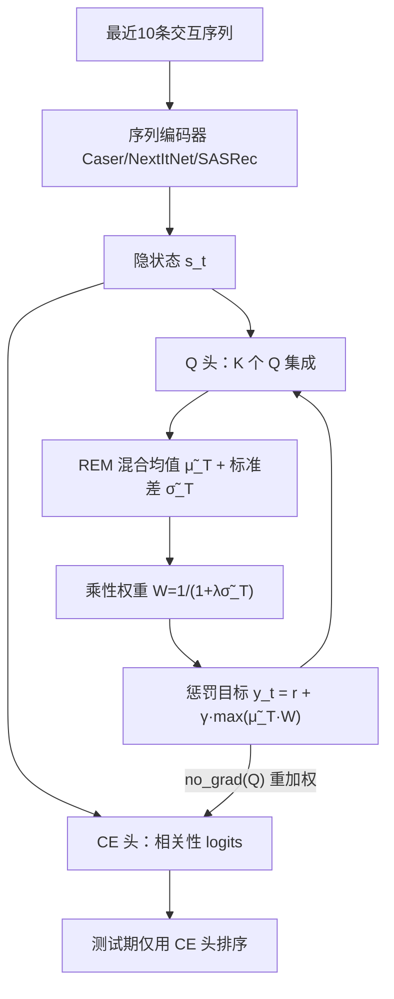
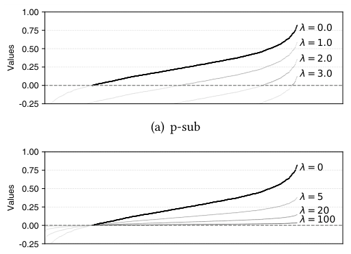

# Value Penalized Q-Learning for Recommender Systems (价值惩罚 Q 学习：面向推荐系统的不确定性离线强化学习)

- **会议/期刊**: SIGIR 2022 (Short Paper, 5 页)
- **作者与机构**: Chengqian Gao、Xueqian Wang、Bo Yuan (清华深圳)；Ke Xu、Lanqing Li、Peilin Zhao (腾讯 AI Lab)；Kuangqi Zhou (新加坡国立大学)
- **推荐链路定位**: 精排 / 重排（作为经典序列推荐模型的增益插件，测试期仍走 CE 头输出）
- **研究方向**: 强化学习与动态探索推荐 / 序列与会话推荐
- **论文原文**: [https://arxiv.org/abs/2110.07923v2](https://arxiv.org/abs/2110.07923v2)
- **开源代码**: [Google Drive 代码目录](https://drive.google.com/drive/folders/1i3E1QTkscyoCAXRH28OxNLpbJeH19sSm)（非 GitHub 仓库，复现成本较高）

## TL;DR (1分钟核心速览)

离线 RL 用于推荐时，万级物品的动作空间放大了 OOD 动作的 Q 值过估计，而现有保守化方法要么依赖难以估计的行为策略（CQL），要么是减性惩罚（p-sub）易把目标压成负数。本文提出 VPQ：用 K 个随机学习率的 Q 集成标准差 $\tilde\sigma_T$作为不确定性，构造乘性权重$W=1/(1+\lambda\tilde\sigma_T)$ 作用于 Bellman 目标的 max 项，并以 critic 框架（CE 头 + Q 头重加权）兼容传统序列模型。在 Retailrocket 与 Yoochoose 上对 Caser/NextItNet/SASRec 三种底座，8 项指标总和相对提升 6.73%/6.64%/9.44%。

## Background & Motivation (背景与核心矛盾)

- **主流范式**: 以 SASRec/Caser 等序列模型估计状态 $s_t$（最近 10 个交互映射为隐状态），再用 Q-learning 回归折扣累计奖励，把"相关性排序"升级为"长期价值排序"。
- **前人局限一（动作空间爆炸）**: 候选物品常超 10k，静态日志只覆盖极小子集，$\max_a$算子会对未记录动作给出高估的 Q 值；而 CQL/MOPO 类方法需要显式估计行为策略$\mu(a|s)$，在万级动作空间中几乎不可行。
- **前人局限二（惩罚方式失当）**: 主流不确定性方法用减性惩罚 $Q-\lambda\,\mathrm{Unc}$，当动作维度$n$增大时$C_0$增大，必须调大$\lambda$ 才能压住高估，却极易把 Q 目标推成负数，训练震荡。
- **核心洞察 (Key Insight)**: 若把 OOD 动作的预测视为 $x_i\sim\mathcal{N}(\mu,\sigma^2)$，则$\mathbb{E}[\max_i x_i]\approx\mu+\sigma C_0$（$C_0=\Phi^{-1}(\cdot)$随$n$单调增）；减性形式给出$\mu+(C_0-\lambda)\sigma$（可负），乘性形式给出$\frac{1}{1+\lambda\sigma}(\mu+\sigma C_0)$（恒正且对大值惩罚更重）。
- **本文切入点**: 把不确定性从"减"改成"乘"，等价于给折扣因子乘上一个数据自适应的 $\gamma W$，既免去行为策略估计，又天然适配大动作空间。

## Method (核心方法设计)

### 1. 整体框架 (Overall Architecture)

输入为用户最近 10 条交互的物品 ID 序列，经经典序列编码器（Caser / NextItNet / SASRec）得到隐状态 $s_t$；随后分成两个头：CE 头输出全库排序 logits，Q 头输出各候选的长期价值。训练时 Q 头由 VPQ 目标驱动——K 个 Q 网络经随机集成混合（REM）得到混合均值$\tilde\mu_T$与标准差$\tilde\sigma_T$，据此构造乘性惩罚目标$y_t$；CE 头则用 no-gradient 的 Q 值对交叉熵重加权，实现"相关性 × 价值"的软耦合。测试阶段**只使用 CE 头**，Q 头仅作为训练期 critic 提供价值梯度，因此不增加线上推理开销。

### 2. 关键设计拆解 (Key Designs)

1. **$p$-mul 乘性不确定性惩罚（核心增量）**：痛点如上，减性惩罚在大动作空间下要么欠惩罚要么越界为负。本文改为
$y_t=r+\gamma\max_a\big[\tilde\mu_T(s_{t+1},a)\cdot W(s_{t+1},a)\big],\quad W=\frac{1}{1+\lambda\tilde\sigma_T(s_{t+1},a)}$。
物理直觉：$W$是"预测可信度折扣"，对既大又飘的预测施加双重压制（大值乘小权重），而小值目标只会被温和收缩、永不翻负；此外$\gamma W$可被吸收进折扣因子，等价于按不确定性动态缩短有效规划视野，直接缩小收敛界$\frac{2\gamma W}{(1-\gamma W)^2}C^{\Pi,\mu}$ 中的集中度系数。

2. **REM 集成方差作为不确定性量化 + 免行为策略约束**：K 个 Q 网络配不同随机学习率采样，每次从 $P_\Delta$采混合权重$\alpha_k$，目标均值$\tilde\mu_T=\sum_k\alpha_k Q_{\theta^T_k}$、不确定性$\tilde\sigma_T=\mathrm{SD}(\{Q_{\theta^T_k}\})$。相比 CQL 需要采样估计$\log\sum_a\exp Q-\mathbb{E}_{\mu}[Q]$、UWAC 需要行为策略密度比，本方案只做前向集成，成本随$K$线性增加而与$|\mathcal{A}|$ 无关——这正是万级物品场景的可用性来源。

3. **Critic 框架与训练目标（相关性 vs 价值解耦）**：纯 $\arg\max_a Q$ 会推荐"高价值但不相关"的物品（消融中 Q-only 全面垫底）。本文保留序列模型为 actor，Q 仅做加权：
$\mathcal{L}_\phi=\mathrm{CE}(s_t,a_t)\cdot\mathrm{no\_grad}\big(Q(s_t,a_t)\big)$，Q 侧损失为$\mathcal{L}_\theta=\tfrac12\big(y_t-\sum_k\alpha_k Q_{\theta_k}(s_t,a_t)\big)^2$。奖励设为购买$r=1.0$、点击$r=0.2$，$K$ 路集成 + 全批量随机混合，**无需负采样**，推理期零额外开销。

<figure class="paper-figure" markdown="span">
  <figcaption>图1：以不同方式惩罚模拟的不稳定预测。粗黑线为从高斯分布中采样并按值排序的密集点。缩放因子 λ 控制惩罚强度。</figcaption>
</figure>

## Experimental Setup & Evaluation Protocol (实验设置与评估协议)

- **数据集与预处理**: 沿用 Xin et al. 的处理流程，数据集本身为电商/会话日志；原文正文未给出用户/物品/交互数统计（短篇幅所致），下表仅标注可得信息：

| 数据集 | #Users | #Items | #Interactions | 稀疏度/密度 | 特征/场景说明 |
| :--- | :---: | :---: | :---: | :---: | :--- |
| Retailrocket | 原文未报告 | 原文未报告 | 原文未报告 | 原文未报告 | 电商行为（浏览/加购/购买），双目标评估 purchase 与 click |
| Yoochoose | 原文未报告 | 原文未报告 | 原文未报告 | 原文未报告 | RecSys'15 会话点击流，双目标评估 purchase 与 click |

- **数据划分与防穿越 (Splitting Strategy)**: 按 Xin et al. 的**全局时间戳切分**序列范式（历史序列前推、末段作测试），序列长度取最近 10 条交互映射为 $s_t$；未见显式 Leave-One-Out 声明。
- **排名评测协议 (Ranking Protocol)**: 未明确披露候选池规模与负采样比例，从 HR@20/NDCG@20 与参数量级推断为**全库/大候选集 Top-20 排序**；指标对点击与购买分别统计，如 $\mathrm{HR}^{(click)}=\#\text{hits among clicks}/\#\text{clicks}$。**这是本文可复现性上的主要短板**。
- **对比基线与超参设置**: 底座 Caser / NextItNet / SASRec；基线 SAC（在线 RL）、REM（随机集成混合，无显式惩罚）、Minus（$p$-sub 减性惩罚）、CQL、UWAC，全部嵌入同一 critic 框架以隔离算法差异。$\lambda_{VPQ}=20$，Minus 的$\lambda$、CQL 的$\alpha$、UWAC 的$\beta$逐数据集网格搜索；结果取 5 次运行均值（未报告显著性检验$p$ 值）。

## Key Experimental Results (实验关键数据)

### 1. 主实验对比 (Main Results)

| 模型 | Retail Purch. HR@20 | Retail Purch. NDCG@20 | Yoo Purch. HR@20 | Yoo Purch. NDCG@20 | Total (8指标和) | Improv.% |
| :--- | :---: | :---: | :---: | :---: | :---: | :---: |
| Caser | 0.4226 | 0.3076 | 0.6607 | 0.3911 | 2.9665 | — |
| Caser-SAC | 0.4617 | 0.3336 | 0.6889 | 0.4173 | 3.0991 | +4.47 |
| Caser-REM | 0.4711 | 0.3390 | 0.6916 | 0.4216 | 3.1184 | +5.12 |
| Caser-Minus (p-sub) | 0.4618 | 0.3325 | 0.7029 | 0.4330 | 3.1124 | +4.92 |
| Caser-CQL | 0.4699 | 0.3376 | 0.6705 | 0.4008 | 3.0970 | +4.40 |
| **Caser-VPQ** | **0.4775** | **0.3454** | **0.7081** | **0.4350** | **3.1661** | **+6.73** |
| NextItNet | 0.6564 | 0.4961 | 0.5934 | 0.3352 | 3.3922 | — |
| Next-SAC | 0.6741 | 0.5354 | 0.5899 | 0.3383 | 3.4186 | +0.78 |
| Next-REM | 0.6839 | 0.5387 | 0.6025 | 0.3509 | 3.4812 | +2.62 |
| Next-CQL | 0.6845 | 0.5399 | 0.6073 | 0.3509 | 3.4901 | +2.89 |
| Next-UWAC | 0.6840 | 0.5310 | 0.6155 | 0.3583 | 3.5102 | +3.48 |
| **Next-VPQ** | **0.6990** | **0.5714** | **0.6226** | **0.3672** | **3.6175** | **+6.64** |
| SASRec | 0.6387 | 0.4599 | 0.6630 | 0.3733 | 3.4861 | — |
| SASRec-CQL | 0.7046 | 0.5599 | 0.6631 | 0.3805 | 3.6997 | +6.12 |
| SASRec-UWAC | 0.6657 | 0.5015 | 0.6786 | 0.3959 | 3.6475 | +4.63 |
| **SASRec-VPQ** | **0.7171** | **0.5914** | **0.6841** | **0.4063** | **3.8153** | **+9.44** |

### 2. 消融实验 (Ablation Study)

以 NextItNet 为底座，比较 Q 值的四种使用方式（图 2）：

| 设置 | Retail HR@20 (Purch.) | Retail NDCG@20 (Purch.) | Retail HR@20 (Click) | Yoo HR@20 (Purch.) | Yoo NDCG@20 (Purch.) |
| :--- | :---: | :---: | :---: | :---: | :---: |
| Q-only（纯价值 $\arg\max Q$） | 0.5679 | 0.3826 | 0.2945 | 0.5850 | 0.3103 |
| CE（原模型，纯相关性） | 0.6564 | 0.4961 | 0.3329 | 0.5934 | 0.3352 |
| Q-aux（TD 误差仅作辅助任务） | 0.6877 | 0.5221 | 0.3516 | 0.5933 | 0.3369 |
| **Q-critic（本文）** | **0.6990** | **0.5714** | **0.3556** | **0.6226** | **0.3672** |

### 3. 关键实验发现 (Key Findings)

1. **乘性惩罚优于减性惩罚，且优势随动作空间增大而扩大**：Caser-Minus 在 Yoochoose 点击上 HR@20 达 0.7029 已略高于 Caser-VPQ 的 0.7081 附近水平，但 Total 仅 3.1124（+4.92%）低于 VPQ 的 3.1661（+6.73%）；说明 p-sub 靠调大 $\lambda$ 换取局部指标时，会在其他指标上付出代价，而 p-mul 给出更均衡的整体最优。
2. **增益来自"更好表征"与"更准价值"两部分，不可互相替代**：Q-aux 单独把 Retail 的 HR@20 从 0.6564 提升到 0.6877（+3.1pt），Q-critic 再叠加价值重加权到 0.6990（再 +1.1pt），而纯 Q-only 反而跌到 0.5679——证明了相关性约束不可省略、RL 只应作为 critic 而非 actor。
3. **超参 $\lambda$存在清晰的单峰区间且跨数据集稳健**：$\lambda=20$在 Yoochoose 与 Retailrocket、三种底座上同时取到最优；$\lambda\to0$时 VPQ 退化为无惩罚的 REM（HR 降至 REM 水平约 0.68/0.60），$\lambda$ 过大则退化为只看即时奖励，验证了"不确定性折扣 = 有效视野调节"的解释。

## Highlights & Limitations (亮点、对比与审稿批判)

- **与代表作对比 (vs. Prior Work)**: 与 CQL 相比，VPQ 完全绕开行为策略与 $\log\sum\exp$的全动作枚举，计算复杂度与$|\mathcal{A}|$ 解耦；与 REM 相比，多了显式不确定性权重，把"集成"从方差缩减手段升级为保守性信号；与 UWAC 相比，UWAC 依赖行为密度比且在本实验中甚至劣于原模型（Caser-UWAC 仅 -2.60%），说明密度比估计在推荐的高维动作空间中确实不可靠。与 Xin et al. 的 critic 框架相比，本文的核心增量正是替换其在线 SAC 为离线不确定性保守目标。
- **可迁移亮点**: (1) "$p$-mul 乘性惩罚 + 集成标准差"这一组合可直接移植到任何含$\max$ 算子的离线价值估计场景（如长序列 DQN 重排、bandit 中的候选打分），且天然保证目标非负；(2) "Q 头训练、CE 头服役"的 critic 解耦范式，可让线上零延迟地享受离线 RL 收益，非常适合工业精排。
- **审稿级局限批判**: (1) 作为 5 页短文，实验协议披露严重不足——未给数据集统计、候选池规模、负采样策略与显著性检验，HR/NDCG 是否全库排序也无从判断，复现难度高；(2) $K$个 Q 网络的集成把训练成本放大$K$倍，且对$\lambda$敏感（最优值恰在扫描区间端点附近），在真实非稳态动态下$W$ 的时效性未做验证；(3) 仅在两个中小规模数据集与 Top-20 指标上验证，缺少工业级 A/B 与长期留存/LTV 证据，难以支撑"提升长期满意度"的核心主张。

## Rating (四维评分)

- **方法创新性 (Novelty)**: ⭐⭐⭐⭐ （把不确定性从减性改为乘性并结合 $\gamma W$ 有效视野解释，理论推导虽为高斯近似却给出了非负性与大值重罚两条硬性质，思路干净）
- **评估协议与实验扎实度 (Protocol & Experiments)**: ⭐⭐⭐ （三底座 × 两数据集 × 双目标共 8 指标覆盖全面，消融设计清晰，但划分/候选池/负采样/显著性检验均未披露）
- **写作与数学规范度 (Clarity & Rigor)**: ⭐⭐⭐⭐ （$p$-sub 与$p$-mul 的期望对比推导直观有力，算法伪代码完整；不足是高斯 i.i.d. 假设与推荐中强相关的 Q 值分布存在偏差）
- **工业落地与复现价值 (Industrial & Practical Value)**: ⭐⭐⭐⭐ （推理期零额外开销、免行为策略估计、即插即用兼容任意序列模型，落地友好；扣分在于代码仅托管于 Google Drive 且训练需 $K$ 倍集成开销）

