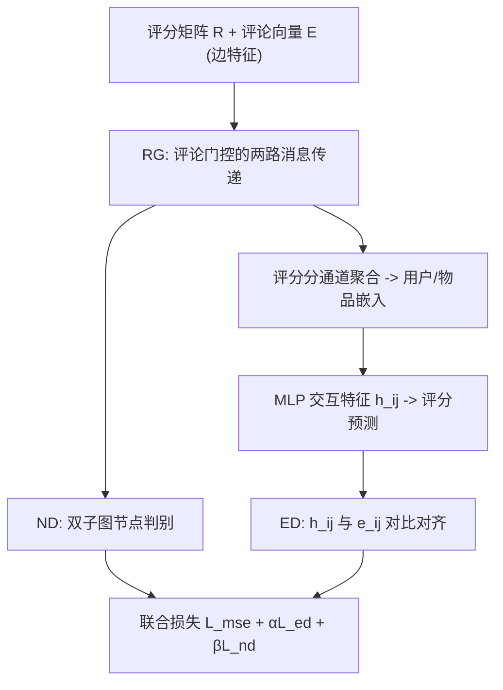
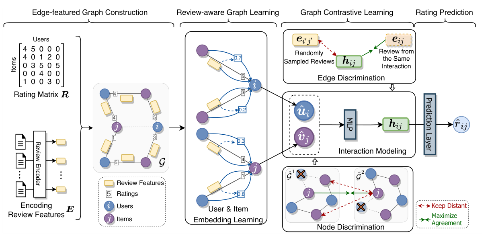
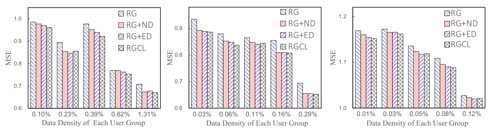

# A Review-aware Graph Contrastive Learning Framework for Recommendation (评论感知图对比学习推荐框架)

- **会议/期刊**: SIGIR 2022
- **作者与机构**: Jie Shuai, Kun Zhang, Le Wu(通讯), Peijie Sun, Richang Hong, Meng Wang (合肥工业大学 大数据知识工程重点实验室)；Yong Li (清华大学电子工程系)
- **推荐链路定位**: 精排（评分预测 / 用户-物品交互建模）
- **研究方向**: 自监督对比学习与交互去噪 / 图神经网络与知识图谱推荐
- **论文原文**: [https://arxiv.org/abs/2204.12063v4](https://arxiv.org/abs/2204.12063v4)
- **开源代码**: 暂未开源

## TL;DR (1分钟核心速览)

现有评论增强推荐把评论当作"附加文本"：要么堆历史评论做用户/物品向量（粒度粗），要么只在训练期用目标评论做近似蒸馏（推理期不可见、且忽略图结构）。本文把每条交互的**评分 + BERT-Whitening 评论向量**作为边特征，构建评论感知二部图，让评论去调制邻居消息与自环消息的两路权重（RG），再叠加**节点判别 (ND)** 与**边判别 (ED)** 两个自监督对比任务，分别强化嵌入学习与交互建模。在 5 个 Amazon/Yelp 5-core 数据集、80/10/10 随机划分、MSE 协议下，Digital_Music 上相对最优基线 RMG 降低 4.2% MSE。

## Background & Motivation (背景与核心矛盾)

- **主流范式**: 评论增强推荐分两派——历史评论派（DeepCoNN/NARRE/DAML 用 TextCNN+注意力聚合用户/物品文档）与目标评论派（TransNets/SDNet 在训练期用目标评论特征约束交互特征）。
- **前人局限**: (1) 历史评论用法粒度过粗，评论只作为节点描述，无法刻画"该用户对该物品"的细粒度偏好；(2) 目标评论派丢失了自然的用户-物品二部图结构，且目标评论在推理期不可得，只能靠蒸馏/对抗近似，信号易失真。
- **核心洞察 (Key Insight)**: 每条评论本质是**一条边上**的语义，天然可做"边特征"；同一条评论既能指示该邻居对中心节点的影响强度（如"价格贵"评论对价格敏感用户权重大），也能作为交互建模的语义监督目标。
- **本文切入点**: 把评论塞进图卷积的**权重算子**而非节点输入，并用评论-交互一致性构造自监督信号，绕开"用户行为稀疏"的标签瓶颈。

## Method (核心方法设计)

### 1. 整体框架 (Overall Architecture)

输入为用户-物品评分矩阵与逐条评论向量，构成边特征图 $\mathcal{G}=<\mathcal{U}\cup\mathcal{V},\mathcal{E}>$。RG 模块在每层消息传递中用评论向量$\boldsymbol{e}_{ij}$学出两个标量门控，分别加权"评论自身消息"与"邻居节点消息"，按评分类型分通道聚合成用户/物品嵌入；随后 MLP 将嵌入对映射为交互特征$\boldsymbol{h}_{ij}$并线性打分。训练侧并行三个目标：MSE 主任务、边判别 ED（$\boldsymbol{h}_{ij}$ 与对应评论对齐）、节点判别 ND（两个节点丢弃子图中的同一节点表征互为正样本），推理侧仅需 RG + MLP，无评论输入。

<figure class="paper-figure" markdown="span">
  <figcaption>图2：Review-aware Graph Contrastive Learning 框架的架构。</figcaption>
</figure>

### 2. 关键设计拆解 (Key Designs)

1. **评论门控的消息传递 (Review-aware Message Passing)**：痛点是 GCN 式聚合对所有邻居一视同仁，且评论信息只能进节点。本文用评论向量同时学两个 sigmoid 门控，一路控制"评论语义消息"，一路控制"邻居嵌入消息"，并按评分 $r$ 分配独立参数矩阵：

$$\boldsymbol{x}_{r;j\to i}^{(l)}=\frac{\sigma(\boldsymbol{w}_{r,1}^{(l)\top}\boldsymbol{e}_{ij})\boldsymbol{W}_{r,1}^{(l)}\boldsymbol{e}_{ij}+\sigma(\boldsymbol{w}_{r,2}^{(l)\top}\boldsymbol{e}_{ij})\boldsymbol{W}_{r,2}^{(l)}\boldsymbol{v}_{j}^{(l-1)}}{\sqrt{|\mathcal{N}_j||\mathcal{N}_i|}}$$

   直觉：门控由"这条评论写了什么"决定，因此噪声评论（如"包装破损"）对偏好建模的权重被自动压低，等价于一次软性的边级去噪；评分分通道则保留 1–5 星的语义差异。

2. **边判别 ED (Edge Discrimination)**：痛点是目标评论在推理期缺失，TransNets/SDNet 的对齐是欧氏/GAN 蒸馏，只约束分布不约束判别性。ED 直接把交互特征 $\boldsymbol{h}_{ij}$当锚点、对应评论$\boldsymbol{e}_{ij}$当正样本、随机采样的$\boldsymbol{e}_{i'j'}$ 当负样本做 InfoNCE 式判别：

$$\mathcal{L}_{ed}=-\mathbb{E}_{\mathcal{E}}\big[\log F(\boldsymbol{h}_{ij},\boldsymbol{e}_{ij})\big]+\mathbb{E}_{\mathcal{E}\times\mathcal{E}'}\big[\log F(\boldsymbol{h}_{ij},\boldsymbol{e}_{i'j'})\big],\quad F(\boldsymbol{a},\boldsymbol{b})=\sigma(\boldsymbol{a}^{\top}\boldsymbol{W}\boldsymbol{b})$$

   负采样取全训练集随机评论（作者验证"同用户/同物品评论作负样本"无差异），说明该任务学到的是细粒度语义匹配而非共现捷径。

3. **节点判别 ND 与训练目标**：用节点丢弃（概率 $\rho$）生成两个子图，同一节点在两子图的表征互为正样本、不同节点为负样本，$\mathcal{L}_{nd}=\mathcal{L}^{user}_{nd}+\mathcal{L}^{item}_{nd}$，形式同上式但以$\hat{\boldsymbol{u}}_i^{1}$为锚点。总损失$\mathcal{L}=\mathcal{L}_{mse}+\alpha\mathcal{L}_{ed}+\beta\mathcal{L}_{nd}$。评论编码器**冻结**（BERT-Whitening，$d=64$），无需负采样即无额外在线开销；推理只跑 1 层 GCN + 2 层 MLP。

## Experimental Setup & Evaluation Protocol (实验设置与评估协议)

- **数据集与预处理**: 四个 Amazon 域 + Yelp，均按 `5-core` 过滤（用户与物品评论数 ≥5），评分为 1–5 整数：

| 数据集 | #Users | #Items | #Reviews | 稀疏度/密度 | 特征/场景说明 |
| :--- | :---: | :---: | :---: | :---: | :--- |
| Digital_Music | 5,541 | 3,568 | 64,706 | 0.330% | Amazon 乐器/数字音乐 |
| Toys_and_Games | 19,412 | 11,924 | 167,597 | 0.072% | Amazon 玩具 |
| Clothing | 39,387 | 23,033 | 278,677 | 0.031% | Amazon 服饰(含尺码/面料评论) |
| CDs_and_Vinyl | 75,258 | 64,443 | 1,097,592 | 0.023% | Amazon 唱片,最稀疏 |
| Yelp | 8,423 | 3,742 | 88,647 | 0.281% | 凤凰城餐饮评论 |

- **数据划分与防穿越 (Splitting Strategy)**: `比例划分` —— 每条交互随机 80%/10%/10% 切分为 train/valid/test，重复 5 次取 mean(±std)。**注意**：随机划分在评分预测任务下允许同一用户的其它交互进入训练集，属于"随机切分"而非时间切分，无未来信息穿越但存在轻度乐观偏差。
- **排名评测协议 (Ranking Protocol)**: **非排序任务**——本文为评分预测，用 MSE 评估，不涉及 Full-Ranking 或 Sampled Ranking，也未报告 Recall@K/NDCG@K。相对提升 >1% 被视为显著（沿用 [23,36] 惯例），未做 $p$ 值检验。
- **对比基线与超参设置**: 11 个基线覆盖五类（SVD/NCF；DeepCoNN/NARRE/DAML；TransNets/SDNet；GC-MC；RMG/SSG），并对 RMG、SSG 的图注意力做了归一化重实现以保证公平。$d=64$，1 层传播，Xavier 初始化 + Adam；$\alpha\in\{0.2,...,2.0\}$（最优 0.8 / 1.0），$\beta\in\{0.2,...,1.0\}$（最优 0.2 / 0.6），节点丢弃率$\rho\in\{0.6,0.7,0.8,0.9\}$。

## Key Experimental Results (实验关键数据)

### 1. 主实验对比 (Main Results)

| Method | Digital_Music | Toys_and_Games | Clothing | CDs_and_Vinyl | Yelp |
| :--- | :---: | :---: | :---: | :---: | :---: |
| NCF | 0.8403 | 0.8078 | 1.1094 | 0.8781 | 1.1896 |
| DeepCoNN | 0.8378 | 0.8028 | 1.1184 | 0.8621 | 1.1877 |
| NARRE | 0.8172 | 0.7962 | 1.1064 | 0.8495 | 1.1862 |
| DAML | 0.8237 | 0.7936 | 1.1065 | 0.8483 | 1.1793 |
| TransNets | 0.8273 | 0.7980 | 1.1141 | 0.8440 | 1.1855 |
| GC-MC | 0.8090 | 0.7986 | 1.1088 | 0.8404 | 1.1737 |
| RMG | 0.8074 | 0.7901 | 1.1064 | 0.8425 | 1.1705 |
| RG (w/o CL) | 0.8037 | 0.7853 | 1.1024 | 0.8360 | 1.1692 |
| RG+ND | 0.7780 | 0.7831 | 1.0925 | 0.8240 | 1.1625 |
| RG+ED | 0.7810 | 0.7797 | 1.0891 | 0.8244 | 1.1636 |
| **RGCL** | **0.7735** | **0.7771** | **1.0858** | **0.8180** | **1.1609** |
| Improv.% | **4.2%** | **1.6%** | **1.9%** | **2.7%** | **0.8%** |

（MSE 越低越好；Improv. 为相对表中最优基线 RMG 的降幅；std 均在 1e-4~5e-3 量级。）

### 2. 消融实验 (Ablation Study)

| 变体 (MSE) | Digital_Music | Toys_and_Games | Clothing |
| :--- | :---: | :---: | :---: |
| GC-MC（图基线） | 0.8145 | 0.8034 | 1.1088 |
| RGAT（SSG 图注意力） | 0.8248 | 0.8093 | 1.1158 |
| RG w/o review（评论只算邻居权重） | 0.8077 | 0.7927 | 1.1038 |
| RG w/o weight（评论只作节点消息） | 0.8074 | 0.7901 | 1.1064 |
| RG（完整） | **0.8037** | **0.7853** | **1.1024** |
| RG 2 层 / 3 层 | 0.8057 / 0.8123 | 0.7894 / 0.7942 | 1.1067 / 1.1144 |
| NARRE + ED | 0.8018 (1.9%) | 0.7910 (0.7%) | 1.0961 (0.9%) |
| GC-MC + ED / + ND+ED | 0.7822 (3.3%) / 0.7803 (3.5%) | 0.7848 (1.7%) / 0.7825 (2.0%) | 1.0922 (1.5%) / 1.0901 (1.7%) |

MINE 互信息估计（越大表示交互特征与目标评论越一致）：TransNets 0.09 → SDNet 0.17 → RG 0.41 → RG+ND 1.35 → RG+ED 2.03 → RGCL 2.46，与 MSE 排序完全一致。

### 3. 关键实验发现 (Key Findings)

1. **增益几乎全部来自自监督，而非更花哨的编码器**：RG 单体相对 RMG 仅 0.5%（Digital_Music），而加上单个 CL 任务即跳到 3.6%（RG+ND）；ED/ND 合并后再取 0.6 个点。说明"评论→边特征"的价值在于提供了可用于对比的语义监督面，而非更深的文本建模。
2. **ED 是主贡献者，且具可迁移性**：MINE 估计中 ED（2.03）显著高于 ND（1.35），GC-MC 上仅加 ED 即降 3.3% MSE（0.8090→0.7822），加 ND 仅再降 0.2 个点；NARRE 上同样有效（1.9%），证明该对比约束不依赖具体骨干。
3. **图深与稀疏度呈反向规律**：1 层最优，2/3 层分别劣化约 0.2%/0.6%，因评论语义沿多层传播会引入无关信息；而按用户密度五等分后，CL 的增益在**最稀疏用户组**（Digital_Music 密度 0.10%）最大，随密度升高增益收窄——即对比信号确实在交互匮乏时补位标签稀缺。

<figure class="paper-figure" markdown="span">
  <figcaption>图3：RG、RG+ND、RG+ED 与 RGCL 在不同用户组上的性能比较。横坐标上的百分比表示组内密度。</figcaption>
</figure>

## Highlights & Limitations (亮点、对比与审稿批判)

- **与代表作对比 (vs. Prior Work)**: vs. TransNets/SDNet：同用目标评论，但后者做欧氏/GAN 蒸馏且完全忽略图结构，本文改为判别式对比 + 边特征 GCN；vs. RMG/SSG：两者把评论抽成节点表征再与图嵌入拼接，本文把评论下沉为边的权重算子（评论参与"聚合怎么算"而非"节点是什么"），因而能对单条边去噪；vs. SGL 系图对比：本文的正负样本设计多了一个"边-交互特征"维度，是评论特有的监督信号。
- **可迁移亮点**: (1) "边语义 → 双门控消息权重"可平移到任何带边特征（时间戳、行为类型、点击停留时长）的行为图，作为轻量边级去噪；(2) 用锚点-边语义的对比任务替代蒸馏，解决"训练期有、推理期无"的辅助信息困境，适用于 CTR 中的转化后行为。
- **审稿级局限批判**: (1) 任务为评分预测 + 随机 80/10/10 划分，未做全库排序与时间切分，无法直接说明 Top-K 推荐收益，且随机划分会让同用户交互跨集，稀疏度结论偏乐观；(2) 评论编码器冻结且依赖预训练 BERT-Whitening，评论语义与评分通道的对齐是"离线固定"的，冷启动新物品若无评论则退化为 GC-MC；(3) $\alpha,\beta$ 在 Digital_Music（0.8/0.2）与 Clothing（1.0/0.6）差异明显，需逐数据集调参，且无开源代码，复现成本偏高。

## Rating (四维评分)

- **方法创新性 (Novelty)**: ⭐⭐⭐⭐ （把评论从"节点描述"改造为"边门控+边级对比锚点"，ED 任务在评论推荐中属新构造，但整体仍是对比学习 + GCN 的常规组合，缺理论层面的谱分析支撑）
- **评估协议与实验扎实度 (Protocol & Experiments)**: ⭐⭐⭐ （5 个数据集 + 5 次重复 + 均值方差、消融/层数/超参/稀疏度分桶/MINE 互信息齐备，但仅 MSE 评分预测、无排序协议与显著性检验，且表 2 与表 3 的 GC-MC 数值存在 0.8090/0.8145 的不一致）
- **写作与数学规范度 (Clarity & Rigor)**: ⭐⭐⭐⭐ （RG 消息传递式 (1)(2)、ND/ED 损失与总目标定义清晰、符号一致；但 $F(\cdot)$中$\boldsymbol{W}$ 的维度与 ED 负样本采样分布在正文未完全展开，复杂度分析缺失）
- **工业落地与复现价值 (Industrial & Practical Value)**: ⭐⭐⭐ （单层传播 + 冻结评论编码，推理开销接近 GC-MC，边门控可直接上线；但无开源实现、$\alpha/\beta$ 逐数据集敏感、且依赖离线评论向量，工程复用需自行重建数据管线）

