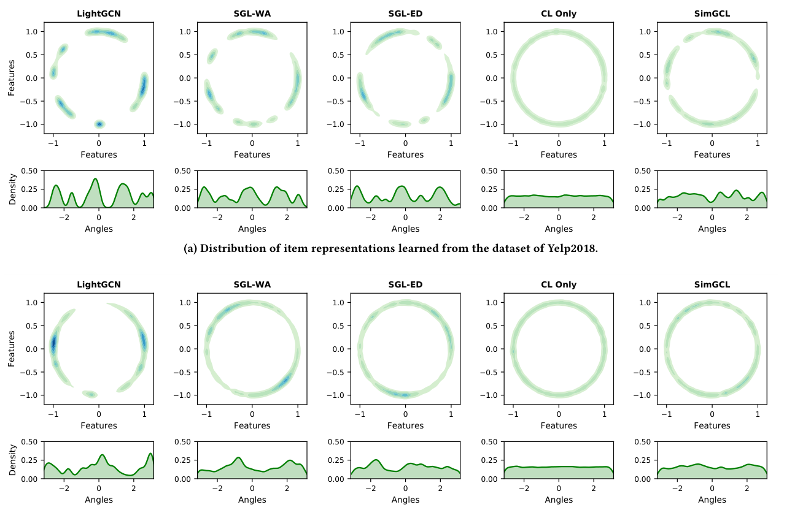
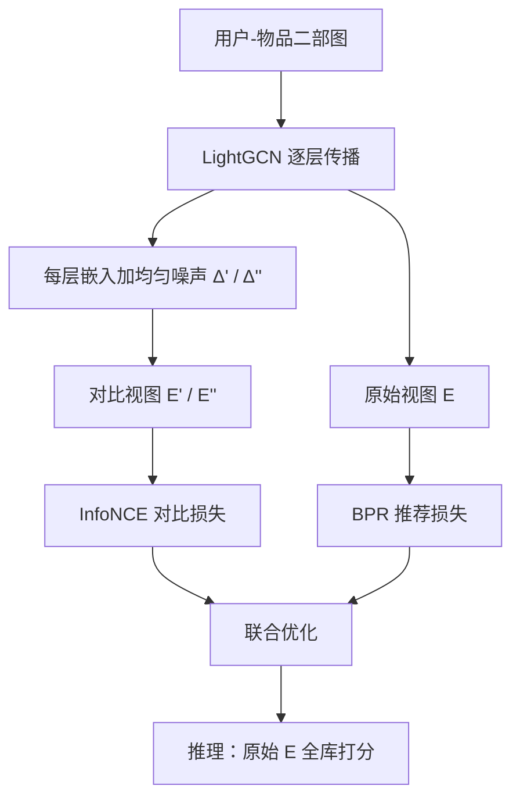
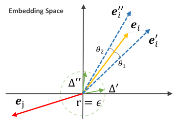

# Are Graph Augmentations Necessary? Simple Graph Contrastive Learning for Recommendation (图增强真的必要吗？面向推荐的简单图对比学习)

- **会议/期刊**: SIGIR 2022
- **作者与机构**: Junliang Yu, Hongzhi Yin, Xin Xia, Tong Chen, Lizhen Cui, Nguyen Quoc Viet Hung；The University of Queensland / Shandong University / Griffith University
- **推荐链路定位**: 召回与表征学习（Top-N 推荐）
- **研究方向**: 自监督对比学习与交互去噪 / 图神经网络与知识图谱推荐
- **论文原文**: [https://arxiv.org/abs/2112.08679v4](https://arxiv.org/abs/2112.08679v4)
- **开源代码**: [https://github.com/Coder-Yu/QRec](https://github.com/Coder-Yu/QRec)

## TL;DR (1分钟核心速览)

本文追问图对比推荐中图增强是否必需：SGL去掉图增强仍有效，真正起作用的是InfoNCE带来的表示均匀性。作者提出SimGCL，丢弃图扰动，改为在每层嵌入加受控均匀噪声构造对比视图，并用$\epsilon$平滑调节均匀性。三数据集全库排序、5次平均下，3层SimGCL较LightGCN在Amazon-Book的Recall@20/NDCG@20提升25.6%/30.2%，且训练快于SGL-ED。

## Background & Motivation (背景与核心矛盾)

- **主流范式**: 以SGL为代表的方法先对用户-物品二部图做边/节点Dropout，再用LightGCN编码两个扰动图，并以InfoNCE拉近同一节点两视图、推远批内负样本。
- **前人局限**: 极端稀疏的图增强（边丢弃率0.9）仍能涨点，说明图增强并非按直觉保留“本质结构”；同时每轮重构增强邻接矩阵成本高，节点丢弃还可能切断关键子图，使两视图共享的可学习不变性极少。
- **核心洞察 (Key Insight)**: KDE可视化显示，LightGCN表征高度聚簇，SGL-WA（无图增强）与SGL-ED均更均匀；仅优化CL损失时分布近乎全均匀但推荐性能很差，说明**均匀性需控制在有限范围**，而非越均匀越好。
- **本文切入点**: 放弃图结构扰动，直接在表示空间注入受控均匀噪声，以更低成本、更细粒度地调节表征均匀性。

<figure class="paper-figure" markdown="span">
  <figcaption>图2：我们使用高斯核密度估计（KDE）绘制 R2 中的特征分布（颜色越深，落入该区域的点越多），并绘制角度上的 KDE（即对每个点 (x,y) ∈S1 的 arctan2(y, x)）。</figcaption>
</figure>

## Method (核心方法设计)

### 1. 整体框架 (Overall Architecture)

输入用户-物品二部图，LightGCN逐层传播得到原始节点表示$\mathbf{E}$。训练时对每层嵌入分别加两组独立均匀噪声，得到两个增强视图$\mathbf{E}'$与$\mathbf{E}''$；BPR损失用原始视图做推荐，InfoNCE拉近同一节点跨视图表示、推远批内其他节点。两损失联合优化，推理阶段不加噪声，仅用原始$\mathbf{E}$打分，因而在线开销与LightGCN同级。

### 2. 关键设计拆解 (Key Designs)

1. **表示级均匀噪声增强（替代图增强）**：痛点在于图扰动需重构邻接矩阵且易破坏连通性。SimGCL对节点$i$构造$\mathbf{e}'_i=\mathbf{e}_i+\boldsymbol{\Delta}'_i$、$\mathbf{e}''_i=\mathbf{e}_i+\boldsymbol{\Delta}''_i$，其中$\|\boldsymbol{\Delta}\|_2=\epsilon$，$\boldsymbol{\Delta}=\bar{\boldsymbol{\Delta}}\odot\mathrm{sign}(\mathbf{e}_i)$，$\bar{\boldsymbol{\Delta}}\sim U(0,1)$。噪声方向与$\mathbf{e}_i$同象限，只做小角度旋转，既保留原表示信息又提供可控方差。
2. **用$\epsilon$平滑调节均匀性**：$\lambda$只能粗调CL权重，$\epsilon$直接控制增强视图偏离原点的距离。$\epsilon$越大，对比损失越把表示推向均匀分布，越能缓解流行度偏置；但过大则过度追求均匀、丢失交互近邻性，推荐性能反降。论文用$\mathcal{L}_{uniform}=\log\mathbb{E}_{u,v\sim p_{node}}e^{-2\|f(u)-f(v)\|_2^2}$验证该趋势。
3. **训练目标、负采样与推理效率**：总损失$\mathcal{L}_{joint}=\mathcal{L}_{rec}+\lambda\mathcal{L}_{cl}$；推荐侧用BPR三元组负采样，对比侧采用批内负样本，无需额外负采样器。SimGCL只需一次邻接矩阵归一化，三路图卷积约为LightGCN的3倍；SGL-ED每轮额外构造两个增强图且Dropout多在CPU完成，Amazon-Book单轮耗时235.3s，SimGCL仅98.4s。

<figure class="paper-figure" markdown="span">
  <figcaption>图3：所提出的基于随机噪声的数据增强在 R2 中的示意图。</figcaption>
</figure>

## Experimental Setup & Evaluation Protocol (实验设置与评估协议)

- **数据集与预处理**: Douban-Book过滤评分$<4$并二值化；三个数据集均无侧特征。

| 数据集 | #Users | #Items | #Interactions | 稀疏度/密度 | 特征/场景说明 |
| :--- | :---: | :---: | :---: | :---: | :--- |
| Douban-Book | 13,024 | 22,347 | 792,062 | 0.272% | 图书评分，过滤低分 |
| Yelp2018 | 31,668 | 38,048 | 1,561,406 | 0.130% | 商户点评 |
| Amazon-Book | 52,463 | 91,599 | 2,984,108 | 0.062% | 图书购买，极稀疏 |

- **数据划分与防穿越 (Splitting Strategy)**: 随机按$7:1:2$划分训练/验证/测试；非全局时间戳切分，存在一定时序泄漏风险。
- **排名评测协议 (Ranking Protocol)**: 无偏`Full-Ranking`，对全部未交互物品排序，报告Recall@20与NDCG@20；每个实验重复5次取均值。
- **对比基线与超参设置**: 对比LightGCN、SGL-ND/ED/RW/WA、Mult-VAE、DNN+SSL、MixGCF等；嵌入维度$d=64$，batch size 2048，学习率0.001，L2系数$10^{-4}$，温度$\tau=0.2$，三层LightGCN。SimGCL的$\epsilon=0.1$，$\lambda$在Douban/Yelp/Amazon分别取0.2/0.5/2；原文未报告显著性检验。

## Key Experimental Results (实验关键数据)

### 1. 主实验对比 (Main Results)

3层设置下各方法Top-20结果（Amazon NDCG按表3的3层结果对齐提升率）：

| 方法 | Douban R@20 | Douban N@20 | Yelp R@20 | Yelp N@20 | Amazon R@20 | Amazon N@20 |
| :--- | :---: | :---: | :---: | :---: | :---: | :---: |
| LightGCN | 0.1501 | 0.1282 | 0.0639 | 0.0525 | 0.0410 | 0.0318 |
| SGL-ND | 0.1626 | 0.1450 | 0.0644 | 0.0528 | 0.0440 | 0.0346 |
| SGL-ED | 0.1732 | 0.1551 | 0.0675 | 0.0555 | 0.0478 | 0.0379 |
| SGL-WA | 0.1705 | 0.1525 | 0.0671 | 0.0550 | 0.0466 | 0.0373 |
| Mult-VAE | 0.1310 | 0.1103 | 0.0584 | 0.0450 | 0.0407 | 0.0315 |
| DNN+SSL | 0.1366 | 0.1148 | 0.0483 | 0.0382 | 0.0438 | 0.0337 |
| MixGCF | 0.1731 | 0.1552 | 0.0713 | 0.0589 | 0.0485 | 0.0378 |
| **SimGCL** | **0.1772** | **0.1583** | **0.0721** | **0.0601** | **0.0515** | **0.0414** |
| **Improv. vs LightGCN** | **+18.1%** | **+23.5%** | **+12.8%** | **+14.5%** | **+25.6%** | **+30.2%** |

### 2. 消融实验 (Ablation Study)

围绕“图增强是否必要”和“CL损失是否核心”的消融如下：

| 方法 | Yelp R@20 | Yelp N@20 | Amazon R@20 | Amazon N@20 |
| :--- | :---: | :---: | :---: | :---: |
| LightGCN（无CL） | 0.0639 | 0.0525 | 0.0410 | 0.0318 |
| SGL-ED（图增强+CL） | 0.0675 | 0.0555 | 0.0478 | 0.0379 |
| SGL-WA（仅CL，无图增强） | 0.0671 | 0.0550 | 0.0466 | 0.0373 |
| CL Only（仅CL损失） | 0.0245 | 0.0190 | 0.0314 | 0.0258 |
| **SimGCL（噪声增强+CL）** | **0.0721** | **0.0601** | **0.0515** | **0.0414** |

### 3. 关键实验发现 (Key Findings)

- **图增强的边际价值很小**：SGL-WA在Yelp/Amazon取得0.0671/0.0466 Recall，已超过SGL-ND的0.0644/0.0440，并逼近SGL-ED的0.0675/0.0478；真正驱动增益的是InfoNCE，而非结构扰动。
- **噪声增强的收益集中在稀疏、长尾场景**：3层SimGCL相对LightGCN在Amazon-Book提升25.6% Recall与30.2% NDCG，在Douban-Book也提升18.1%/23.5%；按物品热度分桶后，SimGCL的增益主要来自Unpopular组，说明均匀化表征确实缓解流行度偏置。
- **效率与噪声类型均倾向“简单均匀”**：Amazon-Book单轮SimGCL为98.4s，SGL-ED为235.3s；SimGCL约10轮达最佳，SGL-ED需14轮。均匀噪声与高斯噪声性能接近，而正噪声略降、对抗噪声明显变差，说明方向约束与适度方差是关键。

## Highlights & Limitations (亮点、对比与审稿批判)

- **与代表作对比 (vs. Prior Work)**: 相较SGL的“图Dropout+InfoNCE”，SimGCL证明图增强可被表示空间噪声替代，省去每轮图重构；相较MixGCF需构造硬负样本，SimGCL仅用批内负样本即取得更高Recall/NDCG；相较LightGCN，SimGCL以辅助CL损失显著改善长尾物品表征。
- **可迁移亮点**: ①用“同象限、固定范数”的噪声做表示增强，可迁移到序列/多模态表征正则；②用$\epsilon$显式控制表征均匀性，比只调$\lambda$更细粒度，适合作为去偏辅助损失。
- **审稿级局限批判**: 仅随机$7:1:2$划分，未做时间切分，离线指标可能偏乐观；未报告显著性检验，且$\epsilon,\lambda$依数据集调参，跨域稳定性与在线A/B价值仍待验证。

## Rating (四维评分)

- **方法创新性 (Novelty)**: ⭐⭐⭐⭐ （反直觉地证明图增强非必需，转向表示空间均匀噪声，机制简洁且有KDE与均匀性曲线支撑）
- **评估协议与实验扎实度 (Protocol & Experiments)**: ⭐⭐⭐⭐ （三数据集、全库排序、5次平均，含效率/去偏/噪声类型分析；但随机划分且缺显著性检验）
- **写作与数学规范度 (Clarity & Rigor)**: ⭐⭐⭐⭐ （公式与复杂度分析清楚，噪声增强动机直观；个别表格数值存在轻微不一致）
- **工业落地与复现价值 (Industrial & Practical Value)**: ⭐⭐⭐⭐ （代码开源，推理不加噪声、与LightGCN同级，训练较SGL-ED显著省时；需调$\epsilon,\lambda$）

