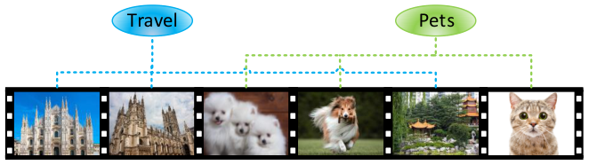
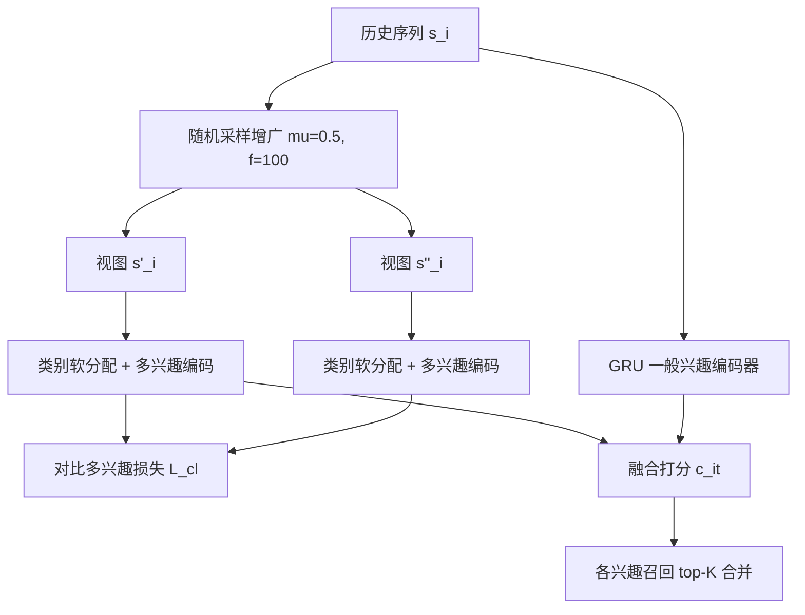

# Improving Micro-video Recommendation via Contrastive Multiple Interests (基于对比多兴趣的微视频推荐改进)

- **会议/期刊**: SIGIR 2022 (short paper, 5 pages)
- **作者与机构**: Beibei Li, Beihong Jin, Jiageng Song, Yisong Yu, Yiyuan Zheng (中科院软件所/国科大), Wei Zhuo (MX Media)
- **推荐链路定位**: 召回（多兴趣向量各自 top-$K$ 召回后合并重排）
- **研究方向**: 自监督对比学习与交互去噪 / 序列与会话推荐
- **论文原文**: [arXiv:2205.09593](https://arxiv.org/abs/2205.09593v1)
- **开源代码**: 原文未发布 CMI 专属实现，文中链接为基线 [ComiRec 官方代码](https://github.com/THUDM/ComiRec)

## TL;DR (1分钟核心速览)

微视频场景中"自动播放 + 短时划走"导致正交互本身含噪，而现有多兴趣模型（MIND/ComiRec）用动态路由或注意力强行切分兴趣，类别塌缩后多兴趣退化。CMI 改用**可学习隐式类别做软分配 + 类别正交约束**解耦 $m$ 个兴趣，并用**同序列两次随机采样视图间的对比多兴趣损失**实现正交互去噪，同时保留 GRU 一般兴趣分支。在 WeChat / TakaTak 上按时间切分、Recall@20 相对最优基线提升 24.05% / 1.72%，HitRate@20 提升 17.89% / 12.63%。

## Background & Motivation (背景与核心矛盾)

- **主流范式**: 微视频推荐要么堆多模态特征做内容理解，要么沿用 MIND / ComiRec 类多兴趣模型——用若干兴趣向量分别召回再合并（图 1 给出一个"旅游 + 宠物"双兴趣序列的典型样例）。
- **前人局限 1（成本与表达）**: 依赖多模态预训练特征，规模化代价高；且最终只蒸馏出**单一整体兴趣向量**，无法覆盖用户在未来可能落到任意一个兴趣分支上的行为。
- **前人局限 2（噪声与退化）**: 微视频自动播放，用户看几秒就划走并不等于"喜欢"，正交互中存在大量假阳性；同时动态路由/注意力学到的多兴趣向量高度同质，兴趣数 $m>1$反而不如$m=1$。
- **核心洞察 (Key Insight)**: 物品类别是兴趣的自然基底——若"每个兴趣对应一个类别"，那么只要强制类别向量正交，兴趣向量就天然可解耦；而局部采样的交互子序列应蕴含与全序列相同的兴趣，这正好构成对比学习的正视图假设。
- **本文切入点**: 以隐式正交类别为锚点做多兴趣软分配，再用对比损失对"兴趣嵌入"而非"物品嵌入"做去噪正则。

<figure class="paper-figure" markdown="span">
  <figcaption>图 1：一个包含两个兴趣（旅行和宠物）的微视频交互序列。</figcaption>
</figure>

## Method (核心方法设计)

### 1. 整体框架 (Overall Architecture)

输入用户历史序列 $s_i=[v_{i_1},\dots,v_{i_{|s_i|}}]$：一支路经 GRU 得到一般兴趣$u_i^g$；另一支路先用可学习类别嵌入$[g_1,\dots,g_m]$对每个物品做余弦软分配，再按类别加权汇聚成$m$个兴趣向量。训练时对$s_i$随机采样两次得到两个增广视图，分别送入两个结构共享的多兴趣编码器，在兴趣层面构造 InfoNCE。打分时取"最强兴趣 + 一般兴趣"之和，每个兴趣独立检索 top-$K$，汇总$mK$个候选后按分数取最终 top-$K$。

### 2. 关键设计拆解 (Key Designs)

1. **隐式正交类别软分配（替代动态路由）**：动态路由在训练初期就把物品硬路由到单一兴趣，容易陷入局部最优（Octopus 因此在表中垫底）。CMI 改为软概率：先算物品 $v_{i_k}$与类别$g_l$的余弦匹配$w_{i_k,l}=g_l^{\top}v_{i_k}/(\|g_l\|_2\|v_{i_k}\|_2)$，经温度$\epsilon$归一化得$p_{i_k,l}$，兴趣即加权和$u_i^{l}=\sum_{k=1}^{|s_i|}p_{i_k,l}\,v_{i_k}$。为防止"类别趋同"与"单类别支配"两种退化，把$g$与$v$全部约束在单位超球面并施加正交惩罚$\mathcal{L}_{orth}=\sum_{i}\sum_{j\neq i}(g_i^{\top}g_j)^2$——等价于让$m$ 个兴趣基底张成近正交子空间，兴趣间冗余被显式压低。
2. **对比多兴趣损失（正交互去噪）**：核心假设是"部分交互隐含的兴趣 = 全序列隐含的兴趣"。由 $s_i$采样$\min(\mu|s_i|,f)$条（$\mu=0.5,f=100$）生成两个视图，对第$k$个兴趣构造正对$(u_i^{k'},u_i^{k''})$，负对由同用户其余$2m-2$个兴趣 + 同 batch 其他用户的全部兴趣构成，共$2(m|\mathcal{B}|-1)$个负样本：$\mathcal{L}_{cl}=-\log\frac{e^{sim(u_i^{k'},u_i^{k''})}}{e^{sim(u_i^{k'},u_i^{k''})}+\sum_{s^-\in\mathcal{S}^-}e^{sim(u_i^{k'},s^-)}}$（对称项同理，$sim$带温度$\tau$）。关键在于**按类别索引对齐正对**——只有"同一类别的兴趣"才算正样本，否则会奖励兴趣塌缩；这与 SGL/SimGCL 在物品/节点层面做增广有本质区别。
3. **训练目标、负采样与推理开销**：最终 $\mathcal{L}=\mathcal{L}_{main}+\lambda_{cl}\mathcal{L}_{cl}+\lambda_{orth}\mathcal{L}_{orth}$，主损失为 softmax 交叉熵$\mathcal{L}_{main}=-\ln\frac{\exp(c_{ip})}{\sum_{v^*\in\mathcal{N}\cup\{v_{ip}\}}\exp(c_{i^*})}$，其中$c_{it}=\max_{1\le k\le m}\{u_i^{k\top}v_t/\epsilon\}+u_i^{g\top}v_t$；每个正样本只采 1 个未交互负样本，其余负样本由同 batch 其他用户正样本充当（in-batch，免额外采样开销）。推理需存储$m$套用户向量（$m=8$），召回量为单兴趣模型的$m$ 倍，是主要线上成本。

## Experimental Setup & Evaluation Protocol (实验设置与评估协议)

| 数据集 | #Users | #Items | #Interactions | 密度 | 特征/场景说明 |
| :--- | :---: | :---: | :---: | :---: | :--- |
| WeChat | 20,000 | 77,557 | 2,666,296 | 0.17% | 微信视频号；含点赞/收藏（显式满意）与播放（隐式参与） |
| TakaTak | 50,000 | 157,691 | 33,863,980 | 0.45% | 印度 MX TakaTak，4 周匿名用户日志 |

- **数据划分与防穿越**: 严格**全局时间戳切分**——跨 $h$天的数据取前$h-2$天为训练、第$h-1$天为验证、第$h$ 天为测试，属 inductive 未来预测，无泄漏。
- **排名评测协议**: 指标为 Recall@$\{10,20,50\}$与 HitRate@$\{10,20,50\}$；**论文未显式声明候选集规模与负样本正负比**，仅说明训练期"每正样本采 1 个未交互负样本"；结合微视频全库规模与指标量级推断为**全库排序 (Full-Ranking)**，但缺少明示是评估严谨性的短板。
- **对比基线与超参**: 5 个多兴趣基线（Octopus、MIND、ComiRec-DR、ComiRec-SA、DSSRec），为公平起见**排除多模态模型**；统一 embedding 维度 $d=64$、batch=1024、Adam；$\epsilon=0.1,\tau=0.1,\lambda_{cl}=0.01,\lambda_{orth}=10,\mu=0.5$；无显著性检验（$p$ 值）报告。

## Key Experimental Results (实验关键数据)

### 1. 主实验对比 (Main Results)

| 模型 | #I. | WeChat R@10 | R@20 | R@50 | H@10 | H@20 | H@50 | TakaTak R@10 | R@20 | R@50 | H@10 | H@20 | H@50 |
| :--- | :---: | :---: | :---: | :---: | :---: | :---: | :---: | :---: | :---: | :---: | :---: | :---: | :---: |
| Octopus | 1 | 0.0057 | 0.0125 | 0.0400 | 0.0442 | 0.0917 | 0.2332 | 0.0076 | 0.0160 | 0.0447 | 0.1457 | 0.2533 | 0.4393 |
| MIND | 1 | 0.0296 | 0.0521 | 0.1025 | 0.1774 | 0.2791 | 0.4514 | 0.0222 | 0.0389 | 0.0773 | 0.2139 | 0.3263 | 0.4977 |
| ComiRec-DR | 1 | 0.0292 | 0.0525 | 0.1049 | 0.1790 | 0.2893 | 0.4621 | 0.0226 | 0.0392 | 0.0769 | 0.2345 | 0.3427 | 0.5144 |
| ComiRec-SA | 1 | 0.0297 | 0.0538 | 0.1079 | 0.1806 | 0.2938 | 0.4684 | 0.0239 | 0.0409 | 0.0752 | 0.2567 | 0.3665 | 0.5207 |
| DSSRec | 1 / 8 | 0.0327 | 0.0578 | 0.1161 | 0.1971 | 0.3064 | 0.4854 | **0.0244** | 0.0408 | 0.0749 | 0.2558 | 0.3704 | 0.5259 |
| **CMI** | 8 | **0.0424** | **0.0717** | **0.1342** | **0.2436** | **0.3612** | **0.5292** | 0.0210 | **0.0415** | **0.0877** | **0.2912** | **0.4172** | **0.5744** |
| **Improv.** | / | +29.66% | +24.05% | +15.59% | +23.59% | +17.89% | +9.02% | −13.9% | +1.72% | +17.09% | +13.84% | +12.63% | +9.22% |

### 2. 消融实验 (Ablation Study)

| 变体 (WeChat, $m=8$) | R@10 | R@20 | R@50 | H@10 | H@20 | H@50 |
| :--- | :---: | :---: | :---: | :---: | :---: | :---: |
| CMI-CL（去对比损失） | 0.0390 (-8.02%) | 0.0665 (-7.25%) | 0.1285 (-4.25%) | 0.2286 (-6.16%) | 0.3443 (-4.68%) | 0.5188 (-1.93%) |
| CMI-G（去 GRU 一般兴趣） | 0.0342 (-19.34%) | 0.0589 (-17.85%) | 0.1165 (-13.19%) | 0.2061 (-15.39%) | 0.3181 (-11.93%) | 0.4935 (-6.71%) |
| **CMI 完整** | **0.0424** | **0.0717** | **0.1342** | **0.2436** | **0.3612** | **0.5292** |

### 3. 关键实验发现 (Key Findings)

1. **多兴趣并非"越多越好"，而是"解耦对了才越好"**：MIND/ComiRec/Octopus 的最优配置全部出现在 #I.=1，即动态路由/注意力学出的第二、三个兴趣几乎全是冗余；而 CMI 把 $m$ 从 1 增到 8 时 R@10 从 0.0303 单调升到 0.0428（+41%），证明正交类别约束才是多兴趣生效的前提，而非"多向量"本身。
2. **一般兴趣分支的边际贡献大于对比分支**：去掉 GRU 后 R@10 掉 19.34%，去掉对比损失仅掉 8.02%（H@50 只掉 1.93%）。这说明对比损失主要在**头部排序精度与鲁棒性**上起正则作用（@10 掉幅 > @50 掉幅），而全局兴趣承担了"跨兴趣兜底"的主干召回职责——两者不可互相替代。
3. **CMI 优化的是覆盖而非单点精度**：TakaTak 上 R@10（0.0210）反而低于 DSSRec（0.0244），但 R@50 反超 17.09%、HitRate@50 反超 9.22%，呈现典型的"多兴趣并集扩大长尾覆盖、却稀释 top-1 精度"的权衡；这与 $mK$召回后合并取 top-$K$、各兴趣头部得分被$\max$ 聚合压制的机制一致，也提示短列表场景需再加融合/重排。

## Highlights & Limitations (亮点、对比与审稿批判)

- **与代表作对比**: 相比 MIND/ComiRec-DR 的**胶囊动态路由**（硬路由 + 迭代耦合，易局部最优），CMI 换成"余弦软分配 + 正交正则"，把解耦从"算法过程"变成"参数几何约束"；相比 ComiRec-SA 的多头注意力（无显式去冗余机制），正交损失直接压兴趣间夹角；相比 DSSRec 的自监督意图解耦（seq2seq 重构 + 额外监督），CMI 的对比发生在**兴趣层且按类别对齐**，不需要解码器。
- **可迁移亮点**: ①"用可学习类别 + 正交惩罚"作为任何多向量表征（多兴趣、多场景、多任务 expert）的解耦正则，成本极低、可作为插件；②采样增广的两个视图在**同语义索引**下配对构造正样本，避免对比学习常见的"假负样本/错位正样本"问题，可直接搬到跨域或会话内对比。
- **审稿级局限批判**: ①**评估协议不透明、缺显著性检验**——未说明候选集是全库还是采样排序，也未给方差/多次运行，TakaTak R@10 的负向结果更需统计支撑；②**计算与部署代价被轻描淡写**：$m=8$ 意味 8 套用户向量与 8 倍 ANN 检索，论文未报训练/推理时延与显存开销，也未与 ComiRec-SA 在同等召回预算下对比；③方法整体为 SIGIR short paper 规模，两数据集均来自工业方，未验证公开基准（如 Amazon 序列数据）上的泛化性。

## Rating (四维评分)

- **方法创新性 (Novelty)**: ⭐⭐⭐⭐ （"正交隐式类别软分配 + 兴趣层按类别对齐的对比损失"组合干净新颖，虽各组件均非首创，但解决了多兴趣模型普遍退化的真问题）
- **评估协议与实验扎实度 (Protocol & Experiments)**: ⭐⭐⭐ （时间切分严谨、基线对比公平且排除多模态干扰，但排序协议未明示、无显著性检验、TakaTak R@10 负向结果未深究）
- **写作与数学规范度 (Clarity & Rigor)**: ⭐⭐⭐⭐ （公式与超参交代完整、退化分析与正交动机讲得清楚；但打分公式中温度 $\epsilon$与软分配共用同一符号、$mK$ 召回合并细节略含糊）
- **工业落地与复现价值 (Industrial & Practical Value)**: ⭐⭐⭐ （无需多模态特征、in-batch 负采样即可训练，工程友好；但 $m$ 倍召回开销与未开源的 CMI 实现降低了直接复现与上线评估的便利度）

