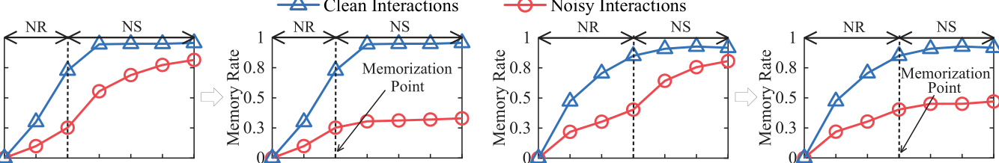
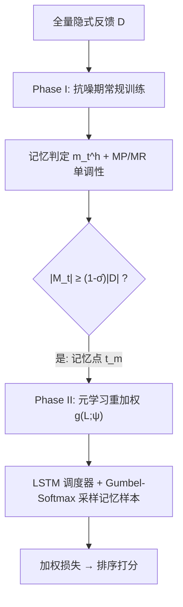

# Self-Guided Learning to Denoise for Robust Recommendation (自引导去噪学习：面向鲁棒推荐的通用去噪范式)

- **会议/期刊**: SIGIR 2022
- **作者与机构**: Yunjun Gao, Yuntao Du, Yujia Hu, Lu Chen 等（浙江大学）；Baihua Zheng（新加坡管理大学）
- **推荐链路定位**: 精排（模型无关的通用训练范式，可挂载于任意打分模型）
- **研究方向**: 自监督对比学习与交互去噪 / 隐性反馈去偏
- **论文原文**: [arXiv:2204.06832](https://arxiv.org/abs/2204.06832v3)
- **开源代码**: [ZJU-DAILY/SGDL](https://github.com/ZJU-DAILY/SGDL)

## TL;DR (1分钟核心速览)

隐性反馈普遍存在“噪声正样本”与“噪声负样本”，现有重加权方法（T-CE、DeCA）只用 loss 大小判噪，会把“高 loss 但干净”的难样本一并压权，且依赖人工阈值、无法适配 BPR 等 pairwise 损失。本文提出 SGDL：先借模型“早期只记干净样本”的记忆效应自动收集记忆样本并估出记忆点，再用元学习让记忆样本反向指导一个自适应加权网络与 LSTM 调度器。在 Adressa/MovieLens/Yelp 的 8:1:1 干净测试集上，Recall@20 相对最强基线提升最高 15.2%。

## Background & Motivation (背景与核心矛盾)

- **主流范式**: 把观测交互当正样本、未观测当负样本；去噪分为样本选择（WBPR、IR）与样本重加权（T-CE、DeCA）两派，后者依托“模型先学简单干净模式、后记忆全部数据”的记忆效应，按 loss 降低高 loss 样本权重。
- **前人局限**: ① *误杀难而干净的交互*——loss 高不等于噪声，直接压权导致用户偏好刻画不足；② *缺乏自适应与通用性*——权值函数（指数/截断）与阈值需网格搜索，故只能配合 pointwise BCE，难以套用 BPR 等排序损失。
- **核心洞察 (Key Insight)**: 作者实测 NeuMF/LightGCN 的“记忆率”曲线，发现训练天然分成 **抗噪期 (NR)** 与 **噪声敏感期 (NS)**：NR 期噪声样本记忆率几乎不动，NS 期才陡升；且 loss 分布呈双峰，可用 GMM 估噪声率。
- **本文切入点**: 不再靠 loss 阈值，而是把 NR 期“自标注”的记忆样本当作监督信号，去meta-学习一个权值函数。

<figure class="paper-figure" markdown="span">
  <figcaption>图1：SGDL的关键思想：(a)和(c)分别展示在MovieLens数据集上训练NeuMF和LightGCN时的记忆率；(b)和(d)展示用SGDL训练相应模型时的记忆率。记忆率是干净交互和噪声交互中已记忆数据的比例（详见第3.1.1节）。NR表示“抗噪”阶段，NS表示“噪声敏感”阶段。</figcaption>
</figure>

## Method (核心方法设计)

### 1. 整体框架 (Overall Architecture)

SGDL 分两阶段：Phase I 用全量隐式反馈常规训练，按“近 $h$个 epoch 是否进入 Top-$N$推荐列表”判定交互是否被记忆，当记忆集合规模触及 GMM 估出的干净样本量即自动切换到 Phase II；Phase II 用记忆样本作为元学习“验证集”，交替更新推荐模型参数$\theta$与加权网络参数$\psi$，并由 LSTM 调度器按“loss + 梯度相似度”采样可信记忆样本，避免其自身噪声反噬。

### 2. 关键设计拆解 (Key Designs)

1. **记忆状态定义与记忆点估计（替代 loss 阈值）**：loss 与排序目标不一致且难辨难样本。作者用 Hit-Ratio 式记忆判定，滑窗平均后以多数票决定是否记忆：
$m_t^{h}(u,i)=\frac{1}{|\mathcal{P}_t^{h}(u,i)|}\sum_{m_j\in\mathcal{P}_t^{h}(u,i)}m_j(u,i)$，并定义$MP_t=|\mathcal{R}_t|/|\mathcal{M}_t|$、$MR_t=|\mathcal{R}_t|/|\mathcal{G}|$。可证$MP$单调降、$MR$单调升，二者交点即最优点；因真实噪声率未知，用双峰 loss 的 GMM 后验估计$\hat{\sigma}=\mathbb{E}_{(u,i)\in\mathcal{D}}[p(\mu\mid L_{(u,i)}(\theta))]$，切换条件为$|\mathcal{M}_t|\ge(1-\hat{\sigma})|\mathcal{D}|$。直觉：用“排序是否已稳定命中”而非“loss 高低”刻画记忆，天然区分难样本与噪声。
2. **元学习自引导重加权（Self-Guided Learning）**：痛点是无从得知“该给多少权”。将权重网络 $g(\cdot;\psi)$（单隐层 MLP）置于双层优化：内层$\theta^{*}(\psi)=\arg\min_\theta \frac{1}{|\mathcal{D}_T|}\sum_k g(L_k(\theta);\psi)L_k(\theta)$，外层用记忆样本损失$\frac{1}{|\mathcal{M}_{t_m}|}\sum_m L_m(\theta^{*}(\psi))$更新$\psi$。展开后$\psi$的梯度含$\sum_k\big(\frac{1}{|\mathcal{M}|}\sum_m G_{mk}\big)\nabla_\psi g$，其中$G_{mk}=\nabla_\theta L_m^{\top}\nabla_\theta L_k$ 为梯度相似度——与记忆样本梯度同向的样本被提权，反向者被压制，从而实现“保难样本、杀噪声”。
3. **自适应去噪调度器与训练开销**：记忆集仍含噪声，故用 LSTM 调度器 $s(\cdot;\phi)$输入$[L_m(\theta),\cos(\nabla_{\hat\theta}L_m(\hat\theta),\nabla_\theta L_m(\theta))]$，经 Gumbel-Softmax$\tilde{y}_m=\frac{\exp((\log\pi_m+\epsilon_m)/\tau)}{\sum_i\exp((\log\pi_i+\epsilon_i)/\tau)}$（$\tau=0.05$）生成可微采样，端到端联合优化。额外参数仅$2d_w$与 LSTM 的$4d_l^2+12d_l$，时间上比常规训练多不足 3 倍前向，属可接受量级。

## Experimental Setup & Evaluation Protocol (实验设置与评估协议)

| 数据集 | #Users | #Items | #Interactions | 稀疏度 | 噪声标注方式 |
| :--- | :---: | :---: | :---: | :---: | :--- |
| Adressa | 212,231 | 6,596 | 419,491 | 99.97% | 停留时长 < 10s 记为噪声 |
| MovieLens | 943 | 1,683 | 100,000 | 93.70% | 评分 < 3 记为噪声 |
| Yelp | 45,548 | 57,396 | 1,672,520 | 99.94% | 评分 < 3 记为噪声 |

- **数据划分与防穿越**: 按 **8:1:1 比例划分**训练/验证/**干净测试集**（测试集剔除噪声交互），验证集早停。
- **排名评测协议**: 报告全体测试用户平均的 Recall@{5,20} 与 NDCG@{5,20}；对比方法在同一 base model、同超参下公平复现。
- **对比基线与超参**: 基座为 NeuMF、CDAE（BCE 损失）与 NGCF、LightGCN（BPR 损失）；去噪基线 Normal、WBPR、IR、T-CE、DeCA，鲁棒图基线 SGCN、SGL。嵌入维度 32/64，层数 3，Adam，batch 128/1024/2048，记忆窗口 $h\in\{2,5,10,20\}$，提升显著性按$p<0.05$ 标注（表中 †）。

## Key Experimental Results (实验关键数据)

### 1. 主实验对比 (Main Results)

| 基座 | 方法 | Adressa R@20 | Adressa N@20 | MovieLens R@20 | MovieLens N@20 | Yelp R@20 | Yelp N@20 |
| :--- | :--- | :---: | :---: | :---: | :---: | :---: | :---: |
| NeuMF | Normal | 0.3208 | 0.1808 | 0.2687 | 0.2765 | 0.0393 | 0.0215 |
| NeuMF | IR | 0.3212 | 0.1830 | 0.2704 | 0.2758 | 0.0407 | 0.0229 |
| NeuMF | T-CE | 0.3220 | 0.1839 | 0.2821 | 0.2845 | 0.0396 | 0.0211 |
| NeuMF | DeCA | 0.3205 | 0.1799 | 0.2723 | 0.2801 | 0.0394 | 0.0216 |
| NeuMF | **SGDL** | **0.3291** | **0.1853** | **0.2844** | **0.3032** | **0.0469** | **0.0260** |
| LightGCN | Normal | 0.1817 | 0.0994 | 0.3173 | 0.3358 | 0.0912 | 0.0515 |
| LightGCN | SGL | 0.1770 | 0.0999 | 0.3156 | 0.3343 | 0.0915 | 0.0526 |
| LightGCN | SGCN | 0.1899 | 0.1160 | 0.3210 | 0.3318 | 0.0916 | 0.0528 |
| LightGCN | DeCA | 0.1855 | 0.1162 | 0.3076 | 0.3270 | 0.0911 | 0.0524 |
| LightGCN | **SGDL** | **0.2105** | **0.1178** | **0.3335** | **0.3513** | **0.0918** | 0.0525 |
| | *Improv.%* | *+10.8%* | *+1.4%* | *+3.9%* | *+4.6%* | *+0.2%* | *−0.6%* |

（Improv.% 相对该基座最强基线；NeuMF 侧 Yelp R@20 相对 IR 提升 15.2%，MovieLens N@20 相对 T-CE 提升 6.6%。）

### 2. 消融实验 (Ablation Study)

| 基座 / 数据集 | 变体 | R@20 | N@20 | 说明 |
| :--- | :--- | :---: | :---: | :--- |
| NeuMF / Adressa | 完整 SGDL | **0.3291** | **0.1853** | — |
| NeuMF / Adressa | w/o DLS | 0.3107 | 0.1794 | 去掉自引导重加权，退化为纯记忆集训练 |
| NeuMF / Adressa | w/o ADS | 0.3285 | 0.1801 | 去掉调度器，记忆样本全用 |
| LightGCN / Adressa | 完整 SGDL | **0.2105** | **0.1178** | — |
| LightGCN / Adressa | w/o DLS | 0.1810 | 0.0985 | 低于 Normal (0.1817) |
| LightGCN / Adressa | w/o ADS | 0.1995 | 0.1007 | 噪声记忆样本拖累 |
| LightGCN / MovieLens | top-$F$ / MLP / LSTM | 0.3159 / 0.3284 / **0.3335** | 0.3349 / 0.3427 / **0.3513** | 调度器结构对比 |

记忆点敏感度（NeuMF/Adressa R@20）：偏移 +10% / +5% / 0 / −5% / −10% 分别为 0.3221 / 0.3275 / **0.3291** / 0.3256 / 0.3203。

### 3. 关键实验发现 (Key Findings)

1. **“记忆点即最优点”经验成立**：记忆点前后偏移 ±10% 都会掉点（LightGCN/Adressa 由 0.2105 降至 0.2006/0.1990），说明 GMM 估噪 + 规模触发式切换足够稳；且略早切换优于略晚切换（+5% 仍有 0.2114），印证“早切多干净、晚切多噪声”。
2. **自引导重加权是命门，调度器是增益**：去掉 DLS 后 LightGCN/Adressa R@20 从 0.2105 掉到 0.1810，甚至不如常规训练，说明“只用记忆集训练”会因丢弃难而干净样本而崩；去掉 ADS 则降到 0.1995，证明记忆集内部残留噪声必须再筛。
3. **调度器非线性建模优于手工打分**：top-$F$ 直接对 loss 与梯度相似度求和的启发式在 Yelp/LightGCN 上 R@20 仅 0.1810（劣于 Normal），而 LSTM 达 0.2105；可视化显示学到的权值函数对低 loss 区间随 loss 上升提权、中段平台、高 loss 陡降——正好实现“先保难样本、后压噪声”。

## Highlights & Limitations (亮点、对比与审稿批判)

- **与代表作对比**: vs. T-CE（截断 BCE + 动态阈值）与 DeCA（双模型预测 KL 一致性），SGDL 不设阈值、不依赖 pointwise 损失，且能直接挂 BPR；vs. SGL/SGCN 这类图结构增强法，SGDL 是模型无关插件，非图模型（NeuMF/CDAE）同样受益，而 SGL 在 Adressa 上甚至劣于 Normal。
- **可迁移亮点**: ① “MP/MR 交点找记忆点”可复用为任意迭代训练的早停/切换信号；② 用记忆样本梯度相似度 $G_{mk}$ 做样本置信度打分，可迁移到负采样去偏与数据清洗。
- **审稿级局限批判**: ① 噪声标签依赖 dwell-time / 评分阈值等启发式标注，真实线上无 ground truth，GMM 估噪在真实噪声比例漂移时可能失准；② Phase II 需三次梯度步与 LSTM 调度，训练成本约为常规 3 倍，且 $h$、$\tau$、隐藏维度等超参仍需调；③ 稠密数据集（MovieLens）增益明显小于稀疏集，说明收益与噪声/稀疏耦合，缺大规模线上 A/B 验证。

## Rating (四维评分)

- **方法创新性 (Novelty)**: ⭐⭐⭐⭐ （把“记忆效应”从观察现象升级为可计算的 MP/MR 切换准则 + 元学习重加权，视角新颖但元学习骨架本身非首创）
- **评估协议与实验扎实度 (Protocol & Experiments)**: ⭐⭐⭐⭐ （3 数据集 × 4 基座 × 2 类损失 × 7 基线，含显著性检验与记忆点/调度器细粒度消融；遗憾缺线上验证与真实噪声标签）
- **写作与数学规范度 (Clarity & Rigor)**: ⭐⭐⭐⭐ （MP/MR 单调性有证明、$\psi$ 梯度展开清晰、复杂度分析完整；双层优化的收敛性仅经验性说明）
- **工业落地与复现价值 (Industrial & Practical Value)**: ⭐⭐⭐⭐ （代码全开源、即插即用挂载任意排序模型；代价是训练开销约 3 倍且需保留记忆缓存）

