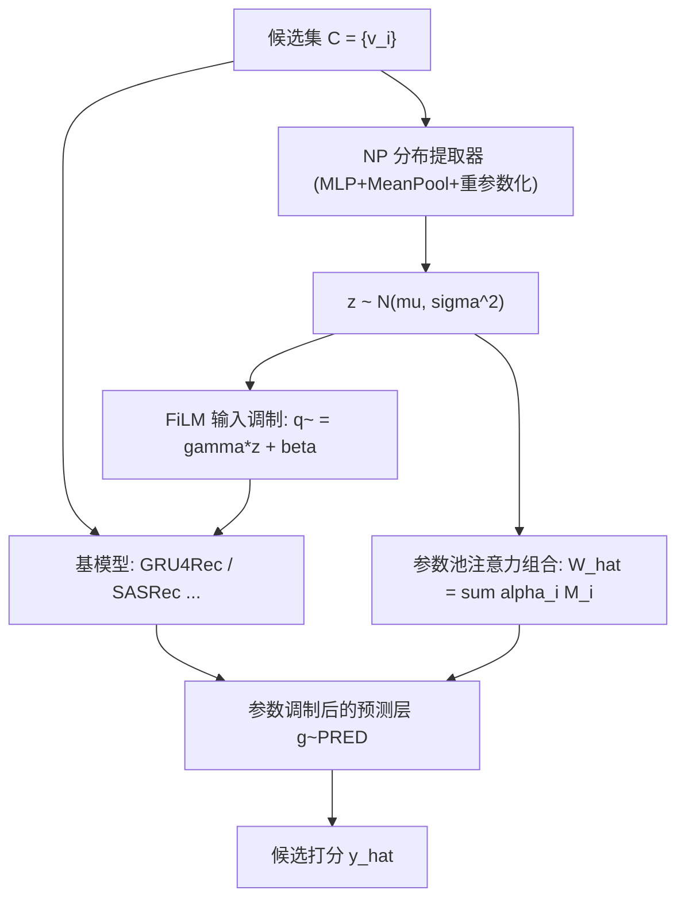
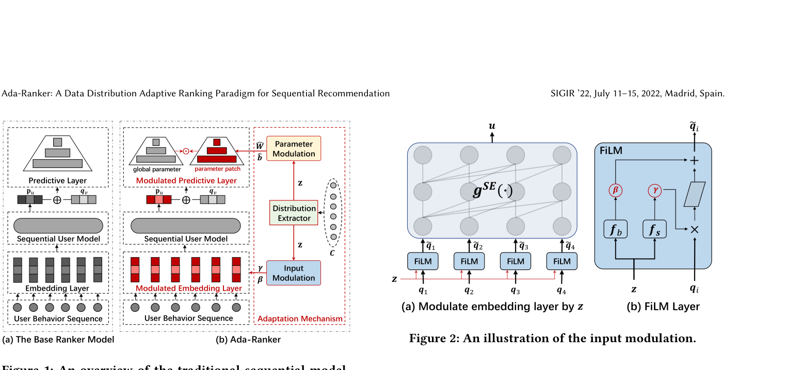

# Ada-Ranker: A Data Distribution Adaptive Ranking Paradigm for Sequential Recommendation (面向序列推荐的数据分布自适应排序范式)

- **会议/期刊**: SIGIR 2022
- **作者与机构**: Xinyan Fan, Wayne Xin Zhao（人大高瓴/北京智源）, Jianxun Lian, Zheng Liu, Chaozhuo Li, Xing Xie（微软亚洲研究院）
- **推荐链路定位**: 精排（Ranker 的推理范式革新）
- **研究方向**: 序列与会话推荐 / 跨域与多场景推荐
- **论文原文**: [https://arxiv.org/abs/2205.10775v1](https://arxiv.org/abs/2205.10775v1)
- **开源代码**: [https://github.com/RUCAIBox/Ada-Ranker](https://github.com/RUCAIBox/Ada-Ranker)

## TL;DR (1分钟核心速览)

工业精排沿用「离线训练→冻结参数→在线服务」范式，但每次请求经召回得到的候选集 $C$在类别占比、流行度、新旧比例上分布差异极大，全局冻结模型只能给出次优打分。本文提出 Ada-Ranker：先用 Neural Process 从$C$中抽取分布表征$z$，再以 FiLM 调制输入表征、以参数池补丁调制打分 MLP，使全局模型$f$即时变为局部模型$f'$。在 ML10M/Taobao/Xbox 的 `Leave-One-Out` + 1 正 19 负候选协议下，7 个序列骨干平均 NDCG 提升约 2.5%，且优于 8 类竞品基线；训练/测试分布不一致时 SASRec 在 Xbox 上增益由 3.3% 升至 15.5%。

## Background & Motivation (背景与核心矛盾)

- **主流范式**: GRU4Rec/SASRec/NextItNet 等序列精排模型端到端离线训练后参数冻结上线，对所有请求做"通用打分"，与候选集 $C$ 无关。
- **前人局限**: ① 候选分布由用户请求决定（NBA 迷的候选多为篮球、点进女装频道的候选高度同质），冻结参数无法适配；② 现有多场景方案（STAR、MMoE、多域模型）假设场景**离散可枚举**，需维护多份重模型，参数不经济且切换有故障风险。
- **核心洞察 (Key Insight)**: 应把"一次请求的候选集"视作一个**独立任务**，推理时用无标签的 $C$ 本身作为上下文即时改写模型；且这种改写必须是轻量、模型无关、可插拔的（C1–C3 三性质）。
- **本文切入点**: 用分布表征 $z$ 在**输入层**与**参数层**两处做调制，把 train-freeze-test 改为 train-adapt-test。

## Method (核心方法设计)

### 1. 整体框架 (Overall Architecture)

给定用户行为序列 $x_u$与候选集$C=\{v_i\}_{i=1}^{m}$，先由分布提取器把$C$压成高斯隐变量$z$（实例化为"这一次排序任务的分布"）；$z$一路进入输入调制器生成 FiLM 系数，改写序列中每个物品嵌入；另一路进入参数调制器，从参数池中按注意力系数线性组合出补丁，乘/加到打分 MLP 的权重与偏置上。两阶段训练：先训好基模型$\Theta$，再冻结$\Theta$只训适应模块$\Phi$，因此关闭补丁即恢复原系统行为。

<figure class="paper-figure" markdown="span">
  <figcaption>图1：传统序列模型（a）与Ada-Ranker范式（b）概览。我们用彩色元素表示Ada-Ranker中的新组件。</figcaption>
</figure>

### 2. 关键设计拆解 (Key Designs)

1. **Neural Process 分布提取（把候选集当随机过程的一次实例化）**：简单平均池化无法刻画混合分布。对每个候选 $r_j=\mathrm{MLP}^{(NP)}(q_j)$后均值池化得置换不变表征$r$，再经$s=\mathrm{ReLU}(W_s r)$输出$\mu=W_\mu s,\ \log\sigma=W_\sigma s$，用重参数化$z=\mu+\epsilon\odot\sigma,\ \epsilon\sim\mathcal{N}(0,I)$ 采样。相比 AVG，NP 的隐变量能把"Thriller&Crime"这类混合分布放到不与无关类别重叠的位置（见图 4 t-SNE），且计算对候选数线性、候选间无交互，工程可控。

2. **FiLM 输入调制（在表征空间"重新摆放"候选）**：由 $z$生成$\gamma=f_s(z),\ \beta=f_b(z)$，对序列中每个物品嵌入做仿射变换$\tilde{q}_t=\gamma\odot q_t+\beta$（全序列共享，与基模型无关）。作者发现逐物品生成不同$\gamma,\beta$ 反而变差（样本不足、过拟合），共享仿射更稳健；相比加性 bias，乘性缩放能让编码器输出更贴合当前候选集的判别边界。

3. **参数池补丁调制（约束化的模型补丁）**：直接由 MLP 生成权重（free_para）难以优化，故设参数池 $\mathcal{M}=\{M_1,\dots,M_L\}$，用$z$与读头$q_i$的内积做 softmax 得系数$\alpha_i=\frac{\exp(z\cdot q_i)}{\sum_j \exp(z\cdot q_j)}$，组合补丁$\hat{W}=\sum_i \alpha_i M_i$，再调制$\tilde{W}_k=W_k\odot\hat{W}_k,\ \tilde{b}_k=b_k+\hat{b}_k$。补丁是低维流形上的组合，既保表达力又保稳定。

4. **训练目标与开销**：损失沿用 BCE $\mathcal{L}=-\frac{1}{|\Gamma|}\sum_{(u,v)}[y\log\tilde{y}+(1-y)\log(1-\tilde{y})]$，负采样沿用基模型设定；额外参数$\Phi=O(LK(hd+d)+dd)$（$L=10,K=2,d=64$）远小于物品嵌入表$O(Md)$，推理对候选逐一算 NP 表征后调制**只做一次**，为常数级增量。

## Experimental Setup & Evaluation Protocol (实验设置与评估协议)

- **数据集与预处理**: 过滤交互数 <10 的用户，按用户分组、时间升序排列。

| 数据集 | #Users | #Items | #Interactions | 稀疏度 | 特征/场景说明 |
| :--- | :---: | :---: | :---: | :---: | :--- |
| ML10M | 69,878 | 10,676 | 10,000,047 | 98.66% | 电影，18 类（可重叠加标签） |
| Taobao | 487,813 | 787,094 | 24,938,811 | 99.99% | 电商，Top-19 类 + others |
| Xbox | 1,000,000 | 6,071 | 25,315,983 | 99.58% | 微软游戏日志，12 类 |

- **数据划分**: `Leave-One-Out`（最后一项测试、倒数第二项验证，其余训练）。
- **排名评测协议**: `Sampled Ranking`，每个正例配 **19 个负例**；关键创新在于负例由 **distribution-mixer sampling** 生成——随机选 $d\in\{1,2,3\}$个类目、以$p=0.5$ 伯努利选择"流行度偏置 or 均匀"采样，从而人为制造多样且可控的候选分布。指标为 GAUC 与 NDCG。
- **对比基线与超参**: 7 个骨干（MF/GRU4Rec/SASRec/NARM/NextItNet/SHAN/SRGNN）+ 8 个竞品（DNS、GSF_concat/avg/trm、PD、DecRS、DLCM、PRM）；Adam，lr=0.001，batch=4096，dropout=0.4，$d=64$，预测层 128×64→64×1；显著性$p$-value 见表。

## Key Experimental Results (实验关键数据)

### 1. 主实验对比 (Main Results)

以 GRU4Rec 为骨干（SASRec 为骨干结论一致），ML10M/Taobao/Xbox：

| 方法 | ML10M GAUC | ML10M NDCG | Taobao GAUC | Taobao NDCG | Xbox GAUC | Xbox NDCG |
| :--- | :---: | :---: | :---: | :---: | :---: | :---: |
| Base (GRU4Rec) | 0.9187 | 0.7781 | 0.8734 | 0.7208 | 0.9388 | 0.8302 |
| DNS | 0.9005 | 0.7512 | 0.8646 | 0.7200 | 0.9254 | 0.8182 |
| GSF_concat | 0.9150 | 0.7744 | **0.8903** | 0.7433 | 0.9335 | 0.8261 |
| GSF_avg | 0.9205 | 0.7760 | 0.8860 | 0.7370 | 0.9390 | 0.8325 |
| GSF_trm | 0.9232 | 0.7815 | 0.8865 | 0.7366 | 0.9429 | 0.8414 |
| PD | 0.9254 | 0.7818 | 0.8913 | 0.7387 | 0.9373 | 0.8216 |
| DecRS | 0.9247 | 0.7881 | 0.8785 | 0.7306 | 0.9427 | 0.8367 |
| DLCM | 0.9240 | 0.7851 | 0.8835 | 0.7366 | 0.9426 | 0.8374 |
| PRM | 0.9244 | 0.7863 | 0.8829 | 0.7397 | 0.9442 | 0.8396 |
| **Ada-Ranker** | **0.9279** | **0.7932** | 0.8888 | **0.7490** | **0.9451** | **0.8438** |
| Improv.% vs best baseline | +0.27% | +0.88% | −0.28% | +1.26% | +0.10% | +0.50% |

骨干普适性：7 个骨干全部稳定提升，GRU4Rec 平均 NDCG +2.50%、SASRec +2.46%（ML10M 0.9106→0.9214 GAUC，0.7616→0.7783 NDCG；Taobao 0.7211→0.7481）。

### 2. 消融实验 (Ablation Study)

| 变体 | ML10M GAUC | ML10M NDCG | Taobao NDCG | Xbox NDCG |
| :--- | :---: | :---: | :---: | :---: |
| Base (GRU4Rec) | 0.9187 | 0.7781 | 0.7208 | 0.8302 |
| 分布提取改 AVG | 0.9238 | 0.7853 | 0.7349 | 0.8384 |
| w/o FiLM | 0.9261 | 0.7899 | 0.7463 | 0.8416 |
| w/o 参数池 (mem_net) | 0.9243 | 0.7863 | 0.7459 | 0.8357 |
| w/o 全局参数 (纯补丁) | 0.9209 | 0.7819 | 0.7448 | 0.8411 |
| free_para（MLP 直生成） | 0.9269 | 0.7907 | 0.7445 | 0.8408 |
| #slots $L=5$/$L=15$ | 0.9260/0.9268 | 0.7896/0.7909 | 0.7483/0.7480 | 0.8417/0.8423 |
| **Ada-Ranker** | **0.9279** | **0.7932** | **0.7490** | **0.8438** |

### 3. 关键实验发现 (Key Findings)

1. **双调制缺一不可，且"保留全局参数"最关键**：去掉参数池补丁后 ML10M NDCG 从 0.7932 掉到 0.7863，去掉全局参数改用纯补丁更掉到 0.7819 —— 说明补丁只应"改写"而非"替代"预训练权重，否则丢掉全局先验。
2. **分布表征质量决定调制质量**：把 NP 换成均值池化，ML10M NDCG 降至 0.7853、Xbox 降至 0.8384，t-SNE 显示 AVG 无法区分记忆网络系数 $\alpha$，NP 才能为混合类目生成可分表征。
3. **分布越漂移，收益越大**：同分布 `SameDis` 下 SASRec+Xbox 的 NDCG 增益 3.3%，而用 Popular/MF/Item2Item 重新配比负例的 `NewDis` 下增益升至 15.5%（基模型自身从 0.78 掉到 0.73），证明范式真正缓解了训练-推理分布错配，而非单纯涨点。

## Highlights & Limitations (亮点、对比与审稿批判)

- **与代表作对比 (vs. Prior Work)**: GSF 用列表级多元打分函数需联合建模全部候选，参数爆炸难收敛；DLCM/PRM 是**解耦**的重排后处理，无法深度改写基模型；PD/DecRS 用因果去偏修正分数，但对给定候选列表的自适应不够鲁棒（Taobao GAUC 上 PD 尚可，NDCG 全面落后）。Ada-Ranker 以极小参数增量实现"模型内部改写"。
- **可迁移亮点**: ①「分布提取 + FiLM 改输入 + 参数池改权重」的三段式适配器可无痛挂到任何 CTR/序列模型上；② distribution-mixer 负采样是一种低成本构造"多分布评测环境"的数据协议，可用于任何系统性检验模型的分布鲁棒性。
- **审稿级局限批判**: ① 评测仅为 1:19 负采样的 `Sampled Ranking`，缺少 `Full-Ranking` 与真实线上曝光日志验证，GAUC 在 Taobao 上还出现负增益；② 每个请求都要跑一次 NP + 生成补丁系数，在线时延随候选规模线性增长，且 $L$、$K$ 需调参，论文未给出线上 QPS/延迟实测；③ `Θ⇒Θ+Φ` 联合微调效果更好却因可插拔性被放弃，说明范式在"性能 vs 工程解耦"间做了妥协。

## Rating (四维评分)

- **方法创新性 (Novelty)**: ⭐⭐⭐⭐ （把元学习/模型补丁思想引入精排推理期，问题定义本身比算子更新颖，但各组件均为已有技术的组合）
- **评估协议与实验扎实度 (Protocol & Experiments)**: ⭐⭐⭐⭐ （3 域数据集 + 7 骨干 + 8 基线 + 消融 + 新分布外推实验齐全，扣分在仅采样排序、无全库排序与线上 A/B）
- **写作与数学规范度 (Clarity & Rigor)**: ⭐⭐⭐⭐ （公式链条清晰、三性质 C1–C3 贯穿全篇、复杂度分析到位，但 $\Phi$ 的参数量刻画略粗）
- **工业落地与复现价值 (Industrial & Practical Value)**: ⭐⭐⭐⭐⭐ （代码开源、可插拔开关设计、参数增量远小于嵌入表，是少见可直接嵌入现有精排系统的适配层）

