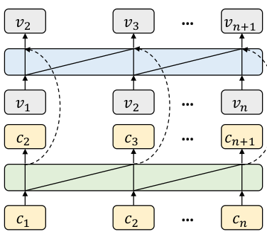

# Coarse-to-Fine Sparse Sequential Recommendation (粗到细的稀疏序列推荐)

- **会议/期刊**: SIGIR 2022
- **作者与机构**: Jiacheng Li, Julian McAuley (UCSD)；Tong Zhao, Jin Li, Jim Chan, Christos Faloutsos, George Karypis, Soo-Min Pantel (Amazon)
- **推荐链路定位**: 召回（Next-Item 序列召回）
- **研究方向**: 序列与会话推荐 / 冷启动与长尾推荐
- **论文原文**: [https://arxiv.org/abs/2204.01839v1](https://arxiv.org/abs/2204.01839v1)
- **开源代码**: 暂未开源

## TL;DR (1分钟核心速览)

针对自注意力序列推荐在**物品极度稀疏**（Amazon 密度 $2\times10^{-5}$）时长尾物品嵌入欠训练、注意力退化为只看最近几步的痛点，CaFe 提出"粗到细"双编码器框架：用低基数的**意图序列**（类目/卖家）独立跑 SASRec 得到稠密先验$R_c$，与带学习式局部掩码的物品编码器输出$R_v$ 相加，最后以**意图×物品联合概率**解码。在 `leave-last-2-out` + 100 负采样排序协议下，相对最强基线 LOCKER-F 平均提升 44.03% NDCG@5、44.53% HR@5。

## Background & Motivation (背景与核心矛盾)

- **主流范式**: SASRec/BERT4Rec 等自注意力模型以方向/双向 Transformer 直接对物品序列建模，全局注意力兼顾长期偏好与短期动态；FDSA/NOVA 等进一步把类目等 side-info 融进物品表征。
- **前人局限**: 作者用 BERT4Rec 做两组动机实验发现两个失效模式：(1) 稀疏数据上注意力分布明显偏向最近几十步，长程偏好几乎被丢弃；(2) 长尾低频物品嵌入散落在原点附近，高频物品才能聚成清晰簇——即**物品序列本身太稀疏，无法提供足够的监督信号**。
- **核心洞察 (Key Insight)**: 意图集合满足 $|C|\ll|V|$（Amazon 1392 vs 191 万），意图序列天然稠密；且 t-SNE 显示高频物品嵌入形成的簇与类目高度对齐，说明**意图可作为物品簇的现成先验**。
- **本文切入点**: 与其从稀疏物品"反推"意图（FDSA/NOVA 做法，在稀疏下反而掉点），不如**显式建模意图序列**，再用它把细粒度物品表征"拉"回语义簇。

<figure class="paper-figure" markdown="span">
  ![图2：动机实验。(a)(b) 展示 BERT4Rec \[17\] 的平均注意力图（前20个时间步）。(c)(d) 展示在 amazon 数据集上训练的 BERT4Rec 的物品嵌入（经 t-SNE \[20\] 投影）。物品类别用作着色标签（SPORT GOAL-绿色；LIP COLOR-橙色；CRIB-蓝色）。](../../../../assets/papers/2204.01839v1/figure_2.png)<figcaption>图2：动机实验。(a)(b) 展示 BERT4Rec [17] 的平均注意力图（前20个时间步）。(c)(d) 展示在 amazon 数据集上训练的 BERT4Rec 的物品嵌入（经 t-SNE [20] 投影）。物品类别用作着色标签（SPORT GOAL-绿色；LIP COLOR-橙色；CRIB-蓝色）。</figcaption>
</figure>

## Method (核心方法设计)

### 1. 整体框架 (Overall Architecture)

输入为同一用户的两条对齐序列：物品序列 $S_u^v$与意图序列$S_u^c$（第$i$步的意图即物品$v_i$所属类目/卖家）。意图编码器是标准 SASRec，输出$R_c$；物品编码器是加了**学习式局部掩码**的方向 Transformer，输出$R_v$；两者逐位置相加得$R=R_v+R_c$。训练时对物品头与意图头同时施加 BCE 损失；推理时分别算出$\sigma(r_{c_j,t})$与$\sigma(r_{v_k,t})$，按乘积排序取 Top-K，即在"意图过滤后的子空间"里挑物品。

```mermaid
flowchart TD
    A["物品序列 S_v (细粒度)"] --> B["物品编码器: 方向 Transformer + 学习式局部掩码"]
    C["意图序列 S_c (粗粒度/稠密)"] --> D["意图编码器: 标准 SASRec"]
    B --> E["R_v"]
    D --> F["R_c"]
    E --> G["融合 R = R_v + R_c"]
    F --> G
    G --> H["物品打分 r_v = R E_v^T"]
    D --> I["意图打分 r_c = R_c E_c^T"]
    H --> J["联合概率解码 P(c,v)=σ(r_c)·σ(r_v)"]
    I --> J
```

<figure class="paper-figure" markdown="span">
  <figcaption>图3：CaFe 框架示意图。</figcaption>
</figure>

### 2. 关键设计拆解 (Key Designs)

1. **显式意图编码与残差式注入**：FDSA/NOVA 之所以失效，是因为意图表征由物品序列隐式反推，在稀疏下基础表征本身就坏，噪声会被放大（实验上 NOVA 仅 0.0475 NDCG@5，低于无意图的 SASRec 0.1418）。CaFe 让意图走独立的稠密序列监督，再从编码器输出层做一次加性融合 $R=R_v+R_c$，等价于给每个位置的低频物品注入一个"簇中心"先验，而不改动注意力本身，训练极其稳定。

2. **学习式相对距离注意力掩码（Local Attention with Learned Bias）**：为抑制稀疏下的"只看近端"退化，作者在 softmax logit 上加可学习偏置 $\ln\theta_{ij}$：

$$f_{att}(Q_i,K_j)=\frac{\exp(w_{ij})\,\theta_{ij}}{\sum_{k=1}^{n}\exp(w_{ik})\,\theta_{ik}},\quad w_{ij}=\frac{Q_iK_j^{\top}}{\sqrt{d}}$$

$$\ln\theta_{ij}=\left(H_i^{l}W_Q^{(m)}+H_j^{l}W_K^{(m)}+d_{ij}\right)W_L^{(m)}+b_L$$

其中 $d_{ij}$取自长度为$2n$ 的相对距离嵌入表。相比 LOCKER 的硬窗口，该形式把"窗口宽度"变成由 query/key 内容与相对距离共同决定的软门控，既保留局部性又不丢长程信号。

3. **训练目标、负采样与推理效率**：损失为两路 BCE 直接相加 $\mathcal{L}=\mathcal{L}_c+\mathcal{L}_v$，每个时间步随机采样 1 个负意图、1 个负物品（Uniform 而非 Hard Negative），总复杂度与 SASRec 同阶、仅多一张小意图嵌入表。推理时打分需遍历$|V|+|C|$并与$\sigma(r_c)$ 相乘，相对纯物品模型约 2 倍打分开销；若做召回可先用意图头粗筛再在类目内精排，反而是**降延迟**的副产品。

## Experimental Setup & Evaluation Protocol (实验设置与评估协议)

- **数据集与预处理**:

| 数据集 | #Users(序列) | #Items | #Interactions | 稀疏度/密度 | 特征/场景说明 |
| :--- | :---: | :---: | :---: | :---: | :--- |
| Amazon | 131,248 | 1,910,226 | 5,370,171 | 2e-5 | 电商；物品类目(1,392)作意图 |
| Tmall (IJCAI-15) | 131,086 | 1,788,758 | 14,460,516 | 6e-5 | 电商；卖家(9,999)作意图 |

- **数据划分与防穿越**: `leave-last-2-out`（最后 1 个交互作 test、倒数第 2 个作 valid，其余训练），与 SASRec/BERT4Rec 保持一致。
- **排名评测协议**: `Sampled Ranking`——每个 ground-truth 物品按**流行度**随机采样 100 个负样本（正负比 1:100），报告 HR@5 / NDCG@5 / MRR@5；未做 Full-Ranking。
- **对比基线与超参设置**: 物品单模态（PopRec、SASRec、BERT4Rec、SSE-PT、LOCKER）与意图感知（NOVA、FDSA，以及作者自行扩展的 BERT-F、LOCKER-F）共 9 个基线；统一 $n=50$、$d=128$、batch=64；未报告显著性检验。

## Key Experimental Results (实验关键数据)

### 1. 主实验对比 (Main Results)

| 数据集 | 模型 | NDCG@5 | HR@5 | MRR |
| :--- | :--- | :---: | :---: | :---: |
| Amazon | PopRec | 0.0286 | 0.0487 | 0.0485 |
| Amazon | SASRec | 0.1418 | 0.1844 | 0.1522 |
| Amazon | BERT4Rec | 0.1830 | 0.2240 | 0.1956 |
| Amazon | SSE-PT | 0.2108 | 0.2501 | 0.2239 |
| Amazon | LOCKER | 0.2170 | 0.2597 | 0.2297 |
| Amazon | FDSA | 0.0670 | 0.1089 | 0.0857 |
| Amazon | BERT-F | 0.2199 | 0.2676 | 0.2329 |
| Amazon | LOCKER-F (次优) | 0.2436 | 0.2947 | 0.2529 |
| Amazon | **CaFe** | **0.3733** | **0.4813** | **0.3656** |
| Amazon | Improv. vs LOCKER-F | +53.24% | +63.32% | +44.56% |
| Tmall | BERT4Rec | 0.2753 | 0.3673 | 0.2782 |
| Tmall | LOCKER | 0.2961 | 0.3872 | 0.2979 |
| Tmall | FDSA | 0.1083 | 0.1685 | 0.1265 |
| Tmall | BERT-F | 0.2998 | 0.3917 | 0.3014 |
| Tmall | LOCKER-F (次优) | 0.3182 | 0.4098 | 0.3189 |
| Tmall | **CaFe** | **0.4290** | **0.5152** | **0.4268** |
| Tmall | Improv. vs LOCKER-F | +34.82% | +25.72% | +33.84% |

### 2. 消融实验 (Ablation Study)

Tmall 数据集，逐项累加（(1) 意图融合进物品嵌入；(2) 显式意图序列建模；(3) 物品编码器局部注意力；(4) 意图×物品联合概率推理）：

| 配置 | NDCG@5 | HR@5 | MRR |
| :--- | :---: | :---: | :---: |
| SASRec 骨干 | 0.0741 | 0.1205 | 0.0948 |
| +(1) FDSA 式隐式融合 | 0.1083 | 0.1685 | 0.1265 |
| +(1)(2) 显式意图建模 | 0.3045 | 0.3938 | 0.3069 |
| +(1)(2)(3) + 局部注意力 | 0.3159 | 0.4066 | 0.3172 |
| +(1)(2)(4) + 联合概率推理 | 0.4254 | 0.5117 | 0.4239 |
| +(1)(2)(3)(4) = **CaFe** | **0.4290** | **0.5152** | **0.4268** |

### 3. 关键实验发现 (Key Findings)

1. **"显式意图序列建模"是绝对主贡献，隐式反推是有害的**：从 FDSA 式融合的 0.1083 跳到显式意图编码的 0.3045，NDCG@5 增益 +181%；而 NOVA(0.0501)/FDSA(0.1083) 在 Tmall 上甚至不敌无意图的 BERT4Rec(0.2753)，证明稀疏场景下从物品序列反推意图只会引入噪声。
2. **测试期联合概率解码是第二大增量**：在 (1)(2)(3) 基础上加入 (4) 带来 0.3159→0.4254（+0.1131 NDCG@5），远大于局部注意力的 +0.0114，说明把意图当"粗粒度过滤门"用在解码端比仅用于表征端更划算。
3. **收益随稀疏度单调放大**：在 Amazon 上按最小物品频次 $k$构造不同稀疏度，$k=1$（最稀疏）时相对 BERT4Rec 提升 >100%，$k=20$（最稠密）时降至 <10%，与"意图序列稠密性补位低频物品"的动机完全吻合。

## Highlights & Limitations (亮点、对比与审稿批判)

- **与代表作对比 (vs. Prior Work)**: 相比 SASRec/BERT4Rec 仅用物品序列，CaFe 多出一条稠密的粗粒度监督通道；相比 FDSA/NOVA 把 side-info 当"特征"融进物品塔，CaFe 把意图升格为"独立预测目标 + 解码门控"；相比 LOCKER 的固定局部窗口，CaFe 用可学习 logit 偏置替代硬掩码，窗口形状由数据决定。
- **可迁移亮点**: (a) 形如 $\ln\theta_{ij}$ 的"距离+内容"可学习 logit 偏置可直接塞进任意 Transformer 序列推荐，几乎零额外成本；(b) 用低基数 side-info 构造"稠密代理序列"做多任务辅助监督，是缓解长尾欠训练的通用配方（可迁移到 POI 品类、视频标签、广告一级行业等）。
- **审稿级局限批判**: (1) 评估仅用 1:100 的**流行度负采样排序**，未做 Full-Ranking，绝对数值被显著抬高，且 BERT-F / LOCKER-F 系作者自行扩展的基线，公平性存疑；(2) 方法强依赖高质量层级 side-info（类目/卖家），实测推理需对 $|V|+|C|$ 全量打分并做乘积，线上召回需额外的意图倒排与两级级联，工程链路与延迟开销未被讨论。

## Rating (四维评分)

- **方法创新性 (Novelty)**: ⭐⭐⭐⭐ （把 side-info 从"特征"重定义为"粗粒度预测目标 + 解码先验"，配合学习式距离掩码，机制简洁但洞察扎实）
- **评估协议与实验扎实度 (Protocol & Experiments)**: ⭐⭐⭐ （两数据集 + 两组基线 + 完整消融 + 稀疏度扫描较充分，但仅 100 负采样排序、无 Full-Ranking 与显著性检验，自扩展基线削弱说服力）
- **写作与数学规范度 (Clarity & Rigor)**: ⭐⭐⭐⭐ （动机实验—公式—消融闭环严密，掩码公式与联合概率定义清晰，复杂度分析偏简）
- **工业落地与复现价值 (Industrial & Practical Value)**: ⭐⭐⭐ （无开源代码，但改动量小、可与现有 SASRec 栈无缝对接，意图级联还能降延迟，复现门槛低）

