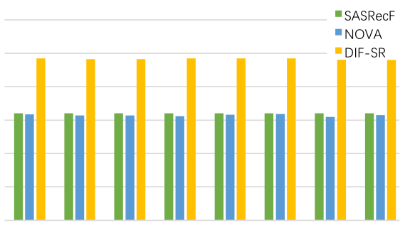
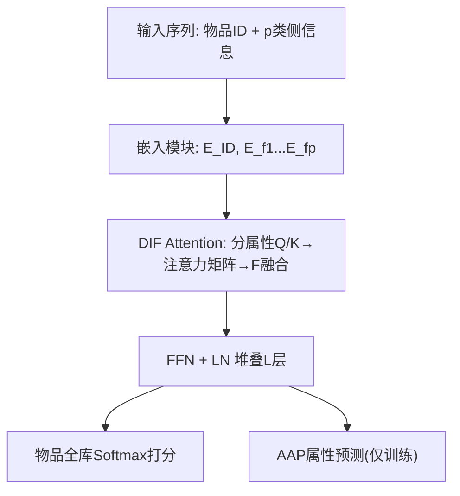
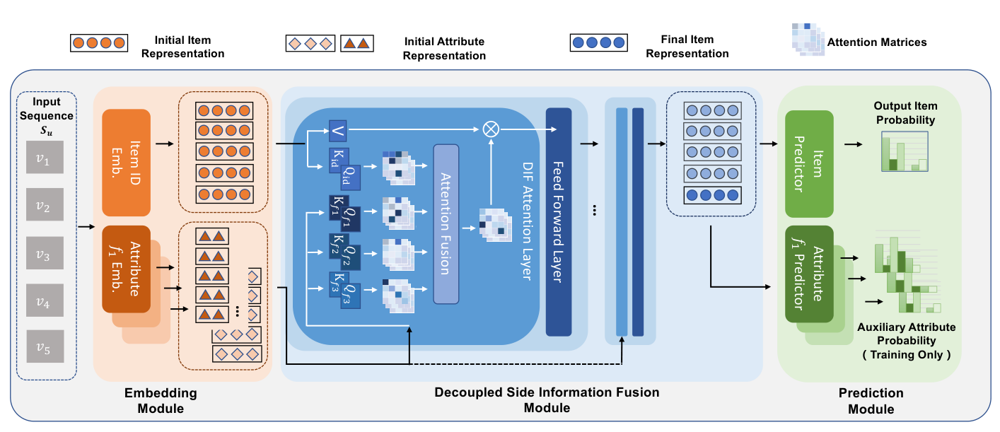

# Decoupled Side Information Fusion for Sequential Recommendation (解耦侧信息融合的序列推荐)

- **会议/期刊**: SIGIR 2022
- **作者与机构**: Yueqi Xie, Peilin Zhou, Sunghun Kim; HKUST, Upstage
- **推荐链路定位**: 召回（Next-Item 预测）
- **研究方向**: 序列与会话推荐
- **论文原文**: [论文原文链接](https://arxiv.org/abs/2204.11046v1)
- **开源代码**: [开源代码仓库链接](https://github.com/AIM-SE/DIF-SR)

## TL;DR (1分钟核心速览)

针对早期侧信息融合的秩瓶颈与混合相关扰动，DIF-SR 将侧信息从输入层移到注意力层，按物品 ID 与各属性分别计算 Q/K 并融合注意力矩阵，辅以辅助属性预测器多任务训练。四个 Amazon/Yelp 数据集采用 5-core、Leave-One-Out、Full-Ranking 评估，Recall@20/NDCG@20 平均较最强基线提升约 3–5%。

## Background & Motivation (背景与核心矛盾)

- **主流范式**: 基于 self-attention 的 SR（SASRec/BERT4Rec）为主，侧信息融合分支在输入层将属性嵌入与物品 ID 早期融合（SASRecF、NOVA、ICAI-SR、S3-Rec）。
- **前人局限**: 早期融合使注意力矩阵秩被多头 Q/K 投影维度 $d_h$卡住，秩$\le d_h$，表达力受限；异构属性混合到同一嵌入空间，跨属性相关噪声进入注意力；简单加法融合令物品与属性共享梯度，难以学习相对重要性。
- **核心洞察**: 解耦位置编码的启示：不混合输入，而在注意力层分开计算再融合注意力分数，可突破秩瓶颈并保留梯度弹性。
- **本文切入点**: 提出 DIF attention + AAP，把侧信息融合从“输入拼接/相加”改为“注意力矩阵级融合”。

<figure class="paper-figure" markdown="span">
  <figcaption>图1：注意力矩阵的秩：比较基于早期融合嵌入的解决方案（即SASRecF和NOVA）与本文提出的DIF-SR的注意力分数矩阵平均秩。嵌入的早期融合导致注意力矩阵秩更低，并限制表达能力。</figcaption>
</figure>

## Method (核心方法设计)

### 1. 整体框架 (Overall Architecture)

输入序列同时取出物品 ID 嵌入 $E_{ID}$与$p$类侧信息嵌入$E_{f_1},\dots,E_{f_p}$；堆叠$L$个 DIF block，每个 block 先由多头 DIF attention 对物品与各属性分别生成注意力矩阵，再用融合函数$\mathcal{F}$ 合成最终注意力矩阵，value 仅取纯物品表示；随后经 FFN/LN 更新物品表示。预测端对全库物品做 softmax，训练端额外挂 AAP 属性预测器，推理时移除。

<figure class="paper-figure" markdown="span">
  <figcaption>图2：所提出网络的概览。</figcaption>
</figure>

### 2. 关键设计拆解 (Key Designs)

1. **DIF Attention（解耦侧信息注意力）**：早期融合的秩瓶颈来自 $R=E_{ID}+\sum_jE_{f_j}$后再算 Q/K。DIF 改为物品与每个属性独立算注意力：$\text{att}_i^{ID}=(R^{ID}W_i^Q)(R^{ID}W_i^K)^\top$，$\text{att}_i^{f_j}=(E_{f_j}W_i^{Q,f_j})(E_{f_j}W_i^{K,f_j})^\top$，再融合$\text{DIF\_att}_i=\mathcal{F}(\text{att}_i^{ID},\{\text{att}_i^{f_j}\}_{j=1}^p)$，输出$\sigma(\text{DIF\_att}_i/\sqrt{d})(R^{ID}W_i^V)$。理论上早期融合秩$\le d_h$，DIF 可达$d_h+\sum_jd_{h_j}$；直觉是属性独立“对齐”后再融合，避免跨属性噪声，且各 Q/K 获得独立梯度。

2. **AAP（辅助属性预测器）**：仅靠注意力融合仍可能弱化属性监督。AAP 在最终物品表示 $R_L^{ID}[n]$上为每个属性加预测头：$\hat{y}^{(f_j)}=\sigma(W_{f_j}R_L^{ID}[n]^\top+b_{f_j})$，以多任务方式迫使物品表示保留属性可预测信息，从而激活侧信息对物品表示学习的反向影响；位置属性不参与 AAP。

3. **训练目标、负采样与推理效率**：总损失 $\mathcal{L}=\mathcal{L}_{id}+\lambda\sum_j\mathcal{L}_{f_j}$，物品侧为全物品 softmax 交叉熵，属性侧为 BCE；原文未采用采样负采样排序。推理仅保留物品分支做全库 top-K 打分；属性嵌入逐层不更新，且$d_{f_j}\le d$，可用更小属性维度降低多头分支开销，但每层仍有$p+1$ 组注意力计算。

## Experimental Setup & Evaluation Protocol (实验设置与评估协议)

- **数据集与预处理**: 四个公开数据集均做 `5-core` 过滤，交互视为隐式反馈：

| 数据集 | #Users | #Items | #Interactions | 稀疏度 | 特征/场景说明 |
| :--- | :---: | :---: | :---: | :---: | :--- |
| Beauty | 22,363 | 12,101 | 198,502 | 99.93% | Amazon 评论，品类+位置 |
| Sports | 35,598 | 18,357 | 296,337 | 99.95% | Amazon 评论，品类+位置 |
| Toys | 19,412 | 11,924 | 167,597 | 99.93% | Amazon 评论，品类+位置 |
| Yelp | 30,499 | 20,068 | 317,182 | 99.95% | 本地商务，类别+位置 |

- **数据划分与防穿越**: `Leave-One-Out`：每个用户序列最后两个物品分别作验证/测试，其余训练。
- **排名评测协议**: `Full-Ranking (全库未交互排序)`，非采样排序；报告 Recall@10/20 与 NDCG@10/20。
- **对比基线与超参设置**: 基线含 GRU4Rec、Caser、BERT4Rec、SASRec、GRU4RecF、SASRecF、S3Rec、NOVA、ICAI-SR；隐藏维度 $d=256$，200 epochs，batch 2048，lr 1e-4；网格搜索$d_f\in\{16,32,64,128,256\}$、heads$\{2,4,8\}$、layers$\{2,3,4\}$、$\lambda\in\{5,10,15,20,25\}$。原文未显式报告显著性检验，以多数据集稳定提升佐证。

## Key Experimental Results (实验关键数据)

### 1. 主实验对比 (Main Results)

下表保留 7 个代表性基线，单元格为 `Recall@20 / NDCG@20`，粗体为 DIF-SR 最优：

| 方法 | Beauty | Sports | Toys | Yelp |
| :--- | :---: | :---: | :---: | :---: |
| GRU4RecF | 0.0902/0.0369 | 0.0610/0.0253 | 0.0767/0.0316 | 0.0578/0.0236 |
| BERT4Rec | 0.0815/0.0309 | 0.0465/0.0173 | 0.0787/0.0297 | 0.0756/0.0385 |
| SASRec | 0.1197/0.0464 | 0.0773/0.0295 | 0.1168/0.0460 | 0.0928/0.0471 |
| SASRecF | 0.1013/0.0488 | 0.0640/0.0286 | 0.1052/0.0497 | 0.0675/0.0282 |
| S3Rec | 0.1236/0.0531 | 0.0758/0.0310 | 0.1349/0.0571 | 0.0902/0.0416 |
| NOVA | 0.1237/0.0527 | 0.0759/0.0307 | 0.1322/0.0567 | 0.0964/0.0483 |
| ICAI-SR | 0.1231/0.0528 | 0.0762/0.0302 | 0.1303/0.0561 | 0.0940/0.0470 |
| **DIF-SR** | **0.1284/0.0541** | **0.0800/0.0325** | **0.1382/0.0597** | **0.1003/0.0496** |

Improv.%：相对最强基线，Beauty/Sports/Toys/Yelp 的 R@20 分别约 +3.8%/+5.0%/+2.4%/+4.0%，N@20 分别约 +1.9%/+4.8%/+4.6%/+2.7%。

### 2. 消融实验 (Ablation Study)

表内为 Recall@20，括号为相对 `w/o DIF & AAP` 的 $\Delta$：

| 设置 | Yelp | Sports | Beauty |
| :--- | :---: | :---: | :---: |
| w/o DIF & AAP (SASRecF) | 0.0663 | 0.0621 | 0.0996 |
| w/o DIF (仅 AAP) | 0.0663 (+0%) | 0.0754 (+21.4%) | 0.0991 (-0.5%) |
| w/o AAP (仅 DIF) | 0.0968 (+46.0%) | 0.0767 (+23.5%) | 0.1240 (+24.5%) |
| **Full DIF-SR** | **0.1003 (+51.3%)** | **0.0800 (+28.8%)** | **0.1284 (+28.9%)** |

### 3. 关键实验发现 (Key Findings)

1. **DIF 是主增益来源**：仅加 DIF、去掉 AAP 已在 Yelp/Sports/Beauty 上带来 +46.0%/+23.5%/+24.5% 的 R@20 提升；而仅加 AAP、保留早期融合在 Yelp 为 0%、Beauty 为 -0.5%，说明秩瓶颈与混合相关才是早期融合的核心短板。
2. **AAP 需与 DIF 协同**：Full 相比 w/o AAP 在 Yelp 0.0968→0.1003（+3.6%）、Sports 0.0767→0.0800（+4.3%）、Beauty 0.1240→0.1284（+3.5%），验证 AAP 通过多任务监督激活属性信息，但前提是注意力层已解耦。
3. **即插即用性强**：DIF-SASRec 在三个数据集上 Recall@10/NDCG@10 平均相对提升 12.42%/22.64%，DIF-BERT4Rec 平均提升 18.46%/36.16%；如 DIF-BERT4Rec 在 Sports 的 NDCG@10 提升 52.31%，说明机制可迁移到单向/双向注意力 SR。

## Highlights & Limitations (亮点、对比与审稿批判)

- **与代表作对比 (vs. Prior Work)**: SASRecF 在输入层直接拼接/相加，秩与梯度均受限；NOVA 虽让 value 非侵入，但 Q/K 仍来自融合嵌入；ICAI-SR 在注意力前做属性聚合。DIF-SR 把融合推迟到注意力矩阵级，按属性解耦 Q/K，是本质差异。
- **可迁移亮点**: DIF attention 可作为 SASRec/BERT4Rec 的插件；AAP 多任务头可低成本增强离散属性监督；属性嵌入维度可显著小于物品维度，便于控制开销。
- **审稿级局限批判**: 每层 $p+1$ 组注意力分支在属性多、序列长时增加显存/时延；全物品 softmax 与全库打分在百万级物品工业场景成本高；AAP 依赖可预测的离散属性，连续/多值属性需改造；实验未报告显著性检验，且仅覆盖四类公开数据。

## Rating (四维评分)

- **方法创新性 (Novelty)**: ⭐⭐⭐⭐ （将侧信息融合从输入层移到注意力矩阵级，并用秩定理与梯度定理支撑解耦设计）
- **评估协议与实验扎实度 (Protocol & Experiments)**: ⭐⭐⭐⭐ （四数据集、Leave-One-Out、Full-Ranking、消融与插件实验完整；未报告显著性检验）
- **写作与数学规范度 (Clarity & Rigor)**: ⭐⭐⭐⭐ （定理、证明与符号清晰，但多头/属性符号较密，阅读门槛偏高）
- **工业落地与复现价值 (Industrial & Practical Value)**: ⭐⭐⭐⭐ （代码开源、插件化强；多属性注意力分支与全库 softmax 需工程优化）

