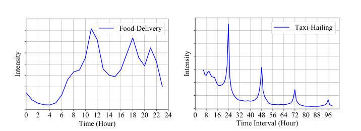
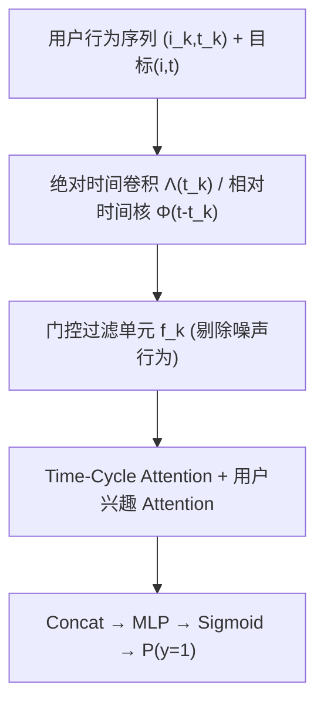
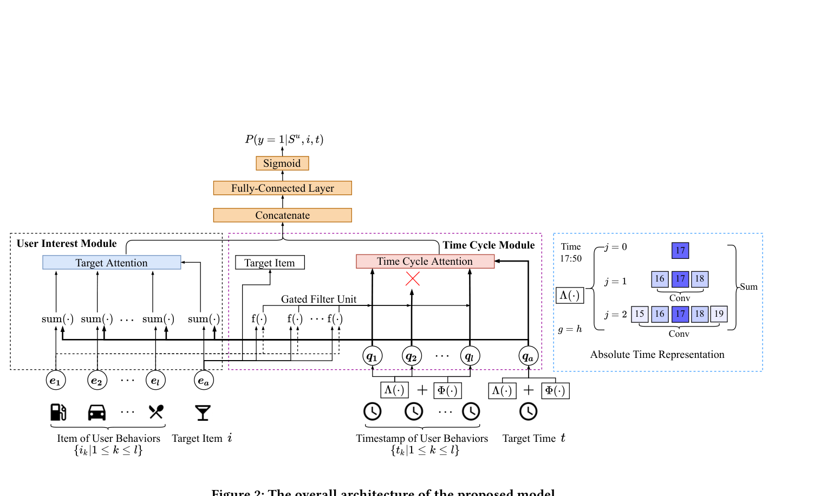

# Denoising Time Cycle Modeling for Recommendation (去噪时间周期建模推荐)

- **会议/期刊**: SIGIR 2022
- **作者与机构**: Sicong Xie, Qunwei Li, Weidi Xu, Kaiming Shen, Shaohu Chen, Wenliang Zhong（蚂蚁集团）
- **推荐链路定位**: 精排（CTR 预估，时间感知）
- **研究方向**: 序列与会话推荐 / CTR 预估与特征交叉
- **论文原文**: [论文原文链接](https://arxiv.org/abs/2402.02718v1)
- **开源代码**: 暂未开源

## TL;DR (1分钟核心速览)

现有时间感知推荐把用户**全部历史行为**都喂入时间建模，但大量与目标物品无关的行为实为噪声，掩盖了真正的周期律。DiCycle 将时间模式拆成**绝对时间周期 (ATC)** 与**相对时间周期 (RTC)** 两路：前者用一维卷积聚合相邻时隙缓解离散化信息损失，后者借 Bochner 定理用平移不变核把时间戳映射为内积可测时间间隔的向量；再用阈值门控 `sim(e_a,e_k)` 硬性剔除噪声行为，最后用 time-cycle attention 融合。在 LastFM/ML-1M/Books 及一个工业数据集（20 亿交互）4 集上，AUC RelaImpr 分别为 12.94%/5.35%/2.61%/2.08%，GAUC 17.31%/5.13%/2.82%/3.14%。

## Background & Motivation (背景与核心矛盾)

- **主流范式**: SASRec/TiSASRec/TimeLSTM/TimelyRec 等用自注意力、时间门或显式时间戳建模用户行为序列的时序规律，做 next-item 或 CTR 预测。
- **前人局限**: (1) 它们把**所有行为**不区分地纳入时间建模，未考虑与目标物品无关的行为会稀释周期信号；(2) 绝对时间被离散成 hour/weekday 嵌入，17:50 与 18:10 被割裂，连续性丢失。
- **核心洞察 (Key Insight)**: 如图 1 所示，外卖类目点击在 11/18/21 点形成日内峰值（ATC，语义时间的周期），打车类目在末次点击后每 24 小时出现局部峰并随时间衰减（RTC，时间间隔驱动的周期）——两类周期并存且须**对目标物品相关**的行为才有效。
- **本文切入点**: 用门控过滤与目标物品强相关行为，再对 ATC / RTC 分别设计专用时间编码并联合建模。

<figure class="paper-figure" markdown="span">
  <figcaption>图1：两种典型用户行为时间模式的分析。</figcaption>
</figure>

## Method (核心方法设计)

### 1. 整体框架 (Overall Architecture)

输入为用户历史行为序列 $S_u=\{(i_k,t_k)\}$、目标物品$i$与目标时刻$t$。模型分两支：**用户兴趣模块**（类 DIN 的 target attention，将时间嵌入$q_k$与物品嵌入$e_k$相加作侧信息）与**时间周期模块**。时间周期模块先将每条行为时间戳编码为$q_k=\Phi(t-t_k)+\Lambda(t_k)$（相对核 + 绝对卷积），经**门控过滤单元**按与目标物品相似度置零噪声行为，再送入 **time-cycle attention** 得到$h$；与兴趣模块输出$r$ 拼接后过 3 层 MLP + Sigmoid 得点击概率，交叉熵训练。

<figure class="paper-figure" markdown="span">
  <figcaption>图2：所提模型的整体架构。</figcaption>
</figure>

### 2. 关键设计拆解 (Key Designs)

1. **绝对时间卷积编码 (ATC)**：痛点—小时/星期离散嵌入割裂相邻时隙。做法—围绕目标时刻取半径 $J(=2)$的邻域$\Lambda^S_{g,j}(t)$，对每个粒度$g$做一维卷积+ReLU+max-pooling 再求和：$\Lambda(t)=\sum_{g\in G}\sum_{j=1}^{J}\text{Pooling}(\text{ReLU}(\text{Conv}(\Lambda^S_{g,j}(t),K)))$。直觉—CNN 局部感受野使 17:50 与 18:10 因共享邻域时隙而获得相近表示，恢复时间连续性。

2. **相对时间核编码 (RTC)**：痛点—需让内积 $\langle\Phi(t_1),\Phi(t_2)\rangle$仅依赖间隔$|t_2-t_1|$且随间隔衰减。做法—依 Bochner 定理构造平移不变核$\mathcal{K}(t_1,t_2)=\psi(t_2-t_1)$，映射为
$$\Phi(t)=\sqrt{\tfrac{1}{d/2}}\big[\cos(\omega_1 t),\sin(\omega_1 t),\cdots,\cos(\omega_{d/2}t),\sin(\omega_{d/2}t)\big]$$
其中 $\omega_i$ 可学习。直觉—不同频率三角基的内积随间隔振荡衰减，天然复现"每 24h 出现局部峰"的 RTC 现象。

3. **门控去噪与 Time-Cycle Attention**：设目标/行为嵌入 $e_a,e_k$，门控权重$f_k=\text{sim}(e_a,e_k)$若$\geq\delta_{thred}$否则 0，$\text{sim}(e_a,e_k)=\frac{1+\cos(e_a,e_k)}{2}$；令$\tilde{q}_k=f_k q_k$后做注意力$\alpha_{aj}\propto\exp\!\big(q_aW_Q(\tilde{q}_jW_K)^\top/\sqrt{d}\big)$，$h=\sum_j\alpha_{aj}\tilde{q}_kW_V$。硬阈值直接把弱相关行为的整条时间向量置零，避免噪声污染周期统计。总损失为标准交叉熵$\mathcal{L}=-\sum_j[y_j\log P(y_j)+(1-y_j)\log(1-P(y_j))]$，负采样采用 1:1 随机未交互采样，无特殊难负样本挖掘。

## Experimental Setup & Evaluation Protocol (实验设置与评估协议)

- **数据集与预处理**（交互含点击/评论/收听）：

| 数据集 | #Users | #Items | #Interactions | 平均/用户 | 特征/场景说明 |
| :--- | :---: | :---: | :---: | :---: | :--- |
| LastFM | 627 | 341,169 | 14,612,388 | 23,305 | 极稀疏音乐收听 |
| ML-1M | 6,040 | 3,416 | 999,611 | 165 | 电影评分 |
| Books | 264,522 | 954,865 | 13,616,232 | 51 | Amazon 图书 |
| IndRec | 0.1B | 1M | 20B | 200 | 两周线上工业日志 |

- **数据划分与防穿越**: `Leave-One-Out`（每用户最后一条作测试，其余训练）；IndRec 另行以点击/曝光未点击分别标正负样本。
- **排名评测协议**: 非全库排序，采用 CTR 二分类 AUC / GAUC 评估，负样本 1:1 随机采样。
- **对比基线与超参**: LR、DNN、DIN、SASRec、GRU4Rec、TimeLSTM、TiSASRec、TimelyRec；公共集 $d=64$、batch 128、lr$1e-4$，IndRec$d=16$、batch 1024；行为长度 200/200/100/100。

## Key Experimental Results (实验关键数据)

### 1. 主实验对比 (Main Results)

| Method | LastFM AUC | ML-1M AUC | Books AUC | IndRec AUC | LastFM GAUC | IndRec GAUC |
| :--- | :---: | :---: | :---: | :---: | :---: | :---: |
| LR | 0.7353 | 0.7883 | 0.7647 | 0.7736 | 0.7418 | 0.7198 |
| DNN | 0.7376 | 0.8532 | 0.7802 | 0.7869 | 0.7416 | 0.7283 |
| DIN | 0.7368 | 0.8561 | 0.7804 | 0.7930 | 0.7432 | 0.7331 |
| SASRec | 0.7475 | 0.8687 | 0.7820 | 0.7944 | 0.7480 | 0.7369 |
| TimeLSTM | 0.7479 | 0.8622 | 0.7833 | 0.7968 | 0.7524 | 0.7375 |
| TiSASRec | 0.7480 | 0.8648 | 0.7912 | 0.7979 | 0.7464 | 0.7379 |
| TimelyRec | 0.7460 | 0.8754 | 0.7875 | 0.7984 | 0.7416 | 0.7386 |
| **DiCycle** | **0.7801** | **0.8955** | **0.7988** | **0.8046** | **0.7961** | **0.7461** |
| **RelaImpr** | **12.94%** | **5.35%** | **2.61%** | **2.08%** | **17.31%** | **3.14%** |

### 2. 消融实验 (Ablation Study)

| Variant (AUC) | LastFM | ML-1M | Books | IndRec |
| :--- | :---: | :---: | :---: | :---: |
| DiCycle 完整 | 0.7801 | 0.8955 | 0.7988 | 0.8046 |
| w/o Absolute Time | 0.7761 | 0.8906 | 0.7941 | 0.8036 |
| w/o Relative Time | 0.7764 | 0.8928 | 0.7932 | 0.8016 |
| w/o Time Cycle Module | 0.7539 | 0.8797 | 0.7862 | 0.7974 |

### 3. 关键实验发现 (Key Findings)

1. **Time-cycle 模块是决定性组件**：移除后 LastFM 从 0.7801 跌至 0.7539（AUC -0.0262，相当于论文口径 -9.35%），ML-1M -0.0158、Books -0.0126；说明去噪+周期融合而非单纯时间嵌入才是增益主因。
2. **ATC 与 RTC 增益互补且场景依赖**：Books/IndRec 去掉相对时间损失更大（相对更关键，因长间隔重复行为），LastFM/ML-1M 去掉绝对时间更伤（语义时刻主导），验证需两路联合。
3. **稀疏集增益最大**：LastFM（极稀疏、平均 23k 交互）RelaImpr 12.94% 远高于密集中 IndRec 2.08%，说明去噪周期建模在噪声比例高的稀疏场景收益显著。

## Highlights & Limitations (亮点、对比与审稿批判)

- **与代表作对比**: 相比 TiSASRec/TimeLSTM 仅做时间戳门控或间隔核，DiCycle 首次引入**目标相关行为去噪**；相比 TimelyRec 的端到端异构时间模式，DiCycle 显式区分 ATC/RTC 并用 Bochner 核给出理论化时间间隔编码。
- **可迁移亮点**: (1) 用平移不变核 $\Phi(t)$ 把时间间隔转为可内积向量，可迁移到任意时序/POI 推荐；(2) 硬阈值门控 `sim` 剔除噪声行为是低成本、可解释的去噪 trick。
- **审稿级局限批判**: (1) 门控阈值 $\delta_{thred}$ 依赖测试集交叉验证，存在**标签泄漏与超参敏感**风险；(2) 依赖 1:1 随机负采样与 AUC 评测，未做 Full-Ranking 或线上 A/B，工业增益 2.08% 的可解释性与延迟开销未量化。

## Rating (四维评分)

- **方法创新性 (Novelty)**: ⭐⭐⭐⭐ （ATC 卷积保连续 + RTC 核函数 + 目标相关门控去噪的组合新颖，但各组件单看均有前人影子）
- **评估协议与实验扎实度 (Protocol & Experiments)**: ⭐⭐⭐⭐ （4 集含工业大规模、8 基线充分，但仅 AUC/GAUC sampled 协议，缺全库排序与显著性检验）
- **写作与数学规范度 (Clarity & Rigor)**: ⭐⭐⭐⭐ （公式与 Bochner 动机清晰，门控阈值选取与复杂度分析略欠）
- **工业落地与复现价值 (Industrial & Practical Value)**: ⭐⭐⭐⭐ （蚂蚁真实 20B 交互验证落地可行，但未开源、阈值调参成本与环境耦合度高）

