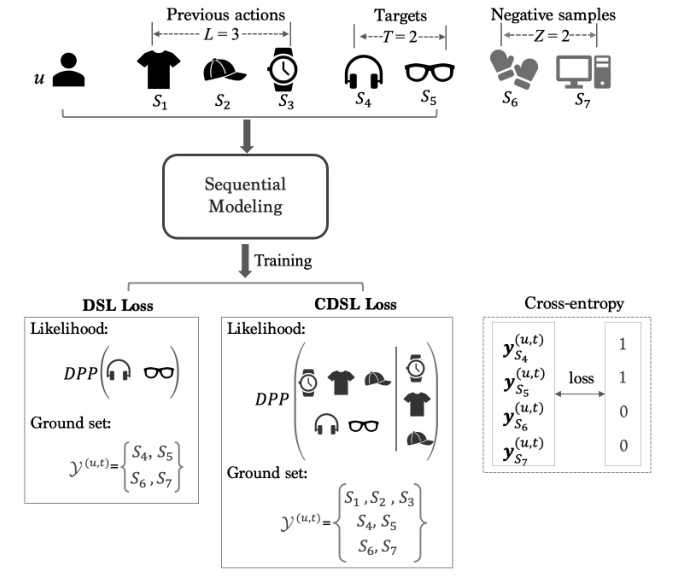
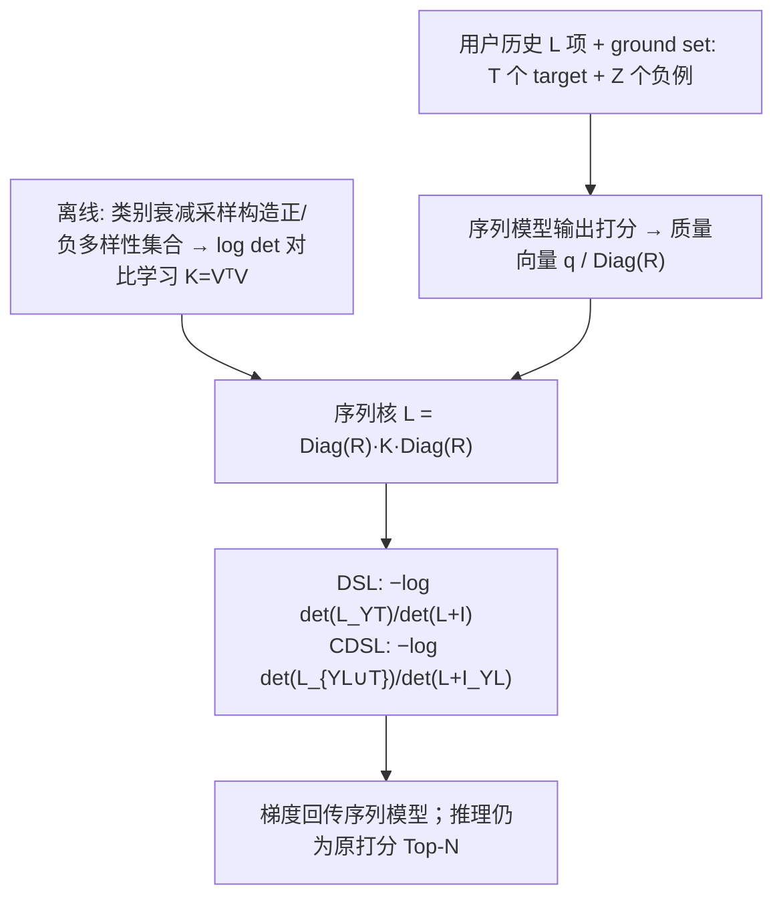

# Determinantal Point Process Likelihoods for Sequential Recommendation (序列推荐的行列式点过程似然损失)

- **会议/期刊**: SIGIR 2022 (ACM SIGIR, Madrid)
- **作者与机构**: Yuli Liu, Christian Walder, Lexing Xie (Australian National University & Data61, CSIRO)
- **推荐链路定位**: 精排（训练目标/损失层面，架构无关的即插即用模块）
- **研究方向**: 序列与会话推荐 / 列表级与多目标排序
- **论文原文**: [https://arxiv.org/abs/2204.11562v1](https://arxiv.org/abs/2204.11562v1)
- **开源代码**: [https://github.com/l-lyl/DPPLikelihoods4SeqRec](https://github.com/l-lyl/DPPLikelihoods4SeqRec)

## TL;DR (1分钟核心速览)

序列推荐长期只在网络架构上做文章，损失一律沿用 pointwise BCE 或 pairwise BPR，而这两类损失把每个 target 当作独立样本比较，既忽略 target 之间的相互依赖，也只优化 relevance、不优化"整个推荐集合被抽中的概率"。本文把 next-item(s) 预测重新表述为**从用户序列专属 ground set 中抽取子集的集合选择问题**，直接以行列式点过程 (DPP) 集合似然的负对数作损失：DSL（target 集合似然）与 CDSL（以历史项为条件的条件 DPP 似然）。损失中的核矩阵经质量-多样性分解 $\mathbf{L}=\mathrm{Diag}(\mathbf{R})\,\mathbf{K}\,\mathrm{Diag}(\mathbf{R})$，使多样性内生进训练目标。在 ML-1M / Anime / Beauty 三数据集、三种 SOTA 基座上直接替换损失即获得显著提升，Beauty 上 Caser 的 Recall@3 提升最高 **+37.2%**，Anime 上 MARank 的 Recall@3 **+39.4%**。

## Background & Motivation (背景与核心矛盾)

- **主流范式**: Caser / MARank / SASRec 等以 CNN、多阶注意力、自注意力建模序列依赖，训练目标统一为二值交叉熵（pointwise）或 BPR（pairwise），损失中每个 target 独立参与比较。
- **前人局限 1（target 依赖缺失）**: 当训练目标是预测接下来 $T>1$个物品时，BCE 的似然可分解为$\prod_{i\in\mathcal{D}_t}\sigma(\cdot)\prod_{j\notin\mathcal{D}_t}(1-\sigma(\cdot))$，即各 target 相互独立，模型只能分别学到$\{\text{shirt,hat,watch},\text{headphones}\}$与$\{\text{shirt,hat,watch},\text{glasses}\}$ 两条序列，无法表达"耳机与眼镜作为同一个配件购买集合共同出现"。
- **前人局限 2（只优化排序、不优化集合）**: 排序损失逼迫模型抬高单个物品分数，却从不显式提高"这一组 target 作为整体被选中"的概率，导致 top-N 结果高度同质、用户兴趣窄化。
- **核心洞察 (Key Insight)**: DPP 给出 $\mathbb{P}(Y)\propto\det(\mathbf{L}_Y)$，其中$\mathbf{L}_{ii}$是元素$i$的边缘包含概率、$\mathbf{L}_{ii}\mathbf{L}_{jj}-\mathbf{L}_{ij}^2$是$i,j$ 共同被选中的概率——**相似度越大越难共存（排斥/多样性）**，天然同时编码"质量"与"多样性"，且行列式边际化可解析计算，不像 MAP 推断那样 NP-hard。
- **本文切入点**: 不改网络，只把损失换成 DPP 集合似然的负对数，让"依赖建模 + 多样性"从推理后处理（DPP-MAP）前移到训练目标。

<figure class="paper-figure" markdown="span">
  <figcaption>图1：基于DPP分布集合似然的损失函数与基础交叉熵损失函数的简化对比图。</figcaption>
</figure>

## Method (核心方法设计)

### 1. 整体框架 (Overall Architecture)

流程分两阶段。**离线阶段**：对每个用户的交互列表用"类别衰减采样"（选中某物品后其所属类别所有物品的被选概率乘以 $0.5$）构造类别分散的正样本集合，并采样同类别但未交互的负集合，用$\log\det$对比损失预训练一个低秩多样性核$\mathbf{K}=\mathbf{V}^{\top}\mathbf{V}$（$D\ll|\mathcal{Y}|$）。**训练阶段**：把序列模型（Caser / MARank / SASRec）对 ground set$\mathcal{Y}^{(u,t)}$（$T$个 target$+\,Z$个负例，CDSL 还含$L$个历史项）的打分$\mathbf{R}$作为质量项，与$\mathbf{K}$组装成序列核$\mathbf{L}$，再计算 DSL / CDSL 负对数似然反传。**推理阶段**不改变任何流程，仍用原模型打分做 Top-N，因此无额外线上开销、也不需 MAP 搜索。

### 2. 关键设计拆解 (Key Designs)

1. **DSL：把 target 集合当作一次 DPP 抽样**：痛点是的 BCE/BPR 逐 target 独立。做法是直接用 DPP 归一化恒等式 $\sum_{Y'\subseteq\mathcal{Y}}\det(\mathbf{L}_{Y'})=\det(\mathbf{L}+\mathbf{I})$ 得到目标集合概率
$$\mathcal{L}_{\text{DSL}}=-\log\mathbb{P}(Y_T)=-\log\frac{\det(\mathbf{L}_{Y_T})}{\det(\mathbf{L}+\mathbf{I})}.$$
直觉：$\det$展开包含$\mathbf{L}_{ij}^2$交叉项，等价于对 target 之间的冗余相似施加惩罚，等价于"整组一起被抽中"的概率最大化。注意$T=1$时该损失退化为纯对角项、失去意义，故原文只在$T>1$ 使用 DSL。

2. **CDSL：条件 DPP 补上序列依赖**：DSL 只建模 target 间依赖，不建模历史与 target 之间的依赖。CDSL 把 DPP 条件化在已观测历史集 $Y_L$上，让整个序列$Y_{L\cup T}$ 成为一次抽取对象：
$$\mathcal{L}_{\text{CDSL}}=-\log\mathbb{P}(Y_{L\cup T}\mid Y_L)=-\log\frac{\det(\mathbf{L}_{Y_{L\cup T}})}{\det\!\big(\mathbf{L}+\mathbf{I}_{Y_L}\big)},$$
其中 $\mathbf{I}_{Y_L}$只在 ground set 中未被观测的位置置 1。好处是$T=1$ 时仍有效（此时只利用序列依赖），且 ground set 变大后核分解更偏向多样性，因此 CDSL 的 category coverage 通常优于 DSL。

3. **质量-多样性分解核与训练目标**：为把个性化 relevance 注入纯相似度核，采用 $\mathbf{L}_{ij}=q_i\,\boldsymbol{\phi}_i^{\top}\boldsymbol{\phi}_j\,q_j$，$q_i$即序列模型打分，$\mathbf{K}=\mathbf{V}^{\top}\mathbf{V}$ 由
$$\ell_{\text{div}}=\sum_{(T^{(+)},T^{(-)})\in\mathcal{T}}\Big[\log\det(\mathbf{K}_{T^{(+)}})-\log\det(\mathbf{K}_{T^{(-)}})\Big]$$
预训练。总损失即上述 DSL/CDSL 负对数似然（对数域即"正集合似然减负集合似然"，等价于一次集合级对比学习，**无需 InfoNCE 式大量负采样**）；负采样数为 $Z=2$（$T=1$）或$Z=T$（$T>1$），历史长度$L=5$（$T=1$）/$L=6$（$T>1$）。额外开销主要是$\mathcal{O}(|Y|^3)$ 的行列式（Cholesky），实测每 epoch 慢约 2 倍，但因收敛更快，总训练时长仅增 0.2%–11%。

## Experimental Setup & Evaluation Protocol (实验设置与评估协议)

- **数据集与预处理**: 三个公开数据集，均采用 `10-core` 过滤，按时间戳排序构造序列：

| 数据集 | #Users | #Items | #Interactions | 稀疏度/密度 | 特征/场景说明 |
| :--- | :---: | :---: | :---: | :---: | :--- |
| ML-1M | 6.0k | 3.4k | 1.0M | ~4.9% | 电影评分，18 个类别 |
| Anime | 73.5k | 12.2k | 1.0M | ~0.11% | 动漫评分，43 个类别 |
| Beauty | 52.0k | 57.2k | 0.4M | ~0.013% | 亚马逊美妆评论，213 类别、高稀疏 |

- **数据划分与防穿越 (Splitting Strategy)**: 时间序切分——每个用户**最后 $T$项作为测试集**（$T\in\{1,2,3,5\}$），剩余项中**前 90% 训练、后 10% 验证**（严格按时间戳先后，无穿越）。测试集大小随$T$ 变化，与训练 target 数保持一致。
- **排名评测协议 (Ranking Protocol)**: 沿用 Caser/SASRec 基线的默认候选集评估（原文**未显式声明 Full-Ranking 全库排序**，属采样候选评估口径），$N\in\{3,5,10\}$。指标：质量 Recall@N / NDCG@N；多样性 Category Coverage（top-N 覆盖类别数 / 数据集总类别数）；权衡$F@N=2\cdot q\cdot d/(q+d)$，$q$为 Re 与 Nd 的均值、$d$ 为 CC。
- **对比基线与超参设置**: 三个代表基座各自保留原损失（Caser+BCE、MARank+BPR、SASRec+BCE）作为对照，仅**替换损失**、其余网络结构与默认超参不动，保证对比只反映损失差异；早停策略为验证集 NDCG@5 连续 10 epoch 不升；显著性以相对提升 $>5\%/*$、$>10\%/**$、$>20\%/***$ 标注。

## Key Experimental Results (实验关键数据)

### 1. 主实验对比 (Main Results)

（下表为原文表 2–4 的代表性切片；同一基座下 DSL/CDSL 仅替换损失，加粗为该行最优，括号为相对同基座原损失的提升）

| 数据集 (T) | 基座 + 损失 | Re@3 | Re@10 | Nd@10 | CC@5 | F@10 |
| :--- | :--- | :---: | :---: | :---: | :---: | :---: |
| Beauty (T=1) | SASRec + BCE | 0.0873 | 0.2079 | 0.1086 | 0.0527 | 0.1047 |
| Beauty (T=1) | SASRec + CDSL | **0.1032** (+18.2%) | **0.2286** | **0.1239** (+14.1%) | 0.0507 | **0.1081** |
| Beauty (T=3) | Caser + BCE | 0.0414 | 0.0975 | 0.1035 | 0.0662 | 0.0999 |
| Beauty (T=3) | Caser + DSL | **0.0568** (+37.2%) | **0.1388** | **0.1420** (+37.2%) | **0.0668** | **0.1216** (+21.7%) |
| Beauty (T=3) | Caser + CDSL | 0.0496 (+19.8%) | 0.1289 | 0.1260 | 0.0657 | 0.1166 |
| Beauty (T=5) | Caser + BCE | 0.0434 | 0.1219 | 0.1758 | 0.0637 | 0.1219 |
| Beauty (T=5) | Caser + CDSL | **0.0554** (+27.6%) | **0.1430** | **0.1954** (+11.2%) | 0.0640 | **0.1297** |
| Anime (T=3) | MARank + BPR | 0.1346 | 0.2616 | 0.3361 | 0.3381 | 0.3618 |
| Anime (T=3) | MARank + DSL | **0.1876** (+39.4%) | **0.3826** (+46.3%) | **0.4487** (+33.5%) | 0.3327 | **0.4353** |
| Anime (T=3) | MARank + CDSL | 0.1738 (+29.1%) | 0.3591 | 0.4264 | 0.3320 | 0.4202 |
| ML-1M (T=3) | Caser + BCE | 0.0506 | 0.1313 | 0.1634 | 0.3498 | 0.2281 |
| ML-1M (T=3) | Caser + CDSL | **0.0561** (+10.9%) | **0.1329** | **0.1718** | **0.3570** | **0.2348** |

### 2. 消融实验 (Ablation Study)

原文无传统 `w/o module` 消融，其"依赖建模粒度"扫描等价于逐项加回组件（$T$ 同时作为敏感度维度），下表取 Caser / Anime 与 Caser / Beauty 的 NDCG@10 / F@10：

| 依赖建模粒度 | Beauty T=1 | Beauty T=3 | Beauty T=5 | Anime T=3 |
| :--- | :---: | :---: | :---: | :---: |
| 无依赖（BCE 原损失） | 0.0806 / 0.1080 | 0.1035 / 0.0999 | 0.1758 / 0.1219 | 0.4144 / 0.4225 |
| + target 依赖（DSL） | 不适用 | 0.1420 / 0.1216 | 0.1822 / 0.1226 | 0.4397 / 0.4445 |
| + target & 序列依赖（CDSL） | **0.1029 / 0.1198** | 0.1260 / 0.1166 | **0.1954 / 0.1297** | **0.4589 / 0.4522** |

### 3. 关键实验发现 (Key Findings)

1. **瓶颈在损失而非容量**：Beauty / T=3 上仅把 BCE 换成 DSL（网络完全不动），Re@3 从 0.0414 升到 0.0568（**+37.2%**），说明 BCE 的"target 独立"假设本身压制了序列推荐；增益幅度远超同期架构改进，且对 CNN（Caser）、多阶注意力（MARank）、自注意力（SASRec）三类骨干一致成立。
2. **两种依赖互补、且 CDSL 更普适**：$T=1$时 DSL 不可用而 CDSL 仍把 Beauty/SASRec 的 Re@3 抬高 18.2%，证明序列依赖是更基础的一层；$T>1$时叠加 target 依赖进一步获益，但$T=5$时 target 间噪声/混淆依赖使 DSL 增益衰减（Beauty T=5 Nd@10 仅 +3.6%，而 CDSL +11.2%），$T=3$ 是甜点。CDSL 因 ground set 扩大使核分解更偏向多样性，CC 通常更优（Anime T=3 Caser CC@5 0.3463→0.3539）；个别案例（ML-1M/Anime T=3 的 SASRec、Beauty T=3 的 MARank F@10）基座仍略优，属少数。
3. **"慢一点、快收敛"的效率账**：MARank / Anime T=3 上 CDSL 每 epoch 55.15s（基线 25.37s，2.2×），但收敛 epoch 由 38 降到 19，总时长仅 **+8.7%**；Beauty T=3 总时长 +11.2%、$T=1$ 仅 +6.0%；且提出损失在更低学习率（0.0005）下表现更好、更早触发早停，说明集合似然的梯度更"稳"。

## Highlights & Limitations (亮点、对比与审稿批判)

- **与代表作对比 (vs. Prior Work)**: ① 与 DPP-MAP 后处理多样化（Chen et al., SIGIR'18 一类）本质不同——把 NP-hard 的推理期 MAP 换成可解析、可求导的训练期似然；② 与 Caser [39] / SASRec [22] 正交——不改网络，只换目标，因此可直接叠在更强的骨干上；③ 与 listwise ranking 不同，listwise 依赖排序位置与置换概率，在二值 relevance 的推荐场景不可用，而 DPP 只需集合级的行列式，复杂度可控。
- **可迁移亮点**: $\mathbf{L}=\mathrm{Diag}(\mathbf{R})\mathbf{K}\mathrm{Diag}(\mathbf{R})$的"模型打分作质量项 + 预训练低秩核作多样性项"是一个通用插件，可直接套到重排、basket 推荐、多目标精排的列表级损失上；$\log\det$ 正负集合对比也是免 InfoNCE 温度超参的集合级对比范式。
- **审稿级局限批判**: ① **评测口径不清**——原文未明确是 Full-Ranking 还是采样候选排序，与近年无偏全库评测潮流不可比，CC 指标也强依赖人工类目体系；② **元数据依赖与复杂度**——多样性核须靠"类别衰减采样"弱监督构造，无类目/冷启物品场景不可用，且 $\det(\mathbf{L}+\mathbf{I})$的$\mathcal{O}(|Y|^3)$开销随$T+Z$增长，$T$大时（$T=5$ 已见噪声依赖）不划算；③ 实验止步 3 个经典数据集、无线上 A/B、无方差/显著性检验，仅用百分比阈值标注。

## Rating (四维评分)

- **方法创新性 (Novelty)**: ⭐⭐⭐⭐ （把 DPP 从"推理期多样化后处理"翻转为"训练期集合似然损失"，视角新；但 DPP 与质量-多样性分解均为既有理论，增量在于条件化与损失化）
- **评估协议与实验扎实度 (Protocol & Experiments)**: ⭐⭐⭐ （三骨干 × 四档 $T$ 的交叉验证相当完整，但划分/打分口径交代不清、缺显著性检验与无偏全库排序）
- **写作与数学规范度 (Clarity & Rigor)**: ⭐⭐⭐⭐ （DSL/CDSL 由归一化恒等式到条件 DPP 的推导链条干净，符号统一；推理与训练复杂度的讨论略简）
- **工业落地与复现价值 (Industrial & Practical Value)**: ⭐⭐⭐ （代码开源、损失即插即用、线上零额外推理开销是真优势；但依赖类目元数据与每 epoch 约 2× 的行列式训练开销，限制了超大物品集场景）

