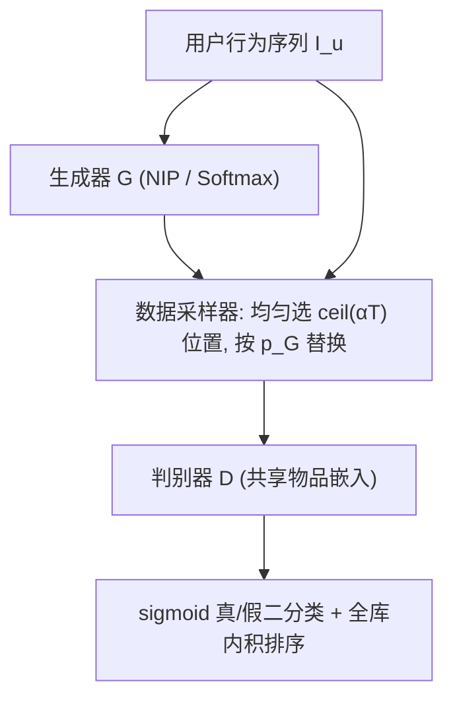
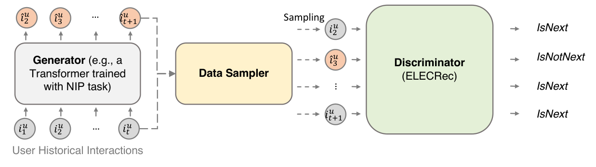

# ELECRec: Training Sequential Recommenders as Discriminators (将序列推荐器训练为判别器)

- **会议/期刊**: SIGIR 2022（Short Paper, 6 页）
- **作者与机构**: Yongjun Chen, Jia Li, Caiming Xiong（Salesforce Research）
- **推荐链路定位**: 召回（序列编码器 + 全库内积排序）
- **研究方向**: 序列与会话推荐 / 自监督对比学习与交互去噪
- **论文原文**: [https://arxiv.org/abs/2204.02011v4](https://arxiv.org/abs/2204.02011v4)
- **开源代码**: [https://github.com/YChen1993/ELECRec](https://github.com/YChen1993/ELECRec)

## TL;DR (1分钟核心速览)

本文针对 Next-Item Prediction（NIP）生成式训练「需大量代表性样本、Softmax 全词表更新慢」的痛点，把序列推荐器改造为 ELECTRA 式判别器：辅助生成器按比例替换序列位置生成"看似合理"的伪下一项，判别器仅做真/假二分类，推理时丢弃生成器。在 4 个数据集、`Leave-One-Out` + `Full-Ranking` 协议下，HR@5/NDCG@5 相对最优基线提升 38.28%–137.16%，且任意训练时长下均优于 SASRec。

## Background & Motivation (背景与核心矛盾)

- **主流范式**: Transformer 序列编码器（SASRec/BERT4Rec/S³-Rec/Seq2Seq）以 NIP 的 Softmax 交叉熵训练，或用 mask/reorder/crop 增广、伪先验物品补数据。
- **前人局限**: ① NIP 依赖足量「有代表性」的共现序列，如「夹克→球鞋→裤子→毛衣→篮球」这类跨品类跳转在稀疏数据中极稀缺，Softmax 又要对全词表逐项更新，收敛慢；② 随机 reorder/mask 增广对顺序敏感数据反而注入噪声，ASReP 类伪先验本身仍由 NIP 训练，无法跳出同一数据分布；③ GAN 式对抗训练反向传播困难、训练不稳。
- **核心洞察 (Key Insight)**: 判别式二分类只需**选择性更新序列中实际出现的物品表征**，无需全词表 Softmax；而"难负例"可以来自一个可学习生成器的采样分布，比人工构造更贴近真实偏好。
- **本文切入点**: 把「生成下一项」换成「判断某物品是否为真下一项」，与 NLP 的 ELECTRA 同构，但判别目标是**未来**位置而非当前位置，更贴合推荐语义。

## Method (核心方法设计)

### 1. 整体框架 (Overall Architecture)

框架由生成器 $G$、数据采样器、判别器$D$三部分组成，二者的序列编码器均为 Transformer 且**共享物品嵌入**。训练时$G$仍以 NIP 目标（Softmax）学习，采样器在每条序列中随机挑$\lceil\alpha T\rceil$个位置并用$G$的输出替换，拼成新序列$\hat{I}_u$送入$D$；$D$逐位置做 sigmoid 二分类，联合损失$L=L_{NIP}+\lambda L_{Disc}$端到端优化。推理阶段$G$被丢弃，仅保留$D$ 的序列编码器做一次前向、与全库物品内积排序，因此在线开销与普通 SASRec 同级。

<figure class="paper-figure" markdown="span">
  <figcaption>图1：所提学习框架示意图。生成器以用户行为序列为输入执行下一项预测（NIP）任务。从生成器中采样合理物品，并与原始序列结合，构成判别器的新输入。判别器旨在区分采样物品是否为目标物品。</figcaption>
</figure>

### 2. 关键设计拆解 (Key Designs)

1. **生成器驱动的可学习难负例采样**：人工增广噪声大、伪先验跳不出 NIP 分布，故改为从 $G$的条件分布直接采样替换：位置集合$\{r_j\}\sim \text{uniform}\{1,T\}$，替换项$\hat{i}^u_j \sim p_G(i^u_j\mid \mathbf{h}^u_{j-1})$。直觉是可学习分布随训练同步进化，负例始终逼近判别器的决策边界；同时被替换的样本天然落在"跨品类但语义近邻"区域，正是 NIP 最缺的训练信号。
2. **判别器与"命中即正例"的软标签修正**：$p_D(\hat{\mathbf{h}}^u_t)=\sigma(\mathbf{w}^{\top}\hat{\mathbf{h}}^u_t)$，损失为
   $L_{Disc}=\sum_{u,t}-\mathbb{I}(\hat{i}^u_t=i^u_{t+1})\log p_D-(1-\mathbb{I}(\hat{i}^u_t\neq i^u_{t+1}))\log(1-p_D)$。
   关键细节：若生成器恰好采到真实目标物品，则视为正例而非假例，避免把正确预测当负例惩罚——这是与标准 ELECTRA 的重要偏差，也是性能不退化的保障。
3. **训练目标、负采样与推理效率**：总损失 $L=L_{NIP}(I,G)+\lambda L_{Disc}(\hat{I},D)$，负例完全来自生成器分布（无均匀/批内负采样），共享物品嵌入以复用参数。因 BCE 只在序列位置上有梯度，物品嵌入更新是"稀疏命中式"的，故收敛远快于全词表 Softmax；推理时$G$ 计算量归零。

## Experimental Setup & Evaluation Protocol (实验设置与评估协议)

- **数据集与预处理**: 4 个数据集，统一按前人做法做 `5-core` 过滤（用户与物品交互数均 ≥5）；原文未披露过滤后规模统计。

| 数据集 | #Users | #Items | #Interactions | 稀疏度/密度 | 特征/场景说明 |
| :--- | :---: | :---: | :---: | :---: | :--- |
| Yelp | — | — | — | — | 本地商家点评（强稀疏、长尾重） |
| Beauty | — | — | — | — | Amazon 美妆，同品类强相关 |
| Sports | — | — | — | — | Amazon 运动户外 |
| Toys | — | — | — | — | Amazon 玩具，品类跳跃明显 |

- **数据划分与防穿越 (Splitting Strategy)**: `Leave-One-Out`——每个用户最后一条交互作测试、倒数第二条作验证、其余全部训练。
- **排名评测协议 (Ranking Protocol)**: 无偏 `Full-Ranking`（全物品集排序，**不做负采样**），指标 HR@5/10、NDCG@5/10。
- **对比基线与超参设置**: 8 个基线——PopRec、Seq-BPR、Caser、GRU4Rec、SASRec、BERT4Rec、S³-Rec、Seq2Seq。Attention 头数 $\{1,2,4\}$、层数$\{1,2,3\}$、嵌入维度$d\in\{32,64,128\}$，batch=256、最大序列长 50；$\alpha,\lambda\in\{0.0,0.1,\dots,1.0\}$ 在验证集调优，验证指标 40 epoch 不升即早停。原文未报告显著性检验（短文篇幅），仅以绝对数值与相对提升论证。

## Key Experimental Results (实验关键数据)

### 1. 主实验对比 (Main Results)

| SR Model | Yelp HR@5 | Yelp NDCG@5 | Beauty HR@5 | Beauty NDCG@5 | Sports HR@5 | Sports NDCG@5 | Toys HR@5 | Toys NDCG@5 |
| :--- | :---: | :---: | :---: | :---: | :---: | :---: | :---: | :---: |
| PopRec | 0.0057 | 0.0037 | 0.0080 | 0.0044 | 0.0056 | 0.0041 | 0.0066 | 0.0046 |
| GRU4Rec | 0.0152 | 0.0091 | 0.0164 | 0.0099 | 0.0162 | 0.0103 | 0.0097 | 0.0059 |
| Caser | 0.0142 | 0.0080 | 0.0251 | 0.0145 | 0.0154 | 0.0114 | 0.0166 | 0.0107 |
| SASRec | 0.0172 | 0.0107 | 0.0384 | 0.0249 | 0.0206 | 0.0135 | 0.0484 | 0.0329 |
| BERT4Rec | 0.0196 | 0.0121 | 0.0351 | 0.0219 | 0.0217 | 0.0143 | 0.0412 | 0.0297 |
| S³-Rec | 0.0201 | 0.0123 | 0.0387 | 0.0244 | 0.0251 | 0.0161 | 0.0443 | 0.0294 |
| Seq2Seq | <u>0.0183</u> | <u>0.0119</u> | <u>0.0410</u> | <u>0.0261</u> | <u>0.0255</u> | <u>0.0170</u> | <u>0.0502</u> | <u>0.0337</u> |
| **ELECRec (ours)** | **0.0434** | **0.0218** | **0.0705** | **0.0507** | **0.0380** | **0.0268** | **0.0756** | **0.0557** |
| **Improv.%** | +137.16 | +83.19 | +71.95 | +94.25 | +49.02 | +57.65 | +50.60 | +65.28 |

### 2. 消融实验 (Ablation Study)

| 变体 (HR@5 / NDCG@5) | Yelp | Beauty | 说明 |
| :--- | :---: | :---: | :--- |
| (A) ELECRec$_{ES}$（共享物品嵌入） | **0.0434 / 0.0218** | 0.0682 / 0.0487 | 默认配置 |
| (B) ELECRec$_{FS}$（独立 Transformer 参数） | 0.0334 / 0.0168 | **0.0705 / 0.0507** | 容量更大但参数翻倍 |
| (C) 仅生成器（Softmax NIP） | 0.0248 / 0.0157 | 0.0685 / 0.0473 | 去掉判别器 |
| (D) SASRec（序列 BCE） | 0.0172 / 0.0107 | 0.0384 / 0.0249 | 二值化 NIP |

### 3. 关键实验发现 (Key Findings)

1. **增益与稀疏度正相关**：Yelp 上 HR@5 从 S³-Rec 的 0.0201 跃至 0.0434（相对 +116%），而品类内聚的 Beauty/Toys 增益仅 50%–72%；说明判别训练补的正是"跨品类稀有跳转"这一最稀缺样本，数据越稀疏、词表越大的场景收益越高。
2. **判别器本身而非生成器是收益来源**：(C) 仅用 Softmax 生成器在 Yelp 仅 0.0248，加入判别器后升至 0.0434（+75%）；且 (C) 已优于 (D) 的序列 BCE 二值化 NIP，说明"Softmax 稠密更新 + BCE 稀疏判别"的组合最优，二者不可互相替代。
3. **共享策略依数据规模而反转**：小数据 Yelp 上共享嵌入 (A) 比独立参数 (B) 高 30%（0.0434 vs 0.0334，起正则作用），而 Beauty 上 (B) 反超（0.0705 vs 0.0682），提示参数量应与词表规模匹配；超参上 $\alpha=0.5$、$\lambda=0.5$最优，$\alpha$过大则负例压倒正例造成类别失衡，$\lambda<1$ 普遍更优——生成器承担全词表更新的主要职责。

## Highlights & Limitations (亮点、对比与审稿批判)

- **与代表作对比 (vs. Prior Work)**: 与 SASRec/BERT4Rec 的差别在于训练信号从"多分类还原真实下一项"变为"二分类识别被替换项"，等价于在序列内部做替换检测式自监督；与 S³-Rec/CL4SRec 的差别在于增广来自可学习生成器而非随机算子，噪声可控；与 Seq2Seq 的多未来物品监督相比，本文额外引入了显式负例对比。
- **可迁移亮点**: ① "命中真实目标即标为正例"的软标签修正可直接套用到任何替换检测/去噪预训练任务；② 用生成器温度或 top-k 控制负例难度，可作为冷启召回阶段的低成本难负例工厂。
- **审稿级局限批判**: ① 训练用逐位置 sigmoid 二分类，但推理实际依赖序列表征与物品嵌入的内积排序（原文未明示打分细节），存在训练-推理打分不一致与概率未校准的隐患；② 负例仅采样自生成器分布，缺乏全库难负例挖掘，且 $\alpha$、$\lambda$ 需逐数据集调参（作者亦自承），工程上增加调参成本；③ 短文未报告显著性检验与方差，增益幅度在小数据集上仍需复核。

## Rating (四维评分)

- **方法创新性 (Novelty)**: ⭐⭐⭐⭐ （把 ELECTRA 式替换检测迁移到"未来物品"判别，虽为跨领域借鉴，但采样器 + 命中即正例的改造切中序列推荐数据稀疏本质）
- **评估协议与实验扎实度 (Protocol & Experiments)**: ⭐⭐⭐⭐ （4 数据集 + Full-Ranking 无偏协议 + 8 基线 + 消融与超参曲线完整，可惜缺显著性检验与数据集统计）
- **写作与数学规范度 (Clarity & Rigor)**: ⭐⭐⭐⭐ （公式简洁、三模块职责清晰，但推理阶段打分函数未形式化，属关键交代缺失）
- **工业落地与复现价值 (Industrial & Practical Value)**: ⭐⭐⭐⭐⭐ （代码开源，推理零额外开销、训练收敛更快，仅需在离线训练阶段挂一个辅助生成器，落地成本极低）

